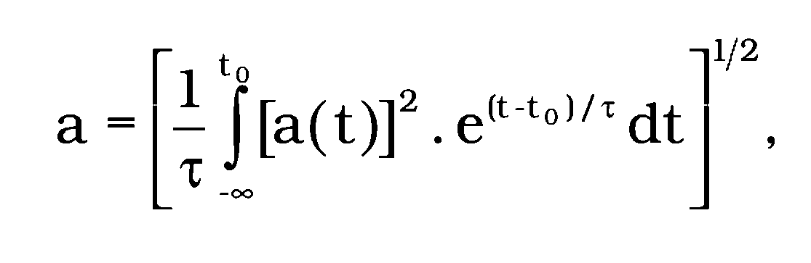
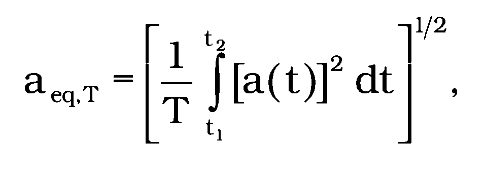
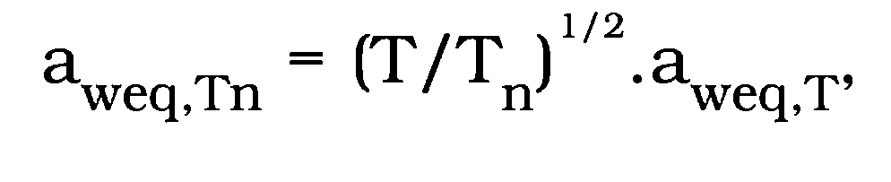
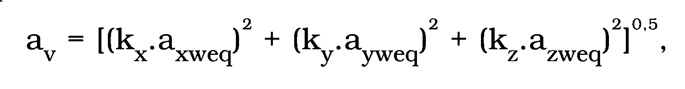

Príloha č. 1 k nariadeniu vlády č. 416/2005 Z. z.

- DEFINÍCIE POJMOV

  - 1. Vibrácie, mechanické kmitanie, je pohyb mechanickej sústavy alebo jej časti, pri ktorom veličina opisujúca jej pohyb alebo polohu je striedavo väčšia a menšia ako určitá rovnovážna alebo vzťažná hodnota tejto veličiny.

  - 2. Otras je náhla jednorazová alebo opakovaná zmena veličiny opisujúcej vibrácie.

  - 3. Vibrácie prenášané na ruky sú vibrácie, ktoré sa prenášajú na jednu ruku alebo obidve ruky z rukovätí strojov a náradia alebo z povrchu predmetov držaných rukou (STN EN ISO 5349-1: 2003 Mechanické kmitanie. Meranie a hodnotenie expozície človeka prenosom kmitania na ruky. Časť 1: Všeobecné požiadavky).

  - 4. Vibrácie prenášané na celé telo sú vibrácie, ktoré sa prenášajú na stojacu, sediacu alebo ležiacu osobu ako celok cez oporný povrch (STN ISO 2631-1: 1999 Mechanické kmitanie a otrasy. Hodnotenie expozície človeka kmitaniu na celé telo. Časť 1: Všeobecné požiadavky).

  - 5. Miestne vibrácie sú vibrácie, ktoré sa nemôžu označiť ako vibrácie prenášané na celé telo ani ako vibrácie prenášané na ruky a prenášajú sa na určitú časť tela.

  - 6. Okamžité zrýchlenie vibrácií je hodnota časovej funkcie okamžitého zrýchlenia vibrácií vo zvolenom čase ti.

- Značka: a(ti)

- Jednotka: m.s-2

  - 7. Zrýchlenie vibrácií; priebežné zrýchlenie vibrácií je efektívna hodnota zrýchlenia určená pri uplatnení exponenciálnej časovej váhovej funkcie podľa vzťahu

- 

- kde

- a(t) je časová funkcia zrýchlenia,

- e(t-t0)/t je exponenciálna časová váhová funkcia,

- τ je časová konštanta a interval priemerovania,

- t je priebežný čas,

- t0 je čas pozorovania (merania).

- Značka: a

- Poznámka: Uplatnenie exponenciálnej časovej váhovej funkcie je násobenie druhej mocniny časovej funkcie fyzikálnej veličiny exponenciálnou funkciou s definovanou časovou konštantou. Často používané časové váhové funkcie pri meraní zrýchlenia sú Slow (S) a Fast (F) s časovými konštantami 1,0 s a 0,125 s. Použitie časových váhových funkcií sa vyjadruje v značke indexom F alebo S alebo použitou časovou konštantou, napríklad 10 s. Uvedenie veličiny bez indexu znamená pri vibráciách použitie S.

  - 8. Vážené zrýchlenie vibrácií je zrýchlenie vibrácií korigované frekvenčnou váhovou funkciou podľa druhu prenosu vibrácií.

- Značka: aw (vibrácie prenášané na celé telo),

- ahw (vibrácie prenášané na ruky).

- Jednotka: m.s-2

  - 9. Ekvivalentné zrýchlenie vibrácií je efektívna hodnota zrýchlenia vibrácií určená vzťahom

- 

- kde

- a(t) je časová funkcia okamžitého zrýchlenia vibrácií,

- T je časový interval priemerovania zrýchlenia vibrácií, T = t2-t1.

- Značka: aeq,T

- Jednotka: m.s-2

  - 10. Ekvivalentné vážené zrýchlenie vibrácií je ekvivalentné zrýchlenie vibrácií získané použitím zvolenej frekvenčnej váhovej funkcie na časovú funkciu okamžitého zrýchlenia vibrácií.

- Značka: aweq,T

- Jednotka: m.s-2

- Poznámky:

  - 1) Ak sa zrýchlenie vibrácií meria v tretinooktávových pásmach, možno váženú hodnotu zrýchlenia

  - vibrácií získať uplatnením frekvenčne príslušných váhových faktorov na namerané hodnoty.

  - 2) Ekvivalentné zrýchlenie vibrácií (vážené i nevážené) určené v časovom intervale T možno prepočítať

  - na iný časový interval Tn podľa vzťahu

- 

- kde

- aweq,Tn je prepočítané ekvivalentné zrýchlenie vibrácií na časový interval Tn.

  - 11. Normalizované zrýchlenie vibrácií je ekvivalentné vážené zrýchlenie vibrácií prepočítané podľa bodu 10 na normalizované trvanie pracovnej zmeny Tn = 8 h.

- Značka: aweq,8h

- Jednotka: m.s-2

  - 12. Výsledné zrýchlenie vibrácií, veľkosť vektora zrýchlenia vibrácií je zrýchlenie vibrácií vypočítané z ekvivalentných vážených hodnôt zrýchlení vibrácií v definovaných smeroch súradnicového systému a z príslušných hodnotiacich faktorov podľa vzťahu

- 

- kde

- kx, ky, kz sú hodnotiace faktory v smere súradnicových osí,

- axweq je vážené ekvivalentné zrýchlenie vibrácií v smere súradnicovej osi x,

- ayweq, azweq je vážené ekvivalentné zrýchlenie vibrácií v smere súradnicových osí y a z.

- Značka: av

- Jednotka: m.s-2

- Poznámka: V prípade potreby sa doplnia ďalšie zaužívané indexy, napríklad av,4h, ahv,8h, pričom sa „eq“, „w“ v indexe neuvádza.

- Hodnotiace faktory vyjadrujú závažnosť pôsobenia vibrácií v smere rôznych osí.

  - 13. Maximálne zrýchlenie vibrácií je maximálna hodnota priebežného zrýchlenia vibrácií vo zvolenom časovom intervale T pri časovej váhovej funkcii S.

- Značka: amax,T

- Jednotka: m.s-2

  - 14. Expozícia vibráciám, vystavenie vibráciám pri práci je expozícia zamestnanca pôsobeniu vibrácií počas určitého časového intervalu.

  - 15. Normalizovaný časový interval je časový interval, na ktorý sa vzťahuje príslušná fyzikálna veličina. Referenčný časový interval pre pracovný čas je 8 hodín.

  - 16. Určujúca veličina je veličina kvantitatívne charakterizujúca vibrácie.

  - 17. Akčná hodnota expozície je hodnota určujúcej veličiny vibrácií v pracovnom prostredí, pri ktorej pravdepodobne vzniká riziko pre zdravie a bezpečnosť v dôsledku pôsobenia vibrácií a pri prekročení ktorej sa musia vykonávať opatrenia na zníženie expozície. V značke veličiny je index a, napríklad av,8h,a.

  - 18. Limitná hodnota expozície je taká hodnota určujúcej veličiny, ktorá nemôže byť u zamestnanca počas pracovnej zmeny prekročená. V značke veličiny je index L, napríklad av,8h,L.
