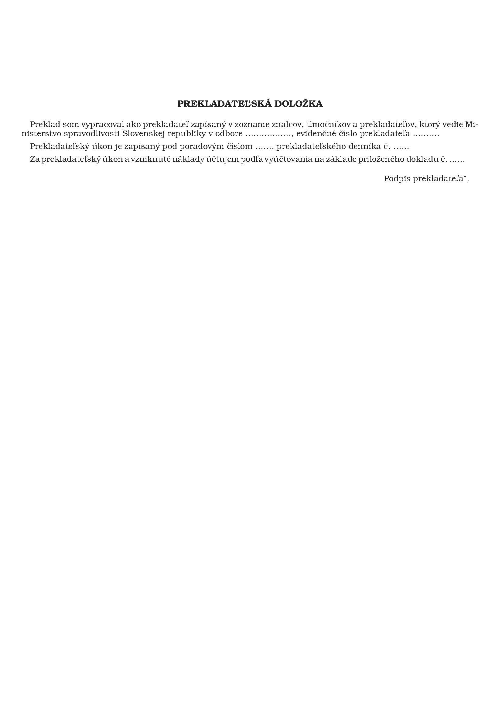

# Čl. I

Vyhláška Ministerstva spravodlivosti Slovenskej republiky č. 490/2004 Z. z., ktorou sa vykonáva zákon č. 382/2004 Z. z. o znalcoch, tlmočníkoch a prekladateľoch a o zmene a doplnení niektorých zákonov, sa mení a dopĺňa takto:

- 1. V § 1 ods. 2 sa na konci pripája táto veta:

- „V elektronickej forme zoznamu sa zverejní aj znalec, tlmočník alebo prekladateľ, ktorý bol vyčiarknutý zo zoznamu.“.

- 2. V § 1 ods. 8 sa slovo „vykoná“ nahrádza slovami „môže vykonať“.

- 3. V § 1 sa vypúšťa odsek 11.

- 4. V § 3 ods. 1 písm. a) sa slová „ekonomika a podnikanie“ nahrádzajú slovami „ekonómia a manažment“.

- 5. V § 5 ods. 3 sa vypúšťajú slová „adresu zamestnávateľa,“.

- 6. V § 5 ods. 6 sa vypúšťa druhá veta.

- 7. V § 5 odseky 7 a 8 znejú:

- „(7)

- Odbornú skúšku vykoná žiadateľ pred skúšobnou komisiou zloženou z troch členov. Predsedu a ďalších členov skúšobnej komisie vymenúva a odvoláva minister spravodlivosti Slovenskej republiky (ďalej len “minister„). Členom skúšobnej komisie je vždy jeden zástupca ministerstva. Predsedom komisie a ďalším členom komisie je spravidla znalec, tlmočník alebo prekladateľ z odboru alebo odvetvia, z ktorého sa vykonáva odborná skúška. Ak členom skúšobnej komisie nie je žiadny znalec, tlmočník alebo prekladateľ z odboru alebo odvetvia, z ktorého sa vykonáva odborná skúška, predsedom a členom skúšobnej komisie môže byť aj iná osoba, ktorá s vymenovaním súhlasí a ktorá svojím vzdelaním a praxou garantuje kvalifikované vykonanie odbornej skúšky v danom odbore alebo odvetví.

- (8)

- Členom skúšobnej komisie pre odbornú skúšku z odborov uvedených v prílohe č. 1 je spravidla osoba zapísaná v zozname členov skúšobnej komisie. Zoznam členov skúšobnej komisie zostavený ministerstvom na základe súhlasu navrhovaného člena obsahuje dostatočný počet osôb na účely zostavovania skúšobných komisií pre každý odbor a každé odvetvie podľa prílohy č. 1. Do zoznamu členov skúšobnej komisie sa môžu zapísať okrem znalcov, tlmočníkov a prekladateľov aj iné osoby, ktoré svojím vzdelaním a praxou garantujú kvalifikované vykonanie odbornej skúšky v danom odbore alebo odvetví.“.

- 8. V § 5 sa vypúšťa odsek 9.

- Doterajšie odseky 10 až 14 sa označujú ako odseky 9 až 13.

- 9. V § 5 odsek 13 znie:

- „(13)

- V odbore zdravotníctvo a farmácia a v odbore psychológia odbornú skúšku nahrádza špecializačná skúška na akreditovanej vzdelávacej inštitúcii Ministerstva zdravotníctva Slovenskej republiky a minimálne sedemročná prax v požadovanom odvetví v súlade s § 5 a § 33 ods. 1 písm. b) zákona.“.

- 10. V § 6 odsek 1 znie:

- „(1)

- Odborná skúška znalca sa skladá z písomnej časti a z ústnej časti. Písomná časť sa skladá z desiatich otázok zo znalosti všeobecne záväzných právnych predpisov o podmienkach výkonu znaleckej činnosti a zo znaleckého posudku. Znaleckým posudkom sa preukazuje najmä aplikácia odborných predpisov, postupov a metodiky pri vypracovaní úkonov znaleckej činnosti v danom odbore a odvetví a odborné vedomosti na konkrétnom prípade.“.

- 11. § 7 a 8 vrátane nadpisov znejú:

- 㤠7

- Odborná skúška tlmočníka

- (1)

- Odborná skúška tlmočníka sa skladá z piatich častí.

- (2)

- V prvej časti žiadateľ dialógom s členmi skúšobnej komisie preukazuje schopnosť odbornej komunikácie v prvom jazyku a v druhej časti schopnosť odbornej komunikácie v druhom jazyku.

- (3)

- V tretej časti žiadateľ preukazuje schopnosť konzekutívneho tlmočenia z prvého jazyka do druhého jazyka a v štvrtej časti preukazuje schopnosť konzekutívneho tlmočenia z druhého jazyka do prvého jazyka.

- (4)

- Piata písomná časť sa skladá z desiatich otázok zo znalosti všeobecne záväzných právnych predpisov o podmienkach výkonu tlmočníckej činnosti.

- (5)

- Za každú časť podľa odseku 2 možno získať tri body, za každú časť podľa odseku 3 možno získať osem bodov a za časť podľa odseku 4 možno získať desať bodov. Uchádzač úspešne vykoná odbornú skúšku, ak získa minimálne dva body za každú časť podľa odseku 2, minimálne šesť bodov za každú časť podľa odseku 3 a minimálne sedem bodov za časť podľa odseku 4.

- (6)

- Odborná skúška pre tlmočníka posunkovej reči nepočujúcich, tlmočníka pre hluchoslepé osoby a artikulačného tlmočníka sa skladá len z častí uvedených v odseku 3 a 4. Uchádzač úspešne vykoná odbornú skúšku, ak získa minimálne 19 bodov. Odborná skúška artikulačného tlmočníka pozostáva z preukázania schopnosti sprostredkovať komunikáciu so zdravotne postihnutou osobou pomocou zvýraznenej artikulácie hovoreného slovenského jazyka a ďalších pomocných prostriedkov.

- § 8

- Odborná skúška prekladateľa

- (1)

- Odborná skúška prekladateľa sa skladá z písomnej časti a z ústnej časti.

- (2)

- Písomná časť sa delí na

- a)

- preklad z prvého jazyka do druhého jazyka,

- b)

- preklad z druhého jazyka do prvého jazyka a

- c)

- test pozostávajúci z desiatich otázok zo znalosti všeobecne záväzných právnych predpisov o podmienkach výkonu prekladateľskej činnosti.

- (3)

- V ústnej časti žiadateľ odôvodňuje použitý spôsob postupu pri preklade.

- (4)

- Za každý preklad podľa odseku 2 písm. a) a b) možno získať desať bodov. Za test podľa odseku 2 písm. c) možno získať desať bodov. Uchádzač vykoná odbornú skúšku, ak získa minimálne osem bodov za každý preklad a minimálne sedem bodov za test z teórie.“.

- 12. V § 14 sa vypúšťa odsek 4.

- Doterajší odsek 5 sa označuje ako odsek 4.

- 13. Za § 25 sa vkladá § 25a, ktorý vrátane nadpisu znie:

- 㤠25a

- Prechodné ustanovenie k úpravám účinným od 15. novembra 2005

- Žiadatelia, ktorí podali písomnú prihlášku na odbornú skúšku ministerstvu pred 15. novembrom 2005, vykonajú odbornú skúšku podľa ustanovení tejto vyhlášky.“.

- 14. Príloha č. 1 znie:

- „Príloha č. 1 k vyhláške č. 490/2004 Z. z.

- ZOZNAM ODBOROV, V KTORÝCH JE POTREBNÉ ŠPECIALIZOVANÉ VZDELÁVANIE

- 1. Doprava cestná

- 2. Ekonómia a manažment

- 3. Elektronické komunikácie

- 4. Elektrotechnika

- 5. Lesníctvo

- 6. Poľnohospodárstvo

- 7. Stavebníctvo

- 8. Strojárstvo “.

  - 15. V prílohe č. 4 časť V. znie:

- „V. Znalecká doložka

- Znalecká doložka fyzickej osoby

- Znalecký posudok som vypracoval ako znalec zapísaný v zozname znalcov, tlmočníkov a prekladateľov, ktorý vedie Ministerstvo spravodlivosti Slovenskej republiky pre odbor ...... a odvetvie .........., evidenčné číslo znalca ............

- Znalecký úkon je zapísaný pod poradovým číslom ....... znaleckého denníka č. .......

- Znalecký úkon a vzniknuté náklady účtujem podľa vyúčtovania na základe priloženého dokladu č. .......

- Podpis znalca

- Znalecká doložka právnickej osoby

- Znalecký posudok bol vypracovaný znaleckou organizáciou/znaleckým ústavom zapísaným v zozname znalcov, tlmočníkov a prekladateľov, ktorý vedie Ministerstvo spravodlivosti Slovenskej republiky pre odbor ...... a odvetvie ........, evidenčné číslo znaleckej organizácie/znaleckého ústavu ..............

- Znalecký úkon je zapísaný pod poradovým číslom ....... znaleckého denníka č. ......

- Znalecký úkon a vzniknuté náklady účtujeme podľa vyúčtovania na základe priloženého dokladu č. ......

- Podpis štatutárneho orgánu Podpis osoby zodpovednej za výkon znaleckej činnosti v danom odbore“.

- 16. V prílohe č. 5 nadpis znie: „OSNOVA ZNALECKÉHO POSUDKU PRE ODBOR STAVEBNÍCTVO, ODVETVIE ODHAD HODNOTY NEHNUTEĽNOSTÍ“.

- 17. Za prílohu č. 5 sa dopĺňa príloha č. 6, ktorá znie:

- „Príloha č. 6 k vyhláške č. 490/2004 Z. z.

- PREKLADATEĽSKÁ DOLOŽKA“.

- 
