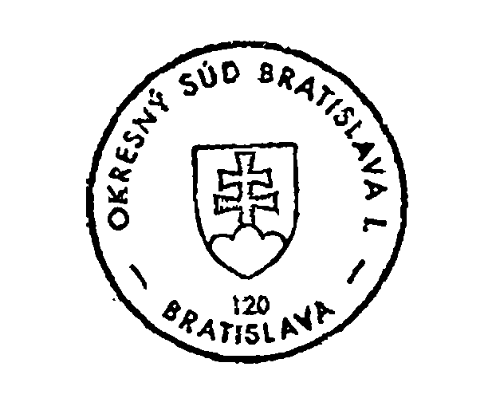
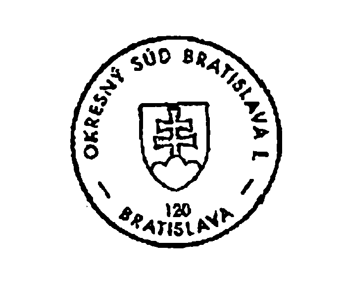
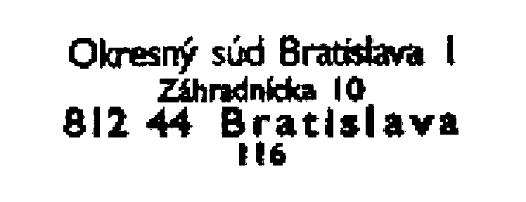
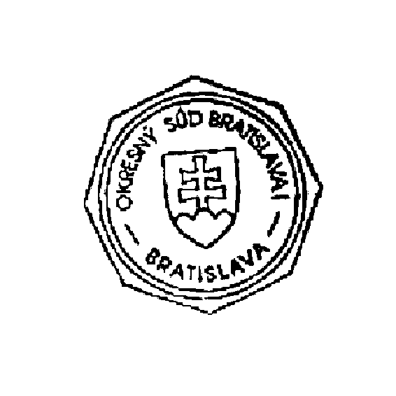
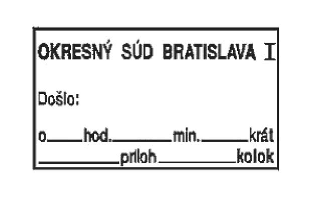

Príloha č. 3 k vyhláške č. 543/2005 Z. z.

- PRAVIDLÁ POUŽÍVANIA PEČIATOK NA SÚDE

  - Čl. I Veľká okrúhla pečiatka

    - 1. Veľká okrúhla pečiatka má priemer 36 mm, v strede je umiestnený štátny znak Slovenskej republiky, po obvode kruhu okolo štátneho znaku je označenie súdu. Každá veľká okrúhla pečiatka je očíslovaná; číslo úradnej pečiatky sa uvedie v jej texte.

    - 2. Vzor veľkej okrúhlej pečiatky

    - 

    - 3. Odtlačkom veľkej okrúhlej pečiatky súd opatrí prvopisy a rovnopisy vyhotovení súdnych rozhodnutí, listiny o poverení výchovou a zastupovaním maloletého, o ustanovení opatrovníka, úradné potvrdenie, doložku o právoplatnosti a vykonateľnosti rozhodnutí, nariadenie výkonu trestu a ochranných opatrení, príkaz na zatknutie a odvolanie tohto príkazu, príkaz na prijatie do väzby a príkaz na prepustenie z väzby alebo z výkonu trestu odňatia slobody, povolenie na návštevu obvineného vo väzbe, žiadosť o vypátranie pobytu osôb a odvolanie tejto žiadosti, výzva na nastúpenie výkonu trestu odňatia slobody, výzva na nastúpenie ochranného liečenia, opatrenie o ustanovení obhajcu, ako aj všetky písomnosti určené pre súdy alebo iné orgány v cudzine. V iných prípadoch sa môže veľká okrúhla pečiatka súdu používať, len ak tak ustanovuje táto vyhláška alebo osobitný právny predpis.

    - 4. Ak sa listina opatrí odtlačkom veľkej okrúhlej pečiatky, odtlačok sa spravidla umiestni dva až tri riadky pod textovým stĺpcom v strede papiera; listina sa podpisuje vpravo od odtlačku okrúhlej pečiatky; je neprípustné, aby podpis zasahoval do odtlačku pečiatky. Veľká okrúhla pečiatka sa odtláča spravidla modrou farbou.

  - Čl. II Malá okrúhla pečiatka

    - 1. Malá okrúhla pečiatka má priemer 22 mm, v strede je umiestnený štátny znak Slovenskej republiky, po obvode kruhu okolo štátneho znaku je označenie súdu. Každá malá okrúhla pečiatka je očíslovaná; číslo úradnej pečiatky sa uvedie v jej texte.

    - 2. Vzor malej okrúhlej pečiatky

    - 

    - 3. Odtlačkom malej okrúhlej pečiatky súd opatrí najmä všetky úradné poverenia, overenia a rozhodnutia, listiny určené do cudziny, rozhodnutia o vyradení nepotrebného a nepoužiteľného majetku v správe štátu, splnomocnenia na zastupovanie v súdnom konaní alebo v konaní pred správnymi orgánmi, výkazy štatisticko-operatívnej evidencie, návrh plánu a rozpočtu, zmluvy, dispozície v súvislosti s bežnými účtami v banke alebo v pobočke zahraničnej banky, registračné doklady v investičnej výstavbe.

    - 4. Čl. I ods. 4 platí primerane.

  - Čl. III Podlhovastá pečiatka

    - 1. Podlhovastá pečiatka súdu má spravidla rozmery 52 mm na šírku a 20 mm na výšku. Text podlhovastej pečiatky pozostáva z označenia súdu a jeho sídla (ulica, číslo ulice, poštové smerové číslo a mesto). Každá podlhovastá pečiatka je očíslovaná; číslo podlhovastej pečiatky sa uvedie v dolnej časti pod označením súdu.

    - 2. Vzor podlhovastej pečiatky súdu

    - 

    - 3. V prípadoch, v ktorých nie je predpísané používanie úradných pečiatok podľa čl. I a II, a v bežnom administratívnom styku sa používa podlhovastá pečiatka súdu.

    - 4. Čl. I ods. 4 platí primerane.

  - Čl. IV Reliéfna pečiatka

    - 1. Reliéfna pečiatka má okrúhly tvar s priemerom 36 mm. V strede je umiestnený štátny znak Slovenskej republiky, po obvode kruhu okolo štátneho znaku je označenie súdu. Každá reliéfna pečiatka je očíslovaná; číslo sa uvedie v dolnej časti pod štátnym znakom.

    - 2. Reliéfna pečiatka sa používa najmä na rozhodnutia týkajúce sa ústavnej zdravotnej starostlivosti, na príkaz na prepustenie z väzby a z výkonu trestu odňatia slobody a v prípadoch ustanovených osobitnými predpismi, ako aj vtedy, ak tak rozhodne predseda súdu.

    - 3. Pri používaní reliéfnej pečiatky sa farba spravidla nepoužíva.

  - Čl. V Osemhranná pečiatka

    - 1. Osemhranná pečiatka má priemer 32 mm, v strede je umiestnený kruh s priemerom 28 mm, kde je umiestnený štátny znak Slovenskej republiky a po obvode tohto kruhu okolo štátneho znaku označenie súdu.

    - 2. Vzor osemhrannej pečiatky

    - 

    - 3. Odtlačkom osemhrannej pečiatky sa opatria rovnopisy poukazov, ktorými sa nariaďuje vydanie peňažných prostriedkov alebo iných hodnôt. V iných prípadoch sa osemhranná pečiatka používa, len ak tak ustanovuje osobitný predpis alebo ak tak rozhodne predseda súdu.

    - 4. Čl. I ods. 4 platí primerane.

  - Čl. VI Podacia pečiatka

    - 1. Podacia pečiatka má rozmery 54 mm na šírku a 32 mm na výšku. Podacia pečiatka obsahuje náležitosti podľa § 136 ods. 1.

    - 2. Vzor podacej pečiatky

    - 

    - 3. Odtlačkom podacej pečiatky sa opatria všetky podania došlé súdu, ak táto vyhláška neustanovuje inak.

    - 4. Odtlačok podacej pečiatky sa umiestňuje podľa § 136 ods. 2. Podacia pečiatka sa odtláča spravidla modrou farbou.

  - Čl. VII Evidencia pečiatok súdu

    - 1. Evidencia úradných pečiatok súdu sa vedie formou evidenčného listu, ktorý dáva prehľad o tom, ktorý sudca alebo zamestnanec súdu aktuálne disponuje úradnou pečiatkou súdu. Evidenčné listy vedie poverený zamestnanec súdu.

    - 2. Evidenčný list podľa odseku 1 je evidenčnou pomôckou a zakladá sa pre každého sudcu a zamestnanca súdu, ktorý pri svojej činnosti používa úradnú pečiatku. Vzor evidenčného listu je uvedený v čl. X.

    - 3. Sudca alebo zamestnanec súdu potvrdí prevzatie úradnej pečiatky svojím vlastnoručným podpisom vedľa odtlačku tejto pečiatky na evidenčnom liste s uvedením dátumu prevzatia; na evidenčnom liste sa tiež vyznačí deň vrátenia úradnej pečiatky s vlastnoručným podpisom sudcu alebo zamestnanca súdu na potvrdenie jej vrátenia.

    - 4. Sudca alebo zamestnanec súdu svojím vlastnoručným podpisom a prevzatím úradnej pečiatky preberá zodpovednosť za používanie tejto pečiatky.

    - 5. Sudca alebo zamestnanec súdu, ktorý prevzal úradnú pečiatku súdu pri skončení služobného pomeru, pracovnoprávneho vzťahu alebo obdobného pracovného vzťahu alebo pri zmene funkcie alebo pracoviska v rámci súdu, odovzdá zverenú úradnú pečiatku a na evidenčnom liste svojím podpisom odobrí jej odovzdanie.

  - Čl. VIII Úschova pečiatok súdu

    - 1. Úradné pečiatky súdu sa uschovávajú tak, aby k nim nemali prístup nepovolané osoby a aby sa zabránilo ich strate, odcudzeniu, zničeniu, poškodeniu, zneužitiu alebo falšovaniu. Po skončení pracovného času sa tieto pečiatky uložia v uzamykateľnej skrini.

    - 2. Úradné pečiatky súdu, ktoré sa nepoužívajú alebo ktoré neboli pridelené konkrétnemu sudcovi alebo zamestnancovi súdu, sa uschovávajú v trezore súdu.

    - 3. Každý sudca a zamestnanec súdu, ktorý pri svojej činnosti používa okrúhlu úradnú pečiatku, je povinný chrániť ju pred stratou, odcudzením, zničením, poškodením, zneužitím a falšovaním najmä v uzamykateľnej skrini alebo v iných vhodných priestoroch, ktoré je možné uzamknúť. Stratu, odcudzenie, zničenie, poškodenie, zneužitie alebo falšovanie okrúhlej úradnej pečiatky je sudca alebo zamestnanec súdu povinný bezodkladne po zistení nahlásiť predsedovi súdu a príslušnému policajnému orgánu.

  - Čl. IX Likvidácia úradných pečiatok súdu

    - 1. Na účely likvidácie úradných pečiatok súdu sa vytvorí spravidla trojčlenná komisia. Z poškodenej, opotrebovanej pečiatky alebo z pečiatky, ktorá sa má vyradiť z používania, sa na čistý hárok papiera vyhotoví jej odtlačok. Z úradnej pečiatky sa následne odstráni guma a tá sa prestrihne na tri časti.

    - 2. O úradných pečiatkach zlikvidovaných podľa prvého bodu sa vyhotoví záznam o likvidácii úradnej pečiatky.

    - 3. Úradný záznam, odtlačok úradnej pečiatky na čistom hárku papiera spolu s odstránenou gumou z úradnej pečiatky sa odovzdajú poverenému zamestnancovi súdu, ktorý zabezpečí v spolupráci so správou súdu zničenie zlikvidovaných úradných pečiatok.

  - Čl. X EVIDENČNÝ LIST [Vzor](../assets/d307779355ca649513dc58fc1938a0084f02002ac267f9df899d54af49b1acac.pdf)
