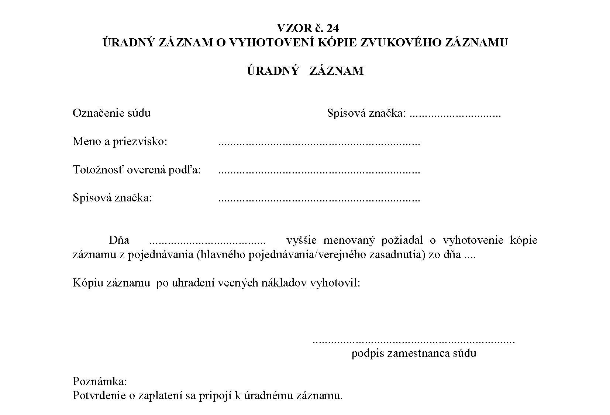

Príloha č. 4 k vyhláške č. 543/2005 Z. z.

- VZORY EVIDENČNÝCH POMÔCOK

  - VZOR č. 1

  - ÚRADNÝ ZÁZNAM O NAZRETÍ DO SÚDNEHO SPISU

- [Vzor 01](../assets/a5953498010ecb3c090d1f33f63234316cf220d682fc92403a755cd841b03c52.pdf)

  - VZOR č. 2

  - ÚRADNÝ ZÁZNAM O VYHOTOVENÍ FOTOKÓPIÍ ZO SÚDNEHO SPISU

- [príloha](../assets/5520227561fc295c0a117b5cb62a1db13d1ef25b961bd5f357751ab22f95bcad.pdf)

  - VZOR č. 3

  - EVIDENČNÁ KNIHA INFORMAČNÉHO CENTRA

- Por. číslo | Dátum | Žiadateľ | Spisová značka | Vydané rozhodnutie, potvrdenie, overenie | Súdny poplatok | Podpis žiadateľa

- 1 | 2 | 3 | 4 | 5 | 6 | 7

  - Do evidenčnej knihy informačného centra sa zapisujú všetky žiadosti oprávnených osôb o vydanie rovnopisu alebo odpisu rozhodnutia alebo inej písomnosti zo súdneho spisu, vydanie úradného potvrdenia zo súdneho spisu, overenie kópií písomností zo súdneho spisu a žiadosti prokurátora o poskytnutie informácií zo súdnych registrov.

  - Evidenčná kniha informačného centra sa vyplňuje takto:

  - Stĺpec 1

  - Uvedie sa poradové číslo počnúc číslom „1“.

  - Stĺpec 2

  - Uvedie sa dátum žiadosti o vydanie rovnopisu, úradného potvrdenia zo súdneho spisu, overenia kópií písomností zo súdneho spisu alebo žiadosti prokurátora o poskytnutie informácií zo súdnych registrov.

  - Stĺpec 3

  - Označí sa meno a priezvisko žiadateľa a jeho adresa, u právnických osôb názov a sídlo. Ak je to potrebné, aj ďalšie identifikačné údaje.

  - Stĺpec 4

  - Uvedie sa spisová značka súdneho spisu, z ktorého sa vydávajú rovnopisy, úradné potvrdenia alebo z ktorého sa overujú vydané kópie. Ak ide o žiadosť prokurátora o poskytnutie informácií zo súdnych registrov, spisová značka sa neuvádza.

  - Stĺpec 5

  - Označí sa písomnosť, ktorej rovnopis sa vydáva, alebo sa označí vydávané úradné potvrdenie, prípadne sa uvedie, že ide o overenie vyhotovených kópií. Ak ide o žiadosť prokurátora o poskytnutie informácií zo súdnych registrov, uvedie sa spôsob jej vybavenia.

  - Stĺpec 6

  - Uvedie sa poznámka o zaplatení súdneho poplatku, ak je to potrebné.

  - Stĺpec 7

  - Uvedie sa podpis žiadateľa.

  - VZOR č. 4

  - KNIHA ÚSCHOV

- [Vzor 04](../assets/51d7b3c26ac0b8583820899db7b579efee4d6e11d1d5cd340ea88657601934fa.pdf)

  - VZOR č. 5

  - KNIHA DOŠLÝCH ZMENIEK

- [príloha](../assets/afef93a9109372a90e7432e199f7e0cc5ceb20f4535b82e3c58316419cdba2eb.pdf)

  - VZOR č. 6

  - ÚRADNÝ ZÁZNAM O PREVZATÍ ZMENKY SÚDOM

- [Vzor 06](../assets/3752e27cfb7a71a9caaf1858eb3e61a2641e1d0875c4387492257ff3e0d887fb.pdf)

  - VZOR č. 7

  - ÚRADNÝ ZÁZNAM

- [Vzor 07](../assets/777e72b181a31693b125da6acbce62394608184a2820fab5f123a8538908a28b.pdf)

  - VZOR č. 8

  - ÚRADNÝ ZÁZNAM O VRÁTENÍ ZMENKY

- [Vzor 08](../assets/1ffcb2fdb8373760ecda4b001bdd290e5235a24310eed35719d183de90de62ec.pdf)

  - VZOR č. 9

  - DORUČOVACIA KNIHA SÚDNEHO DORUČOVATEĽA

- [Vzor 09](../assets/f6e9c75381d73213d55cf43a26101dc8356527ce69723ace92e17d21ff996719.pdf)

  - VZOR č. 11

  - ZOZNAMY VÄZIEB

- [Vzor 11](../assets/432390e05e5dd150e853e42fde6106d9f9009aadcad450eb3076c92445456321.pdf)

  - VZOR č. 12

  - SÚDNY REGISTER Ntt

- [Vzor 12](../assets/ae49fb4237662cb51507f0ad788b6dae6a3847a02af267390618a4d6488066f5.pdf)

  - VZOR č. 13

  - ZOZNAM ODOSLANÝCH SÚDNYCH SPISOV

- [Vzor 13](../assets/22a39eb652cd269543c5a95c5018c19e0404b76cb77cfb6cb48ca83b6dffaaa6.pdf)

  - VZOR č. 14

  - KNIHA VYDANÝCH VÝPISOV Z OBCHODNÉHO REGISTRA

- [príloha](../assets/b53cc991c528de804dfa6bbb93b41dab155266b65ce49bfc42e0e6693ea40d2d.pdf)

  - Vzor č. 15

  - KNIHA ZBIERKY DOKUMENTOV

- [Vzor č. 15](../assets/70388ce7e19639c9ad65047451d3b5ea8c2490a83d42067b6eb9f799a474dd9c.pdf)

  - VZOR č. 16

  - TRESTNÝ LIST PRE MEDZINÁRODNÚ VÝMENU

- [Vzor 16](../assets/377e39015c05ce07234d6af465edb7314231c0a4794155b783e421c54f6f3368.pdf)

  - VZOR č. 17

  - SPISOVÝ OBAL SPISU AGENDY SPRÁV SÚDU

- [Vzor 17](../assets/2d761cf7089d6dccab2ccb11fe6597bfab96feaaa67888c51725cca0a552670f.pdf)

  - VZOR č. 18

  - REGISTER „Kp"

- [príloha](../assets/7e118348f7f1c42bfbbc98d176f185ebd3e939ac070cfd93bf3244d8deaf0f32.pdf)

  - VZOR č. 19

  - ZOZNAM TROV KONANIA A ZOZNAM PRIPOJENÝCH SPISOV

  - (PREDTLAČ)

- [príloha](../assets/18ecfe5b734f006d1918c53962417306de18628086d233fd50e421afb211c5dc.pdf)

  - VZOR č. 20

  - ZOZNAM SÚDNYCH SPISOV ODOVZDÁVANÝCH DO REGISTRATÚRNEHO STREDISKA

- [Vzor 20](../assets/494af5f0e9f44f6436c01d2bdb9e4050cf135be2040d18365c9f7d417b8bc8e9.pdf)

  - VZOR č. 21

  - ŽIADANKA O VYDANIE SÚDNEHO SPISU Z REGISTRATÚRNEHO STREDISKA

- [Vzor 21](../assets/23c0581433cb120b05851f54fdc4c0524c664903759fe0c0470029e50a156411.pdf)

  - VZOR č. 22

  - SPRÁVNY REGISTER

- [Vzor 22](../assets/43aecc9cf7b99bcbd3506d6bdbbc3f321ca5730aeb97e02cf56331bb4062401e.pdf)

  - VZOR č. 23

  - ZOZNAM HESIEL

- [Vzor 23](../assets/f1e9fa1a8719fb23828cf51269633c72d1d3df94dc949e2ef2a5d49e2eae20b9.pdf)

  - VZOR č. 24

  - PROTOKOL

- 

  - VZOR č. 25 a č. 26

- [VZOR č. 25 a č. 26](../assets/3adc952fa78d9d5ad1a3c56bbe3dce84b1a935bc3b9e2a3e2fa2b8673878b37b.pdf)
