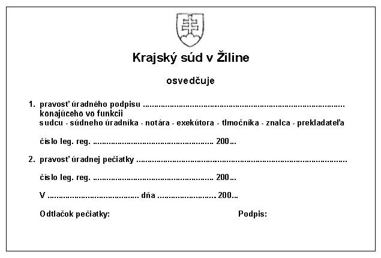

Príloha č. 8 k vyhláške č. 543/2005 Z. z.

- VYŠŠIE OVEROVANIE LISTÍN

  - Čl. I VZOR

    - Apostila

  - [Vzor 01](../assets/269488dab71dd5c59dc1dedb41b1c5f01f389935803a8cbc5d5ed58a0dceb3e5.pdf)

  - Čl. II VZOR

    - Osvedčenie na účely konzulárnej superlegalizácie

  - 

  - Čl. III Postup pri vyššom overovaní

    - Osvedčenie podľa § 67 ods. 6 písm. a) a b) môže mať formu nálepky alebo pečiatky, ktorá sa pevne pripojí alebo umiestni na listinu pod podpis a odtlačok pečiatky, ktorých pravosť sa overuje. Osvedčenie zamestnanec vyplní podľa predtlače, podpíše ho vlastnou rukou a potvrdí odtlačkom malej úradnej pečiatky súdu v modrej farbe tak, aby čiastočne prekrývala osvedčenie. Ak v dôsledku nedostatku miesta na overovanej listine nemožno osvedčenie umiestniť priamo na ňu, zamestnanec súdu k verejnej listine pripojí pomocou trikolóry vo farbách štátnej zástavy osobitný hárok papiera, kam osvedčenie umiestni. V mieste pripojenia umiestni odtlačok malej úradnej pečiatky súdu, aby bolo zrejmé, že pripojenie vykonal súd.

  - Čl. IV VZOR

    - Kniha vyššieho overenia

  - [príloha](../assets/75df425ec24e7da67e807ea9f8d29fe43aa76cf7be5ab70bfc914c79e0c96c6c.pdf)
