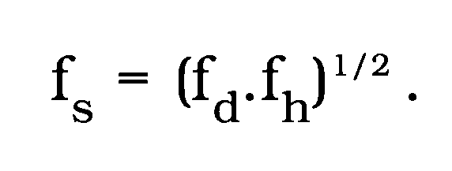
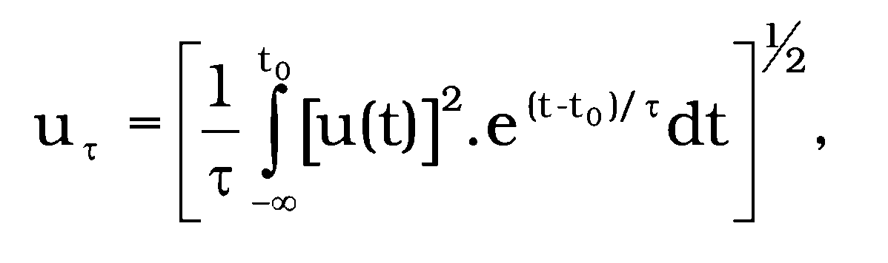
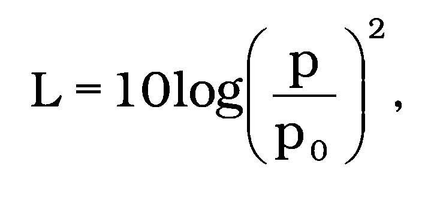
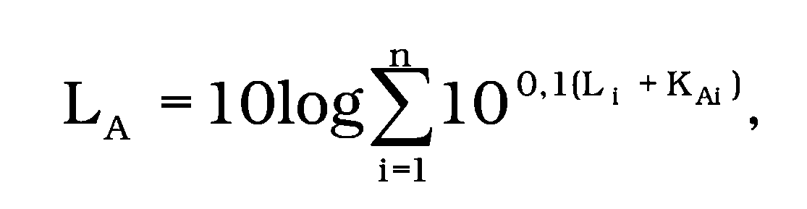
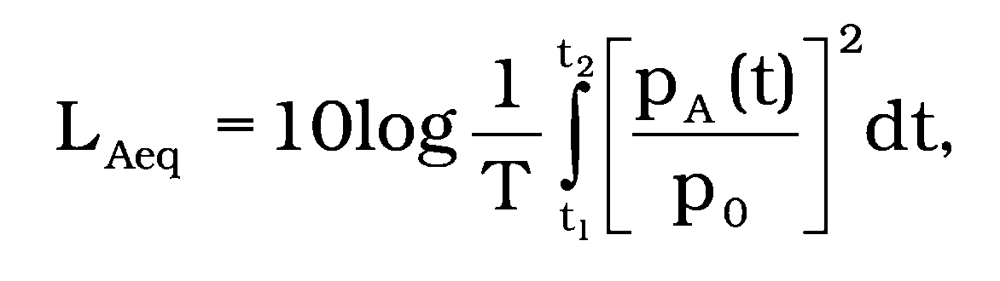
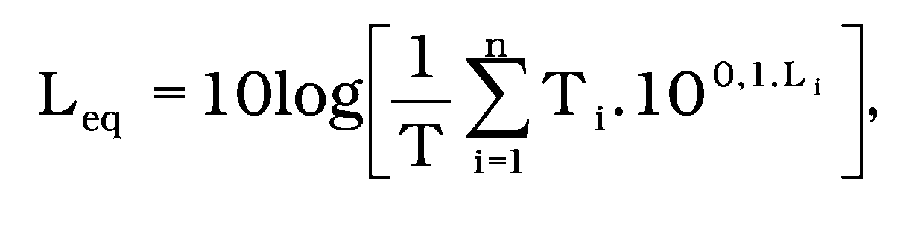
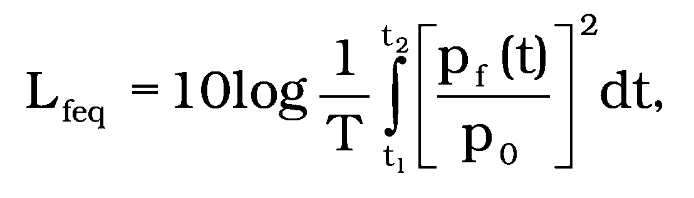
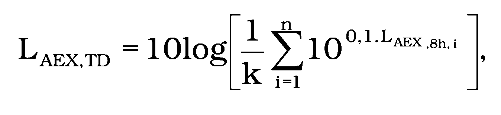
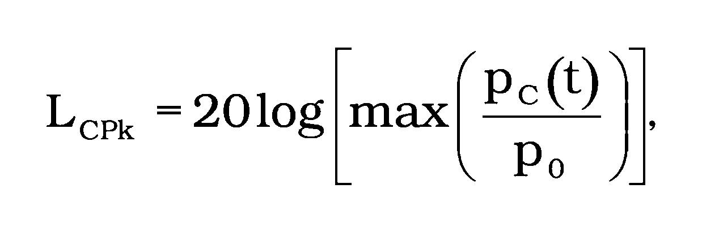

Príloha č. 1 k nariadeniu vlády č. 115/2006 Z. z.

- DEFINÍCIE POJMOV

  - 1. Zvuk je akustické vlnenie schopné vyvolať u človeka vnem.

  - 2. Hluk je každý nežiaduci, rušivý, nepríjemný alebo škodlivý zvuk.

  - 3. Okamžitý akustický tlak je rozdiel medzi celkovým tlakom a statickým tlakom v určitom okamihu ti v danom bode prostredia.

    - Značka: p(ti)

    - Poznámka: Okamžitý akustický tlak sa s časom mení. Závislosť okamžitého tlaku od času udáva časová funkcia okamžitého akustického tlaku p(t).

  - 4. Frekvenčné pásmo je oblasť frekvencií ohraničená dolnou hraničnou frekvenciou fd a hornou hraničnou frekvenciou fh; charakterizuje sa strednou frekvenciou fs(STN EN ISO 266 Akustika. Normalizované frekvencie), pre ktorú platí

    - 

    - Ak fh = 2.fd, frekvenčné pásmo je oktávové,

    - ak fh = 21/3.fd, frekvenčné pásmo je tretinooktávové.

    - Rozloženie zvuku do frekvenčných pásiem vytvára frekvenčné spektrum zvuku.

  - 5. Počuteľný zvuk je zvuk, ktorého frekvenčné spektrum je v tretinooktávových pásmach so strednými frekvenciami 20 Hz až 20 kHz.

  - 6. Infrazvuk je zvuk, ktorého frekvenčné spektrum je v tretinooktávových pásmach so strednými frekvenciami 1 Hz až 16 Hz.

  - 7. Nízkofrekvenčný zvuk je počuteľný zvuk, ktorého frekvenčné spektrum je v tretinooktávových pásmach so strednými frekvenciami 20 Hz až 40 Hz.

  - 8. Vysokofrekvenčný zvuk je počuteľný zvuk, ktorého frekvenčné spektrum je v tretinooktávových pásmach so strednými frekvenciami 8 kHz až 20 kHz.

  - 9. Ultrazvuk je zvuk, ktorého frekvenčné spektrum je v oktávovom pásme so strednou frekvenciu 31,5 kHz.

  - 10. Priebežná efektívna hodnota fyzikálnej veličiny je efektívna hodnota tejto veličiny určená pri uplatnení zvolenej časovej váhovej funkcie podľa vzťahu

    - 

    - kde u(t) je časová funkcia fyzikálnej veličiny,

    - e(t–t0)/τ je exponenciálna časová váhová funkcia,

    - τ je časová konštanta,

    - t je priebežný čas,

    - t0 je čas pozorovania (odčítania).

    - Značka: uτ

    - Poznámka: Uplatnenie exponenciálnej časovej váhovej funkcie je násobenie druhej mocniny časovej funkcie fyzikálnej veličiny exponenciálnou funkciou s definovanou časovou konštantou. Časová váhová funkcia F (Fast) má časovú konštantu 0,125 s. Časová váhová funkcia S (Slow) má časovú konštantu 1,0 s. Použitie časových váhových funkcií sa vyjadruje v značke indexom.

    - Pretože v akustike sa najčastejšie používa časové váženie F a S, index sanahrádza indexom F alebo S. Uvedenie veličiny bez indexu znamená použitie časového váženia F.

  - 11. Akustický tlak je priebežná efektívna hodnota tlaku určená z časovej funkcie okamžitého akustického tlaku podľa bodu 10.

    - Značka: p, ps

    - Jednotka: Pa

  - 12. Hladina akustického tlaku; priebežná hladina akustického tlaku je hladina určená vzťahom

    - 

    - kde p je akustický tlak v Pa, ktorého hladina sa určuje,

    - p0 je referenčný akustický tlak, p0 = 2.10-5Pa.

    - Značka: L, LS

    - Jednotka: dB (decibel)

    - Poznámka: Index v označení sa riadi poznámkou v bode 10.

  - 13. Hladina akustického tlaku vo frekvenčnom pásme je priebežná hladina akustického tlaku určená podľa bodu 12, pričom sa použije akustický tlak z príslušného frekvenčného pásma.

    - Značka: Lf pre časové váženie F (index F je vynechaný),

    - LfS pre časové váženie S.

    - Jednotka: dB

    - Poznámka: Hladiny získané v oktávových a tretinooktávových frekvenčných pásmach sa označujú L0, Lt alebo Lt,fS s označením strednej frekvencie pásma, napr. Lt,250 pre fS = 250 Hz.

  - 14. Hladina zvuku s frekvenčným vážením A alebo s frekvenčným vážením C; hladina A zvuku alebo hladina C zvuku je priebežná hladina akustického tlaku podľa bodu 12, v ktorom sa použije časová funkcia okamžitého akustického tlaku korigovaného frekvenčnou váhovou funkciou A alebo frekvenčnou váhovou funkciou C (STN IEC 61 672-1:2004 Elektroakustika. Zvukomery).

    - Značka: LA, LC (pri časovom vážení S bude LAS, LCS)

    - Jednotka: dB

    - Poznámka 1: Akustický tlak korigovaný frekvenčnou váhovou funkciou sa skrátene nazýva vážený akustický tlak.

    - Značka: pA, pC

    - Poznámka 2: Vážená hladina A zvuku sa vypočíta z hladín akustického tlaku vo frekvenčných pásmach podľa vzťahu pre súčet hladín

    - 

    - kde Li je hladina akustického tlaku v i-tom frekvenčnom pásme,

    - KAi je frekvenčná váhová korekcia filtra A pre i-té frekvenčné pásmo,

    - n je počet frekvenčných pásiem.

  - 15. Hladina infrazvuku s vážením G; hladina G infrazvuku je priebežná hladina akustického tlaku, ktorý je korigovaný frekvenčnou váhovou funkciou G (STN ISO 7196 Akustika. Frekvenčná váhová funkcia na meranie infrazvuku).

    - Značka: LG

    - Jednotka: dB

  - 16. Hladina ultrazvuku je hladina akustického tlaku v oktávovom frekvenčnom pásme so strednou frekvenciou fs = 31,5 kHz.

    - Značka : LoU

    - Jednotka: dB

  - 17. Ekvivalentná hladina A zvuku, C zvuku alebo G infrazvuku je veličina definovaná vzťahom

    - 

    - kde pA(t) je časová funkcia okamžitého akustického tlaku váženého frekvenčnou váhovou funkciou A, C alebo G, udáva sa v pascaloch,

    - T je trvanie integrácie, T = t2 - t1,

    - p0 je referenčný akustický tlak, p0 = 2.10-5Pa.

    - Značka : LAeq, LCeq, LGeq

    - Jednotka: dB

    - Index v značke môže byť doplnený časovým údajom T, napríklad LAeq,8h.

    - V prípade pôsobenia ustálených hladín Li počas intervalov Ti možno Leq určiť zo vzťahu

    - 

    - kde T = ∑t Tt.

  - 18. Ekvivalentná hladina akustického tlaku vo frekvenčnom pásme je hladina určená vzťahom

    - 

    - kde pf (t) je časová funkcia okamžitého akustického tlaku vo zvolenom frekvenčnom pásme.

    - Značka: Lfeq

    - Jednotka: dB

  - 19. Normalizovaná hladina expozície hluku je hladina určená z ekvivalentnej hladiny A zvuku prepočtom na menovitý 8-hodinový pracovný deň podľa vzťahu

    - LAEX,8h = LAeq,T + 10 log (T/Tn),

    - kde T je trvanie ekvivalentnej hladiny A zvuku počas pracovnej zmeny,

    - Tn je menovité trvanie pracovnej zmeny 8 h.

    - Značka: LAEX,8h

    - Jednotka: dB

    - Poznámka 1: Použitie iného filtra alebo frekvenčného pásma sa vyznačí v indexe značky, napr. LGEX,8hpre normalizovanú hladinu infrazvukovej expozície.

    - Poznámka 2: Na základe uvedeného vzťahu možno prepočítať aj inú ekvivalentnú hladinu, napr. váženú, neváženú, vo frekvenčnom pásme, na normalizovanú hladinu.

    - Poznámka 3: Vzťah možno použiť aj na prepočet ekvivalentnej hladiny A zvuku na iné trvanie časového intervalu, napr. na 1 h, čím sa získa LAeq,1h.

    - Poznámka 4: Ak hluk v niektorej časti pracovnej zmeny je tónový alebo impulzový, potom pri výpočte normalizovanej hladiny sa použijú vzťahy z prílohy C STN ISO 9612. Akustika. Pokyny na meranie a hodnotenie expozície hluku v pracovnom prostredí, v ktorých sa uplatnia korekcie na uvedený hluk. Názov a značka veličiny zostanú tak, ako je uvedené v tomto bode, pretože ide tiež o prepočítanú ekvivalentnú hodnotu.

  - 20. Týždenný priemer denných hodnôt normalizovanej hladiny expozície hluku sa vypočíta podľa vzťahu

    - 

    - kde k je počet dní v týždni; pre menovitý päťdňový pracovný týždeň k = 5,

    - n je počet skutočne odpracovaných dní v týždni,

    - LAEX,8h,i je normalizovaná hladina expozície hluku v i-tom pracovnom dni.

    - Značka: LAEX,TD

    - Jednotka: dB

  - 21. Maximálna hladina A zvuku je najvyššia hladina A zvuku určená vo zvolenom časovom intervale pri použití časovej váhovej funkcie F; použitie inej časovej váhovej funkcie musí byť zvýraznené v označení, napr.: LAmax,S.

    - Značka : LAmax

    - Jednotka: dB

  - 22. Vrcholová hladina C akustického tlaku je hladina určená z maximálneho okamžitého akustického tlaku s frekvenčným vážením C počas meraného intervalu podľa vzťahu

    - 

    - kde pc(t) je časová funkcia akustického tlaku váženého frekvenčnou váhovou funkciou C.

    - Hladina sa získa meraním hladiny C akustického tlaku na zvukomeri pri použití funkcie Peak. Použitie tejto funkcie sa vyjadruje v značke indexom Pk.

    - Značka: LCPk

    - Jednotka: dB

  - 23. Tónový zvuk je zvuk, ktorému možno subjektívne prisúdiť výšku. Zvuk sa považuje za tónový, ak je tónová zložka počuteľná.

    - Prítomnosť tónovej zložky vo zvukovom spektre sa preukazuje tretinooktávovou frekvenčnou analýzou tak, že hladina akustického tlaku v niektorom pásme prevyšuje hladiny v oboch susedných pásmach viac ako o 5 dB. V niektorých prípadoch tretinooktávová analýza na preukázanie tónovej zložky vo zvukovom spektre nepostačuje a je potrebné použiť analýzu pomocou užších frekvenčných pásiem.

  - 24. Zvukový impulz je jednorazový akustický dej charakterizovaný náhlym nárastom tlaku s nasledujúcim rýchlym poklesom.

  - 25. Impulzový hluk je hluk, ktorý vzniká v dôsledku jedného alebo viacerých zvukových impulzov, z ktorých každý má trvanie kratšie ako 1 s a výskyt impulzov je menší ako 20 za sekundu. Dĺžka trvania impulzu je daná časovým intervalom, ohraničeným poklesom hodnoty LCPk zníženej o 20 dB.

  - 26. Určujúca veličina je veličina, ktorá kvantitatívne charakterizuje hluk a používa sa na hodnotenie expozície hluku z hľadiska ochrany zdravia a bezpečnosti pri práci.

  - 27. Referenčný časový interval je časový interval, vzhľadom na ktorý sa hodnotí príslušná fyzikálna veličina. Referenčný časový interval pre pracovnú zmenu je 8 h. V odôvodnených prípadoch sa použije iná dĺžka referenčného intervalu, ak je pre ňu definovaná napr. akčná hodnota expozície hluku alebo limitná hodnota expozície hluku.

  - 28. Hluk pozadia je hluk alebo iné vplyvy registrované meracím prístrojom i vtedy, ak zdroj hluku, ktorý sa má na základe merania posudzovať, nepôsobí.

    - Poznámka: Pri meraní hladiny hluku posudzovaného zdroja pôsobí okrem hluku posudzovaného zdroja Lzdroj aj hluk pozadia Lpoz, ktoré spolu vytvárajú súčtovú hladinu Ls.

    - Ak je rozdiel medzi súčtovou hladinou hluku a hladinou hluku pozadia väčší ako 18 dB, hluk pozadia zanedbateľne ovplyvňuje hladinu posudzovaného zdroja.

    - Ak je rozdiel medzi súčtovou hladinou hluku a hladinou hluku pozadia (Ls– Lpoz) v intervale od 3 dB do 18 dB, potom sa hladina hluku posudzovaného zdroja Lzdrojurčí tak, že sa od súčtovej hladiny Ls odpočíta korekcia k určená podľa vzťahu

    - k = –10log(1 – 10-0,1(Ls-Lpoz)).

    - Ak je rozdiel Ls – Lpoz menší ako 3 dB, nemožno jednoznačne určiť hladinu hluku posudzovaného zdroja.

  - 29. Akčná hodnota expozície hluku je hodnota určujúcej veličiny hluku, pri ktorej prekročení sa vykonávajú opatrenia na zníženie hluku. V značke veličiny je index a, napr. LAEX,8h,a.

    - Horná akčná hodnota expozície hluku a dolná akčná hodnota expozície hluku sú určené na ochranu zdravia zamestnancov, predovšetkým na ochranu sluchu pred počuteľným zvukom. Akčné hodnoty expozície hluku pre skupiny prác sú určené na ochranu zdravia zamestnancov pred nešpecifickými, najmä rušivými a obťažujúcimi účinkami hluku.

  - 30. Limitná hodnota expozície hluku je hodnota určujúcej veličiny, ktorá nemôže byť u zamestnanca prekročená ani s použitím, ani bez použitia chráničov sluchu. V značke veličiny je index L, napr. LAEX,8h,L .

  - 31. Ototoxické látky sú chemické látky, ktoré majú jedovatý (toxický) účinok na vnútorné ucho a na sluchový nerv.
