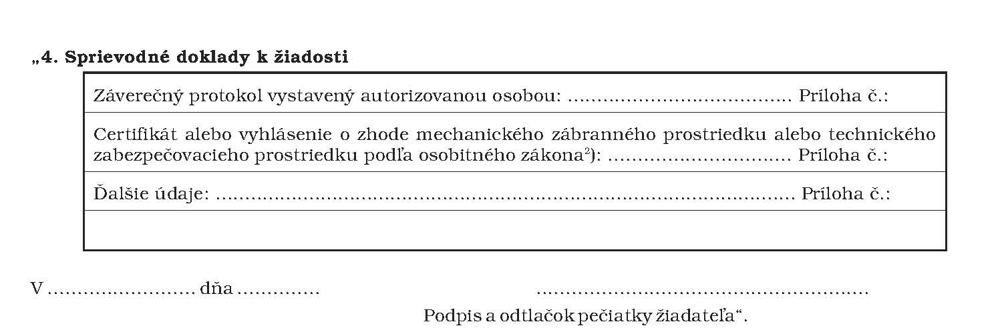

# Čl. I

Vyhláška Národného bezpečnostného úradu č. 337/2004 Z. z., ktorou sa upravujú podrobnosti o certifikácii mechanických zábranných prostriedkov a technických zabezpečovacích prostriedkov a o ich používaní sa mení a dopĺňa takto:

- 1. V § 3 ods. 4 sa na konci pripájajú tieto vety:

- „Podľa schváleného skúšobného postupu vykonávajú overovanie zhody vlastností všetky autorizované osoby. Skúšobné postupy úrad zverejňuje na internetovej stránke úradu.“.

- 2. V § 4 ods. 1 sa slovo „osvedčuje“ nahrádza slovom „potvrdzuje“.

- 3. V § 4 sa za odsek 2 vkladá nový odsek 3, ktorý znie:

- „(3)

- Certifikát prostriedku vydáva úrad diplomatickým misiám, konzulárnym úradom Slovenskej republiky a Slovenskej informačnej službe na základe vyhlásenia ich štatutárneho orgánu o spôsobilosti prostriedku chrániť utajované skutočnosti podľa prílohy č. 3.“.

- Doterajšie odseky 3 a 4 sa označujú ako odseky 4 a 5.

- 4. Za § 5 sa vkladá § 5a, ktorý vrátane nadpisu znie:

- 㤠5a

- Pravidlá používania mechanického zábranného prostriedku a technického zabezpečovacieho prostriedku

- (1)

- Po uplynutí platnosti certifikátu typu môže mechanický zábranný prostriedok používať užívateľ ďalších desať rokov a technický zabezpečovací prostriedok ďalších päť rokov, ak nenastala zmena vlastností rozhodujúcich na zabezpečenie ochrany utajovaných skutočností. Vykonanie kontroly vlastností zabezpečí vedúci4a) najmenej raz ročne.

- (2)

- Záznam o vykonaní kontroly sa uvedie v bezpečnostnej dokumentácii fyzickej bezpečnosti a objektovej bezpečnosti.

- (3)

- Po uplynutí platnosti certifikátu podľa odseku 1 môže užívateľ požiadať o overenie.4b)“.

- Poznámky pod čiarou k odkazom 4a a 4b znejú:

- „4a)

- § 8 ods. 1 zákona č. 215/2004 Z. z.

- 4b)

- § 54 zákona č. 215/2004 Z. z.“.

- 5. V prílohe č. 1 sa za bod 3 vkladá bod 4, ktorý znie:

- 

- Poznámka pod čiarou k odkazu 2 znie:

„2)

Zákon č. 90/1998 Z. z. o stavebných výrobkoch v znení neskorších predpisov.

Zákon č. 264/1999 Z. z.“.

- 6. Za prílohu č. 2 sa vkladá príloha č. 3, ktorá znie:

- „Príloha č. 3 k vyhláške č. 337/2004 Z. z.

- VYHLÁSENIE ŠTATUTÁRNEHO ORGÁNU UŽÍVATEĽA O SPÔSOBILOSTI JEDNOTLIVÉHO PROSTRIEDKU

- [Vzor 03](assets/f5579108cac84f092d80198721edea2d4fd31f2c379c257c044b8198167e2a0c.pdf)“.

- 7. Za § 6 sa vkladá § 6a, ktorý znie:

- 㤠6a

- Táto vyhláška bola prijatá v súlade s osobitným predpisom5) pod číslom notifikácie 2005/0710/SK.“.

  - Poznámka pod čiarou k odkazu 5 znie:

- „5)

- Smernica Európskeho parlamentu a Rady 98/34/ES o postupe pri poskytovaní informácií v oblasti technických noriem a predpisov v platnom znení (Ú. v. ES L 204, 21. 7. 98).“.
