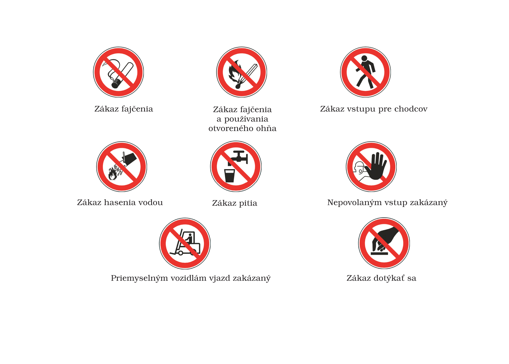
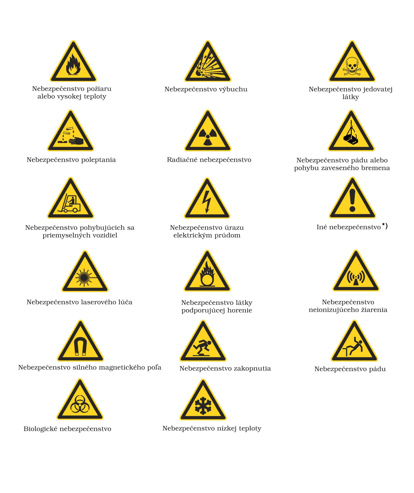
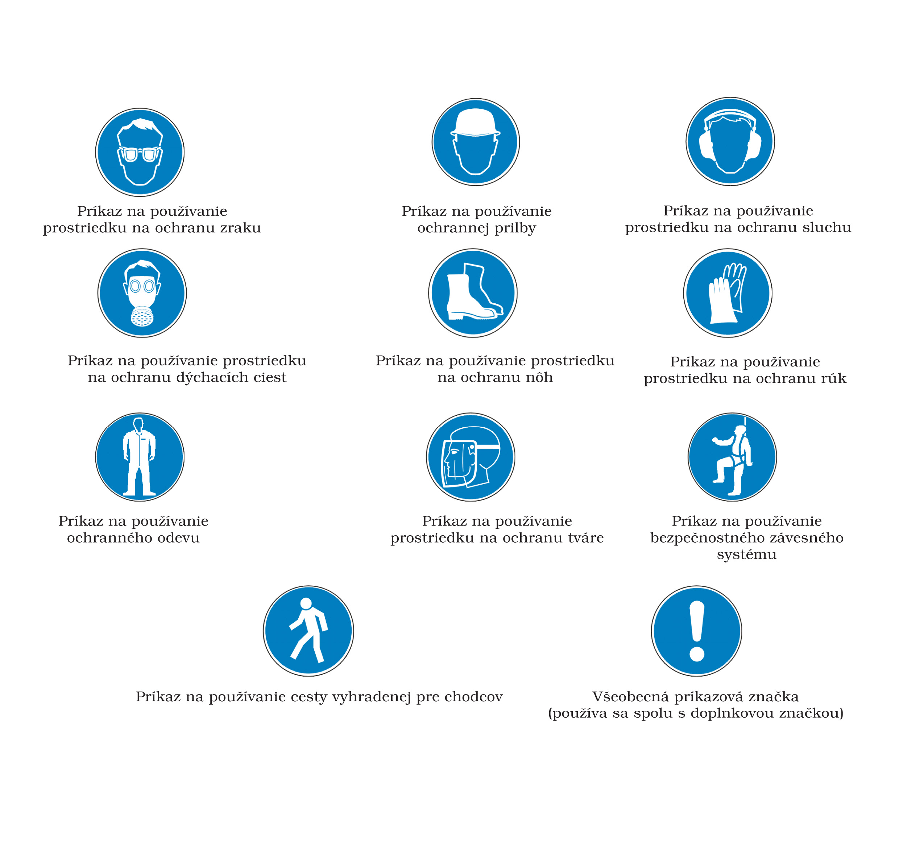
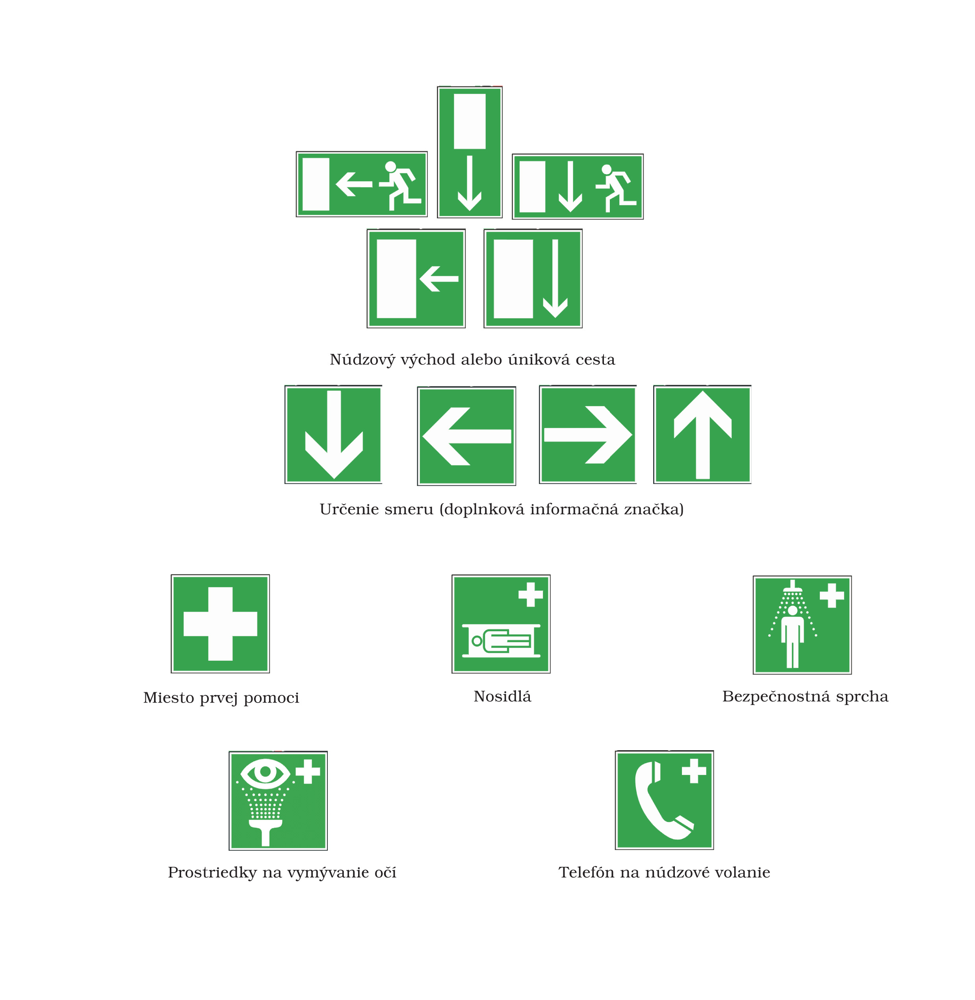
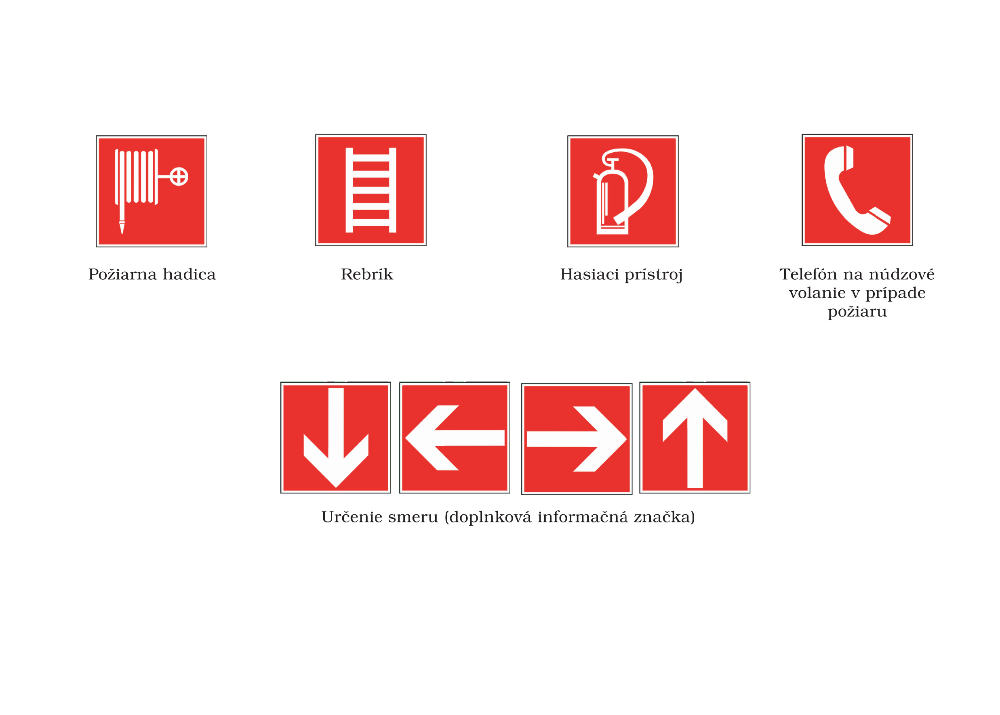

Príloha č. 2 k nariadeniu vlády č. 387/2006 Z. z.

- VŠEOBECNÉ MINIMÁLNE POŽIADAVKY NA ZNAČKY

  - 1. Vlastnosti

    - 1.1 Značka je označenie, ktoré poskytuje konkrétnu informáciu kombináciou geometrického tvaru, farby a symbolu alebo piktogramu a ktoré je viditeľné pri dostatočnej intenzite osvetlenia.

      - Informačná značka je označenie, ktoré poskytuje inú informáciu, ako sú informácie uvedené v bodoch 3.1 až 3.4.

      - Doplnková značka je označenie, ktoré poskytuje doplňujúcu informáciu; doplnková značka sa používa spolu s inou značkou.

    - 1.2 Tvar a farba značiek označujúce zákaz, výstrahu, príkaz, núdzový východ, únikovú cestu, miesto na poskytovanie prvej pomoci a zariadenie na ochranu pred požiarmi sú ustanovené v bode 3.

    - 1.3 Symbol alebo piktogram je zobrazenie, ktoré sa používa na značke alebo na osvetlenom povrchu a ktoré znázorňuje situáciu alebo prikazuje osobitné správanie.

      - Piktogramy musia byť jednoduché a musia obsahovať iba nevyhnutné podrobnosti.

      - Používané piktogramy môžu byť nepatrne odlišné alebo podrobnejšie ako piktogramy ustanovené v bode 3, ak budú vyjadrovať rovnaký význam a ak odlišná úprava nebude meniť ich význam.

    - 1.4 Značky sa vyrábajú z materiálu, ktorý je odolný proti nárazu a poveternostným vplyvom a je vhodný do prostredia, v ktorom sa používa.

    - 1.5 Rozmery, kolorimetrické a fotometrické vlastnosti značiek zaručujú ich dobrú viditeľnosť a zrozumiteľnosť.

  - 2. Podmienky používania

    - 2.1 Značky sa umiestňujú v primeranej výške a v polohe vhodnej z hľadiska zorného uhla, so zreteľom na prekážky, a to pri vstupe na miesto všeobecného ohrozenia alebo v bezprostrednej blízkosti konkrétneho ohrozenia alebo predmetu. Značky sa umiestňujú na dobre osvetlenom, ľahko prístupnom a viditeľnom mieste.

      - Ak denné osvetlenie nie je dostatočné, použijú sa fosforeskujúce farby, reflexné materiály alebo umelé osvetlenie.

    - 2.2 Značka sa musí odstrániť, ak zanikne dôvod na jej používanie.

  - 3. Používané značky

    - 3.1 Zákazové značky

      - Zákazová značka je označenie, ktoré zakazuje správanie, ktoré by mohlo viesť k ohrozeniu alebo spôsobiť ohrozenie.

      - Hlavné znaky

    - – kruhový tvar,

    - – čierny piktogram na bielom pozadí, červený okraj a červený šikmý pruh, pričom červená farba musí zaberať

    - najmenej 35 % plochy značky.

      - Používajú sa tieto značky:

  - 

    - 3.2 Výstražné značky

      - Výstražná značka je označenie, ktoré upozorňuje na nebezpečenstvo alebo ohrozenie.

      - Hlavné znaky

    - – trojuholníkový tvar,

    - – čierny piktogram na žltom pozadí s čiernym okrajom, pričom žltá farba musí zaberať najmenej 50 % plochy značky.

      - Používajú sa tieto značky:

  - 

  - *)

  - Značka sa nepoužije na upozornenie na nebezpečné látky alebo zmesi okrem označenia skladu nebezpečných látok alebo zmesí podľa prílohy č. 3 bodu 5 druhej vety.

    - 3.3 Príkazové značky

      - Príkazová značka je označenie, ktoré prikazuje osobitné správanie.

      - Hlavné znaky

    - – kruhový tvar,

    - – biely piktogram na modrom pozadí, pričom modrá farba musí zaberať najmenej 50 % plochy značky.

      - Používajú sa tieto značky:

  - 

    - 3.4 Značky pre núdzový východ, únikové cesty a prvú pomoc

      - Značka pre núdzový východ, únikovú cestu alebo prvú pomoc je označenie, ktoré informuje o núdzovom východe, únikovej ceste, mieste prvej pomoci alebo záchrannom vybavení.

      - Hlavné znaky

    - – obdĺžnikový alebo štvorcový tvar,

    - – biely piktogram na zelenom pozadí, pričom zelená farba musí zaberať najmenej 50 % plochy značky.

      - Používajú sa tieto značky:

  - 

    - 3.5 Značky na ochranu pred požiarmi

      - Značka na ochranu pred požiarmi je označenie, ktoré informuje o umiestnení zariadenia na ochranu pred požiarmi.

      - Hlavné znaky

    - – obdĺžnikový alebo štvorcový tvar,

    - – biely piktogram na červenom pozadí, pričom červená farba musí zaberať najmenej 50 % plochy značky.

      - Používajú sa tieto značky:

  - 
