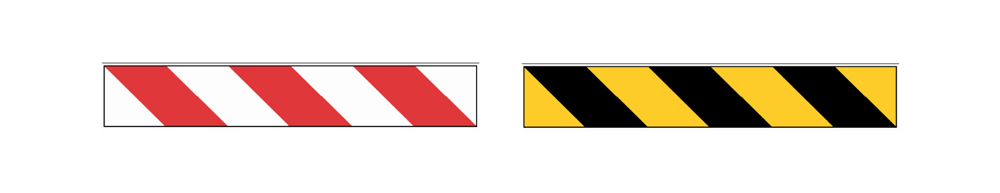

Príloha č. 5 k nariadeniu vlády č. 387/2006 Z. z.

- MINIMÁLNE POŽIADAVKY NA OZNAČENIE PREKÁŽOK, NEBEZPEČNÝCH MIEST A KOMUNIKÁCIÍ

  - 1. Označenie prekážok a nebezpečných miest

    - 1.1 Miesta, na ktorých je nebezpečenstvo zrážky s prekážkou, nebezpečenstvo pádu alebo padajúcich predmetov, sa označujú striedavo žltými a čiernymi pásmi alebo červenými a bielymi pásmi, ak sú tieto miesta zamestnancom prístupné.

    - 1.2 Rozmery označenia musia byť primerané veľkosti prekážky alebo nebezpečného miesta.

    - 1.3 Žlté a čierne alebo červené a biele pásy musia mať sklon približne 45o a musia byť približne rovnakej šírky.

    - 1.4 Vzor

  - 

  - 2. Označenie komunikácií

    - 2.1 Ak používanie a vybavenie priestorov vyžaduje zaistenie bezpečnosti a ochrany zdravia zamestnancov, komunikácie pre vozidlá sa zreteľne vyznačujú neprerušovanými pásmi výraznej farby, prednostne bielej alebo žltej, a to so zreteľom na farbu podkladu.

    - 2.2 Pásy musia byť umiestnené tak, aby určovali potrebnú bezpečnú vzdialenosť medzi vozidlom a ďalším predmetom, ktorý môže byť v jeho blízkosti, ako aj medzi vozidlom a chodcom.

    - 2.3 Ak je to možné, trvalé komunikácie vo vonkajších priestoroch sa vyznačia v súlade s bodmi 2.1 a 2.2, ak nie sú zabezpečené vhodnými zábranami alebo ak nie sú vybudované chodníky.
