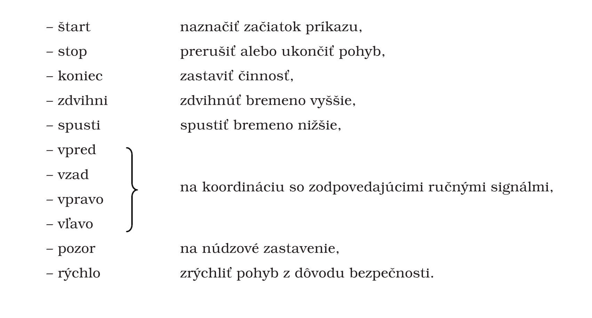

Príloha č. 8 k nariadeniu vlády č. 387/2006 Z. z.

- MINIMÁLNE POŽIADAVKY NA SLOVNÚ KOMUNIKÁCIU

  - 1. Všeobecne

    - 1.1 Slovná komunikácia je hovorená správa oznámená ľudským alebo syntetickým hlasom obsahujúca vopred určené slová.

    - 1.2 Slovná komunikácia medzi hovorcom alebo vysielačom a jedným poslucháčom alebo viacerými poslucháčmi sa má uskutočniť formou krátkych textov, viet, skupín slov alebo jednotlivých slov.

    - 1.3 Hovorené správy majú byť krátke, jednoduché a zrozumiteľné. Vyjadrovacia schopnosť hovorcu a sluchová schopnosť poslucháča zabezpečujú spoľahlivú slovnú komunikáciu.

    - 1.4 Slovná komunikácia je

      - a) priama, prostredníctvom ľudského hlasu,

      - b) nepriama, prostredníctvom ľudského alebo syntetického hlasu, ktorý je vysielaný vhodnými prostriedkami.

  - 2. Osobitné pravidlá používania

    - 2.1 Komunikujúce osoby, ktoré dobre ovládajú používaný jazyk, sú schopné správne vyslovovať a správne porozumieť hovorenej správe a sú schopné na základe tejto správy správať sa vhodným spôsobom so zreteľom na bezpečnosť a ochranu zdravia pri práci.

    - 2.2 Ak sa slovná komunikácia použije namiesto ručných signálov alebo spolu s ručnými signálmi, použijú sa tieto určené slová:

- 
