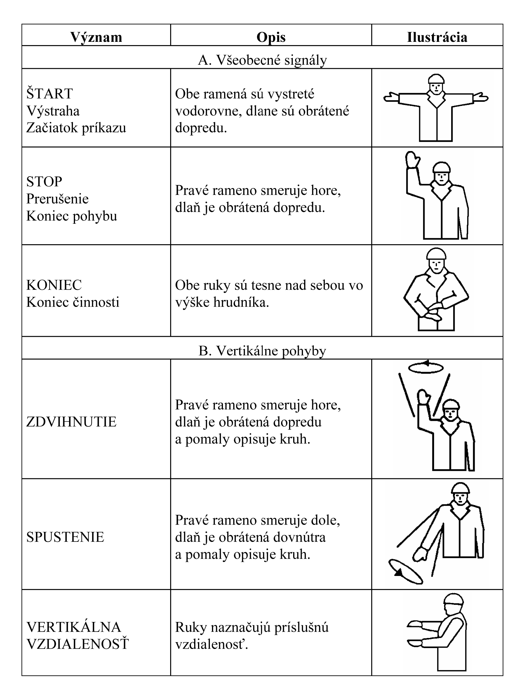
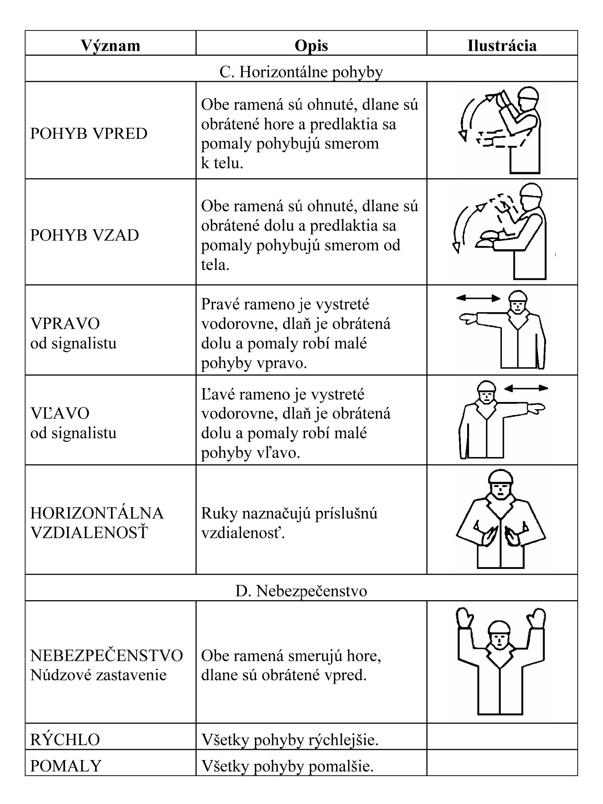

Príloha č. 9 k nariadeniu vlády č. 387/2006 Z. z.

- MINIMÁLNE POŽIADAVKY NA RUČNÉ SIGNÁLY

  - 1. Všeobecne

    - 1.1 Ručný signál je predpísaný pohyb alebo poloha ramien alebo rúk na usmernenie zamestnancov a iných osôb, ak vykonávajú činnosť, ktorá môže ohroziť bezpečnosť alebo zdravie.

    - 1.2 Ručný signál musí byť presný, jednoduchý, ľahko vykonateľný, zrozumiteľný a zreteľne odlíšený od ostatných signálov.

    - 1.3 Ak sa používajú súčasne obidve ramená alebo ruky, musia sa pohybovať symetricky a ukazovať iba jeden signál.

    - 1.4 Ručný signál môže byť nepatrne odlišný alebo podrobnejší ako tie, ktoré sú uvedené v bode 3, ak spĺňajú podmienky uvedené v bodoch 1.2 a 1.3.

  - 2. Osobitné pravidlá používania

    - 2.1 Osoba, ktorá dáva signály (ďalej len „signalista“), používa pohyby ramien alebo rúk na pokyny určujúce činnosť osoby, ktorá prijíma tieto signály (ďalej len „obsluha“).

    - 2.2 Signalista nesmie vykonávať iné činnosti okrem riadenia činnosti a zaisťovania bezpečnosti a ochrany zdravia zamestnancov v jeho blízkosti.

    - 2.3 Signalista musí byť schopný sledovať zrakom všetky činnosti tak, aby nebola ohrozená jeho bezpečnosť a zdravie.

    - 2.4 Ak podmienky podľa bodu 2.3 nemožno splniť, zamestnávateľ musí podľa potreby zabezpečiť ešte jedného signalistu alebo viacerých signalistov.

    - 2.5 Obsluha musí ľahko rozpoznať signalistu.

      - Signalista musí mať na sebe jeden charakteristický prvok alebo viac charakteristických prvkov, napríklad plášť, vestu, prilbu, rukávniky, pásku na rukáve alebo signalizačné terče.

      - Charakteristické prvky musia mať výraznú farbu, podľa možnosti rovnakú, a môže ich používať len signalista.

    - 2.6 Ak nie je obsluha schopná bezpečne vykonať príkazy, ktoré prijala, musí prerušiť prebiehajúcu činnosť, aby si vyžiadala nové pokyny.

  - 3. Predpísaný signál

    - Na ručnú signalizáciu sa používajú tieto signály:

- 

- 
