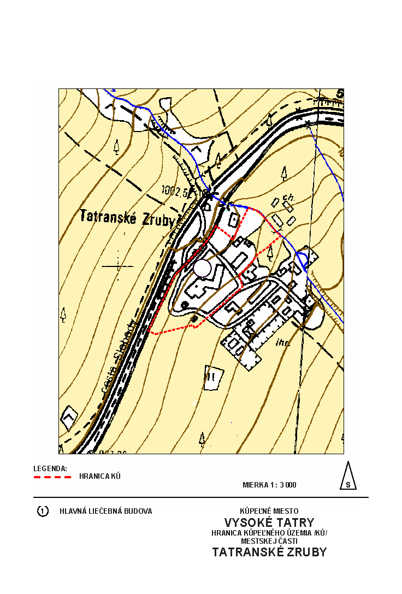

Príloha k nariadeniu vlády č. 446/2006 Z. z.

- ŠTATÚT KÚPEĽNÉHO MIESTA VYSOKÉ TATRY

  - Čl. I Rozsah kúpeľného miesta Vysoké Tatry a kúpeľných území v kúpeľnom mieste Vysoké Tatry

    - (1) Územie kúpeľného miesta Vysoké Tatry je zhodné s katastrálnymi územiami mesta Vysoké Tatry a je vyznačené v územnoplánovacej dokumentácii mesta Vysoké Tatry. Kúpeľné miesto Vysoké Tatry je súčasťou Tatranského národného parku.

    - (2) Rozsah kúpeľného miesta Vysoké Tatry je na obrázku č. 1.

    - (3) V kúpeľnom mieste Vysoké Tatry sú vymedzené tieto kúpeľné územia:

      - a) kúpeľné územie v mestskej časti Horný Smokovec,

      - b) kúpeľné územie v mestskej časti Nový Smokovec,

      - c) kúpeľné územie v mestskej časti Dolný Smokovec,

      - d) kúpeľné územie v mestskej časti Štrbské Pleso,

      - e) kúpeľné územie v mestskej časti Tatranská Kotlina,

      - f) kúpeľné územie v mestskej časti Tatranská Polianka,

      - g) kúpeľné územie v mestskej časti Tatranské Matliare,

      - h) kúpeľné územie v mestskej časti Tatranské Zruby.

    - (4) Kúpeľné územia podľa odseku 3 sú vyznačené v územnoplánovacej dokumentácii mesta Vysoké Tatry a príslušnom katastri nehnuteľností. Ich rozsah je na obrázkoch č. 2 až 9.

    - (5) Opis hraníc kúpeľného územia v mestskej časti Horný Smokovec

      - a) severná hranica vedie po vrstevnici 977 m n. m. nad Cestou slobody a po trati Tatranskej elektrickej železnice pod Cestou slobody,

      - b) západná hranica začína od vrstevnice 977 m n. m. južným smerom po Cestu slobody a pokračuje pod Cestou slobody po štátnu cestu III/5344,

      - c) južná hranica je vedená štátnou cestou III/5344 západným smerom a nad Cestou slobody pokračuje cestou II/537 po východnú hranicu,

      - d) východná hranica vedie od vrstevnice 977 m n. m. južným smerom po Cestu slobody.

    - (6) Opis hraníc kúpeľného územia v mestskej časti Nový Smokovec

      - a) severná hranica vedie od križovatky štátnej cesty II/537 s jednosmernou miestnou komunikáciou od hotela MS 70, pokračuje štátnou cestou II/537 po Vilu Gerlach, za Vilou Gerlach smeruje miestnou komunikáciou medzi penziónom Villa Dr. Szontagh a Liečebným domom Palace a ďalej pokračuje miestnou komunikáciou nad objektom Magura smerom k miestnej komunikácii k Domu služieb až k pôvodnej východnej hranici pozdĺž potoka Štiavnik,

      - b) západná hranica je ohraničená jednosmernou miestnou komunikáciou od štátnej cesty II/537 medzi penziónom Villa Dr. Szontagh a Liečebným domom Palace,

      - c) južnú hranicu tvorí chodník popri štátnej ceste II/537, ďalej pokračuje účelovou komunikáciou k futbalovému ihrisku a chodníkom pod Liečebným domom Penzák k premosteniu potoka Štiavnik pri štátnej ceste II/537,

      - d) východná hranica vedie pozdĺž potoka južným smerom k zákrute pri poliklinike na ceste II/537 a pokračuje účelovou komunikáciou k futbalovému ihrisku.

    - (7) Opis hraníc kúpeľného územia v mestskej časti Dolný Smokovec

      - a) severná hranica vedie po vrstevnici 920 m n. m. severovýchodným smerom k ceste Pekná vyhliadka v Hornom Smokovci,

      - b) západná hranica začína na vrstevnici 888 m n. m. na okraji štátnej cesty Poprad – Starý Smokovec a pokračuje severozápadným smerom popri štátnej ceste až na vrstevnicu 920 m n. m.,

      - c) južná hranica je na vrstevnici 888 m n. m. až po štátnu cestu Poprad – Starý Smokovec,

      - d) východná hranica vedie po štátnej ceste Poprad – Starý Smokovec od vrstevnice 920 m n. m. juhovýchodným smerom, ďalej po štátnej ceste Horný Smokovec – Dolný Smokovec až na vrstevnicu 888 m n. m.

    - (8) Opis hraníc kúpeľného územia v mestskej časti Štrbské Pleso

      - a) severná hranica vedie okolo jazera Štrbské pleso ku križovatke ciest do areálu hotela FIS a Liečebného domu Helios a ponad Liečebný dom Helios k východnej hranici,

      - b) západnú hranicu tvorí chodník okolo jazera Štrbské pleso od Liečebného domu Solisko smerom k jazeru Slepé pleso,

      - c) južná hranica začína od cesty pri Liečebnom dome Solisko, ďalej vedie po južnej strane cesty pod komplexom Liečebného domu Hviezdoslav a končí na križovatke s chodníkom k jazeru Štrbské pleso,

      - d) východná hranica vedie od Liečebného domu Hviezdoslav chodníkom okolo jazera Štrbské pleso, pokračuje chodníkom k rázcestiu miestnej komunikácie od Liečebného domu Helios a areálu hotela FIS, k potoku Mlynica a potom pozdĺž potoka Mlynica smerom k hospodárskemu dvoru Kúpeľov Štrbské Pleso, a. s., a ďalej poza Liečebný dom Helios smerom k severnej hranici.

    - (9) Opis hraníc kúpeľného územia v mestskej časti Tatranská Kotlina

      - a) severnú hranicu tvorí prístupová komunikácia k chodníku k Belianskej jaskyni,

      - b) západná hranica vedie vrstevnicou 800 m n. m. po severnú hranicu,

      - c) južná hranica začína od štátnej cesty I/67 prístupovou komunikáciou za evanjelickým kostolom k objektu na pozemku s parc. č. 523/1,

      - d) východnú hranicu tvorí časť štátnej cesty I/67 od južnej hranice po severnú hranicu.

    - (10) Opis hraníc kúpeľného územia v mestskej časti Tatranská Polianka

      - a) severná hranica vedie pozdĺž lesnej cesty na kóte 1076 m n. m.,

      - b) západná hranica vedie od štátnej cesty II/537 smerom k severnej hranici pozdĺž lesnej cesty a potokom cca 100 m od Sanatória Dr. Guhra až na kótu 1076 m n. m.,

      - c) južná hranica prebieha súbežne so štátnou cestou II/537 od potoka za kúpeľným areálom smerom k východnej hranici a končí pri účelovej komunikácii k Sanatóriu Dr. Guhra,

      - d) východná hranica vedie od štátnej cesty II/537 účelovou komunikáciou k Sanatóriu Dr. Guhra a ďalej popod ihrisko a pozdĺž lesnej cesty na sever až na kótu 1076 m n. m.

    - (11) Opis hraníc kúpeľného územia v mestskej časti Tatranské Matliare

      - a) severnú hranicu tvorí Skalnatý potok od štátnej cesty II/537,

      - b) západná hranica je priama spojnica od Skalnatého potoka k účelovej ceste k zotavovni Metalurg,

      - c) južná hranica je tvorená účelovou komunikáciou k zotavovni Metalurg,

      - d) východnú hranicu tvorí časť štátnej cesty II/537 od rázcestia účelovej cesty k zotavovni Metalurg po Skalnatý potok.

    - (12) Opis hraníc kúpeľného územia v mestskej časti Tatranské Zruby:

      - a) západnú hranicu tvorí časť trate Tatranskej elektrickej železnice nad areálom kúpeľnej liečebne od koncového bodu južnej hranice až po asfaltové parkovisko pri bytovom dome Vostok, odkiaľ pokračuje severná hranica,

      - b) severná hranica vedie od trate Tatranskej elektrickej železnice k asfaltovému parkovisku pri bytovom dome Vostok (parc. č. 504/2), pokračuje okolo plochy parkoviska k potoku a ďalej je tvorená potokom až po chodník nad objektom na pozemku parc. č. 504/12,

      - c) východná hranica sa napája na severnú hranicu v priesečníku potoka a chodníka nad objektom na pozemku parc. č. 504/12, pokračuje po tomto chodníku až po cestu vedúcu z parkoviska pre hlavnú liečebnú budovu nad objektom na pozemku parc. č. 504/10 a pod pozemkom parc. č. 504/46 – zeleň pod hlavnou liečebnou budovou,

      - d) južná hranica smeruje po hranici pozemkov parc. č. 504/49 a parc. č. 504/39 až po trať Tatranskej elektrickej železnice, odkiaľ sa začína západná hranica.

  - Čl. II Opatrenia na ochranu kúpeľného miesta Vysoké Tatry

    - (1) V kúpeľnom mieste Vysoké Tatry môžu byť len také stavby a zariadenia vrátane športovo-rekreačných zariadení, ktoré nenarušujú zdravé životné prostredie, najmä klimatické a hydrologické podmienky.

    - (2) V kúpeľnom mieste Vysoké Tatry sa lesný porast udržiava podľa lesného hospodárskeho plánu, opatrení vydaných podľa osobitného predpisu1) a osobitných bioprojektov ako rehabilitačný a respiračný priestor nadväzujúci na kúpeľné územie.

    - (3) Obhospodarovanie lesných porastov v kúpeľnom mieste Vysoké Tatry sa musí v súlade s osobitným predpisom1) prispôsobiť podmienkam kúpeľného prostredia a hydrologickým a klimatickým podmienkam.

    - (4) V kúpeľných územiach sa nesmie

      - a) parkovať s motorovými vozidlami mimo vyhradených miest okrem parkovania osobitne označených motorových vozidiel na prepravu zdravotne postihnutých osôb a na zásobovanie,

      - b) vykonávať úmyselná ťažba dreva mimo lesného hospodárskeho plánu,

      - c) vykonávať posyp komunikácií posypovým materiálom spôsobujúcim prašnosť,

      - d) vykonávať iná činnosť, ako je uvedené v písmenách a) až c), ktorá môže negatívne ovplyvniť klimatické ukazovatele a kvalitu ovzdušia.

    - (5) V kúpeľných územiach sa musia udržiavať objekty v dobrom technickom stave a nezastavané pozemky ako park.

    - 

    - 

    - 

    - 

    - 

    - 

    - 

    - 

    - 
