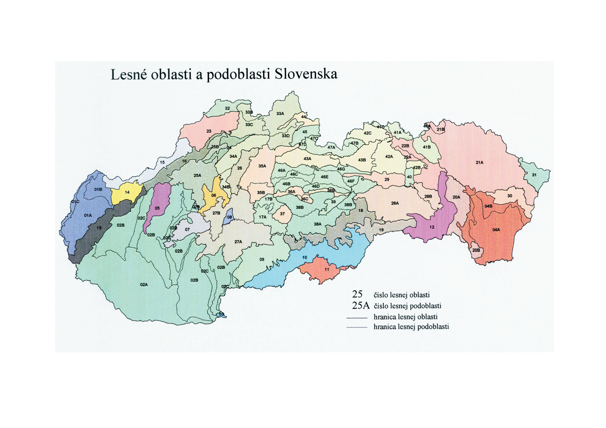

Príloha č. 7 k vyhláške č. 453/2006 Z. z.

- ZOZNAM LESNÝCH OBLASTÍ A PODOBLASTÍ A ICH GRAFICKÉ ZOBRAZENIE Lesné oblasti a podoblasti s prevahou výskytu 1. lesného vegetačného stupňa

- 01 Záhorská nížina, Dyjsko-moravská niva

- A Borská nížina

- B Chvojnická pahorkatina

- C Dyjsko-moravská niva, Dolnomoravská niva

- 02 Podunajská nížina

- A Podunajská rovina, Čenkovská niva

- B Podunajská pahorkatina (bez nív)

- C Sústava nív podunajskej pohorkatiny

- (Dolnovážska, Nitrianska, Žitavská, Hronská, Ipeľská niva)

- 03 Burda

- 04 Východoslovenská nížina

- A Východoslovenská rovina

- B Východoslovenská pahorkatina

- Lesné oblasti s prevahou výskytu 2. lesného vegetačného stupňa

- 05 Považský Inovec

- 06 Hornonitrianska kotlina

- 07 Tribeč

- 08 Žiarska kotlina

- 09 Krupinská planina, Ostrôžky

- 10 Juhoslovenská kotlina, Gemerská pahorkatina

- 11 Cerová vrchovina

- 12 Košická kotlina, Abovská pahorkatina

- Lesné oblasti a podoblasti s prevahou výskytu 3. lesného vegetačného stupňa

- 13 Malé Karpaty

- 14 Myjavská pahorkatina

- 15 Biele Karpaty

- 16 Považské podolie

- 17 Zvolenská kotlina

- A Sliačska kotlina, Zvolenská pahorkatina, Slatinská kotlina

- B Bystrická vrchovina, Bystrické podolie, Ponická vrchovina

- 18 Revúcka vrchovina, Rožňavská kotlina

- 19 Slovenský kras

- 20 Slanské vrchy, Zemplínske vrchy

- A Slanské vrchy

- B Zemplínske vrchy

- 21 Nízke Beskydy

- A Ondavská vrchovina, Laborecká vrchovina, Beskydské predhorie

- B Busov

- 22 Šarišská vrchovina, Spišsko-šarišské medzihorie

- A Šarišská vrchovina, Šarišské podolie, Stráže

- B Ľubovnianska kotlina, Ľubotínska pahorkatina, Jakubianska brázda, Hromovec

- 23 Javorníky

- 24 Žilinská kotlina

- 25 Strážovské vrchy, Súľovské vrchy

- A Strážovské vrchy

- B Súľovské vrchy

- 26 Turčianska kotlina

- 27 Štiavnické vrchy, Javorie, Pliešovská kotlina, Pohronský Inovec, Vtáčnik, Kremnické vrchy

- A Štiavnické vrchy, Javorie, Pliešovská kotlina, Pohronský Inovec

- B Vtáčnik, Kremnické vrchy

- Lesné oblasti a podoblasti s prevahou výskytu 4. lesného vegetačného stupňa

- 23 Javorníky

- 24 Žilinská kotlina

- 25 Strážovské vrchy, Súľovské vrchy

- A Strážovské vrchy

- B Súľovské vrchy

- 26 Turčianska kotlina

- 28 Volovské vrchy, Čierna hora

- A Volovské vrchy

- B Čierna hora

- 29 Hornádska kotlina

- 30 Vihorlatské vrchy

- 31 Bukovské vrchy

- Lesné oblasti a podoblasti s prevahou výskytu 5. lesného vegetačného stupňa

- 32 Západné Beskydy

- 33 Stredné Beskydy

- A Oravské Beskydy, Podbeskydská brázda, Podbeskydská vrchovina, Oravská Magura

- B Kysucké Beskydy

- C Kysucká vrchovina

- D Oravská vrchovina

- 34 Malá Fatra, Žiar

- A Malá Fatra

- B Žiar

- 35 Veľká Fatra, Starohorské vrchy, Chočské vrchy

- A Veľká Fatra sever, Starohorské vrchy sever, Ždiarska brázda

- B Veľká Fatra juh, Starohorské vrchy juh

- 36 Horehronské podolie

- A Lopejská kotlina, Bystrianske podhorie

- B Heľpianske podolie

- C Breznianska kotlina

- 37 Poľana

- 38 Veporské vrchy, Stolické vrchy

- A Veporské vrchy juh, Stolické vrchy

- B Veporské vrchy sever

- 39 Spišskogemerský kras

- 40 Branisko

- 41 Východné Beskydy

- A Ľubovnianska vrchovina

- B Čergov

- C Pieniny

- 42 Levočské vrchy, Bachureň, Spišská Magura, Ždiarska brázda

- A Bachureň

- B Levočské vrchy

- C Spišská Magura, Ždiarska brázda

- 43 Podtatranská kotlina

- A Liptovská kotlina

- B Popradská kotlina, Tatranské podhorie

- Lesné oblasti a podoblasti s prevahou výskytu 6. lesného vegetačného stupňa

- 44 Oravská kotlina

- 45 Skorušinské vrchy, Zuberská brázda

- 46 Nízke Tatry, Kozie chrbty

- A Salatíny, Demänovské vrchy

- B Ďumbier, Prašivá; juh

- C Ďumbier, Prašivá; sever

- D Kráľova hoľa, Priehyba; juh

- E Kráľova hoľa, Priehyba; sever

- F Predná hoľa

- G Kozie chrbty

- Lesná oblasť a podoblasti s prevahou výskytu 7. lesného vegetačného stupňa

- 47 Tatry

- A Liptovské Tatry, Roháče, Červené vrchy, Liptovské kopy, Vysoké Tatry (bez Širokej)

- B Belianske Tatry, Široká

- C Osobitá

- D Sivý vrch

- Vysvetlivky:

- 45 - názov lesnej oblasti

- A - názov podoblasti v rámci lesnej oblasti

- 
