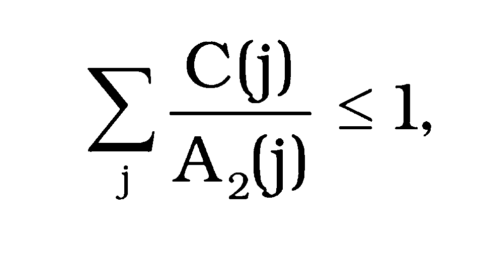
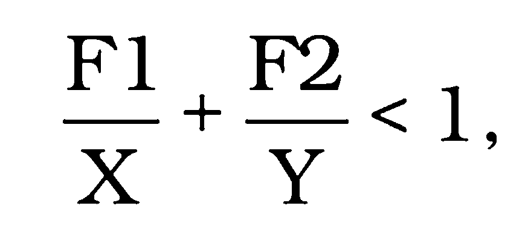

Príloha č. 1 k vyhláške č. 57/2006 Z. z.

- POŽIADAVKY NA RÁDIOAKTÍVNE MATERIÁLY, OBALOVÉ SÚBORY A ZÁSIELKY

  - I. časť: Požiadavky na rádioaktívne materiály

    - 1. Rádioaktívny materiál NMA-III musí byť pevná látka takej povahy, že ak sa celý obsah zásielky podrobí skúške predpísanej v prílohe č. 4 časti II, aktivita vo vode nepresiahne 0,1 A2.

    - 2. Celkové množstvo málo disperzného rádioaktívneho materiálu v zásielke musí spĺňať tieto požiadavky:

      - a) dávkový príkon vo vzdialenosti 3 m od netieneného rádioaktívneho materiálu nepresiahne 10 mSv.h-1,

      - b) ak sa podrobí skúškam predpísaným v prílohe č. 4 časti IV bodoch 25 a 26, úniky do vzduchu v plynovej a aerosólovej forme do aerodynamického ekvivalentného priemeru 100 m nepresiahnu 100 A2; na každú skúšku možno použiť samostatnú vzorku,

      - c) ak sa podrobí skúške predpísanej v prílohe č. 4 časti II, aktivita vo vode nepresiahne 100 A2; pri vykonaní tejto skúšky sa musia zohľadniť poškodzujúce účinky skúšok predpísaných v písmene b).

  - II. časť: Všeobecné požiadavky na všetky obalové súbory a zásielky

    - 1. Zásielka sa musí projektovať tak, aby ju bolo možné

      - a) ľahko a bezpečne prepravovať vzhľadom na jej hmotnosť, objem a formu,

      - b) počas prepravy riadne zabezpečiť na dopravnom prostriedku.

    - 2. Zdvíhacie úchyty zásielky sa musia projektovať tak, aby nezlyhali, keď sa budú používať navrhovaným spôsobom, a aby sa v prípade ich poškodenia nenarušila schopnosť zásielky splniť ostatné požiadavky tejto vyhlášky. Projekt musí zohľadniť príslušné bezpečnostné faktory vzťahujúce sa na zdvíhanie trhom.

    - 3. Upínacie zariadenie a akékoľvek iné úchyty na vonkajšom povrchu zásielky, ktoré možno použiť na jej zdvíhanie, sa musia projektovať tak, aby udržali jej hmotnosť v zmysle požiadaviek uvedených v bode 2, alebo sa musia odstrániť alebo inak vyradiť z funkcie počas prepravy.

    - 4. Ak je to prakticky možné, obalový súbor sa musí projektovať a zhotoviť tak, aby vonkajší povrch nemal vystupujúce časti a mohol sa ľahko dekontaminovať.

    - 5. Ak je to prakticky možné, vonkajší povrch zásielky sa musí riešiť tak, aby sa na ňom nezrážala a neudržiavala voda.

    - 6. Akékoľvek zariadenie pripojené k zásielke počas prepravy, ktoré nie je súčasťou zásielky, nesmie znižovať jej bezpečnosť.

    - 7. Zásielka musí byť schopná odolať účinkom akýchkoľvek zrýchlení, vibrácií alebo rezonancií z vibrácií, ktoré môžu vzniknúť za podmienok pravdepodobných pri bežnej preprave, bez zníženia účinnosti uzatváracích zariadení v rôznych priestoroch zásielky alebo bez porušenia celistvosti zásielky ako celku. Najmä matice, skrutky, svorníky a iné zabezpečovacie zariadenia sa musia projektovať tak, aby nedošlo k ich samovoľnému uvoľneniu alebo k strate, a to ani po viacnásobnom použití.

    - 8. Materiály obalových súborov, akýchkoľvek častí alebo konštrukcií a rádioaktívny obsah zásielky musia byť navzájom fyzikálne a chemicky zlučiteľné. Musí sa zohľadniť zmena ich vlastností pod vplyvom radiácie.

    - 9. Ventily, ktorými by mohol rádioaktívny obsah unikať, sa musia zabezpečiť proti neoprávnenému použitiu.

    - 10. Projekt zásielky musí zohľadniť také vonkajšie teploty a tlaky, ktoré sa môžu vyskytnúť za normálnych podmienok prepravy.

    - 11. Zásielka sa musí projektovať s prihliadnutím na ďalšie nebezpečné vlastnosti rádioaktívneho materiálu.

    - 12. Zásielka obsahujúca vysoko disperzný rádioaktívny materiál sa musí projektovať tak, aby boli zabezpečené radiačné opatrenia v najvyššej možnej miere.

  - III. časť: Dodatočné požiadavky na zásielky prepravované letecky

    - 1. Teplota dostupných povrchov zásielok prepravovaných letecky nesmie presiahnuť 50 oC pri vonkajšej teplote 38 oC. Slnečné ožiarenie sa neberie do úvahy.

    - 2. Zásielky určené na leteckú prepravu sa musia riešiť tak, aby pri vonkajšej teplote v rozmedzí –40 oC až +55 oC nedošlo k poškodeniu celistvosti ich obalového súboru.

    - 3. Letecky prepravované zásielky obsahujúce rádioaktívne materiály musia mať kontajnmentový systém schopný odolať bez úniku zníženiu vonkajšieho tlaku na 5 kPa.

  - IV. časť: Požiadavky na bežné zásielky

    - Projekt bežnej zásielky musí zohľadniť požiadavky uvedené v časti II, a ak sa bude zásielka prepravovať letecky, aj požiadavky uvedené v časti III.

  - V. časť: Požiadavky na priemyselné zásielky

    - 1. Priemyselná zásielka typu 1 (PZ-1) sa musí projektovať tak, aby spĺňala požiadavky uvedené v časti II, v časti VII bode 2 a navyše, ak sa prepravuje letecky, aj požiadavky uvedené v časti III.

    - 2. Aby sa zásielka mohla kvalifikovať ako priemyselná zásielka typu 2 (PZ-2), musí sa projektovať tak, aby spĺňala požiadavky na PZ-1 uvedené v bode 1, a ak sa podrobí skúškam predpísaným v prílohe č. 4 časti IV bodoch 10 a 11, musí zabrániť

      - a) strate alebo rozptylu rádioaktívneho obsahu,

      - b) takej strate celistvosti tienenia, ktorá by spôsobila zvýšenie dávkového príkonu na ktorejkoľvek časti vonkajšieho povrchu zásielky o viac ako 20 %.

    - 3. Aby sa zásielka mohla kvalifikovať ako priemyselná zásielka typu 3 (PZ-3), musí sa projektovať tak, aby spĺňala požiadavky na PZ-1 uvedené v bode 1 a požiadavky uvedené v časti VII bodoch 3 až 15.

    - 4. Letecky možno prepravovať nehorľavý pevný rádioaktívny materiál NMA-II alebo NMA-III v zásielkach PZ-1, PZ-2 alebo PZ-3, ak celkový obsah aktivity v jednotlivej zásielke nepresiahne 3 000 A2.

  - VI. časť: Požiadavky na zásielky obsahujúce hexafluorid uránu

    - 1. Hexafluorid uránu sa musí baliť a prepravovať v súlade s požiadavkami technickej normy.8)

    - 2. Každá zásielka s obsahom 0,1 kg hexafluoridu uránu alebo viac sa musí projektovať tak, aby odolala

      - a) štrukturálnej skúške predpísanej v prílohe č. 4 časti IV bode 6 bez úniku a bez neprijateľných napätí špecifikovaných v technickej norme,8)

      - b) skúške predpísanej v prílohe č. 4 časti IV bode 10 bez straty alebo bez rozptylu hexafluoridu uránu,

      - c) skúške predpísanej v prílohe č. 4 časti IV bode 16 bez prasknutia kontajnmentového systému.

    - 3. Zásielka s obsahom 0,1 kg hexafluoridu uránu alebo viac nesmie mať zariadenia na odľahčenie tlaku.

  - VII. časť: Požiadavky na zásielky typu A

    - 1. Zásielka typu A môže obsahovať rádioaktívny materiál, ktorého celková aktivita nepresiahne hodnotu A2. Pre zmes rádionuklidov v zásielke typu A platí vzťah:

- 

- kde

- C(j) – aktivita j-teho rádionuklidu,

- A2(j) – hodnota A2 pre j-ty rádionuklid.

- 2.

- Zásielka typu A sa musí projektovať tak, aby spĺňala požiadavky uvedené v bodoch 3 až 16, požiadavky uvedené v časti II, a ak sa bude prepravovať letecky, aj požiadavky uvedené v časti III.

- 3.

- Najmenší vonkajší rozmer zásielky nesmie byť menší ako 10 cm.

- 4.

- Vonkajšia forma zásielky musí umožniť pripojenie pečatí, ktoré nemožno ľahko porušiť a ktorých neporušený stav slúži ako dôkaz, že zásielka nebola otvorená.

- 5.

- Akékoľvek upínacie zariadenia na zásielke sa musia projektovať tak, aby sily pôsobiace na tieto zariadenia za normálnych a havarijných podmienok prepravy nespôsobovali na zásielke zmeny, ktoré nie sú v súlade s touto vyhláškou.

- 6.

- Zásielka sa musí projektovať tak, aby jednotlivé komponenty obalového súboru vydržali teploty v rozsahu od –40 oC do +70 oC. Osobitná pozornosť sa musí venovať nízkym teplotám tuhnutia kvapalín a možnosti prípadného znehodnocovania materiálov obalového súboru v danom teplotnom rozsahu.

- 7.

- Projekt zásielky a výrobné postupy musia byť v súlade so slovenskými štandardmi alebo s inými požiadavkami schválenými úradom.

- 8.

- Projekt zásielky musí obsahovať kontajnmentový systém bezpečne uzatvoriteľný pomocou uzatváracieho mechanizmu, ktorý nemožno otvoriť náhodne a ani v dôsledku tlaku, ktorý môže vzniknúť v zásielke.

- 9.

- Ak kontajnmentový systém tvorí osobitnú jednotku zásielky, musí byť bezpečne uzatvoriteľný uzatváracím mechanizmom, ktorý je nezávislý od ktorejkoľvek inej časti obalového súboru.

- 10.

- Projekt ktorejkoľvek časti kontajnmentového systému musí zohľadniť rádiolytický rozklad kvapalín a iných nestálych materiálov a tvorenie plynov chemickou reakciou a rádiolýzou.

- 11.

- Kontajnmentový systém musí udržať svoj rádioaktívny obsah pri znížení vonkajšieho tlaku na 60 kPa.

- 12.

- Všetky ventily s výnimkou poistných musia byť vybavené uzáverom zabraňujúcim akémukoľvek úniku cez ventil.

- 13.

- Radiačné tienenie obklopujúce tú časť zásielky, ktorá je špecifikovaná ako súčasť kontajnmentového systému, sa musí projektovať tak, aby sa zabránilo nežiaducemu uvoľneniu tejto časti od tienenia. Ak radiačné tienenie a súčasť kontajnmentového systému, ktorá je ním obklopená, tvoria osobitnú jednotku, musí byť toto tienenie bezpečne uzatvoriteľné mechanizmom, ktorý je nezávislý od ktorejkoľvek inej časti konštrukcie obalového súboru.

- 14.

- Zásielka sa musí projektovať tak, aby pri skúškach predpísaných v prílohe č. 4 časti IV bodoch 7 až 12 nedošlo

- a)

- k strate alebo rozptylu rádioaktívneho obsahu,

- b)

- k takej strate celistvosti tienenia, ktorá by spôsobila zvýšenie dávkového príkonu na ktorejkoľvek časti vonkajšieho povrchu zásielky o viac ako 20 %.

- 15.

- Zásielka obsahujúca tekutý rádioaktívny materiál musí byť vybavená zariadením na zvládnutie zmeny objemu obsahu v závislosti od teplotných zmien, dynamických javov a dynamiky pri plnení.

- 16.

- Zásielka typu A obsahujúca tekutý rádioaktívny materiál musí okrem predchádzajúcich ustanovení

- a)

- spĺňať požiadavky uvedené v bode 14, ak sa zásielka podrobí skúškam predpísaným v prílohe č. 4 časti IV bode 13,

- b)

- byť vybavená jedným z týchto zariadení:

- 1.

- vhodným absorpčným materiálom, ktorý bude schopný absorbovať dvojnásobný objem tekutého obsahu; takýto absorpčný materiál musí byť umiestnený tak, aby bol v styku s kvapalinou, ak dôjde k jej úniku,

- 2.

- kontajnmentovým systémom zloženým z primárnych, vnútorných a sekundárnych, vonkajších kontajnmentových častí, projektovaným tak, aby zabezpečil udržanie tekutého obsahu v sekundárnej, vonkajšej časti, aj keď bude primárna, vnútorná časť netesná.

  - VIII. časť: Požiadavky na zásielky typu B(U)

    - 1. Zásielka typu B(U) sa musí projektovať tak, aby spĺňala požiadavky uvedené v bodoch 2 až 16, požiadavky uvedené v časti II, v časti VII bodoch 3 až 15 okrem bodu 14 písm. a), a ak sa prepravuje letecky, aj požiadavky uvedené v bode 17 a v časti III.

    - 2. Zásielka sa musí projektovať tak, aby boli za normálnych podmienok prepravy (skúšky predpísané v prílohe č. 4 časti IV bodoch 7 až 12) splnené požiadavky tejto vyhlášky na obal a tienenie aj za predpokladu, že by bola zásielka ponechaná bez dozoru počas jedného týždňa nepriaznivému pôsobeniu tepla vyvíjaného jej rádioaktívnym obsahom vo vonkajšom prostredí s teplotou uvedenou v bode 4 a slnečným ožiarením uvedeným v bode 5. Osobitne sa musia zohľadniť také účinky tepla, ktoré by mohli

      - a) zmeniť usporiadanie, geometrický tvar alebo fyzický stav rádioaktívneho obsahu, alebo ak je rádioaktívny materiál uzatvorený v plechovom obale alebo v nádobe (napríklad palivové články v povlaku), vyvolať deformáciu alebo roztopenie plechového obalu, nádoby alebo rádioaktívneho materiálu,

      - b) znížiť účinnosť obalového súboru nerovnomerným rozpínaním, praskaním alebo topením tieniaceho materiálu,

      - c) urýchliť koróziu v kombinácii s vlhkosťou.

    - 3. Zásielka sa musí projektovať tak, aby teplota jej dostupných povrchov nepresiahla 50 oC pri vonkajšej teplote uvedenej v bode 4 okrem prepravy v podmienkach výlučného použitia.

    - 4. Vonkajšou teplotou sa rozumie teplota 38 oC.

    - 5. Podmienkami slnečného ožiarenia sa rozumejú podmienky uvedené v tabuľke č. 1.

    - Tabuľka č. 1 Slnečné ožiarenie

  - Tvar a umiestnenie povrchu | Slnečné ožiarenie vo W.m-2 počas 12 hodín za deň

  - Plochý povrch dopravovaný vodorovne - základňa - ostatné povrchy | 0 800

  - Plochý povrch nedopravovaný vodorovne - všetky povrchy | 200a)

  - Zakrivený povrch | 400a)

  - a) Alternatívne možno použiť funkciu sínus s upraveným absorpčným koeficientom pri zanedbaní možného vplyvu odrazu od okolitých predmetov.

    - 6. Zásielka, ktorá má tepelnú ochranu vyhovujúcu požiadavkám tepelnej skúšky predpísanej v prílohe č. 4 časti IV bode 16, sa musí projektovať tak, aby ochrana zostala účinná, aj keď sa zásielka podrobí skúške predpísanej v prílohe č. 4 časti IV bodoch 7 až 12 a bode 15 písm. a) a b) alebo písm. b) a c) podľa toho, čo je vhodnejšie. Takáto ochrana na vonkajšej časti zásielky nesmie byť narušená rytím, rezaním, šmykom, odieraním alebo hrubým zaobchádzaním.

    - 7. Zásielka sa musí projektovať tak, aby pri skúškach predpísaných

      - a) v prílohe č. 4 časti IV bodoch 7 až 12 strata rádioaktívneho obsahu nepresiahla 10-6 A2.h-1,

      - b) v prílohe č. 4 časti IV bode 14, bode 15 písm. b), bodoch 16, 17 a 18 a pri skúškach predpísaných

        - 1. v prílohe č. 4 časti IV bode 15 písm. c) pre zásielky s hmotnosťou najviac 500 kg, celkovou hustotou určenou na základe vonkajších rozmerov, nepresahujúcou 1 000 kg.m-3 a s rádioaktívnym obsahom presahujúcim 1 000 A2,

        - 2. v prílohe č. 4 časti IV bode 15 písm. a) pre všetky ostatné zásielky boli splnené tieto požiadavky:

          - 2a. tienenie zásielky musí zostať v takom stave, aby dávkový príkon vo vzdialenosti 1 m od povrchu zásielky nepresiahol 10 mSv.h-1 s maximálnym rádioaktívnym obsahom, na ktorý je zásielka projektovaná,

          - 2b. celková strata rádioaktívneho obsahu zásielky počas jedného týždňa nesmie presiahnuť hodnotu 10 A2 pre 85Kr a hodnotu A2 pre všetky ostatné rádionuklidy.

    - 8. Ak zásielka obsahuje zmes rôznych rádionuklidov, použijú sa v bode 7 ustanovenia bodov 3 až 5 prílohy č. 3 okrem 85Kr, pre ktorý možno použiť efektívnu hodnotu A2(i) rovnajúcu sa 10 A2. V bode 7 písm. a) sa musia zohľadniť limitné hodnoty vonkajšej kontaminácie uvedené v § 5 ods. 3 písm. a) tejto vyhlášky.

    - 9. Zásielka s rádioaktívnym obsahom s vyššou aktivitou ako 105 A2sa musí projektovať tak, aby pri skúške ponorením do vody predpísanej v prílohe č. 4 časti IV bode 18 nedošlo k roztrhnutiu kontajnmentového systému.

    - 10. Dodržanie povolených hodnôt úniku aktivity nemožno viazať na použitie filtrov a mechanických chladiacich systémov.

    - 11. Zásielka nesmie obsahovať poistný tlakový systém kontajnmentového systému, ktorý by za podmienok uvedených v prílohe č. 4 časti IV bodoch 7 až 12 a 14 až 17 umožňoval únik rádioaktívneho materiálu do okolia.

    - 12. Zásielka sa musí projektovať tak, aby úroveň napätí v kontajnmentovom systéme pri najvyššom normálnom prevádzkovom tlaku a pri skúškach predpísaných v prílohe č. 4 časti IV bodoch 7 až 12 a 14 až 17 nedosiahla hodnoty, ktoré by nepriaznivo ovplyvnili zásielku tak, že by nesplnila príslušné ustanovenia tejto vyhlášky.

    - 13. Najvyšší normálny prevádzkový tlak v zásielke nesmie presiahnuť 700 kPa.

    - 14. Okrem požiadaviek na zásielky prepravované letecky (časť III bod 1) nesmie maximálna teplota na ktorejkoľvek časti ľahko dostupného povrchu zásielky počas prepravy presiahnuť 85 oC pri vonkajšej teplote uvedenej v bode 4 a bez jej vystavenia slnečnému ožiareniu. Zásielka sa musí prepravovať v podmienkach výlučného použitia, ak maximálna teplota presiahne 50 oC. Na ochranu osôb zabezpečujúcich prepravu možno použiť bariéry alebo steny, ktoré sa nemusia podrobovať žiadnym skúškam.

    - 15. Zásielka obsahujúca málo disperzný rádioaktívny materiál sa musí projektovať tak, aby akékoľvek vnútorné časti obalového súboru nepriaznivo neovplyvnili charakteristiky málo disperzného rádioaktívneho materiálu.

    - 16. Zásielka sa musí projektovať na teploty okolia v rozsahu od –40 oC do +38 oC.

    - 17. Letecky možno prepravovať zásielky typu B(U), ak celkový obsah aktivity v zásielke nepresiahne

      - a) hodnotu, ktorú schválil úrad alebo kompetentný orgán iného štátu v osvedčení pre málo disperzný rádioaktívny materiál,

      - b) 3 000 A2 pre ostatné rádioaktívne materiály.

  - IX. časť: Požiadavky na zásielky typu B(M)

    - 1. Zásielky typu B(M) musia spĺňať požiadavky na zásielky typu B(U) uvedené v časti VIII bode 1. Úrad môže na prepravu zásielok typu B(M) v Slovenskej republike alebo po dohode s kompetentnými orgánmi príslušných štátov na medzinárodnú prepravu medzi Slovenskou republikou a príslušnými štátmi ustanoviť iné požiadavky ako tie, ktoré sú uvedené v časti VII bode 6 a v časti VIII bodoch 4, 5 a 8 až 15. Požiadavky na zásielky typu B(U) uvedené v časti VIII bodoch 8 až 15 však musia byť splnené v prakticky možnom rozsahu.

    - 2. Úrad môže povoliť periodické odvzdušňovanie zásielok typu B(M) počas prepravy.

  - X. časť: Požiadavky na zásielky typu C

    - 1. Zásielky typu C sa musia projektovať tak, aby splnili požiadavky uvedené v bodoch 2 až 4, požiadavky uvedené v časti II, v časti VII bodoch 2 až 14 okrem bodu 13 písm. a) a požiadavky uvedené v časti VIII bodoch 2 až 5 a 9 až 15.

    - 2. Zásielka musí vyhovovať ustanoveniam časti VIII bodu 7 písm. b) a bodu 11 po umiestnení do prostredia s tepelnou vodivosťou 0,33 W. m-1.K-1 a teplotou 38 oC v ustálenom stave. Pred začatím skúšok musí mať zásielka najvyšší normálny prevádzkový tlak, každá tepelná izolácia zásielky musí byť neporušená a teplota prostredia musí byť 38 oC.

    - 3. Zásielka sa musí projektovať tak, aby pri najvyššom normálnom prevádzkovom tlaku a pri skúškach predpísaných

      - a) v prílohe č. 4 časti IV bodoch 7 až 12 strata rádioaktívneho obsahu nepresiahla 10-6 A2 za hodinu,

      - b) v prílohe č. 4 časti IV bode 22 boli splnené tieto požiadavky:

        - 1. tienenie zásielky musí zostať v takom stave, aby dávkový príkon vo vzdialenosti 1 m od povrchu zásielky nepresiahol 10 mSv.h-1 s maximálnym rádioaktívnym obsahom, na ktorý je zásielka projektovaná,

        - 2. celková strata rádioaktívneho obsahu zásielky počas jedného týždňa nesmie presiahnuť hodnotu 10 A2 pre 85Kr a hodnotu A2 pre všetky ostatné rádionuklidy.

    - 4. Ak zásielka obsahuje zmes rôznych rádionuklidov, použijú sa v bode 3 ustanovenia bodov 3 až 5 prílohy č. 3 okrem 85Kr, pre ktorý možno použiť efektívnu hodnotu A2(i) rovnajúcu sa 10 A2. V bode 3 písm. a) sa musia zohľadniť limitné hodnoty vonkajšej kontaminácie uvedené v § 5 ods. 3 písm. a) tejto vyhlášky.

    - 5. Zásielka sa musí projektovať tak, aby pri skúške ponorením do vody predpísanej v prílohe č. 4 časti IV bode 18 nedošlo k roztrhnutiu kontajnmentového systému.

  - XI. časť: Požiadavky na zásielky obsahujúce štiepny materiál

    - 1. Štiepny materiál sa musí prepravovať tak, aby

      - a) sa za normálnych a havarijných podmienok prepravy udržala podkritickosť; osobitne sa musia zohľadniť tieto možnosti:

        - 1. prienik vody zo zásielky alebo do zásielky,

        - 2. strata účinnosti zabudovaných neutrónových absorbátorov alebo moderátorov,

        - 3. zmena usporiadania štiepneho materiálu v zásielke alebo v dôsledku jeho úniku zo zásielky,

        - 4. zmenšenie medzier v zásielkach alebo medzi zásielkami,

        - 5. ponorenie zásielky do vody alebo jej zasypanie snehom,

        - 6. zmeny teploty,

      - b) boli splnené požiadavky

        - 1. časti VII bodu 3 na štiepne materiály obsiahnuté v zásielkach,

        - 2. tejto vyhlášky týkajúce sa vlastností materiálu,

        - 3. uvedené v bodoch 2 až 11.

    - 2. Ak nie je známa chemická alebo fyzikálna forma, izotopické zloženie, hmotnosť alebo koncentrácia, moderačný pomer alebo hustota, alebo geometrické usporiadanie, musí sa hodnotenie podľa bodov 6 až 11 vykonať za predpokladu, že každý neznámy parameter má hodnotu, ktorá spôsobí maximálne násobenie neutrónov v súlade so známymi podmienkami a parametrami takéhoto hodnotenia.

    - 3. Pre vyhoreté jadrové palivo musí hodnotenie podľa bodov 6 až 11 vychádzať buď z izotopického zloženia preukázateľne spôsobujúceho maximálne násobenie neutrónov v priebehu ožarovania, alebo z konzervatívneho odhadu násobenia neutrónov pre hodnotenie zásielky. Pred prepravou sa musí urobiť meranie potvrdzujúce konzervatívnosť odhadu izotopického zloženia.

    - 4. Po vykonaní skúšok predpísaných v prílohe č. 4 časti IV bodoch 7 až 12 sa musí preukázať, že kocku s hranou 10 cm nemožno vložiť do obalového súboru.

    - 5. Zásielka sa musí projektovať na teploty okolia v rozsahu –40 oC až +38 oC, ak úrad neustanoví inak v doklade o schválení typu prepravného zariadenia.

    - 6. Pre jednotlivú zásielku sa musí predpokladať, že voda môže prenikať do všetkých voľných priestorov zásielky alebo z nich môže unikať vrátane tých priestorov, ktoré sa nachádzajú vnútri kontajnmentového systému. Ak však projekt uvažuje s použitím osobitných prostriedkov zabraňujúcich takémuto prenikaniu vody do určitých voľných priestorov alebo jej unikaniu z týchto priestorov, a to aj napriek chybe ľudského faktora, potom sa tento predpoklad nepoužije. Osobitnými prostriedkami sú

      - a) pre zásielky obsahujúce iba hexafluorid uránu

        - 1. ventily, ktoré sa po skúškach zásielok predpísaných v bode 11 písm. b) fyzicky nedotýkajú nijakého iného komponentu obalového súboru okrem pôvodného bodu pripojenia a ktoré navyše zostávajú tesné po skúške predpísanej v prílohe č. 4 časti IV bode 16,

        - 2. vysoký stupeň kontroly kvality pri výrobe, údržbe a opravách obalového súboru,

        - 3. skúšky preukazujúce uzatvorenie zásielky pred každým odoslaním,

      - b) pre ostatné zásielky

        - 1. viacnásobné vysokoúčinné zábrany proti vode, z ktorých každá by mala zostať vodotesná po skúškach predpísaných v bode 11 písm. b),

        - 2. vysoký stupeň kontroly kvality pri výrobe, údržbe a opravách obalového súboru,

        - 3. skúšky preukazujúce uzatvorenie zásielky pred každým odoslaním.

    - 7. Pri hodnotení sa musí predpokladať, že tesne okolo kontajnmentového systému môže byť vrstva vody hrubá najmenej 20 cm, pôsobiaca ako reflektor, alebo hrubší reflektor, ktorý môže byť tvorený okolitým materiálom obalového súboru. Ak sa však dá preukázať, že po skúškach predpísaných v bode 11 písm. b) zostane kontajnmentový systém neporušený vnútri obalového súboru, možno v bode 8 písm. c) predpokladať, že reflektor okolo kontajnmentového systému tvorí vrstva vody hrubá najmenej 20 cm.

    - 8. Zásielka musí byť podkritická za predpokladov uvedených v bodoch 6 a 7 a za takého stavu zásielky, ktorý vedie k najvyššiemu násobeniu neutrónov

      - a) za normálnych podmienok prepravy (bez nehôd),

      - b) pri skúškach predpísaných v bode 10 písm. b),

      - c) pri skúškach predpísaných v bode 11 písm. b).

    - 9. Na zásielky prepravované letecky sa vzťahujú tieto požiadavky:

      - a) zásielka musí byť podkritická pri skúškach predpísaných v prílohe č. 4 časti IV bode 22, ak je obklopená vrstvou vody hrubou najmenej 20 cm, pôsobiacou ako reflektor, a ak voda nepreniká dovnútra zásielky,

      - b) o príspevku osobitných prostriedkov uvedených v bode 6 sa nesmie uvažovať, ak nie je vylúčený prienik vody do voľných priestorov alebo jej únik z týchto priestorov po skúškach predpísaných v prílohe č. 4 časti IV bode 24 a následne v prílohe č. 4 časti IV bode 22.

    - 10. Pri hodnotení skupín zásielok za normálnych podmienok prepravy sa určí číslo „N“ (počet zásielok) tak, že zásielky v počte päťnásobku „N“ budú podkritické pre také usporiadanie a podmienky, ktoré spôsobujú najvyššie násobenie neutrónov za predpokladu, že

      - a) medzi zásielkami bude voľný priestor a zásielky budú usporiadané tak, že zo všetkých strán budú obklopené vrstvou vody hrubou najmenej 20 cm, pôsobiacou ako reflektor,

      - b) stav zásielok bude taký, aký sa vyhodnotil alebo preukázal po vykonaní skúšok predpísaných v prílohe č. 4 časti IV bodoch 7 až 12.

    - 11. Pri hodnotení skupín zásielok za havarijných podmienok prepravy sa určí číslo „N“ (počet zásielok) tak, že zásielky v počte dvojnásobku „N“ budú podkritické pre také usporiadanie a podmienky, ktoré spôsobujú najvyššie násobenie neutrónov za predpokladu, že

      - a) medzi zásielkami dochádza k moderácii vodíkom a zásielky budú usporiadané tak, že zo všetkých strán budú obklopené vrstvou vody hrubou najmenej 20 cm, pôsobiacou ako reflektor,

      - b) sa vykonajú skúšky predpísané v prílohe č. 4 časti IV bodoch 7 až 12, po ktorých sa vykoná niektorá z týchto skúšok, ktorá kladie najväčšie obmedzenia:

        - 1. skúšky predpísané v prílohe č. 4 časti IV bode 15 písm. b) a buď v prílohe č. 4 časti IV bode 15 písm. c) pre zásielky s hmotnosťou nepresahujúcou 500 kg a s celkovou hustotou určenou na základe vonkajších rozmerov, nepresahujúcou 1 000 kg.m-3, alebo v prílohe č. 4 časti IV bode 15 písm. a) pre všetky ostatné zásielky, po ktorých sa vykonajú skúšky predpísané v prílohe č. 4 časti IV bode 16 a v prílohe č. 4 časti IV bodoch 19 až 21,

        - 2. skúška predpísaná v prílohe č. 4 časti IV bode 17,

      - c) ak akákoľvek časť štiepneho materiálu unikne z kontajnmentového systému po skúškach predpísaných v písmene b), štiepny materiál unikne z každej zásielky v dodávke a všetok takýto štiepny materiál sa môže usporiadať do takej konfigurácie a s takou moderáciou, ktoré spôsobia najvyššie násobenie neutrónov, ak je obklopený vrstvou vody hrubou najmenej 20 cm, pôsobiacou ako reflektor.

    - 12. Štiepny materiál možno prepravovať ako bežnú zásielku, na ktorú sa nevzťahujú ustanovenia bodov 2 až 11, ak vyhovuje jednej z týchto podmienok:

      - a) v jednej dodávke možno prepravovať také množstvo štiepneho materiálu, pre ktoré platí:

  - 

    - kde

    - F1 – hmotnosť 235U [g],

    - F2 – hmotnosť ostatných štiepnych materiálov [g],

    - X a Y – hmotnostné limity uvedené v tabuľke č. 2,

    - Tabuľka č. 2

  - Druh štiepneho materiálu | Hmotnosť štiepneho materiálu v zmesi s látkami, ktoré majú priemernú hustotu vodíka nižšiu alebo rovnakú ako voda [g] | Hmotnosť štiepneho materiálu v zmesi s látkami, ktoré majú priemernú hustotu vodíka vyššiu ako voda [g]

  - 235U (X) | 400 | 290

  - Ostatné štiepne materiály (Y) | 250 | 180

    - a zároveň platí jeden z týchto predpokladov:

    - 1. každá jednotlivá zásielka neobsahuje viac ako 15 g štiepneho materiálu; pre nezabalený materiál sa tento limit vzťahuje na celú dodávku uloženú na dopravnom prostriedku,

    - 2. štiepny materiál je homogénnym vodným roztokom alebo zmesou, kde pomer štiepnych nuklidov k vodíku je menší ako 5 % hmotnosti,

    - 3. v ľubovoľnom 10-litrovom objeme materiálu nie je viac ako 5 g štiepneho materiálu (berýlium ani deutérium nesmie byť prítomné v množstve prevyšujúcom 0,1 % hmotnosti štiepneho materiálu),

      - b) štiepnym materiálom je urán obohatený 235U najviac na 1 % hmotnosti s celkovým obsahom Pu a 233U neprevyšujúcim 1 % hmotnosti 235U, rozložený úplne homogénne v celom materiáli, a ak je 235U vo forme kovu, oxidu alebo karbidu, nesmie byť usporiadaný do tvaru mreže,

      - c) štiepnym materiálom sú kvapalné roztoky dusičnanu uranylu s uránom obohateným 235U najviac na 2 % hmotnosti s celkovým obsahom Pu a 233U neprevyšujúcim 0,002 % hmotnosti uránu a s pomerom atómov dusíka k uránu (N/U) najmenej 2,

      - d) prepravuje sa menej než 1 kg Pu v každej zásielke; z tohto množstva môže tvoriť obsah 239Pu a 241Pu alebo ich kombinácia najviac 20 % hmotnosti.
