# Čl. I

Vyhláška Úradu pre normalizáciu, metrológiu a skúšobníctvo Slovenskej republiky č. 210/2000 Z. z. o meradlách a metrologickej kontrole v znení vyhlášky č. 310/2000 Z. z., vyhlášky č. 403/2000 Z. z., vyhlášky č. 9/2001 Z. z., vyhlášky č. 48/2001 Z. z., vyhlášky č. 75/2001 Z. z., vyhlášky č. 133/2001 Z. z., vyhlášky č. 27/2002 Z. z., vyhlášky č. 69/2002 Z. z., vyhlášky č. 427/2003 Z. z., vyhlášky č. 361/2004 Z. z., vyhlášky č. 669/2004 Z. z. a vyhlášky č. 187/2005 Z. z. sa mení a dopĺňa takto:

- 1. § 7 sa dopĺňa odsekmi 9 a 10, ktoré znejú:

- „(9)

- Po vykonanej oprave sa postupuje podľa § 8 ods. 2 aj pri prvotnom overení určeného meradla, ktorého platnosť rozhodnutia o schválení typu uplynula.

- (10)

- Postup pri prvotnom overení po oprave je zhodný s postupom pri následnom overení, ak nebol uplatnený postup podľa osobitného predpisu.2a)“.

- Poznámka pod čiarou k odkazu 2a znie:

- „2a)

- § 9 ods. 4 zákona č. 264/1999 Z. z. o technických požiadavkách na výrobky a o posudzovaní zhody a o zmene a doplnení niektorých zákonov v znení neskorších predpisov.“.

- 2. § 8 sa dopĺňa odsekom 3, ktorý znie:

- „(3)

- Meradlá, ktoré podliehajú následnému overeniu a ktorých druhy sa uvádzajú na trh podľa osobitného predpisu,1) sa následne overujú podľa harmonizovaných slovenských technických noriem alebo normatívnych dokumentov.2b)“.

- Poznámka pod čiarou k odkazu 2b znie:

- „2b)

- § 13 nariadenia vlády Slovenskej republiky č. 294/2005 Z. z. o meradlách.“.

- 3. V § 9 sa za odsek 10 vkladajú nové odseky 11 a 12, ktoré znejú:

- „(11)

- Čas platnosti overenia určených meradiel označených značkou prvotného overenia uznanou podľa § 37 ods. 2 zákona sa počíta odo dňa uvedenia meradla do používania, ak bolo uvedené do používania v roku overenia, a od začiatku nasledujúceho roka, ak bolo uvedené do používania v roku nasledujúcom po roku overenia.

- (12)

- Čas platnosti overenia určených meradiel podľa tejto vyhlášky, ktoré boli uvedené na trh podľa postupov F, F1 a G osobitného predpisu,2c) začína plynúť odo dňa overenia určeného meradla podľa tohto osobitného predpisu.2c)“.

- Poznámka pod čiarou k odkazu 2c znie:

- „2c)

- § 8 nariadenia vlády Slovenskej republiky č. 294/2005 Z. z.“.

- Doterajšie odseky 11 až 13 sa označujú ako odseky 13 až 15.

- 4. V § 10 odsek 8 znie:

- „(8)

- Systém práce autorizovanej osoby podľa § 23 ods. 2 písm. e) zákona a dokumentácia podľa § 23 ods. 2 písm. k) zákona musia zodpovedať požiadavkám na riadenie kvality podľa slovenskej technickej normy.6) Pri posudzovaní systému práce a dokumentácie sa posudzuje najmä

- a)

- pracovný postup činnosti, ktorá je predmetom autorizácie,

- b)

- neistoty merania,

- c)

- opis pravidelných interných kontrol etalónov v období medzi kalibráciami,

- d)

- spôsob riadenia dokumentácie podľa § 23 ods. 2 písm. k) zákona vrátane manipulácie s meradlami a overovacími značkami,

- e)

- spôsob kontroly zamestnancov pri výkone činnosti, ktorá je predmetom autorizácie.“.

- 5. § 12a znie:

- 㤠12a

- Táto vyhláška bola prijatá v súlade s právne záväzným aktom Európskych spoločenstiev a osobitnými predpismi o poskytovaní informácií v oblasti technických noriem a technických predpisov.7)“.

- Poznámka pod čiarou k odkazu 7 znie:

- „7)

- Smernica Európskeho parlamentu a Rady z 22. júna 1998 o postupe pri poskytovaní informácií v oblasti technických noriem a predpisov v znení smernice 98/48/ES, zákon č. 264/1999 Z. z., nariadenie vlády Slovenskej republiky č. 453/2002 Z. z. o postupoch pri poskytovaní informácií v oblasti technických predpisov a technických noriem.“.

- 6. Za § 12a sa vkladá § 12b, ktorý znie:

- 㤠12b

- Na určené meradlá uvedené na trh podľa osobitného predpisu8) sa nevzťahuje od 30. októbra 2006 tretí stĺpec tabuľky v prílohe č. 1.“.

- Poznámka pod čiarou k odkazu 8 znie:

- „8)

- Napríklad nariadenie vlády Slovenskej republiky č. 399/1999 Z. z., ktorým sa ustanovujú podrobnosti o technických požiadavkách na váhy s neautomatickou činnosťou v znení nariadenia vlády Slovenskej republiky č. 150/2002 Z. z., nariadenie vlády Slovenskej republiky č. 294/2005 Z. z.“.

- 7. V prílohe č. 1 bode 1 položke 1.1 sa vypúšťa bod 1.1.5.

- 8. V prílohe č. 1 nadpis položky 2.2 a položky 2.2.1 a 2.2.2 znejú:

- „2.2

- Mechanický pohyb

- Meradlá uvedené v položke 2.2.2 podliehajú pred uvedením na trh schváleniu typu podľa osobitného predpisu.5) Meradlá uvedené v položke 2.2.2, ktoré pri overení vyhovejú ustanoveným požiadavkám, sa označia overovacou značkou a zabezpečovacou značkou.

- 2.2.1 | Cestné rýchlomery (používané pri kontrole dodržia- vania pravidiel cestnej premávky)3) | áno | áno | 1 rok | 31

- 2.2.2 | Záznamové zariadenia v cestnej doprave2),3),5) | - | áno5) | 2 roky | 5)

- “.

  - 9. V prílohe č. 1 položka 2.3.1 znie:

  - 2.3.1 | Neinvazívne meradlá tlaku krvi4) a) mechanické b) elektromechanické | - - | po oprave14) po oprave14) | 2 roky 1 rok | 4016) 4016)

  - 10. V prílohe č. 1 položka 2.4.6 znie:

  - 2.4.6 | Momentové kľúče | áno | áno | 1 rok | 59

  - 11. V prílohe č. 1 nadpis položky 3.1 znie:

    - „3.1 Teplota, teplo

    - Meradlá uvedené v položke 3.1.1 podliehajú pred uvedením na trh alebo do používania posúdeniu zhody podľa osobitného predpisu13) a počas používania následnému overeniu. Po oprave podliehajú prvotnému overeniu.".

- 12. V prílohe č. 1 poznámka pod čiarou k odkazu 5

- znie:

- „5)

- Nariadenie Rady (EHS) č. 3821/85 z 20. decembra 1985 o záznamovom zariadení v cestnej doprave (Mimoriadne vydanie Ú. v. EÚ, 7/zv. 1).“.

- 13. V prílohe č. 18 prvej časti sa vypúšťa bod 4.

- Doterajšie body 5 až 9 sa označujú ako body 4 až 8.

- 14. Príloha č. 31 vrátane nadpisu znie:

- „Príloha č. 31 k vyhláške č. 210/2000 Z. z.

- Cestné rýchlomery

- Prvá časť

- Vymedzenie meradiel a spôsob ich metrologickej kontroly

- 1.

- Táto príloha sa vzťahuje na cestné rýchlomery, ktoré sa používajú na meranie rýchlosti cestných motorových vozidiel pri kontrole dodržiavania pravidiel cestnej premávky ako určené meradlá podľa § 8 zákona.

- 2.

- Táto príloha sa vzťahuje na meradlá

- a)

- cestné radarové rýchlomery, ktoré pracujú na princípe merania zmeny frekvencie vyžarovaného elektromagnetického mikrovlnného vlnenia, ktoré vzniká odrazom tohto vlnenia od pohybujúceho sa objektu v dôsledku Dopplerovho efektu,

- b)

- cestné laserové rýchlomery, ktoré pracujú na princípe vyhodnotenia signálu odrazeného laserového lúča od pohybujúceho sa objektu; spracovaný signál je funkciou okamžitej rýchlosti objektu.

- 3.

- Cestné rýchlomery pred uvedením na trh podliehajú schváleniu typu a prvotnému overeniu. Technické požiadavky, metrologické požiadavky, metódy technických skúšok pri schvaľovaní typu a metódy skúšania pri prvotnom a následnom overení cestných rýchlomerov sú uvedené v druhej časti.

- 4.

- Cestné rýchlomery schváleného typu výrobca alebo dovozca označí značkou schváleného typu.

- 5.

- Cestné rýchlomery, ktoré pri overení vyhovejú ustanoveným požiadavkám, sa označia overovacou značkou a vydá sa doklad o overení.

- 6.

- Cestné rýchlomery počas ich používania ako určené meradlá podliehajú následnému overeniu.

- Druhá časť

- Technické požiadavky, metrologické požiadavky, metódy technických skúšok a metódy skúšania pri overovaní cestných rýchlomerov

- 1.

- Termíny a definície

- 1.1

- Termíny a definície vzťahujúce sa na cestné rýchlomery

- 1.1.1

- Cestný rýchlomer je meradlo určené na meranie rýchlosti cestných motorových vozidiel umiestnené mimo vozidla, ktorého rýchlosť sa meria.

- 1.1.2

- Rýchlosť cestného motorového vozidla je fyzikálna veličina, ktorá je definovaná podielom dĺžky dráhy prekonanej pohybujúcim sa motorovým vozidlom a zodpovedajúceho časového intervalu za podmienky, že pohyb vozidla je rovnomerný po celej dráhe; rýchlosť cestných motorových vozidiel sa vyjadruje v km.h-1.

- 1.2

- Termíny a definície vzťahujúce sa na cestné radarové rýchlomery

- 1.2.1

- Vyžarovacia charakteristika antény je závislosť úrovne vyžiarenej energie od uhla, ktorý je vymedzený stredovou osou antény a priamkou spájajúcou stred antény a merný bod; meria sa pri konštantnej vzdialenosti od stredu antény pre horizontálnu alebo vertikálnu rovinu.

- 1.2.2

- Základný merací uhol α je uhol, ktorý je vymedzený stredovou osou vyžarovacej charakteristiky vysielacej antény a vektorom rýchlosti meraného pohybujúceho sa vozidla.

- 1.2.3

- Merací rozsah (hlavného laloka) vyžarovacej charakteristiky antény je veľkosť uhla β so stredom v osi hlavného laloka vyžarovacej charakteristiky antény, ktorý pri základnom meracom uhle α nespôsobí chybu merania rýchlosti väčšiu, ako je najväčšia dovolená chyba.

- 1.2.4

- Dopplerov efekt je fyzikálny jav charakterizovaný zmenou frekvencie vlnenia v mieste pozorovateľa pri jeho odraze od pohybujúceho sa objektu.

- Meraná rozdielová (Dopplerova) frekvencia fd je daná vzťahom

- 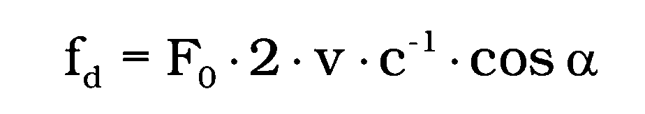

- kde F0 – frekvencia mikrovlnného vlnenia (vysielača),

- fd – rozdielová frekvencia úmerná rýchlosti objektu,

- v – rýchlosť pohybujúceho sa objektu,

- α – základný merací uhol,

- c – rýchlosť šírenia elektromagnetického vlnenia.

- Tento vzťah je platný za predpokladu, že c je oveľa väčšie ako v.

- 1.2.5

- Mikrovlnné vlnenie je elektromagnetické vlnenie, ktorého frekvencia je v pásme od 3 GHz do 300 GHz.

- 1.2.6

- Nestacionárny režim je režim merania rýchlosti cestného motorového vozidla pohybujúcim sa cestným rýchlomerom (napr. z pohybujúceho sa motorového vozidla).

- 1.3

- Termíny a definície vzťahujúce sa na cestné laserové rýchlomery

- 1.3.1

- Vlnová dĺžka lasera je vlnová dĺžka monochromatického svetelného lúča λ žiarenia generovaného cestným laserovým rýchlomerom.

- 1.3.2

- Uhlová šírka laserového zväzku je rozbiehavosť svetelného lúča v horizontálnej aj vo vertikálnej rovine.

- 1.3.3

- Výkon lasera je výkon svetelného lúča vyžiareného laserom.

- 2.

- Technické požiadavky

- 2.1

- Konštrukcia cestného rýchlomera (ďalej len „rýchlomer") vrátane vnútornej logiky vyhodnocovania merania zaručuje pri správnom používaní rýchlomera v súlade s technickou dokumentáciou, že indikovaná rýchlosť vozidla nemôže byť priradená inému vozidlu ani vtedy, ak sa

- a)

- vozidlá navzájom míňajú, predchádzajú alebo ide o jazdu v súbežných jazdných pruhoch,

- b)

- rýchlomer používa na pohybujúcom sa meracom vozidle.

- Ak táto funkcia nie je v plnej miere zaručená, potom sa rýchlomer vybavuje zariadením, ktoré indikuje nesprávne meranie alebo vynuluje nesprávny výsledok merania.

- 2.2

- Ak rýchlomer dovoľuje meranie rýchlosti motorových vozidiel v obidvoch smeroch (prichádzajúce vozidlá aj odchádzajúce vozidlá), potom je vybavený zariadením rozlišujúcim smer jazdy a indikáciou smeru jazdy. Smer jazdy je vždy súčasťou výsledku merania.

- 2.3

- Rýchlomer sa vybavuje zariadením, ktoré indikuje pokles napájacieho napätia pod hodnotu, pri ktorej chyba merania prekročí najväčšiu dovolenú chybu merania rýchlosti. Zariadenie upozorní obsluhu na nesprávne meranie alebo samo zariadenie nedovolí vykonať chybné meranie.

- 2.4

- Ak sa súčasne s meraním vyhotovuje aj záznam situácie (fotografický obrázok, videozáznam a pod.), potom sa zabezpečuje správne nastavenie optickej osi záznamu a osi vyžarovacej charakteristiky antény. Postup nastavenia sa opisuje v technickej dokumentácii rýchlomera.

- 2.5

- Ak sa rýchlomer používa bez optického záznamového zariadenia, potom indikovaná hodnota meranej rýchlosti vozidla zostáva viditeľná dovtedy, kým operátor hodnotu manuálne nevymaže nulovaním. Indikovaná hodnota nesmie byť prepísaná novým prejazdom vozidla alebo zrušená akýmkoľvek obslužným úkonom okrem vymazania nulovaním alebo vypnutia celého zariadenia z činnosti.

- 2.6

- Ak rýchlomer má analógovú indikáciu meranej rýchlosti, chyba odčítania indikovanej hodnoty rýchlosti má byť menšia ako 0,5 %. Indikovaná hodnota sa počas 15 minút nesmie zmeniť o viac ako 0,5 %.

- 2.7

- Ak je rýchlomer vybavený optickým záznamovým zariadením na zaznamenávanie situácie a výsledkov, potom každý záznam musí obsahovať

- a)

- dátum, čas a miesto merania,

- b)

- identifikačné údaje motorového vozidla – evidenčné číslo vozidla,

- c)

- odmeranú hodnotu rýchlosti, jednotku rýchlosti (km.h-1) a smer pohybu vozidla (ˇ - príjazd, ^ - odjazd),

- d)

- identifikačné údaje rýchlomera (výrobné číslo a pod.),

- e)

- označenie verzie použitého programového vybavenia.

- 2.8

- Ak sa rýchlomer používa v nestacionárnom režime, musí byť na zázname vyznačený tento spôsob merania rýchlosti a hodnota rýchlosti pohybujúceho sa rýchlomera.

- 2.9

- Pre laserový rýchlomer musia byť v technickej dokumentácii alebo meracom programe rýchlomera uvedené najmenšia meracia vzdialenosť a najväčší bočný odstup rýchlomera, aby nebola prekročená najväčšia dovolená chyba rýchlosti.

- 2.10

- Rýchlomer musí byť skonštruovaný tak, aby bez porušenia overovacích značiek alebo zabezpečovacích značiek nebolo možné zmeniť jeho programové vybavenie, nastavenie, chránené metrologické parametre ani údaje uložené v pamäti rýchlomera.

- 2.11

- Mechanická konštrukcia a inštalácia na mieste merania zabezpečujú stabilitu merania za bežnej prevádzky motorových vozidiel na všetkých cestách a primeranú odolnosť proti poškodeniu pri preprave.

- 2.12

- Rýchlomery sa konštruujú tak, aby rádiové vysielanie z rádiostanice obsluhy nemalo žiadny vplyv na meranie rýchlosti vozidiel. Ani iné vysielače rozhlasové, televízne, telefónneho systému (mobilný telefónny systém) a pod. nemajú vplyv na meranie rýchlosti vozidiel a na metrologické charakteristiky rýchlomera.

- 2.13

- Rýchlomery sú svojou konštrukciou odolné proti zmenám teploty v rozsahu od -30 oC do +65 oC bez zmeny metrologických charakteristík.

- 2.14

- Na metrologické charakteristiky rýchlomerov nemá vplyv vlhkosť vzduchu a časti vystavené poveternostným vplyvom sú odolné proti vnikajúcemu prachu a striekajúcej vode.

- 2.15

- Rýchlomer nemá pri používaní vyžarovať elektromagnetickú energiu, ktorou by mohla byť rušená činnosť iných technických zariadení podľa požiadaviek elektromagnetickej kompatibility.

- 2.16

- Sprievodná technická dokumentácia

- Sprievodná technická dokumentácia rýchlomera obsahuje

- a)

- fyzikálny princíp činnosti rýchlomera,

- b)

- blokové zapojenie rýchlomera s vysvetlením činnosti jednotlivých blokov,

- c)

- technickú špecifikáciu parametrov rýchlomera a pracovných podmienok,

- d)

- podmienky a spôsoby inštalácie a používanie rýchlomera,

- e)

- informáciu o základných zdrojoch chýb, resp. neistôt merania, kvantifikáciu pre jednotlivé spôsoby používania,

- f)

- predpokladaný čas bezporuchovej prevádzky,

- g)

- zoznam bodov a miest, ktoré treba opatriť zabezpečovacou značkou (plombou), aby sa zabránilo prístupu k dôležitým nastavovacím bodom,

- h)

- návod na obsluhu.

- 2.17

- Označenie rýchlomera

- 2.17.1

- Na rýchlomere, ktorý sa môže skladať z niekoľkých funkčne samostatných častí, sú na každej časti nezmazateľným spôsobom uvedené tieto údaje:

- a)

- značka alebo meno výrobcu,

- b)

- označenie typu rýchlomera,

- c)

- výrobné číslo každej časti rýchlomera,

- d)

- značka schváleného typu.

- 2.17.2

- Na indikátore rýchlomera a v zázname je pri hodnote rýchlosti v tesnej blízkosti vyznačená meracia jednotka, t. j. km.h-1 alebo km/h.

- 3.

- Metrologické požiadavky

- 3.1

- Merací rozsah a chyba meradla

- 3.1.1

- Rýchlomer má merací rozsah rýchlosti najmenej od 30 km.h-1do 150 km.h-1.

- 3.1.2

- Chyba rýchlomera ∆v

- 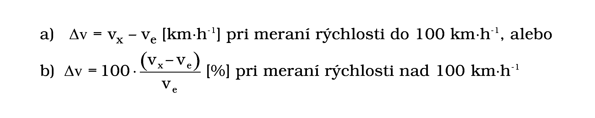

- kde vx – hodnota rýchlosti, ktorú indikuje rýchlomer,

- ve – hodnota rýchlosti určená etalónovým zariadením.

- 3.2

- Najväčšia dovolená chyba

- a)

- je ±3 km.h-1 pri meraní rýchlosti do 100 km.h-1,

- b)

- je ±3 % z hodnoty meranej rýchlosti pre hodnoty rýchlosti nad 100 km.h-1.

- 3.3

- Metrologické požiadavky vzťahujúce sa na cestné radarové rýchlomery

- 3.3.1

- Merací rozsah hlavného laloka vyžarovacej charakteristiky antény je volený tak, aby v celom jeho rozsahu bola chyba merania rýchlosti menšia ako 2 %.

- 3.3.2

- Meranie rýchlosti cestných motorových vozidiel nie je vyhodnocované v tých častiach vyžarovacej charakteristiky antény, kde uhol dopadu mikrovlnného vlnenia môže spôsobiť chybu merania väčšiu ako 2 %.

- 3.3.3

- Základný merací uhol (a) pri šikmom meraní rýchlosti uvedie výrobca rýchlomera v technickej dokumentácii.

- 3.3.4

- Vyžarovaný mikrovlnný výkon a citlivosť prijímača radaru sú zosúladené tak, aby sa v normálnom meracom režime podľa návodu nedal zachytiť pohyb vozidla cez viac ako dva jazdné pruhy, t. j. v treťom jazdnom pruhu.

- 3.3.5

- Zameriavacie zariadenie na nastavenie základného meracieho uhla umožňuje nastavenie s chybou menšou ako 0,5o.

- 3.3.6

- Zameriavacie zariadenie sa nevyžaduje, ak sa rýchlomer bude používať tak, že základný merací uhol je menší ako 10o.

- 3.4

- Metrologické požiadavky vzťahujúce sa na cestné laserové rýchlomery

- 3.4.1

- Uhlová šírka laserového zväzku je stanovená v technickej dokumentácii výrobcu a nesmie byť väčšia ako 5 mrad.

- 3.4.2

- Výkon lasera rýchlomera musí vyhovovať požiadavkám bezpečnosti a ochrany zdravia pre triedu 1 pri jeho používaní.1)

- 4.

- Metódy technických skúšok pri schvaľovaní typu a metódy skúšania pri overovaní

- Technické skúšky rýchlomera pozostávajú

- a)

- z vonkajšej obhliadky rýchlomera a príslušenstva,

- b)

- zo skúšok rýchlomera v laboratóriu,

- c)

- zo skúšok rýchlomera v teréne.

- 4.1

- Referenčné podmienky pri skúškach

- 4.1.1

- Pri skúškach v laboratóriu musí byť teplota okolia 20 oC ±2 oC a relatívna vlhkosť vzduchu do 85 %.

- 4.1.2

- Napájacie napätie rýchlomera má byť v rozsahu hodnôt udávaných výrobcom alebo v prípade neuvedenia odchýlka môže byť –10 % až +20 % od menovitej hodnoty napätia.

- 4.1.3

- Ostatné parametre pri skúške majú menovité hodnoty a tolerancie podľa schválených technických podmienok, ktoré deklaruje výrobca rýchlomera.

- 4.2

- Potrebné pomôcky

- 4.2.1

- Pomôcky na skúšanie cestných radarových rýchlomerov

- 4.2.1.1

- Mikrovlnný elektronický čítač merajúci v rozsahu vstupných frekvencií vysielača cestného radarového rýchlomera (pásmo 34 GHz) s kombinovanou štandardnou neistotou merania frekvencie menšou ako 2 x 10-4.

- 4.2.1.2

- Merač mikrovlnného výkonu s meracou anténou pre výkonové a frekvenčné pásmo vysielača cestného radarového rýchlomera (pásmo 34 GHz) s kombinovanou štandardnou neistotou merania výkonu menšou ako 6 %.

- 4.2.1.3

- Polohovacie zariadenie na meranie vyžarovacej charakteristiky antény v rozsahu ±90o s kombinovanou štandardnou neistotou merania polohovacieho uhla menšou ako 0,2°.

- 4.2.1.4

- Elektronický generátor (imitátor) Dopplerových frekvencií, ktorého výstupný signál vyhodnotí cestný radarový rýchlomer ako frekvenciu úmernú rýchlosti pohybujúceho sa vozidla. Generovaná frekvencia je daná vzťahom pre Dopplerovu frekvenciu uvedeným v bode 1.2.4.

- Ak výrobca rýchlomera neudáva jednotlivé hodnoty pre členy v rovnici podľa bodu 1.2.4, ale len prevodové konštanty, platia tieto vzťahy:

- 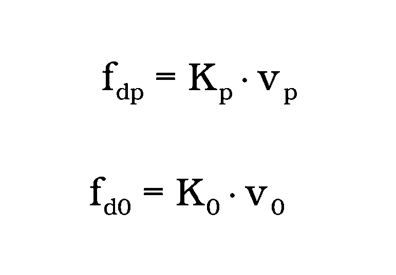

- kde vp, v0– rýchlosti pre merané vozidlo na príjazde alebo odjazde,

- Kp, K0– konštanty rýchlomera pre smer príjazd alebo odjazd,

- fdp, fd0 – Dopplerove frekvencie pre smer príjazd alebo odjazd.

- Kombinovaná štandardná neistota frekvencie generátora Dopplerových frekvencií je menšia ako 1 x 10-5.

- 4.2.1.5

- Etalónové zariadenie na meranie rýchlosti motorových vozidiel v teréne s meracím rozsahom rýchlostí od 20 km.h-1 do 130 km.h-1, s kombinovanou štandardnou neistotou merania rýchlosti menšou ako 0,3 km.h-1 do rozsahu merania rýchlosti 100 km.h-1a s kombinovanou štandardnou neistotou merania rýchlosti 0,3 % z hodnoty meranej rýchlosti pre rozsah rýchlosti nad 100 km.h-1.

- 4.2.1.6

- Nastaviteľný stabilizovaný zdroj jednosmerného napätia do 20 V. Skutočná hodnota napätia zdroja sa meria voltmetrom s kombinovanou štandardnou neistotou menšou ako 0,1 %.

- 4.2.1.7

- Skúšobné motorové vozidlo

- 4.2.2

- Pomôcky na skúšanie cestných laserových rýchlomerov

- 4.2.2.1

- Nastaviteľný stabilizovaný zdroj jednosmerného napätia do 20 V. Skutočná hodnota napätia zdroja sa meria voltmetrom s kombinovanou štandardnou neistotou menšou ako 0,1 %.

- 4.2.2.2

- Meracie zariadenie umožňujúce meranie uhlovej šírky laserového zväzku a výkonu lasera podľa údajov v technickej dokumentácii výrobcu.

- 4.2.2.3

- Meracie pásmo na vytýčenie kontrolných bodov skúšobnej dráhy. Kombinovaná štandardná neistota kalibrácie meracieho pásma nemá byť horšia ako (20 + 30 . L) µm, kde L je dĺžka v metroch.

- 4.2.2.4

- Etalónové zariadenie so snímačmi na meranie času prejazdu skúšobného vozidla kontrolnými bodmi skúšobnej dráhy. Kombinovaná štandardná neistota merania času nemá byť horšia ako 1 x 10-5 s.

- Zariadenie umožňuje meranie rýchlosti motorových vozidiel v teréne od 20 km.h-1 do 130 km.h-1 s kombinovanou štandardnou neistotou merania rýchlosti menšou ako 0,3 km.h-1 do rozsahu merania rýchlosti 100 km.h-1a s kombinovanou štandardnou neistotou merania rýchlosti 0,3 % z hodnoty meranej rýchlosti pre rozsah rýchlosti nad 100 km.h-1.

- 4.2.2.5

- Skúšobné motorové vozidlo

- 4.3

- Technické skúšky pri schvaľovaní typu

- 4.3.1

- Vonkajšia obhliadka

- Pri vonkajšej obhliadke rýchlomera sa kontroluje

- a)

- úplnosť predpísanej technickej dokumentácie,

- b)

- zhoda predloženého rýchlomera s dokumentáciou,

- c)

- stav jednotlivých funkčných celkov z hľadiska prevádzky rýchlomera.

- 4.3.2

- Skúšky cestných radarových rýchlomerov v laboratóriu

- 4.3.2.1

- Meranie frekvencie vysielača cestného radarového rýchlomera

- Frekvencia F0 (podľa bodu 1.2.4) vysielača rýchlomera sa meria podľa postupu určeného výrobcom. Ak nie je postup výrobcom udaný, meria sa frekvencia mikrovlnným čítačom bezkontaktným spôsobom alebo v meracom bode na meranie frekvencie určenom výrobcom rýchlomera. Meranie sa vykoná po 15 min a po 2 h od pripojenia rýchlomera na napájacie napätie. Hodnota odchýlky frekvencie má byť v oboch prípadoch menšia, ako predpisuje výrobca, alebo taká, aby chyba merania rýchlosti spôsobená zmenou frekvencie F0 nebola väčšia ako 0,1 %. Pre rýchlomery pracujúce v pásme 34 GHz odchýlka frekvencie musí byť menšia ako 34 MHz.

- 4.3.2.2

- Meranie vyžarovacej charakteristiky antény vysielača

- Pri meraní sa postupuje podľa metodiky stanovenej výrobcom rýchlomera. Meranie sa vykoná pre horizontálnu aj vertikálnu rovinu. Ak výrobca vyžarovaciu charakteristiku antény neudáva alebo vyžarovací uhol zodpovedajúci poklesu výkonu na polovičnú hodnotu je neznámy, tento uhol má byť menší ako uhol, pri ktorom je chyba merania rýchlosti 2 %.

- 4.3.2.3

- Meranie výstupného výkonu vysielača rýchlomera

- Meranie sa vykoná podľa zapojenia odporúčaného výrobcom rýchlomera. Namerané hodnoty nepresiahnu deklarované parametre v rámci stanovenej neistoty merania. Ak nie je známa hodnota najväčšieho vyžiareného mikrovlnného výkonu rýchlomera, pre rýchlomery pracujúce v K pásme nesmie byť vyžiarený výkon väčší ako 2 mW.

- 4.3.2.4

- Meranie relatívnej citlivosti prijímacej časti rýchlomera

- Meranie sa vykoná podľa zapojenia odporúčaného výrobcom rýchlomera.

- 4.3.2.5

- Skúška nastavenia základného meracieho uhla α

- Skúška sa vykoná podľa postupu určeného výrobcom rýchlomera. Ak postup nie je známy, vykoná sa skúška takto: základný merací uhol sa zistí tak, že jedno rameno uhla tvorí vrchol vyžarovacej charakteristiky antény (meranie výkonu alebo detekcia vyžiareného vlnenia) a druhé rameno uhla je vymedzené priamkou zameriavacieho zariadenia. Kombinovaná štandardná neistota merania základného meracieho uhla rýchlomera má byť menšia ako 0,5o.

- 4.3.2.6

- Stanovenie chyby rýchlomera elektronickým generátorom Dopplerových frekvencií

- Chyba rýchlomera sa stanoví podľa metodiky určenej výrobcom a rozhodnutím o schválení typu rýchlomera. Meranie a vyhodnotenie sa vykoná pre obidva smery – pre prichádzajúce vozidlo a odchádzajúce vozidlo, aspoň 2 x 5 hodnôt rýchlostí v rozsahu do 100 km.h-1 a taktiež 2 x 5 meraní pre rýchlosti nad 100 km.h-1.

- 4.3.2.7

- Skúška relatívnej citlivosti prijímacej časti rýchlomera

- Relatívna citlivosť prijímacej časti rýchlomera sa meria podľa metodiky stanovenej výrobcom. Hodnota relatívnej citlivosti rýchlomera je taká úroveň signálu na generátore Dopplerových frekvencií pri konštantnej geometrii meracieho pracoviska, ktorá zaručí spoľahlivé odmeranie idúceho vozidla v najväčšej vzdialenosti udanej výrobcom.

- 4.3.2.8

- Skúška vplyvu zmeny napájacieho napätia

- Nastaviteľným stabilizovaným zdrojom jednosmerného napätia sa sleduje správnosť funkcie rýchlomera v závislosti od zmeny napájacieho napätia. Rýchlomer musí spoľahlivo pracovať aj pri zmene napájacieho napätia v rozsahu uvedenom v technickej dokumentácii výrobcu.

- 4.3.3

- Skúšky cestných radarových rýchlomerov v teréne

- 4.3.3.1

- Skúška správnosti rýchlomera skúšobným vozidlom

- Skúškou na skúšobnej dráhe sa etalónovým skúšobným zariadením a skúšobným vozidlom zisťuje chyba rýchlomera. Rýchlomer a etalónové zariadenie sa inštalujú podľa predpisu výrobcu. Skúška sa vykoná najmenej pri troch hodnotách rýchlosti v rozsahu do 130 km.h-1v smere prichádzajúceho skúšobného vozidla a pri troch hodnotách rýchlosti v rozsahu do 130 km.h-1v smere odchádzajúceho skúšobného vozidla a vypočíta sa kombinovaná štandardná neistota merania rýchlosti.

- 4.3.3.2

- Skúška relatívnej citlivosti rýchlomera

- Skúška sa vykoná meraním rýchlosti skúšobného vozidla pohybujúceho sa voči skúšanému rýchlomeru v najväčšej vzdialenosti, ktorú udáva výrobca rýchlomera. Meranie sa vykoná najmenej dvakrát pre prichádzajúce vozidlo a dvakrát pre odchádzajúce vozidlo. Rýchlosť vozidla sa nevyhodnocuje, kontroluje sa len správnosť funkcie rýchlomera.

- 4.3.4

- Skúšky cestných laserových rýchlomerov

- 4.3.4.1

- Skúška vplyvu zmeny napájacieho napätia

- Nastaviteľným stabilizovaným zdrojom jednosmerného napätia sa sleduje správnosť funkcie rýchlomera v závislosti od zmeny napájacieho napätia. Rýchlomer musí spoľahlivo pracovať aj pri zmene napájacieho napätia v rozsahu uvedenom v technickej dokumentácii výrobcu.

- 4.3.4.2

- Skúška rozlišovacej schopnosti merania vzdialenosti

- Skúška sa vykoná pre uvedenú najmenšiu meraciu vzdialenosť (napr. 30 m) a pre 50 m alebo 100 m. Cieľová skúšobná plocha sa umiestni v danej vzdialenosti a vykoná sa meranie v rozsahu 1,5-násobku predpokladanej rozlišovacej schopnosti rýchlomera raz vpred a druhý raz vzad.

- 4.3.4.3

- Skúška nastavenia zameriavacieho zariadenia meradla

- Skúška sa vykoná podľa skúšobného obrazca a vo vzdialenosti podľa odporúčania výrobcu. Kontroluje sa nastavenie podľa tolerančného poľa udávaného výrobcom alebo sa vykoná justáž podľa návodu výrobcu. Ak výrobca nepredpisuje skúšobný obrazec a vzdialenosť, vykoná sa kontrolné meranie podľa štandardného skúšobného obrazca pre laserové meradlá rýchlosti pre vzdialenosť 50 m, resp. 100 m.

- 4.3.4.4

- Skúška správnosti rýchlomera skúšobným vozidlom

- Skúškou na skúšobnej dráhe sa etalónovým skúšobným zariadením a skúšobným vozidlom zisťuje chyba rýchlomera. Rýchlomer a etalónové zariadenie sa inštalujú podľa predpisu výrobcu. Skúška sa vykoná najmenej pri troch hodnotách rýchlosti v rozsahu do 130 km.h-1v smere prichádzajúceho skúšobného vozidla a pri troch hodnotách rýchlosti v rozsahu do 130 km.h-1 v smere odchádzajúceho skúšobného vozidla a vypočíta sa kombinovaná štandardná neistota merania rýchlosti.

- 4.3.4.5

- Skúška relatívnej citlivosti rýchlomera

- Skúška sa vykoná meraním rýchlosti skúšobného vozidla pohybujúceho sa voči skúšanému rýchlomeru v najväčšej vzdialenosti, ktorú udáva výrobca rýchlomera. Meranie sa vykoná najmenej dvakrát pre prichádzajúce vozidlo a dvakrát pre odchádzajúce vozidlo. Rýchlosť vozidla sa nevyhodnocuje, kontroluje sa len správnosť funkcie rýchlomera.

- 4.4

- Rozsah skúšok pri prvotnom overení a následnom overení

- 4.4.1

- Pri prvotnom overení cestných radarových rýchlomerov sa kontroluje zhoda predloženého rýchlomera so schváleným typom a vykoná sa úplný súbor skúšok podľa bodov 4.3.1, 4.3.2 a 4.3.3. Pri skúškach podľa bodov 4.3.2.2 až 4.3.2.6 sa prihliada na rozhodnutie o schválení typu rýchlomera.

- 4.4.2

- Pri následnom overovaní cestných radarových rýchlomerov sa kontroluje zhoda predloženého rýchlomera so schváleným typom a vykonajú sa skúšky v laboratóriu podľa bodov 4.3.1 písm. c), 4.3.2.1 až 4.3.2.6, 4.3.2.8 a 4.3.3.2. Pri skúškach podľa bodov 4.3.2.2 až 4.3.2.6 sa prihliada na rozhodnutie o schválení typu rýchlomera.

- 4.4.3

- Pri prvotnom a následnom overení cestných laserových rýchlomerov sa kontroluje zhoda predloženého rýchlomera so schváleným typom a vykonajú sa skúšky podľa bodov 4.3.1 a 4.3.4.

- 4.5

- Vyhodnotenie nameraných údajov

- 4.5.1

- Pri cestných radarových rýchlomeroch sa namerané hodnoty rýchlosti pri meraní elektronickým generátorom Dopplerových frekvencií a v teréne vyhodnotia podľa metodiky stanovenej výrobcom rýchlomera a rozhodnutia o schválení typu rýchlomera.

- 4.5.2

- Pri cestných laserových rýchlomeroch sa hodnoty rýchlosti namerané skúšaným rýchlomerom porovnajú s hodnotami rýchlosti skúšobného vozidla vypočítanými zo vzdialenosti kontrolných bodov na skúšobnej dráhe a príslušných časových intervalov prechodu vozidla týmito bodmi.

- 5.

- Overenie

- Rýchlomer, ktorý pri všetkých skúškach vyhovie ustanoveným požiadavkám, sa označí overovacou značkou a vydá sa doklad o overení.

- Tie časti, ktoré by po nedovolenom zásahu mohli byť príčinou udania nesprávneho výsledku, musia byť opatrené zabezpečovacou značkou (plombou alebo iným spôsobom ochránené pred nedovoleným zásahom).

- Overovacie a zabezpečovacie značky sa umiestňujú na rýchlomer v súlade s rozhodnutím o schválení typu rýchlomera.“.

- 15. Príloha č. 40 vrátane nadpisu znie:

- „Príloha č. 40 k vyhláške č. 210/2000 Z. z.

- Neinvazívne meradlá tlaku krvi

- Prvá časť

- Vymedzenie meradiel a spôsob ich metrologickej kontroly

- 1.

- Táto príloha sa vzťahuje na neinvazívne auskultačné a oscilometrické meradlá tlaku krvi (ďalej len „meradlá"), ktorých manžeta sa upevňuje na rameno pacienta, určené na používanie v zdravotníctve na diagnostické a terapeutické účely ako určené meradlá podľa § 8 zákona.

- 2.

- Meradlá sa členia podľa použitého meracieho systému na

- a)

- mechanické,

- b)

- elektromechanické.

- 3.

- Meradlá podliehajú pred uvedením na trh alebo do používania posúdeniu zhody podľa osobitného predpisu.1)

- 4.

- Meradlá počas ich používania ako určené meradlá podliehajú následnému overeniu a prvotnému overeniu po vykonanej oprave.

- 5.

- Technické požiadavky, metrologické požiadavky a metódy skúšania pri overení meradiel sú uvedené v druhej časti.

- 6.

- Meradlá, ktoré pri overení vyhovejú ustanoveným požiadavkám, sa označia overovacou značkou.

- 7.

- Postup pri prvotnom overení po oprave je zhodný s postupom pri následnom overení.

- Druhá časť

- Technické požiadavky, metrologické požiadavky a metódy skúšania pri overení meradiel

- 1.

- Termíny a definície

- 1.1

- Mechanické meradlo je meradlo, ktoré používa ortuťový tlakomer (ďalej len „kvapalinové meradlo"), alebo deformačný tlakomer (ďalej len „deformačné meradlo") alebo iné mechanické meracie zariadenie na neinvazívne meranie arteriálneho tlaku krvi pomocou nafukovacej manžety.

- Mechanické meradlo sa skladá

- a)

- z tlakomera,

- b)

- z manžety,

- c)

- z ventilu na znižovanie tlaku (často kombinovaného s ventilom na rýchle zníženie tlaku),

- d)

- z ručnej pumpy alebo elektrického čerpadla,

- e)

- zo spojovacích hadíc.

- 1.2

- Elektromechanické meradlo je meradlo, ktoré sa skladá

- a)

- najmenej z jednej manžety pripojenej na pneumatický systém,

- b)

- najmenej z jedného prevodníka tlaku na meranie tlaku v manžete,

- c)

- najmenej z jedného displeja meranej hodnoty,

- d)

- ak treba, zo signálnych vstupov a výstupov.

- 1.3

- Prevodník tlaku je zložka, ktorá prevádza tlakové signály na elektrické signály.

- 1.4

- Auskultačná metóda je metóda, pri ktorej sa odpočúvajú zvuky (známe ako Korotkovove zvuky) na priškrtenej artérii pri postupnom znižovaní škrtiaceho tlaku. Objavenie zvukov súhlasí so systolickým tlakom krvi a zmiznutie zvukov súhlasí s diastolickým tlakom krvi.

- Meradlo používajúce auskultačnú metódu sa zvykne nazývať auskultačné meradlo.

- 1.5

- Oscilometrická metóda je metóda, pri ktorej sa stredný arteriálny tlak krvi, systolický tlak krvi a diastolický tlak krvi určujú z priebehu amplitúd oscilácií tlaku vzduchu vyvolaných v manžete pulzmi krvi v artérii medzi škrtením a postupným uvoľnením artérie manžetou.

- Meradlo používajúce oscilometrickú metódu sa zvykne nazývať oscilometrické meradlo.

- 1.6

- Diastolický tlak krvi (hodnota) je najmenšia hodnota arteriálneho tlaku krvi ako výsledok uvoľnenia ľavej komory srdca.

- 1.7

- Stredný arteriálny tlak krvi (hodnota) je hodnota integrálu jedného cyklu krivky tlaku krvi delená časom jedného pulzu srdca.

- 1.8

- Systolický tlak krvi (hodnota) je najväčšia hodnota arteriálneho tlaku krvi ako výsledok stlačenia ľavej komory srdca.

- 1.9

- Simulátor tlaku krvi je zariadenie na simuláciu oscilácií tlaku vzduchu vyskytujúcich sa v manžete pri meraní tlaku krvi.

- 1.10

- Celková chyba oscilometrického meradla je rozdiel výsledkov porovnávacích meraní uskutočnených skúšaným oscilometrickým meradlom a referenčným meradlom.

- 2.

- Technické požiadavky

- 2.1

- Netesnosť pneumatického systému

- Netesnosť nesmie spôsobiť väčší pokles tlaku v pneumatickom systéme meradla ako 4 mm Hg/min (0,5 kPa/min) pri mechanických meradlách a väčší ako 6 mm Hg/min (0,8 Pa/min) pri oscilometrických meradlách.

- 2.2

- Rýchle znižovanie tlaku

- Pri rýchlom znižovaní tlaku v pneumatickom systéme (pri plne otvorenom ventile) čas poklesu tlaku z 260 mm Hg na 15 mm Hg (z 35 kPa na 2 kPa) nesmie prekročiť 10 s. Pri systémoch umožňujúcich merať tlak krvi novonarodencom čas poklesu tlaku zo 150 mm Hg na 5 mm Hg (z 20 kPa na 0,7 kPa) nesmie prekročiť 5 s.

- 2.3

- Rýchlosť klesania tlaku pri meraní auskultačnými meradlami

- Ručne ovládané a samolinearizačné výpustné ventily musia umožňovať nastavenie rýchlosti poklesu tlaku (2 – 3) mm Hg/s [(0,3 – 0,4) kPa/s]. Pri zariadeniach, ktoré regulujú znižovanie tlaku podľa frekvencie pulzov, musí sa rýchlosť poklesu tlaku udržiavať medzi (2 – 3) mm Hg/pulz [(0,3 – 0,4) kPa/pulz].

- Nastavovanie tejto rýchlosti ručnými ventilmi musí byť bezproblémové a spoľahlivé.

- 2.4

- Únik ortuti v kvapalinovom meradle

- Ochrana proti úniku ortuti musí zabezpečiť, aby pri tlaku 100 mm Hg (13,3 kPa) nad hornou hranicou meracieho rozsahu meradla nenastal počas 5 s pozorovateľný únik ortuti.

- 2.5

- Škrtenie prietoku vzduchu ochranou proti úniku ortuti

- Oneskorenie premiestňovania ortuťového stĺpca spôsobené zariadením brániacim úniku ortuti nesmie prekročiť 1,5 s pri rýchlom premiestnení hladiny ortuti z 200 mm Hg na 50 mm Hg (z 25 kPa na 5 kPa). Za rýchle sa považuje premiestnenie spôsobené rýchlym vypustením vzduchu s tlakom 200 mm Hg (25 kPa) zo systému do okolia.

- 3.

- Metrologické požiadavky

- 3.1

- Najväčšia dovolená chyba merania tlaku v manžete

- Najväčšia dovolená chyba merania tlaku v manžete pri teplote okolia od 15 oC do 25 oC, relatívnej vlhkosti od 20 % do 85 % a pri stúpajúcom aj klesajúcom tlaku je ±3 mm Hg (±0,4 kPa) vo všetkých bodoch meracieho rozsahu.

- 3.2

- Hysteréza deformačného meradla

- Hysteréza v celom meracom rozsahu deformačného meradla sa musí nachádzať v rozsahu (0 – 4) mm Hg (0 kPa – 0,5 kPa).

- 3.3

- Celková chyba oscilometrického meradla

- Priemerná hodnota celkovej chyby systolického tlaku krvi a diastolického tlaku krvi vypočítaná z najmenej troch opakovaných porovnávacích meraní nesmie prekročiť ±5 mm Hg (±0,7 kPa) a výberová smerodajná odchýlka jedného merania hodnotu 8 mm Hg (1,1 kPa).2)3)

- Skúšané meradlo sa porovnáva s referenčným meradlom podľa bodu 4.2.2.3.

- 4.

- Metódy skúšania pri overení

- 4.1

- Všeobecne

- 4.1.1

- Meradlo predložené na overenie musí

- a)

- mať priložený návod na používanie podľa osobitného predpisu4) a písomné vyhlásenie výrobcu alebo dovozcu o zhode podľa osobitného predpisu4) (kópia môže byť súčasťou návodu na používanie) a na meradle musí byť umiestnené označenie CE alebo

- b)

- byť označené značkou schváleného typu meradla, ak ide o meradlo s rozhodnutím o schválení typu vydaným pred 1. januárom 2005, a mať priložený návod na používanie podľa osobitného predpisu.4)

- 4.1.2

- Vonkajšia obhliadka

- Pri vonkajšej obhliadke sa zisťuje, či meradlo

- a)

- zhoduje sa so schváleným typom, ak je to aplikovateľné,

- b)

- má všetky komponenty podľa návodu na používanie a tejto prílohy vrátane manžety,

- c)

- nemá viditeľné nedostatky alebo poškodenia vrátane manžety.

- Ak meradlo pri vonkajšej obhliadke nevyhovie, skúšky na overenie sa nevykonajú.

- 4.2.

- Skúšky pri overení

- 4.2.1.

- Skúšky technických vlastností

- 4.2.1.1

- Skúška netesnosti pneumatického systému

- Skúška sa vykoná podľa čl. 8.15) pri mechanických meradlách a podľa čl. 8.42) pri elektromechanických meradlách.

- 4.2.1.2

- Skúška rýchleho znižovania tlaku

- Skúška sa vykoná podľa čl. 8.35) pri mechanických meradlách a podľa čl. 8.62) pri elektromechanických meradlách.

- 4.2.1.3

- Skúška rýchlosti klesania tlaku pri meraní auskultačnými meradlami

- Skúška sa vykoná podľa čl. 8.2,5) pri znižovaní tlaku podľa frekvencie pulzov podľa čl. 8.5.2)

- 4.2.1.4

- Skúška na únik ortuti v kvapalinovom meradle

- Skúška sa vykoná podľa čl. 8.6.5)

- 4.2.1.5

- Skúška škrtenia prietoku vzduchu ochranou proti úniku ortuti v kvapalinovom meradle

- Skúška sa vykoná podľa čl. 8.7.5)

- 4.2.2

- Skúšky metrologických vlastností

- 4.2.2.1

- Určenie chyby merania tlaku

- Skúška sa vykoná podľa čl. 8.1.6)

- 4.2.2.2

- Určenie hysterézy deformačného meradla

- Skúška sa vykoná podľa čl. 8.8.5)

- 4.2.2.3

- Určenie celkovej chyby oscilometrického meradla

- 4.2.2.3.1

- Celková chyba sa určí

- a)

- simultánnym opakovaným porovnávacím meraním uskutočneným skúšaným a referenčným auskultačným meradlom na hornom ramene tej istej ruky vybratých fyzických osôb [skúšobná metóda N13)] a súčasne

- b)

- skúškou s použitím kalibrovaného simulátora tlaku krvi postupom schváleným ústavom.

- 4.2.2.3.2

- Pri metóde podľa bodu 4.2.2.3.1 písm. a) osoby musia byť vybraté tak, aby aspoň jedna hodnota systolického tlaku krvi a jedna hodnota diastolického tlaku krvi bola v pásme vysokých tlakov (> 160/> 100) mm Hg, jedna v pásme normálnych tlakov (90 – 160)/(80 – 100) mm Hg a po jednej hodnote v pásme nízkych tlakov (< 100/< 80) mm Hg.

- 4.2.2.3.3

- Pri metóde podľa bodu 4.2.2.3.1 písm. b) je najmenší počet skúšobných bodov päť, pričom v každom pásme (vysoký, normálny a nízky tlak) musí byť najmenej jeden skúšobný bod. Pri tejto skúške sa hodnota dovolenej výberovej smerodajnej odchýlky znižuje na 3 mm Hg (0,4 kPa).

- 4.2.2.3.4

- Použitie len jednej z metód podľa bodu 4.2.2.3.1 je oprávnené, iba ak vlastnosti skúšaného meradla neumožňujú vykonať skúšky obidvomi metódami. V tom prípade sa táto skutočnosť uvedie v záznamoch o skúške. Ak sa použijú obidve metódy, meradlo musí vyhovieť pri skúške podľa obidvoch metód, aby bolo overené.

- 5.

- Overenie

- 5.1

- Meradlo, ktoré pri skúškach vyhovelo ustanoveným požiadavkám, sa označí overovacou značkou a zabezpečovacími značkami. Pri označovaní sa postupuje podľa rozhodnutia o schválení typu, ak je to aplikovateľné. Na vyžiadanie sa vydá doklad o overení.

- 5.2

- Počet a umiestnenie zabezpečovacích značiek musí byť taký, aby bez ich porušenia nebolo možné zmeniť metrologické charakteristiky overeného meradla.“.

- 16. Príloha č. 59 vrátane nadpisu znie:

- „Príloha č. 59 k vyhláške č. 210/2000 Z. z.

- Momentové kľúče

  - Prvá časť Všeobecné ustanovenia, vymedzenie meradiel a spôsob ich metrologickej kontroly

    - 1. Táto príloha sa vzťahuje na momentové kľúče určené na kontrolu dotiahnutia závitových spojov, ktoré sa používajú ako určené meradlá podľa § 8 zákona.

    - 2. Momentové kľúče sa podľa typu delia na

      - a) ukazovacie momentové kľúče (typ I),

      - b) limitné momentové kľúče (typ II).

    - 3. Za ukazovacie momentové kľúče (typ I) sa na účely tejto prílohy považujú

      - a) trieda A: momentové kľúče s torznou alebo ohybnou tyčou a indikačným zariadením,

      - b) trieda B: momentové kľúče s pevným telesom a indikačným zariadením,

      - c) trieda C: momentové kľúče s pevným telesom kľúča a elektronickým meracím zariadením,

      - d) trieda D: momentové skrutkovače s indikačným zariadením,

      - e) trieda E: momentové skrutkovače s elektronickým meracím zariadením.

    - 4. Za limitné momentové kľúče (typ II) sa na účely tejto prílohy považujú

      - a) trieda A: momentové kľúče s indikačným zariadením,

      - b) trieda D: momentové skrutkovače s indikačným zariadením,

      - c) trieda G: momentové kľúče s ohybnou tyčou a indikačným zariadením.

    - 5. Momentové kľúče pred uvedením na trh podliehajú schváleniu typu a prvotnému overeniu. Metódy technických skúšok pri schvaľovaní typu a metódy skúšania pri overení sú uvedené v druhej časti.

    - 6. Momentové kľúče schváleného typu výrobca alebo dovozca označí značkou schváleného typu.

    - 7. Momentové kľúče počas ich používania ako určené meradlá podliehajú následnému overeniu. Postup pri následnom overení je zhodný s postupom pri prvotnom overení.

    - 8. Momentové kľúče, ktoré pri overení vyhovejú ustanoveným požiadavkám, sa označia overovacou značkou a vydá sa doklad o overení.

  - Druhá časť Metrologické požiadavky, technické požiadavky, metódy technických skúšok pri schvaľovaní typu a metódy skúšania pri overení momentových kľúčov

    - 1. Termíny a definície

    - 1.1 Ukazovací momentový kľúč (typ I) je momentový kľúč s mechanickým alebo elektronickým meracím systémom a indikačným zariadením (stupnica, číselníkový odchýlkomer alebo displej), ktoré priamo ukazujú meranú hodnotu momentu sily v jednotkách momentu sily alebo v hodnotách úmerných momentu sily (dielikoch).

    - 1.2 Limitný momentový kľúč (typ II) je nastaviteľný momentový kľúč, ktorý akusticky, opticky alebo mechanicky indikuje dosiahnutie nastaveného momentu sily. Hodnota momentu sily sa nastavuje na indikačnom zariadení (stupnica alebo displej).

    - 1.3 Merací rozsah ukazovacieho momentového kľúča je rozsah momentu sily, ktorý možno merať momentovým kľúčom.

    - 1.4 Merací rozsah limitného momentového kľúča je rozsah momentu sily, ktorý možno na momentovom kľúči nastaviť.

    - 1.5 Dolná hranica meracieho rozsahu ukazovacieho momentového kľúča je najmenšia hodnota momentu sily, ktorú možno momentovým kľúčom ešte merať.

    - 1.6 Dolná hranica meracieho rozsahu limitného momentového kľúča je najmenšia hodnota momentu sily, ktorú možno na momentovom kľúči nastaviť.

    - 1.7 Horná hranica meracieho rozsahu ukazovacieho momentového kľúča je najväčšia hodnota momentu sily, ktorú možno momentovým kľúčom ešte merať.

    - 1.8 Horná hranica meracieho rozsahu limitného momentového kľúča je najväčšia hodnota momentu sily, ktorú možno na momentovom kľúči nastaviť.

    - 1.9 Indikačné zariadenie momentových kľúčov typu I je zariadenie, ktoré indikuje hodnotu meraného momentu sily.

    - 1.10 Indikačné zariadenie momentových kľúčov typu II je zariadenie na nastavenie požadovanej hodnoty momentu sily.

    - 1.11 Rozlíšiteľnosť je najmenší rozdiel údajov indikačného zariadenia momentového kľúča, ktorý možno jednoznačne rozlíšiť alebo nastaviť.

    - 1.12 Chyba ukazovacieho momentového kľúča je rozdiel medzi údajom momentového kľúča a konvenčne skutočnou hodnotou momentu sily.

    - 1.13 Chyba limitného momentového kľúča je rozdiel medzi nastavenou hodnotou momentu sily a konvenčne skutočnou hodnotou momentu sily.

    - 2. Metrologické požiadavky

    - 2.1 Najväčšie dovolené chyby ΔM ukazovacích momentových kľúčov (typ I) sú uvedené v tabuľke č. 1.

    - Tabuľka č. 1

    - Trieda*) | Horná hranica meracieho rozsahu |

    - | ≤ 10 N·m | > 10 N·m

    - A a D | ±6% |

    - B, C a E | ±6 % | ±4%

    - *) Pri momentových kľúčoch s elektronickým meracím systémom (trieda C a trieda E) a displejom (trieda B a trieda D) hodnota najväčšej dovolenej chyby zahŕňa i chybu rozlíšiteľnosti indikačného zariadenia. | |

    - 2.2 Najväčšie dovolené chyby ΔM limitných momentových kľúčov (typ II) sú uvedené v tabuľke č. 2.

    - Tabuľka č. 2

    - Trieda*) | Horná hranica meracieho rozsahu |

    - | ≤ 10 N·m | > 10 N·m

    - A | ±6 % | ±4%

    - D a G | ±6% |

    - *) Pri momentových kľúčoch s displejom (trieda A a trieda D) hodnota najväčšej dovolenej chyby zahŕňa i chybu rozlíšiteľnosti indikačného zariadenia. | |

    - 2.3 Momentové kľúče udávajú meranú hodnotu momentu sily v Nm.

    - 2.4 Môžu sa používať aj jednotky mNm alebo kNm.

    - 2.5 Momentové kľúče indikujúce meranú hodnotu v iných jednotkách ako Nm majú na ukazovateli aj hodnotu indikujúcu merané hodnoty v Nm.

    - 2.6 Ukazovací momentový kľúč indikuje hodnoty od nuly.

    - 2.7 Dolná hranica meracieho rozsahu limitného momentového kľúča musí byť najmenej 20 % hornej hranice meracieho rozsahu.

    - 2.8 Hodnota dielika indikačného zariadenia nesmie byť väčšia ako 5 % hornej hranice meracieho rozsahu.

    - 3. Technické požiadavky

    - 3.1 Momentové kľúče sú vybavené indikačným zariadením s priamym odčítaním zo stupnice, z číselníkového odchýlkomera alebo z displeja (digitálne zobrazenie).

    - 3.2 Značky stupnice a číslovanie stupnice sú zreteľné a dobre čitateľné.

    - 3.3 Momentové kľúče s výstupom digitálneho zobrazenia musia mať číslice zreteľné a dobre čitateľné zo vzdialenosti najmenej 0,5 m.

    - 3.4 Ukazovacie momentové kľúče sa po úplnom odľahčení vrátia späť do nulovej polohy.

    - 3.5 Konštrukcia momentových kľúčov umožňuje ich jednoduchú justáž. Justáž sa dá spoľahlivo zabezpečiť, aby nemohlo dôjsť k jej svojvoľnému porušeniu, a tým aj k zmene metrologických vlastností pri používaní.

    - 3.6 Momentové kľúče sa konštruujú tak, aby boli dostatočne pevné na daný merací rozsah. Pri najväčšom zaťažení nedochádza k trvalej deformácii žiadnej časti momentového kľúča.

    - 3.7 Rozmer pripájacieho štvorhranu je daný najväčšou hornou hranicou meracieho rozsahu momentového kľúča. Priradenie je uvedené v tabuľke č. 3.

    - Tabuľka č. 3

    - Horná hranica meracieho rozsahu [N·m] | Veľkosť pripájacieho štvorhrami [mm]

    - 30 | 6,3

    - 135 | 10

    - 340 | 12,5

    - 1000 | 20

    - 2100 | 25

    - 4. Nápisy a značky

    - 4.1 Na štítku alebo priamo na momentovom kľúči sú zreteľne a nezmazateľne vyznačené tieto údaje:

      - a) meno alebo obchodné meno výrobcu alebo jeho obchodná značka,

      - b) typové označenie,

      - c) značka schváleného typu,

      - d) výrobné číslo,

      - e) merací rozsah (prípadne horná hranica meracieho rozsahu),

      - f) meracia jednotka alebo jej symbol,

      - g) smer zaťaženia (len pri momentových kľúčoch s jedným smerom zaťažovania).

    - 4.2 Nápisy a značky sa umiestňujú tak, aby boli zreteľne viditeľné, ľahko čitateľné a neodstrániteľné.

    - 5. Technické skúšky pri schvaľovaní typu

    - 5.1 Na účely technických skúšok pri schvaľovaní typu sa predkladá jeden momentový kľúč a príslušná technická dokumentácia. Na základe výsledkov prebiehajúcich skúšok môže vykonávateľ technických skúšok požiadať o predloženie ďalších momentových kľúčov.

    - 5.2 V prípade schvaľovania typového radu momentových kľúčov sa predkladá vzorka typového radu podľa špecifikácie vykonávateľa technických skúšok.

    - 5.3 Pri technických skúškach pri schvaľovaní typu sa kontroluje vyhotovenie a rozmery momentového kľúča a vykonajú sa skúšky preťaženia, životnosti, spätného chodu, relatívneho rozpätia chyby a zisťuje sa chyba δ meradla.

    - 5.4 Pri kontrole vyhotovenia sa preverí, či momentový kľúč svojimi náležitosťami a rozmermi zodpovedá požiadavkám tejto prílohy, príslušnej slovenskej technickej norme a technickej dokumentácii.

    - 5.5 Vonkajšia obhliadka momentového kľúča sa vykonáva vizuálne; na kontrolu rozmerov sa použijú vhodné dĺžkové meradlá.

    - 5.6 Rozšírená neistota merania etalónovým zariadením pri technických skúškach pri schvaľovaní typu nepresiahne ± 1 % z meranej hodnoty momentu sily.

    - 5.7 Technické skúšky pri schvaľovaní typu sa vykonávajú pri teplote (23 ±5) oC a relatívnej vlhkosti vzduchu do 90 %. Počas týchto skúšok sa teplota nesmie meniť viac ako o 2 oC.

    - 5.8 Postup skúšok preťaženia a životnosti pri schvaľovaní typu a kritériá ich vyhodnotenia ustanovuje príslušná slovenská technická norma.

    - 5.9 Pri schvaľovaní typu sa vykonajú najmenej tri opakované skúšky na zistenie chyby Δ momentového kľúča postupom zhodným s postupom skúšky pri prvotnom a následnom overení.

    - 5.10 Relatívna chyba spätného chodu momentového kľúča sa vypočíta podľa vzťahu

    - 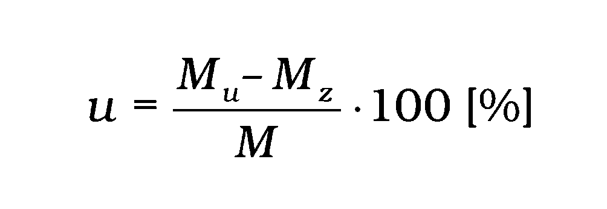

    - kde

    - Mu – konvenčne skutočná hodnota momentu sily pri odľahčovaní odčítaná zo stupnice etalónového zariadenia,

    - Mz – konvenčne skutočná hodnota momentu pri zaťažovaní odčítaná zo stupnice etalónového zariadenia,

    - M – hodnota momentu sily odčítaná zo stupnice momentového kľúča.

    - 5.11 Relatívna chyba spätného chodu sa skúša najmenej pri troch hodnotách, a to pri približne 20 %, 60 % a 100 % hornej hranice meracieho rozsahu.

    - 5.12 Relatívna chyba spätného chodu nesmie presiahnuť hodnotu 1,5-násobku absolútnej hodnoty najväčšej dovolenej chyby pre daný typ a triedu uvedenej v tabuľke č. 1.

    - 5.13 Relatívne rozpätie chyby r momentového kľúča sa vypočíta podľa vzťahu

    - 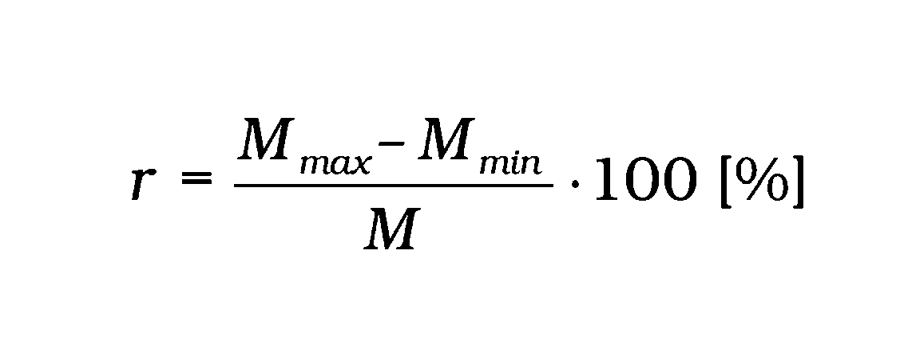

    - kde

    - Mmax – najväčšia konvenčne skutočná hodnota momentu sily z troch sérií meraní odčítaná zo stupnice etalónového zariadenia,

    - Mmin – najmenšia konvenčne skutočná hodnota momentu sily z troch sérií meraní odčítaná zo stupnice etalónového zariadenia,

    - M – hodnota momentu sily odčítaná zo stupnice momentového kľúča.

    - 5.14 Relatívne rozpätie chyby sa skúša najmenej pri troch hodnotách, a to pri približne 20 %, 60 % a 100 % hornej hranice meracieho rozsahu.

    - 5.15 Relatívne rozpätie chyby r nesmie presiahnuť hodnotu 0,6-násobku absolútnej hodnoty najväčšej dovolenej chyby pre daný typ a triedu uvedenej v tabuľke č. 1.

    - 6. Metódy skúšania pri prvotnom a následnom overení

    - 6.1 Skúšky pri prvotnom a následnom overení momentového kľúča pozostávajú z vonkajšej obhliadky a skúšky presnosti.

    - 6.2 Pri vonkajšej obhliadke momentového kľúča sa vizuálne preverí,

      - a) či jeho vyhotovenie zodpovedá schválenému typu,

      - b) či jeho vyhotovenie zodpovedá požiadavkám príslušnej slovenskej technickej normy,

      - c) či momentový kľúč nie je mechanicky poškodený, deformovaný alebo či nemá iné nedostatky,

      - d) čitateľnosť, správnosť a úplnosť predpísaných nápisov.

    - 6.3 Pri vonkajšej obhliadke momentového kľúča, ktorý bol uvedený do používania podľa doterajších predpisov, vizuálne sa preverí,

      - a) či jeho vyhotovenie zodpovedá požiadavkám príslušnej slovenskej technickej normy,

      - b) či momentový kľúč nie je mechanicky poškodený, deformovaný alebo či nemá iné nedostatky,

      - c) čitateľnosť, správnosť a úplnosť predpísaných nápisov.

    - 6.4 Rozšírená neistota merania etalónovým zariadením pri prvotnom a následnom overení nepresiahne ± 1 % z meranej hodnoty momentu sily.

    - 6.5 Rozšírená neistota merania pri prvotnom a následnom overení je menšia alebo sa rovná 1/3 najväčšej dovolenej chyby ΔM meradla.

    - 6.6 Overenie momentových kľúčov sa vykoná po vyrovnaní ich teploty s teplotou okolia, ktorá je (23 ±5) oC a relatívnej vlhkosti vzduchu do 90 %. Počas týchto skúšok sa teplota nesmie meniť viac ako o 2 oC.

    - 6.7 Pred začatím skúšania sa momentový kľúč predbežne trikrát zaťaží na najväčšiu hodnotu meracieho rozsahu a odľahčí sa späť do nulovej polohy.

    - 6.8 Momentové kľúče sa skúšajú najmenej pri troch hodnotách, a to pri približne 20 %, 60 % a 100 % hornej hranice meracieho rozsahu.

    - 6.9 Ak má momentový kľúč smer zaťažovania pravý aj ľavý, vykoná sa skúška pre obidva smery zaťaženia.

    - 6.10 Pri každej hodnote a v každom smere krútiaceho momentu sa vykoná najmenej päť meraní nasledujúcich bezprostredne za sebou.

    - 6.11 Chyba momentového kľúča Δi sa vypočíta podľa vzťahu

    - 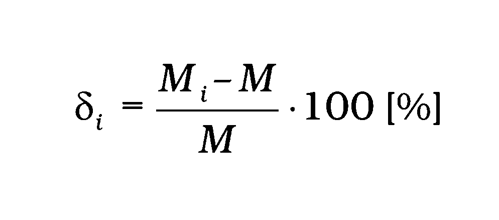

    - kde Mi – hodnota momentu sily odčítaná zo stupnice momentového kľúča,

    - M – konvenčne skutočná hodnota momentu sily odčítaná zo stupnice etalónového zariadenia.

    - 6.12 Zistená chyba Δi momentového kľúča vypočítaná podľa bodu 6.11 neprekročí v žiadnom meraní najväčšiu dovolenú chybu ΔM pre daný typ a triedu uvedenú v tabuľkách č. 1 a č. 2.

    - 6.13 Momentové kľúče, ktoré pri overení vyhoveli ustanoveným požiadavkám, označia sa overovacou značkou a vydá sa doklad o overení.

    - 6.14 Momentové kľúče, ktoré pri overení vyhovejú ustanoveným požiadavkám, označia sa zabezpečovacími značkami na miestach určených v rozhodnutí o schválení typu meradla, ak je to aplikovateľné.

    - 6.15 Postup pri prvotnom a následnom overení ustanovuje príslušná slovenská technická norma.

    - 7. Príklady vyhotovenia momentových kľúčov

    - 7.1 Ukazovacie momentové kľúče (typ I)

    - 7.1.1 Trieda A: momentové kľúče s torznou alebo ohybnou tyčou a indikačným zariadením

    - 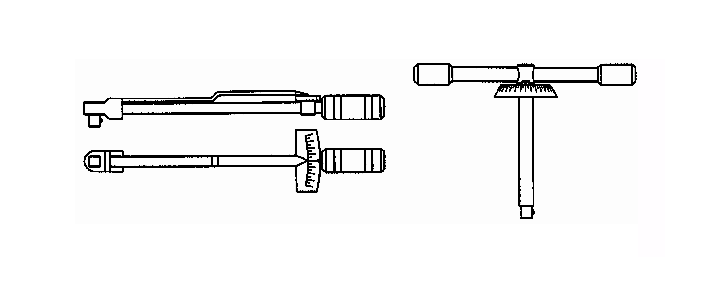

    - 7.1.2 Trieda B: momentové kľúče s pevným telesom a indikačným zariadením

    - 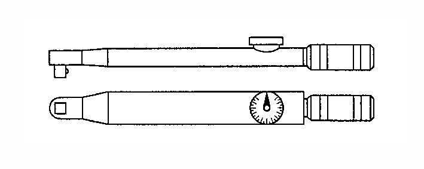

    - 7.1.3 Trieda C: momentové kľúče s pevným telesom kľúča a elektronickým meracím zariadením

    - 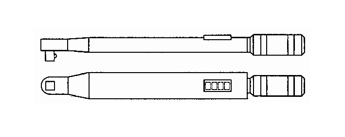

    - 7.1.4 Trieda D: momentové skrutkovače s indikačným zariadením

    - 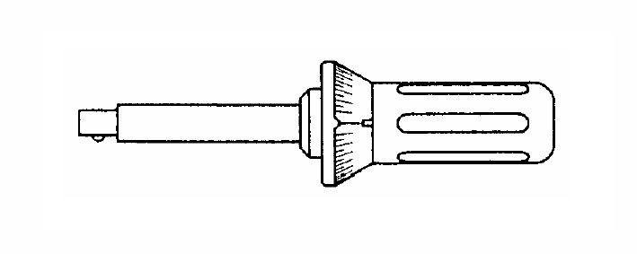

    - 7.1.5 Trieda E: momentové skrutkovače s elektronickým meracím zariadením

    - 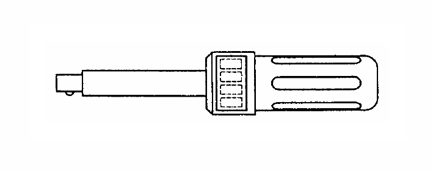

    - 7.2 Limitné momentové kľúče (typ II)

    - 7.2.1 Trieda A: momentový kľúč s indikačným zariadením

    - 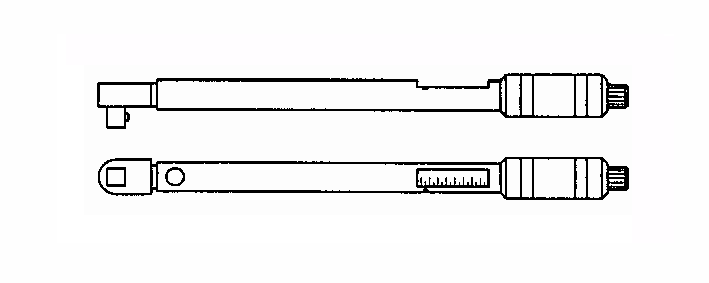

    - 7.2.2 Trieda D: momentový skrutkovač s indikačným zariadením

    - 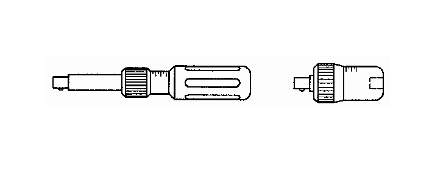

    - 7.2.3 Trieda G: momentový kľúč s ohybnou tyčou a indikačným zariadením

    - 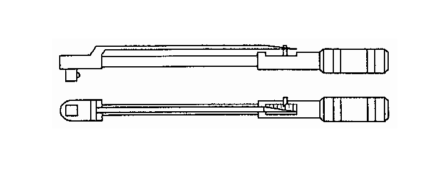

- 17. Príloha č. 62 sa vypúšťa.
