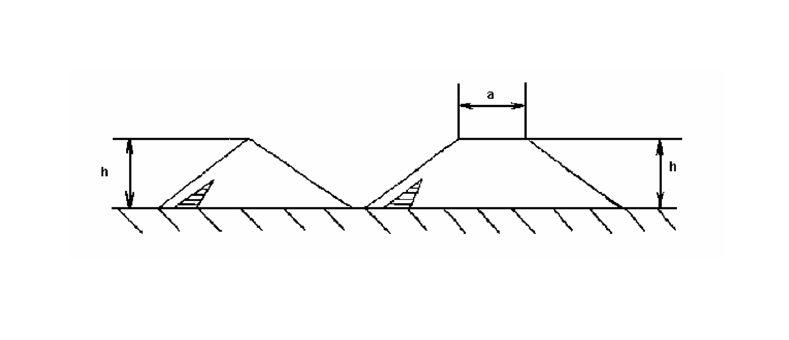

Príloha č. 3 k vyhláške č. 258/2007 Z. z.

- SPÔSOB URČOVANIA VÝŠKY HROMADY TUHÉHO PALIVA A DOVOLENÁ VÝŠKA VOĽNE SYPANEJ HROMADY TUHÉHO PALIVA

  - a) Výška hromady tuhého paliva sa určuje pri

    - 1. hromade, ktorá má trojuholníkový prierez, výškou trojuholníka,

    - 2. hromade, ktorá má lichobežníkový prierez, vzdialenosťou medzi základňou a hornou základňou hromady.

    - 

    - a – šírka hornej základne

    - h – výška hromady

  - b) Dovolená výška voľne sypanej hromady tuhého paliva je najviac

    - 1. 6 m pre triedené čierne uhlie a prané čierne uhlie,

    - 2. 4 m pre prachové hnedé uhlie, triedené hnedé uhlie, netriedené hnedé uhlie, prané hnedé uhlie, lignit, prachové čierne uhlie a pre ťažné čierne uhlie,

    - 3. 3 m pre brikety po vytriedení briketových úlomkov,

    - 4. 1,5 m pre brikety a briketové úlomky.
