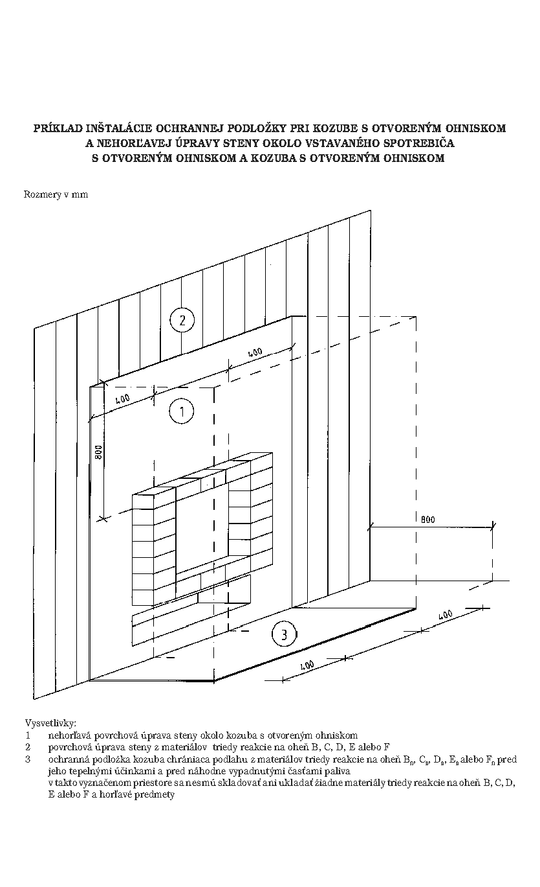

Príloha č. 4 k vyhláške č. 401/2007 Z. z.

- PRÍKLAD INŠTALÁCIE OCHRANNEJ PODLOŽKY PRI KOZUBE S OTVORENÝM OHNISKOM A NEHORĽAVEJ ÚPRAVY STENY OKOLO VSTAVANÉHO SPOTREBIČA S OTVORENÝM OHNISKOM A KOZUBA S OTVORENÝM OHNISKOM 
