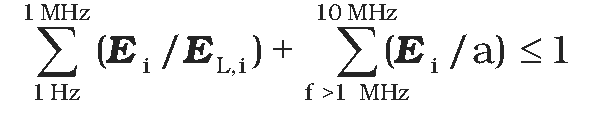
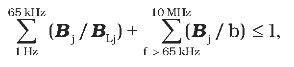
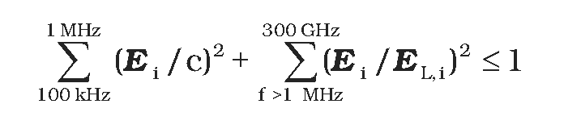
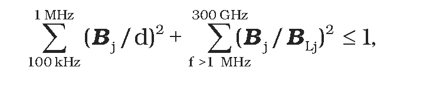
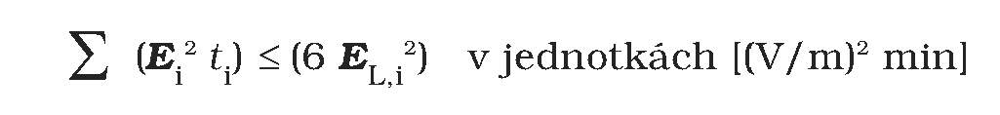
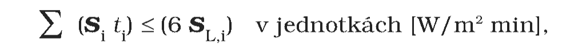

Príloha k vyhláške č. 534/2007 Z. z.

- AKČNÉ HODNOTY EXPOZÍCIE

  - 1. Akčné hodnoty expozície

    - Tabuľka 1

    - Akčné hodnoty expozície pre elektrické, magnetické a elektromagnetické polia (efektívne hodnoty pre nepretržitú expozíciu)

  - Frekvenčný rozsah | Intenzita elektrického poľa E (V/m) | Intenzita magnetického poľa H (A/m) | Magnetická indukcia B (μT) | Hustota toku výkonu ekvivalentnej rovinnej vlny Seq (W/m2)

  - 0 Hz až < 1 Hz | – | 3,2 . 104 | 4 . 104 | –

  - 1Hz až < 8 Hz | 10 000 | 3,2 . 104/ƒ2 | 3,2 . 104/ƒ2 | –

  - 8 Hz až < 25 Hz | 10 000 | 4 000/ƒ | 5 000/ƒ | –

  - 0,025 kHz až < 0,8 kHz | 250/ƒ | 4/ƒ | 5/ƒ | –

  - 0,8 kHz až < 3 kHz | 250/ƒ | 5 | 6,25 | –

  - 3 kHz až < 150 kHz | 87 | 5 | 6,25 | –

  - 0,15 MHz až < 1 MHz | 87 | 0,73/ƒ | 0,92/ƒ | –

  - 1 MHz až < 10 MHz | 87/ƒ1/2 | 0,73/ƒ | 0,92/ƒ | –

  - 10 MHz až < 400 MHz | 28 | 0,073 | 0,092 | 2

  - 400 MHz až < 2 000 MHz | 1,375 . ƒ1/2 | 0,0037 . ƒ1/2 | 0,0046 . ƒ1/2 | ƒ /200

  - 2 GHz až 300 GHz | 61 | 0,16 | 0,20 | 10

  - Poznámky:

    - 1. f je frekvencia, ako je uvedená v stĺpci frekvenčného rozsahu.

    - 2. Pre frekvencie v oblasti 100 kHz až 10 GHz vrátane musí byť hodnota Seq, E2, H2 a B2 spriemerovaná za 6-minútový interval.

    - 3. Pre frekvencie nad 10 GHz musí byť hodnota Seq, E2, H2 a B2 spriemerovaná za 68/f1,05-minútový interval (f v GHz).

    - 4. Akčná hodnota expozície pre statické elektrické pole nie je zavedená; pri pobyte v silnom statickom elektrickom poli je však potrebné znížiť vplyv nepríjemného pocitu spôsobeného elektrickým nábojom indukovaným na povrchu tela a zabrániť sršaniu výbojov z povrchu tela.

    - 5. Pre frekvencie do 100 kHz vrátane sa špičková akčná hodnota expozície pre intenzitu poľa vypočíta vynásobením príslušných efektívnych hodnôt hodnotou 21/2. Pre impulzy v trvaní tp sa ekvivalentná frekvencia uplatňovaná pre akčné hodnoty expozície vypočíta ako f = 1/(2tp).

    - 6. Pre frekvencie v oblasti 100 kHz až 10 MHz vrátane sa špičková hodnota pre intenzitu poľa vypočíta vynásobením príslušných efektívnych hodnôt hodnotou 10a, kde a = (0,665 . log(f/105) + 0,176), pričom f je v Hz.

    - 7. Pre frekvencie v oblasti 10 MHz až 300 GHz sa špičková hodnota vypočíta vynásobením zodpovedajúcej efektívnej hodnoty intenzity poľa hodnotou 32 a pre hustotu toku výkonu ekvivalentnej rovinnej vlny hodnotou 1 000.

    - 8. Vzhľadom na impulzné alebo premenlivé elektromagnetické polia alebo vo všeobecnosti vzhľadom na súčasnú expozíciu poliam s viacerými frekvenciami je na posudzovanie, meranie alebo výpočet potrebné použiť primerané metódy, ktoré umožňujú analyzovanie charakteristík vĺn a povahy biologických interakcií, pričom sa berú do úvahy príslušné technické normy.

    - 9. Pre špičkovú hodnotu impulzne modulovaných elektromagnetických polí platí, že pre nosné frekvencie vyššie ako 10 MHz by Seq spriemerované na šírku impulzu nemalo presiahnuť 1 000-násobok akčných hodnôt Seq alebo intenzita poľa by nemala presiahnuť 32-násobok akčných hodnôt intenzity poľa nosnej frekvencie.

    - Tabuľka 2

  - Akčné hodnoty expozície pre kontaktný elektrický prúd

  - Frekvenčný rozsah | Maximálny kontaktný prúd I (mA)

  - 0 Hz až < 2,5 kHz | 0,5

  - 2,5 kHz až < 100 kHz | 0,2 ƒ

  - 100 kHz až 110 MHz | 20

  - Akčná hodnota pre plošnú hustotu elektromagnetickej energie

  - Akčná hodnota pre plošnú hustotu elektromagnetickej energie, ktorá dopadne na povrch tela pri žiarení a poliach s dobou trvania t ≤ 30 μs a frekvenciou vyššou ako 300 MHz, je 0,02 J/m2.

  - Akčná hodnota pre indukovaný elektrický prúd

  - Pre frekvencie od 10 MHz do 110 MHz je akčná hodnota pre indukovaný prúd i tečúci ktoroukoľvek končatinou 0,045 A.

  - 2. Súčasná expozícia poliam od niekoľkých zdrojov s rôznymi frekvenciami

  - 2.1. Podmienky na stanovenie akčných hodnôt expozície

    - Pri posudzovaní expozície pri súčasnom pôsobení elektrického a magnetického poľa rovnakej frekvencie alebo poľa s rôznymi frekvenciami podľa zistených akčných úrovní je nutné posudzovať oddelene vplyv elektrickej stimulácie, ktorá sa uplatňuje v intervale frekvencií od 0 Hz do 10 MHz, a tepelného pôsobenia poľa, ktoré sa uplatňuje v intervale frekvencií od 100 kHz do 300 GHz.

    - a) Elektrická stimulácia vyvolaná hustotou indukovaného elektrického prúdu v tkanive neprekračuje akčné hodnoty, ak spĺňajú zistené úrovne polí nerovnosti:

    - 

      - a

    - 

      - kde

      - Ei označuje intenzitu elektrického poľa s frekvenciou i,

      - EL,i je akčná hodnota intenzity elektrického poľa pre i-tú frekvenciu,

      - Bj je magnetická indukcia s frekvenciou j,

      - BL,j je akčná hodnota magnetickej indukcie pre j-tú frekvenciu,

      - a je 87 V/m,

      - b je 6,25 . 10-6 T.

      - (Konštantné hodnoty a a b sú v tomto prípade použité aj pre frekvenciu vyššiu ako 1 MHz, pretože súčet sa týka hustoty indukovaných elektrických prúdov a nezahŕňa tepelné pôsobenie poľa.)

    - b) Tepelné pôsobenie, ktoré sa uplatňuje pri frekvenciách vyšších ako 100 MHz, neprekračuje limitnú hodnotu, ak sú splnené nerovnosti:

    - 

      - a

    - 

      - kde

      - c = 87 . 103/f0,5 V/m,

      - d = 0,92/fT,

      - f je v hertzoch.

  - 2.2. Podmienky na stanovenie akčných hodnôt pre krátkodobú expozíciu

  - Tepelné pôsobenie expozície elektrickému a magnetickému poľu, ktorá je kratšia ako čas určený na stredovanie, prípadne série krátkodobých expozícií pôsobiacich počas doby kratšej ako čas určený na stredovanie neprekračuje akčnú hodnotu, ak doby expozície ti a zistené úrovne polí Ei a Bi z intervalu frekvencií od 100 kHz do 10 GHz spĺňajú nerovnosti:

  - 

  - a

  - 

  - alebo ak hustota toku výkonu rovnakého frekvenčného intervalu spĺňa nerovnosť:

  - 

  - kde

  - ti je doba i-tej expozície v minútach,

  - Ei je intenzita elektrického poľa pri i-tej expozícii v jednotkách (V/m),

  - Bi je magnetická indukcia pri i-tej expozícii v jednotkách (T),

  - Si je hustota toku výkonu pri i-tej expozícii v jednotkách (W/m2),

  - EL,i, BL,i, SL,i sú akčné hodnoty intenzity elektrického poľa, magnetickej indukcie a hustoty toku výkonu pre nepretržitú expozíciu uvedené v tabuľke 2.

  - Okamžité hodnoty intenzity, magnetickej indukcie a hustoty toku výkonu nesmú prekročiť špičkové akčné hodnoty.

  - 3. Spoločné ustanovenia

  - 3.1. Spôsob zisťovania neprekročenia akčných hodnôt expozície

  - 3.1.1. Akčné hodnoty pre intenzitu elektrického a magnetického poľa, magnetickú indukciu a pre hustotu toku výkonu alebo pre hustotu žiarivej energie uvedené v tejto prílohe platia pre pole neporušené prítomnosťou osôb v posudzovanom priestore. Ak je pole priestorovo silne nehomogénne, porovnáva sa s akčnými hodnotami priemerná intenzita poľa v oblasti zodpovedajúcej polohe srdca a hlavy exponovanej osoby alebo sa na porovnanie s akčnou hodnotou použije hodnota v geometrickom strede tejto oblasti. Neprekročenie akčnej hodnoty pre kontaktný elektrický prúd sa zistí priamym meraním kontaktného elektrického prúdu u príslušnej osoby alebo meraním elektrického prúdu rezistorom napodobňujúcim impedanciu ľudského tela.

  - 3.1.2. Vzťahy určujúce podmienky splnenia akčných hodnôt pri súčasnej expozícii človeka elektrickému a magnetickému poľu a pri súčasnej expozícii človeka poliam od viacerých zdrojov sú uvedené v bode 2, pre krátkodobú expozíciu v bode 2.2.

  - 3.1.3. Ak nie je uvedené inak, stanovené akčné hodnoty expozície sú udané v efektívnych hodnotách príslušných veličín.

  - 3.2. Požadovaná presnosť

  - 3.2.1. Nepresnosť zistených hodnôt spôsobená nepresnosťou výpočtu, približnosťou teoretického modelu alebo nepresnosťou merania použitým prístrojom a podmienkami merania sa na porovnanie s akčnými hodnotami započíta takto:

    - a) ak je stredná relatívna chyba výpočtu alebo merania príslušnej veličiny menšia ako 1 dB, t. j. približne 12,5 % pri intenzite poľa a 25 % pri výkonových veličinách, pokladá sa akčná hodnota za dodržanú, ak je vypočítaná alebo nameraná hodnota rovnaká ako akčná hodnota alebo je nižšia,

    - b) ak je stredná relatívna chyba zisťovanej veličiny väčšia ako 1 dB, pokladá sa akčná hodnota za splnenú, ak je vypočítaná alebo nameraná hodnota príslušnej veličiny nižšia ako jej akčná hodnota aspoň o toľko dB, o koľko dB presahuje stredná relatívna chyba 1 dB. Rovnaké pravidlo platí, ak je na zistenie, či nie sú prekročené akčné hodnoty, potrebné použiť kombináciu dvoch alebo viacerých zistených hodnôt podľa vzťahov uvedených v tejto prílohe.

  - 3.2.2. Pri overovaní neprekročenia akčných hodnôt meraním sa musia používať prístroje kalibrované aspoň raz za päť rokov a po každej oprave. Pri kalibrácii meracej sondy je potrebné zmerať aj uhlovú závislosť sondy.

  - 3.2.3. Ani pri dodržaní stanovených akčných hodnôt expozície nemožno vylúčiť ovplyvnenie niektorých zariadení implantovaných do tela, napr. kardiostimulátorov, protéz obsahujúcich feromagnetické materiály a podobne.
