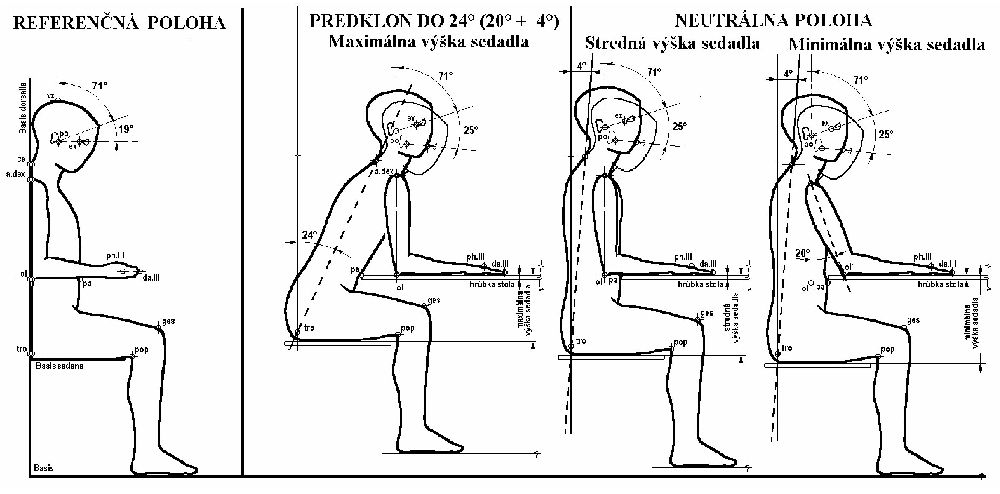
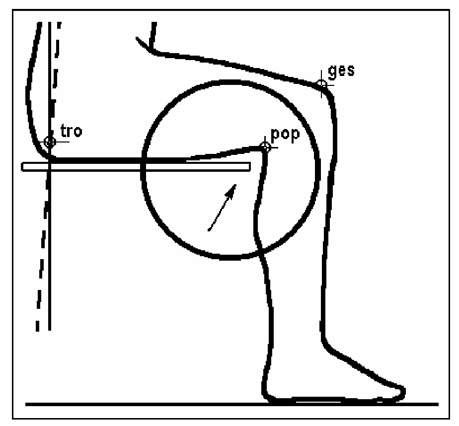
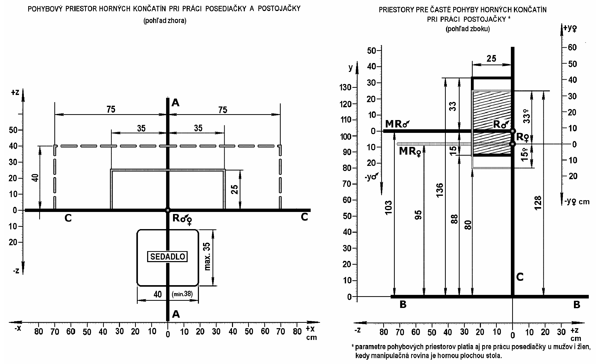
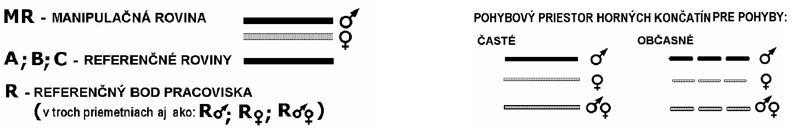

Príloha č. 1 k vyhláške č. 542/2007 Z. z.

- POŽIADAVKY NA MIESTO VÝKONU PRÁCE V SÚVISLOSTI S OBMEDZOVANÍM ZVÝŠENEJ FYZICKEJ ZÁŤAŽE PRI PRÁCI

  - 1. Miesto výkonu práce musí byť usporiadané tak, aby manipulačné roviny, pohybové priestory a vynakladané sily zodpovedali telesným rozmerom a prirodzeným pohybom končatín zamestnancov a aby nedochádzalo k zaujatiu fyziologicky neprijateľných pracovných polôh.

  - 2. Výška pracovnej manipulačnej roviny musí zodpovedať telesným rozmerom zamestnanca, základnej pracovnej polohe, hmotnosti predmetov, bremien a podobne, ktoré sa používajú pri práci, ako aj zrakovým nárokom na prácu.

  - 3. Pracovné sedadlo a priestor pre dolné končatiny

    - a) miesto výkonu práce, kde je základná pracovná poloha trvalo v sede, musí byť vybavené pracovným sedadlom s nastaviteľnou výškou sedadla a s opierkou chrbta,

    - b) miesto výkonu práce, kde je základná pracovná poloha trvalo v stoji a nevyžaduje trvalé sledovanie chodu zariadenia, musí byť vybavené sedadlom s jednoduchou konštrukciou na krátkodobý odpočinok,

    - c) konštrukcia sedadiel má zaisťovať ich stabilitu, prípadne ľahko nastaviteľnú výšku sedadla a sklonu chrbtovej opierky. Povrch sedadla a chrbtovej opierky má zodpovedať podmienkam práce z hľadiska poréznosti, umývateľnosti a podobne,

    - d) miesto výkonu práce, na ktorom je zvýšená pracovná rovina, musí byť vybavené pracovnými sedadlami s výškou sedadla zodpovedajúcou výške pracovnej roviny a zrakovým požiadavkám pri práci a musí byť vybavené opierkou pre dolné končatiny,

    - e) na montážnych linkách v pásovej výrobe s trvalým alebo prerušovaným sedením a keď sú pracovné úkony spojené s otáčaním trupu alebo s úkonmi mimo najväčší dosah rúk, sa miesto výkonu práce vybavuje otočnými, prípadne pojazdnými sedadlami.

  - 4. Individuálne nastavenie výšky sedadla stoličky a opierky dolných končatín nad podlahou vzhľadom k výške pracovnej plochy stola sa upravuje podľa obrázkov č. 1 a 2. Pracovná plocha stola nesmie byť nižšia ako 65 cm za predpokladu, že jeho hrúbka nepresahuje 5 cm. Výška stola pre prácu v sede aj v stoji nesmie byť vyššia ako 95 cm nad podlahou.

  - 5. Pod dolnou plochou stola musí byť pre prácu v sede voľný priestor pre dolné končatiny s najmenšou šírkou a hĺbkou 50 cm a s najmenšou výškou 60 cm nad podlahou alebo nad opierkou dolných končatín (optimálna šírka a hĺbka priestoru pre dolné končatiny je 70 cm a viac).

  - 6. Stredná výška individuálneho nastavenia hornej plochy sedadla v neutrálnej polohe zamestnanca k danému stolu (predklon osi trupu 4o) sa rovná rozdielu výšky hornej plochy stola od podlahy a antropometrického rozmeru výšky lakťa (bodu olecranon) nad sedadlom.

  - 7. Najmenšia výška individuálneho nastavenia hornej plochy sedadla v neutrálnej polohe zamestnanca k danému stolu (predklon osi trupu 4o) sa rovná rozdielu výšky hornej plochy stola a antropometrického rozmeru výšky lakťa (bodu olecranon) pri ramene v abdukcii 20o nad sedadlom.

  - 8. Najväčšia výška individuálneho nastavenia hornej plochy sedadla sa rovná rozdielu výšky hornej plochy stola a antropometrického rozmeru výšky lakťa (bodu olecranon) ramena kolmo spusteného k podlahe pri predklone trupu 24o, čo je hodnota uhla po korekcii na neutrálnu polohu trupu (20o + 4o) zamestnanca k danému stolu.

  - 9. Voľný priestor medzi hornou plochou sedadla stoličky a spodnou plochou stola má byť optimálne viac ako 21 cm a najmenej 11 cm.

  - 10. Pri práci, ktorá vyžaduje zvýšené nároky na zrak, napríklad s drobnými predmetmi, súčiastkami a podobne, sa výška pracovnej roviny zvyšuje približne o 10 cm až 20 cm, pričom treba zabezpečiť podopretie predlaktí. Pri práci, pri ktorej sa manipuluje s predmetmi ťažšími ako 2 kg, pri práci v stoji, sa manipulačná rovina znižuje približne o 10 cm až 20 cm.

  - 11. Nastavenie výšky sedadla stoličky nad podlahou alebo nad opierkou dolných končatín v prípade použitia vyšších stolov musí umožňovať zmenu polohy dolných končatín pri práci. Správne nastavenie výšky sedadla má byť podľa obrázku č. 2 také, aby v prednej časti sedadla bol voľný priestor zodpovedajúci hrúbke dlane pod spodnou časťou stehna (za fossa poplitea).

  - 12. Najväčšia hĺbka sedadla stoličky má byť 35 cm, aby nedochádzalo k pritláčaniu podkolenia. Pri práci v sede treba sedieť na celej ploche sedadla s podoprenou driekovou časťou chrbtice.

  - 13. Priestor pre pohyby a dosahy horných končatín pri práci v sede a v stoji sa upravuje podľa údajov na obrázku č. 3, pričom

    - a) manipulačná rovina je rovina, v ktorej sa vykonáva najviac pracovných operácií,

    - b) referenčná rovina je základná rovina pre odvodzovanie ďalších rozmerov a priestorových vzťahov,

    - c) referenčná rovina A je rovina, ktorá je kolmá na podlahu a pomyselne rozdeľuje zamestnanca na symetrické polovice na pracovnom mieste,

    - d) referenčná rovina B je podlaha,

    - e) referenčná rovina C je rovina, ktorá je kolmá na podlahu a prechádza buď prednou hranou stola, alebo bodom pracovného zariadenia, ktorý je najbližšie k zamestnancovi,

    - f) referenčný bod pracoviska je miesto, kde sa pretínajú referenčné roviny A a C s manipulačnou rovinou pre mužov a ženy.

  - 14. Sily prípustné pre ovládače sú uvedené v tabuľke č.1, pričom

    - a) trvalo používané ovládače sú ovládače, ktoré sa používajú viac ako 40-krát počas pracovnej zmeny,

    - b) často používané ovládače sú ovládače, ktoré sa používajú viac ako 20-krát až 40-krát počas pracovnej zmeny,

    - c) zriedkavo používané ovládače sú ovládače, ktoré sa používajú menej ako 20-krát počas pracovnej zmeny.

  - 15. Pri základnej polohe v stoji sa neodporúča použitie nožných ovládačov. Ovládače obsluhované iným spôsobom ako rukami a chodidlami, napríklad lakťové a kolenové ovládače, sa nesmú používať.

  - 

    - Obrázok č. 1 Individuálne nastavenie výšky sedadla stoličky nad podlahou a opierky dolných končatín k výške pracovnej plochy stola

  - Vysvetlivky:

    - vx. = vertex – najvyššie položený bod na vrchole hlavy v mediosagitálnej rovine pri hlave orientovanej vo frankfurtskej horizontále, ce. = cervicale – najviac dorzálne vystupujúci bod nad tŕňovým výbežkom 7. krčného stavca, a. dex. = acromiale – najviac do strany vystupujúci bod nadpleckového výbežku (processus acromialis), dex. = na pravej strane tela, ex. = ektokanthion – bod na laterálnej strane oka na spojnici obidvoch viečok, po. = porion – bod na horných okrajoch vonkajších zvukovodov, ph. III. = phalangion III. – kožný priemet najdorzálnejšieho bodu na metacarpo-phalangeálnom kĺbe III. prsta, da. III. = daktylion III. – najnižšie položený bod na prednom okraji III. prsta, ol. = olecranon – najdistálnejší bod na procesus olecrani pri 90° flexii predlaktia, pa. = maximálne prominujúci bod v abdominálnej oblasti, pop. = popliteale – bod na spodnom okraji stehna pri fossa poplitea, ges. = bod na hornom okraji patelly v predĺžení holennej kosti, tro. = trochanterion – najvyššie položený bod na veľkom chocholíku (trochanter major), hmatáme ho v najširšom mieste bokov, B. = Basis – horizontálna plocha, na ktorej zamestnanec počas práce stojí, Bs. = Basis sedens – horizontálna plocha, na ktorej zamestnanec počas práce sedí, Bd. = Basis dorsalis – vertikálna plocha, o ktorú sa zamestnanec pri práci opiera chrbtom

  - 

    - Obrázok č. 2 Nastavenie výšky sedadla stoličky nad podlahou alebo nad opierkou dolných končatín v prípade použitia vyšších stolov

  - 

    - Obrázok č. 3 Priestor pre pohyby horných končatín pri práci

  - Vysvetlivky:

  - 

  - Tabuľka č. 1 Ovládače – typy, tvary, polohy, spôsob ovládania, ovládacie sily

  - Typ ovládača | Tvar, polohy a frekvencie ovládania | Spôsob ovládania, minimálne a maximálne sily (N) |

  - Tlačidlo | kruhové, štvorcové, obdĺžnikové, hríbové | jedným prstom dlaňou | min. 2,5 max. 8 min. 2,5 max. 50

  - Prepínač páčkový | valcový, kužeľový, hranolový dvojpolohový: min. 30° do strán od zvislej osi, trojpolohový: min. 30° do strán od zvislej osi a kolmo na základňu | prstami | min. 2,5 max. 10

  - Prepínač otočný | kruhová základňa, úchopová časť kužeľová, obdĺžniková pri zrakovej kontrole: max. počet polôh 24, min. uhol medzi polohami 15°, pri hmatovej kontrole max. počet polôh 8, min. uhol medzi polohami 45° | prstami | min. 2,5 max. 15

  - Točidlo, točka | valcová, kužeľová priemer do 2,5 cm priemer väčší ako 2,5 cm | prstami | min. 2,5 max. 4 min. 2,5 max. 15

  - Koleso ručné | vonkajší priemer venca sa volí podľa rýchlosti otáčania, pri väčšej rýchlosti menší priemer | jednou rukou oboma rukami | min. 10 max.100 min. 10 max. 200

  - Volant | a) stacionárne technické zariadenia b) mobilné technické zariadenia c) všetky technické zariadenia pri zlyhaní posilovača riadenia (pri núdzovom riadení) Poľnohospodárske a lesné stroje: a) stacionárne stroje b) mobilné stroje c) všetky stroje pri zlyhaní posilovača riadenia (núdzové riadenie) | oboma rukami jednou alebo oboma rukami oboma rukami oboma rukami jednou alebo oboma rukami oboma rukami | max. 115 max. 80 max. 350 max. 120 max. 120 max. 490

  - Ručná páka | rukoväť: valcová, kužeľová, guľová používaná trvalo používaná často používaná zriedka | hornou končatinou pohyb páky: dopredu a dozadu do strán dopredu a dozadu do strán nahor a nadol (núdzová a parkovacia brzda) Poľnohospodárske a lesné stroje: núdzová a parkovacia brzda | min. 10 max. 60 min. 10 max. 40 min. 10 max. 120 min. 10 max. 80 min. 10 max. 300 max. 250 max. 295

  - Nožná páka (pedál) | obdĺžniková, kruhová, štvorcová používaná trvalo používaná často Poľnohospodárske a lesné stroje: pedál spojky pedál akcelerátora pedál prevádzkovej a núdzovej brzdy ostatné pedále | pohybom celej nohy pedál prevádzkovej núdzovej brzdy pedál ovládaný pohybom nohy v členku | min. 10 max. 90 min. 40 max. 400 min. 20 max.60 max. 245 max. 60 max. 580 max. 150
