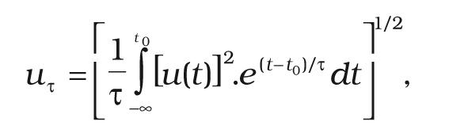
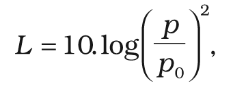
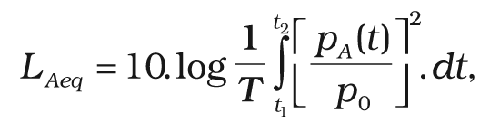
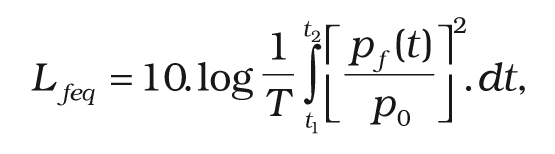
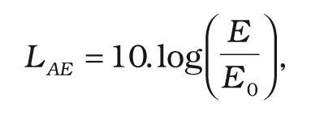
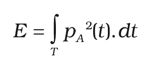
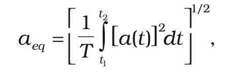

# § 2 Základné pojmy

Na účely tejto vyhlášky

- a) zvuk je akustické vlnenie, ktoré vyvoláva u človeka vnem. Základnou fyzikálnou veličinou je akustický tlak,

- b) počuteľný zvuk je zvuk vo frekvenčnom rozsahu tretinooktávových pásiem s menovitými strednými frekvenciami od 20 Hz do 20 kHz,

- c) hluk je každý rušivý, obťažujúci, nepríjemný, nežiaduci, neprimeraný alebo škodlivý zvuk. Vo vonkajšom prostredí sa hodnotí hluk najmä z týchto vonkajších zdrojov:

  - i) hluk z dopravy na pozemných komunikáciách a vodných plochách vrátane miestnej hromadnej dopravy,

  - ii) hluk z koľajovej dopravy na železničných dráhach,

  - iii) hluk z leteckej dopravy a hluk v okolí letísk,

  - iv) hluk z iných zdrojov, napríklad hluk stacionárnych zdrojov, hluk z priemyselnej, stavebnej a výrobnej činnosti, hluk z mimopracovných aktivít človeka.

- Vo vnútornom prostredí budov sa hodnotí hluk najmä z týchto vnútorných a vonkajších zdrojov:

  - i) hluk z vnútorných zdrojov v budove, napríklad hluk z technických zariadení budov, hluk z aktivít človeka v budove,

  - ii) hluk prenikajúci z vonkajších zdrojov, napríklad hluk z dopravy, hluk z iných zdrojov,

- d) infrazvuk je zvuk vo frekvenčnom rozsahu tretinooktávových pásiem s menovitými strednými frekvenciami pod 16 Hz,

- e) frekvenčné pásmo je oblasť frekvencií ohraničená dolnou hraničnou frekvenciou a hornou hraničnou frekvenciou. Rozloženie zvuku do frekvenčných pásiem tvorí frekvenčné spektrum zvuku. Frekvenčné pásmo charakterizuje menovitá stredná frekvencia fs podľa slovenskej technickej normy,1)

- f) vibrácie (mechanické kmitanie) je pohyb mechanickej sústavy alebo jej časti, ktorý vyvolá u človeka vnem a pri ktorom veličina opisujúca polohu, zrýchlenie, rýchlosť alebo stav uvedenej sústavy je striedavo väčšia a menšia ako rovnovážna alebo vzťažná hodnota tejto veličiny. Základnou fyzikálnou veličinou je zrýchlenie vibrácií,

- g) otras je náhla jednorazová alebo opakovaná zmena zrýchlenia vibrácií,

- h) vibrácie pôsobiace na celé telo sú vibrácie, ktoré sa v budovách prenášajú na stojacu, sediacu alebo ležiacu osobu cez kontaktný povrch a predstavujú riziko pre zdravie človeka alebo pôsobia rušivo,

- i) priebežná efektívna hodnota fyzikálnej veličiny je hodnota tejto veličiny určená podľa vzťahu

kde u(t) je časová funkcia fyzikálnej veličiny,

e(t-t0)/τ je exponenciálna časová váhová funkcia,

τ je časová konštanta,

t je priebežný čas,

t0 je čas pozorovania, resp. odčítania hodnoty.

Pri meraní zvuku má časová váhová funkcia F (Fast) časovú konštantu 0,125 s. Časová váhová funkcia S (Slow) má časovú konštantu 1,0 s. Použitie časových váhových funkcií sa vyjadruje v značke indexom F, S alebo použitou časovou konštantou, napríklad 10 s.

Uvedenie veličiny bez indexu znamená použitie časovej váhovej funkcie F pri meraní zvuku a časovej váhovej funkcie S pri meraní vibrácií.

Značka: uô,

- j) akustický tlak je priebežná efektívna hodnota časovej funkcie akustického tlaku p(t) určená podľa písmena i).

Značka: p, pô,

Jednotka: Pa,

- k) hladina akustického tlaku; priebežná hladina akustického tlaku je veličina určená vzťahom

kde p je akustický tlak v Pa,

p0 je referenčný akustický tlak, p0 = 2.10-5 Pa.

Značka: L, LS,

Index v značke sa používa v súlade s písmenom i)

Jednotka: dB (decibel),

- l) hladina akustického tlaku vo frekvenčnom pásme je priebežná hladina akustického tlaku určená podľa písmena k), pričom sa použije akustický tlak z príslušného frekvenčného pásma.

Značka: Lo,fs pre hladiny v oktávových frekvenčných pásmach s menovitou strednou frekvenciou pásma fs (napríklad L0, 250 prefs= 250 Hz),

Lt,fs pre hladiny v tretinooktávových frekvenčných pásmach s menovitou strednou frekvenciou pásma fs(napríklad Lt, 250 pre fS = 250 Hz),

Jednotka: dB,

- m) hladina A zvuku; hladina zvuku s frekvenčným vážením A je priebežná hladina akustického tlaku podľa písmena k), ktorý je korigovaný frekvenčnou váhovou funkciou A danou v slovenskej technickej norme.2)

Pri použití frekvenčnej váhovej funkcie C sa písmeno A mení na písmeno C.

Značka: LA, LC (pri časovom vážení S bude LAS, LCS),

Jednotka: dB,

- n) hladina G infrazvuku; hladina infrazvuku s frekvenčným vážením G je priebežná hladina akustického tlaku podľa písmena k), ktorý je korigovaný frekvenčnou váhovou funkciou G danou v slovenskej technickej norme.3)

Značka: LG,

Jednotka: dB,

- o) ekvivalentná hladina A zvuku je veličina určená vzťahom

kde pA(t) je časová funkcia akustického tlaku váženého frekvenčnou váhovou funkciou A,

T je integračný interval, T = t2 – t1 v s,

p0 je referenčný akustický tlak, p0 = 2.10-5 Pa.

Podobne je definovaná ekvivalentná hladina C zvuku a ekvivalentná hladina G infrazvuku.

Značka: LAeq, LCeq, LGeq

Index v značke sa môže doplniť časovým údajom T, napríklad LAeq,30min, LAeq,12h, LAeq,d,

Jednotka: dB,

- p) ekvivalentná hladina akustického tlaku vo frekvenčnom pásme je veličina určená vzťahom

kde pf(t) je časová funkcia akustického tlaku vo zvolenom frekvenčnom pásme.

Značka: Lfeq,

Index v značke sa používa v súlade s písmenom l), napríklad Lt,250eq,

Jednotka: dB,

- r) hladina A zvukovej expozície je veličina určená vzťahom

kde E je zvuková expozícia v Pa2.s definovaná ako

E 0 je referenčná hodnota zvukovej expozície E0 = 4 .10-10 Pa2.s, daná kvadrátom referenčného akustického tlaku p0 = 2.10-5 Pa násobeného referenčným časovým intervalom T0 = 1s,

T je integračný interval daný spravidla časom výskytu zvukovej udalosti v s.

Podobne je definovaná hladina C zvukovej expozície.

Značka: LAE, LCE,

Index v značke sa môže doplniť časovým údajom T, napríklad LCE,3s,

Jednotka: dB,

- s) maximálna hladina A zvuku je najvyššia hodnota hladiny A zvuku v sledovanom časovom intervale pri použití časovej váhovej funkcie F. V odôvodnených prípadoch je možné stanoviť maximálnu hladinu A zvuku na základe štatistického výskytu hladín.

Značka: LAmax,

Jednotka: dB,

- t) ustálený hluk je súvislý zvuk, ktorého hladina akustického tlaku sa v mieste a v čase pozorovania významne nemení,

- u) premenný hluk je súvislý zvuk, ktorého hladina akustického tlaku sa v mieste a v čase pozorovania významne mení, ale nie je impulzový (napríklad hluk z parkovísk, letných terás alebo športovísk, hluk pri nakladaní a odvoze komunálneho odpadu alebo pri zásobovaní tovarom, zvonenie zvonov, štekot psov),

- v) prerušovaný hluk je zvuk, ktorý sa v mieste pozorovania vyskytuje v pravidelných alebo nepravidelných časových intervaloch, pričom trvanie každého intervalu je spravidla dlhšie ako 5 s (napríklad prejazdy motorových vozidiel, prejazd vlaku, prelet lietadla, prerušovaná činnosť kompresora),

- w) zvlášť rušivý hluk je zvuk, ktorý individuálne ruší alebo obťažuje človeka (napríklad výrazné rytmické alebo tónové zložky vo zvuku, hlasitá reč, hudba, intenzívne a náhodne sa opakujúce zvukové impulzy, prerušovaný alebo premenný hluk s veľkým rozdielom hladín),

- x) tónový hluk je zvuk, ktorému možno subjektívne prisúdiť výšku. Zvuk sa považuje za tónový, ak je tónová zložka počuteľná a pôsobí rušivo.

Prítomnosť tónovej zložky vo frekvenčnom spektre zvuku sa preukazuje napríklad tretinooktávovou frekvenčnou analýzou tak, že hladina akustického tlaku v pásme s tónovou zložkou prevyšuje hladiny v susediacich pásmach o viac ako 5,0 dB. Za hladinu v jednom pásme s tónovou zložkou je možné považovať aj dve susediace pásma s rozdielom ich hladín najviac 3,0 dB.

V niektorých prípadoch je potrebné použiť analýzu pomocou užších frekvenčných pásiem,

- y) zvukový impulz je jednorazový akustický dej charakterizovaný náhlym nárastom akustického tlaku a krátkym trvaním,

- z) impulzový hluk je rušivý alebo nepríjemný zvuk, ktorý vzniká v dôsledku jedného alebo viacerých zvukových impulzov. Impulzový hluk v závislosti od druhu zdroja, ktorým môže byť bežný impulzový, vysokoimpulzový a vysokoenergetický impulzový zdroj, sa primerane posudzuje podľa slovenskej technickej normy,4)

  - za) špecifický hluk je časová alebo frekvenčná zložka zvuku, ktorá je človekom vnímaná ako rušivý, obťažujúci alebo nepríjemný hluk a ktorá spravidla súvisí s konkrétnym zdrojom zvuku.

- Na účely vyhlášky je to tónový hluk, impulzový hluk a zvlášť rušivý hluk,

  - zb) zrýchlenie vibrácií je priebežná efektívna hodnota zrýchlenia vibrácií určená z časovej funkcie zrýchlenia vibrácií podľa písmena i),

- Značka: a, aτ,

- Jednotka: m.s-2,

  - zc) vážené zrýchlenie vibrácií je zrýchlenie vibrácií korigované frekvenčnou váhovou funkciou danou v technickej norme5) podľa druhu prenosu a smeru pôsobenia vibrácií,

- Značka: aw,

- Jednotka: m.s-2,

  - zd) ekvivalentné zrýchlenie vibrácií je efektívna hodnota zrýchlenia definovaná vzťahom

- 

- kde a(t) je časová funkcia zrýchlenia vibrácií,

- T je integračný interval priemerovania T = t2 – t1.

- Značka: aeq,

- Jednotka: m.s-2,

  - ze) ekvivalentné vážené zrýchlenie vibrácií je ekvivalentné zrýchlenie vibrácií získané použitím frekvenčnej váhovej funkcie podľa písmena zc) na časovú funkciu zrýchlenia vibrácií.

- Značka : aweq,

- Jednotka: m.s-2,

- Index v značke sa môže doplniť integračným intervalom T, napríklad aweq,1h ,

  - zf) maximálne vážené zrýchlenie vibrácií je najvyššia hodnota váženého zrýchlenia vibrácií v sledovanom časovom intervale a v danom mieste s použitím časovej váhovej funkcie S.

- V odôvodnených prípadoch je možné stanoviť maximálne hodnoty zrýchlenia vibrácií na základe štatistického výskytu hodnôt zrýchlenia,

- Značka: awmax,

- Jednotka: m.s-2,

  - zg) určujúca veličina je fyzikálna veličina, ktorá charakterizuje hluk, infrazvuk alebo vibrácie a používa sa na hodnotenie nepriaznivých účinkov hluku, infrazvuku alebo vibrácií z hľadiska ochrany verejného zdravia,

  - zh) referenčný časový interval je časový interval, na ktorý sa vzťahuje posudzovaná alebo prípustná hodnota. Referenčný časový interval pre deň je od 6.00 h do 18.00 h (12 h), pre večer od 18.00 h do 22.00 h (4 h) a pre noc od 22.00 h do 6.00 h (8 h).

- V odôvodnených prípadoch sa použije aj iná dĺžka referenčného časového intervalu (napríklad ak je pre ňu definovaná prípustná hodnota),

  - zi) posudzovaná hodnota je hodnota, ktorá sa porovnáva s prípustnou hodnotou.

- Je to nameraná hodnota alebo z nameranej hodnoty odvodená hodnota určujúcej veličiny zväčšená o hodnotu neistoty merania a v prípade potreby upravená korekciami a stanovená vzhľadom na referenčný časový interval.

V prípade predikcie hluku je to predpokladaná hodnota určujúcej veličiny vrátane príslušnej neistoty.

V značke veličiny sa uvádza index R, napríklad LR,Aeq,d, LR,Aeq,v, LRE,n, LR,Amax, aR,weq,

zj)

prípustné hodnoty určujúcich veličín sú dohodnuté úrovne určujúcich veličín, ktorých neprekračovanie sa považuje za dostatočné zabezpečenie ochrany verejného zdravia podľa súčasného stavu poznania a ekonomickej úrovne spoločnosti.

V značke určujúcej veličiny sa uvádza index p, napríklad: LAeq,d,p , Leq,v,p , LAmax,p , aweq,p ,

zk)

neistota merania je parameter priradený k výsledkom merania charakterizujúci rozptyl hodnôt, ktoré sa môžu zdôvodnene priraďovať k meranej veličine. Stanovuje sa v súlade s metrologickou praxou,

zl)

hluk pozadia, šum pozadia je hluk alebo iné vplyvy registrované meracími prístrojmi aj vtedy, ak zvuk, infrazvuk alebo vibrácie, ktoré sa majú na základe merania posudzovať, nepôsobia.

Ak je meraný rozdiel hladiny posudzovaného zvuku a hladiny hluku pozadia menší ako 3,0 dB, nemožno jednoznačne určiť zvuk alebo infrazvuk, ktorý sa má na základe merania posudzovať.

Ak je zrýchlenie vibrácií dané šumom pozadia väčšie ako 50 % meranej hodnoty posudzovaného zrýchlenia, nemožno jednoznačne určiť vibrácie, ktoré sa majú na základe merania posudzovať,

zm)

korekcia na hluk pozadia je záporná hodnota, ktorá sa môže pripočítať k nameranej hladine posudzovaného zvuku, ak rozdiel ΔL posudzovanej hladiny a hladiny hluku pozadia v zodpovedajúcom frekvenčnom pásme je v intervale od 3,0 dB do 18,0 dB. Určuje sa podľa nasledovného vzťahu:

K = –10.log(1 – 10(– 0,1.ΔL))

Značka: K,

Jednotka: dB,

zn)

chránený priestor je vnútorné alebo vonkajšie prostredie, v ktorom sa zdržujú ľudia trvale alebo opakovane a pre ktorý sú stanovené prípustné hodnoty určujúcich veličín hluku, infrazvuku a vibrácií (napríklad chránená obytná miestnosť, chránené územie),

zo)

vonkajšie prostredie je chránený vonkajší priestor

i)

mimo budov, v ktorom sa zdržiavajú ľudia z oddychových, rekreačných, liečebných alebo iných ako pracovných dôvodov,

ii)

pred obvodovými stenami bytových budov, škôl, zariadení zdravotnej starostlivosti a iných budov vyžadujúcich tiché prostredie,

zp)

vnútorné prostredie budov je chránený vnútorný priestor budov, v ktorom sa zdržiavajú ľudia trvale alebo opakovane dlhodobo, najmä obytné miestnosti v budovách na bývanie, v domovoch dôchodcov, ubytovniach, izby pacientov v zariadeniach zdravotnej starostlivosti, miestnosti s aktivitami vyžadujúcimi tiché prostredie alebo dorozumievanie rečou (napríklad učebne, študovne, čakárne).

Stavebné prvky, konštrukcie a zariadenia chránia vnútorné prostredie budov pred hlukom prenikajúcim z vonkajších a vnútorných zdrojov pri súčasnom zabezpečení ostatných vlastností vnútorných priestorov, napríklad vetranie, vykurovanie, osvetlenie,

zr)

podstatná rekonštrukcia dopravnej stavby a súvisiacej dopravnej infraštruktúry je rekonštrukcia, v dôsledku ktorej je možné predpokladať zmenu posudzovanej hodnoty hluku v súvisiacom vonkajšom prostredí o viac ako 1 dB bez protihlukových úprav,

zs)

okolie je

1)

územie do vzdialenosti 100 m od osi priľahlej koľaje železničnej dráhy,

2)

územie do vzdialenosti 500 m od okraja pohybových plôch letísk, územie do vzdialenosti 1 000 m od osi vzletových a pristávacích dráh a územie do vzdialenosti 1 000 m od kolmého priemetu určených letových trajektórií9)11)s dĺžkou priemetu 9 000 m od okraja vzletových a pristávacích dráh letísk,

zt)

objektivizácia je stanovenie posudzovanej hodnoty určujúcej veličiny,

zu)

hodnotenie je porovnanie posudzovanej hodnoty určujúcej veličiny s príslušnou prípustnou hodnotou.
