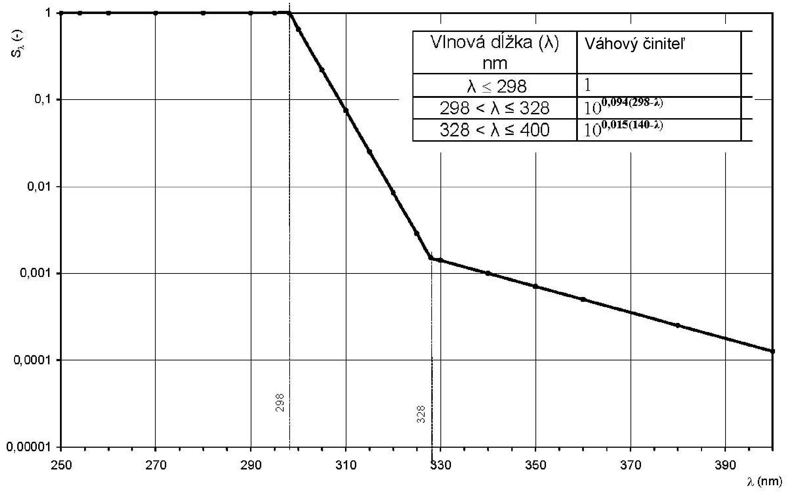

Príloha č. 2 k vyhláške č. 554/2007 Z. z.

- LIMITY ULTRAFIALOVÉHO ŽIARENIA

  - Limity ultrafialového žiarenia sa ustanovujú ako limity erytemálne účinnej intenzity ožiarenia podľa typu opaľovacieho prístroja (tabuľka č. 1), erytemálne účinnej prahovej dávky ožiarenia podľa miestne rozšírených typov pokožky (tabuľka č. 2).

  - Tabuľka č. 1

  - Erytemálne účinná intenzita ožiarenia podľa typu opaľovacieho prístroja

- Typ opaľovacieho prístroja | Eer [W.m-2] |

- | 280 nm < λ ≤ 320 nm | 320 nm < λ ≤ 400 nm

- 1 | < 0,0005 | ≥ 0,15

- 2 | 0,0005 až 0,15 | ≥ 0,15

- 3 | < 0,15 | < 0,15

- 4 | ≥ 0,15 | < 0,15

- Podiel krátkovlnového UV žiarenia (UVC, λ < 280 nm) emitovaného žiaričmi v opaľovacích prístrojoch musí byť ­nulový. | |

- Použitie opaľovacích prístrojov:

  - Typy 1 a 2 sú určené na používanie v soláriách, kozmetických salónoch a podobných prevádzkach pod dozorom zaškolených osôb.

  - Typ 3 je vhodný na domáce a podobné použitie a môže ho používať aj nezaškolená osoba.

  - Typ 4 je určený na používanie na základe odporúčania lekára.

  - Tabuľka č. 2

  - Erytemálne účinná prahová dávka ožiarenia podľa miestne rozšírených typov pokožky

- Typ pokožky | Erytemálne účinná prahová dávka žiarenia Her |

- | [J.m-2] | [MED]

- II** | 250 | 1,0

- III*** | 350 | 1,4

- IV**** | 450 | 1,8

- Hodnoty Her nie sú uvedené pre typ pokožky I*, pre ľudí tohto typu je opaľovanie v opaľovacom prístroji zo zdravotného hľadiska nevhodné. | |

  - * Keltský typ – nápadne svetlá pleť, pehy, hrdzavé vlasy, modré, zriedkavo hnedé oči, svetlé prsné bradavky: ťažké bolestivé spálenie, rýchlo sčervenie, zle sa opaľuje, šúpe sa, čas prvého opaľovania na slnku 5 min. – 10 min.

  - ** Európsky typ so svetlou pleťou – trochu tmavšia pleť ako pri type I, blond až hnedé vlasy, modré, zelené, sivé oči, svetlé prsné bradavky: ťažké bolestivé spálenie, pleť sa len málo opáli, šúpe sa, čas prvého opaľovania na slnku 10 min. – 20 min.

  - *** Európsky typ s tmavou pleťou – svetlá až svetlohnedá pleť, tmavoblond až hnedé vlasy, sivé, hnedé oči, tmavšie prsné bradavky: k spáleniu dochádza zriedka, je mierne, opálenie je priemerné, čas prvého opaľovania na slnku 20 min. – 30 min.

  - **** Stredomorský typ – svetlohnedá pleť, tmavé pehy, tmavohnedé vlasy, tmavé oči, tmavé prsné bradavky: k spáleniu nedochádza, opálenie je rýchle a hlboké, čas prvého opaľovania na slnku 40 min.

  - Prístroje s ultrafialovými žiaričmi nesmú vysielať žiarenie s celkovou účinnou ožiarenosťou (efektívna ožiarenosť, erytemálna účinná intenzita ožiarenia) presahujúcou 0,3 W . m-2, posudzovanou podľa krivky spektrálnej erytemálnej účinnosti (akčná krivka CIE). Miera zdravotného rizika sa objektivizuje meraniami pomocou spektrorádiometra alebo vhodného širokospektrálneho rádiometra s krivkou citlivosti snímača čo najtesnejšie prispôsobenou krivke spektrálnej erytemálnej účinnosti podľa CIE.

  - Spôsob merania erytemálne účinnej intenzity ožiarenia (Eer) UV žiaričom v spektrálnej oblasti UVB (280 nm – 320 nm) a v oblasti UVA (320 nm – 400 nm) určuje slovenská technická norma.5)

  - Najvyšší prípustný čas jedného opaľovania nesmie viesť k prekročeniu limitov minimálnej erytemálnej dávky (Her) uvedených v tabuľke č. 2 v závislosti od typu pokožky.

  - Krivka spektrálnej erytemálnej účinnosti (akčná krivka CIE)

- 

  - Opaľovací prístroj – elektrický spotrebič vybavený UV žiaričmi, používaný v soláriu na opaľovanie pokožky. Podľa vlnovej dĺžky a intenzity ožiarenia sa tieto opaľovacie prístroje delia na štyri typy:

  - 1. typ s oblasťou biologického účinku UVA 320 nm – 400 nm s relatívne vysokou intenzitou ožiarenia,

  - 2. typ s oblasťou biologického účinku UVA + UVB – 400 nm s relatívne vysokou intenzitou ožiarenia v rozsahu 320 nm – 400 nm,

  - 3. typ s oblasťou biologického účinku UVA + UVB 280 nm – 400 nm s obmedzenou intenzitou ožiarenia,

  - 4. typ s oblasťou biologického účinku UVB 280 nm – 320 nm.

    - Ultrafialový (UV) žiarič – zdroj vyžarujúci prevažne v UV oblasti, pričom prípadné viditeľné alebo infračervené žiarenie má len podružný význam.

    - Zdroj žiarenia – umelým zdrojom UV žiarenia v opaľovacích prístrojoch sú obyčajne žiarivky so špeciálnym luminifórom alebo ortuťové výbojky s filtrami nežiaducich zložiek žiarenia.

    - Erytemálne účinná intenzita ožiarenia – intenzita elektromagnetického žiarenia, ktoré sa dávkuje v súlade so stanovenou funkciou erytemálnej spektrálnej účinnosti.

    - Fyzikálne veličiny – použité fyzikálne veličiny sú uvedené v tabuľke č. 3.

    - Tabuľka č. 3

    - Fyzikálne veličiny

  - Veličina | Definícia | Značka | Jednotka

  - Žiarivý tok | výkon vysielaný, prenášaný alebo prijímaný žiarením | Φ | W

  - Vlnová dĺžka | vzdialenosť v smere šírenia periodickej vlny medzi najbližšími dvoma bodmi a rovnakou fázou vlny | λ | nm

  - Ožiarenosť; intenzita ožiarenia; hustota žiarivého toku | podiel žiarivého toku dopadajúceho na plošný element v danom bode a veľkosti tejto plochy | E | W.m-2

  - Dávka ožiarenia | podiel žiarivej energie, ktorá dopadá na plošný element v danom bode a veľkosti tejto plochy | H | J.m-2

  - Pomerné spektrálne rozloženie žiarenia; relatívna spektrálna účinnosť | pomerná hodnota, podiel spektrálnej účinnosti j-teho pásma k maximálnej účinnosti | Sλ | 1

  - Minimálna erytemálna dávka | najmenšia dávka žiarenia, ktorá spôsobí práve viditeľné sčervenanie (erytém) pokožky, ostro rozoznateľné od ­ne­ožiarenej pokožky; dávka 1 MED zodpovedá erytemálne váženému ožiareniu 250 J.m-2 | MED | J.m-2

  - Celková účinná ožiarenosť (efektívna ožiarenosť, erytemálna účinná intenzita ožiarenia) | ožiarenie elektromagnetickým žiarením dávkovaným podľa špecifikovaného funkčného spektra | Eer,Eeff | W . m-2

  - Maximálna doba expozície | najvyšší prípustný čas jedného opaľovania, za ktorý ľudský organizmus dosiahne erytemálnu účinnú prahovú dávku žiarenia podľa miestne rozšírených typov pokožky je uvedený v tabuľke č. 2 | tmax | s
