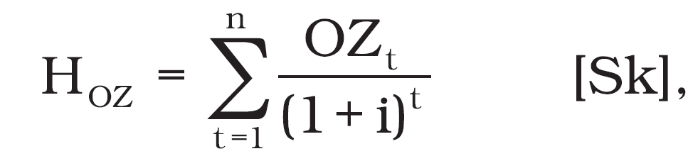
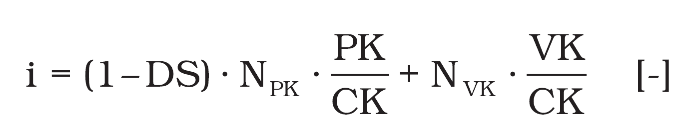
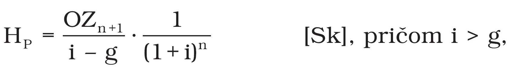
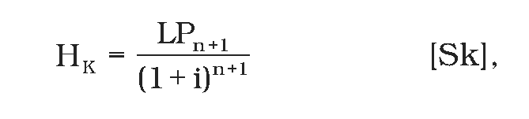
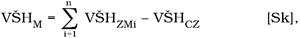
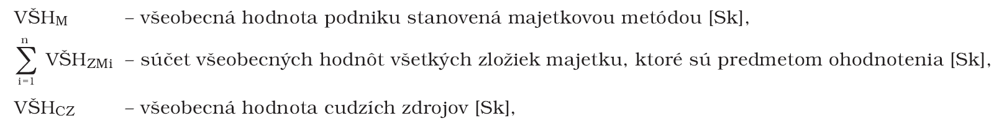
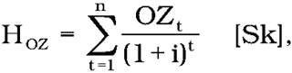

# Čl. I

Vyhláška Ministerstva spravodlivosti Slovenskej republiky č. 492/2004 Z. z. o stanovení všeobecnej hodnoty majetku sa mení a dopĺňa takto:

- 1. V § 4 ods. 3 sa vypúšťajú slová „č. 1 až 15“.

- 2. V § 4 ods. 4 sa slová „č. 1 až 15“ nahrádzajú slovom „tejto“.

- 3. V prílohe č. 1 druhý bod znie:

- „2.

- Podnikateľská metóda stanovenia všeobecnej hodnoty podniku a častí podniku

- a)

- Všeobecná hodnota podniku a častí podniku stanovená podnikateľskou metódou pri časovo neobmedzenej životnosti podniku sa stanoví takto:

- VŠHP = HOZ + HP [Sk],

- kde je

- VŠHP | – | všeobecná hodnota podniku stanovená podnikateľskou metódou [Sk],

- HOZ | – | všeobecná hodnota odčerpateľných zdrojov počas hodnoteného obdobia [Sk],

- HP | – | hodnota pokračujúca [Sk].

- Všeobecná hodnota odčerpateľných zdrojov počas hodnoteného obdobia sa stanoví takto:

- 

- kde je

- HOZ | – | všeobecná hodnota odčerpateľných zdrojov počas hodnoteného obdobia [Sk],

- OZt | – | odčerpateľné zdroje počas hodnoteného obdobia [Sk],

- i | – | miera kapitalizácie v percentách, ktorá sa do výpočtu dosadzuje v desatinnom tvare [%/100],

- n | – | dĺžka sledovaného obdobia [rok].

- Miera kapitalizácie (i) sa stanoví takto:

- 

- CK = PK + VK [Sk],

- kde je

- i | – | vypočítaná miera kapitalizácie v percentách odrážajúca mieru rizika, priemernú nákladovosť kapitálu a štruktúru využívaného kapitálu, ktorá sa do výpočtu dosadzuje v desatinnom tvare [%/100],

- DS | – | sadzba dane z príjmu v percentách, ktorá je stanovená podľa zákona o dani z príjmov pre ohodnocovaný podnik, do výpočtu sa dosadzuje v desatinnom tvare [%/100],

- NPK | – | náklady spojené s využívaním požičaného kapitálu v percentách, t. j. úrok a iné náklady platené veriteľom, ktoré sa do výpočtu dosadzujú v desatinnom tvare [%/100],

- PK | – | objem požičaného kapitálu v slovenských korunách; pozostáva zo zložiek pasív, ktorými na účel výpočtu miery kapitalizácie sú dlhodobé bankové úvery, bežné bankové úvery, finančné výpomoci, emitované dlhopisy, zmenky, lízing, platené nájmy a iné záväzky [Sk],

- NVK | – | náklady vlastného kapitálu v percentách, to znamená podiel na zisku očakávaný a získavaný vlastníkom za vklad svojho kapitálu do podniku, ktoré sa do výpočtu dosadzujú v desatinnom tvare [%/100],

- VK | – | objem vlastného kapitálu v slovenských korunách pozostáva zo zložiek pasív, ktorými na účel výpočtu je vlastné imanie [Sk],

- CK | – | celkový kapitál, ktorým sa rozumie súčet vlastného kapitálu a požičaného kapitálu [Sk].

- Hodnota pokračujúca sa stanoví takto:

- 

- kde je

- HP | – | hodnota pokračujúca [Sk],

- OZn+1 | – | objem odčerpateľných zdrojov v roku nasledujúcom po sledovanom období [Sk],

- i | – | miera kapitalizácie v percentách, ktorá sa do výpočtu dosadzuje v desatinnom tvare [%/100],

- g | – | trvale udržateľná miera rastu odčerpateľných zdrojov v percentách, ktorá sa do výpočtu dosadzuje v desatinnom tvare [%/100],

- n | – | dĺžka sledovaného obdobia [rok].

- Hodnota pokračujúca (HP) je všeobecná hodnota odčerpateľných zdrojov podniku v roku nasledujúcom po sledovanom období zohľadňujúca predpoklady podniku vytvárať odčerpateľné zdroje počas časovo neobmedzeného obdobia, ktorá je prepočítaná na súčasnú hodnotu k dátumu ohodnotenia.

- Trvale udržateľná miera rastu odčerpateľných zdrojov (g) vyjadruje percentuálnu medziročnú zmenu schopnosti podniku vytvárať odčerpateľné zdroje, ktorá závisí od stavu podniku ku dňu ohodnotenia a od jeho vývoja počas sledovaného obdobia v rámci jeho odvetvia v kontexte s jeho históriou.

- Trvale udržateľná miera rastu sa v znaleckom posudku stanoví v súlade so zaužívanými postupmi odbornej praxe, napríklad Gordonov model, geometrické rady, aritmetické rady, a vybraný metodický postup sa v znaleckom posudku opíše.

- b)

- Všeobecná hodnota podniku a častí podniku stanovená podnikateľskou metódou pri časovo obmedzenej životnosti podniku sa stanoví takto:

- VŠHP = HOZ + HK [Sk],

- kde je

- VŠHP | – | všeobecná hodnota podniku stanovená podnikateľskou metódu pri časovo obmedzenej životnosti podniku [Sk],

- HOZ | – | všeobecná hodnota odčerpateľných zdrojov počas hodnoteného obdobia [Sk],

- HK | – | konečná hodnota podniku a častí podniku v roku nasledujúcom po sledovanom období [Sk].

- Hodnota konečná sa stanoví takto:

- 

- kde je

- HK | – | konečná hodnota podniku a častí podniku v roku nasledujúcom po sledovanom období, ktorá je prepočítaná na súčasnú hodnotu k dátumu ohodnotenia [Sk],

- LPn+1 | – | predpokladaný čistý výnos zo speňaženia majetku v roku nasledujúcom po sledovanom období (likvidačný prebytok) [Sk],

- i | – | miera kapitalizácie v percentách, ktorá sa do výpočtu dosadzuje v desatinnom tvare [%/100],

- n | – | dĺžka sledovaného obdobia.“.

- “.

- 4. V prílohe č. 2 treťom bode písm. b) sa slová „úroková miera" nahrádzajú slovami „miera kapitalizácie".

- 5. V prílohe č. 2 štvrtom bode písm. b) sa v celom texte slová „úroková miera" nahrádzajú slovami „miera kapitalizácie".

- 6. V prílohe č. 6 časti A šestnástom bode sa slovo „desaťtisícine" nahrádza slovom „tisícine" a vo vzorci v menovateli sa číslo „104" nahrádza číslom „103".

- 7. V prílohe č. 6 časti B deviatom bode písm. d) sa vo vzorci v menovateli číslo „104" nahrádza číslom „103".

- 8. V prílohe č. 6 časti B bode 16.3 sa vzorec „k3 =1.01 – 0.1D [-]" nahrádza vzorcom „k3 =1.01 – 0.01D [-]".

- 9. V prílohe č. 7 prvá veta znie:

- „Všeobecná hodnota cenných papierov1) sa stanoví podnikateľskou metódou, majetkovou metódou, kombinovanou metódou, porovnávacou metódou alebo likvidačnou metódou.“.

- 10. V prílohe č. 7 tretia veta znie: „Všeobecná hodnota sa stanoví spravidla použitím viacerých metód.".

- 11. Za prílohu č. 15 sa dopĺňa príloha č. 16, ktorá znie:

- „Príloha č. 16 k vyhláške č. 492/2004 Z. z.

- STANOVENIE VŠEOBECNEJ HODNOTY AKCIÍ NA ÚČELY ZISTENIA PRIMERANEJ HODNOTY PROTIPLNENIA PODĽA ZÁKONA Č. 566/2001 Z. Z. O CENNÝCH PAPIEROCH A INVESTIČNÝCH SLUŽBÁCH A O ZMENE A DOPLNENÍ NIEKTORÝCH ZÁKONOV (ZÁKON O CENNÝCH PAPIEROCH) V ZNENÍ NESKORŠÍCH PREDPISOV

- Všeobecná hodnota akcie na účely zisťovania primeraného protiplnenia podľa osobitného zákona1) sa stanoví ako podiel všeobecnej hodnoty podniku ako celku a počtu vydaných akcií so zohľadnením ich menovitej hodnoty.

- Všeobecná hodnota podniku ako celku sa stanoví majetkovou metódou alebo podnikateľskou metódou, ak osobitný zákon2) neustanovuje povinnosť stanoviť všeobecnú hodnotu podniku ako celku majetkovou metódou a zároveň podnikateľskou metódou.

- Ak osobitný zákon2) ustanovuje znalcovi povinnosť stanoviť všeobecnú hodnotu podniku ako celku majetkovou metódou a zároveň podnikateľskou metódou, použijú sa obidve metódy, pričom v závere znaleckého posudku sa uvedú obidve všeobecné hodnoty podniku stanovené majetkovou metódou aj podnikateľskou metódou vrátane z nich vyplývajúcich všeobecných hodnôt akcií. Pri stanovení všeobecnej hodnoty podniku sa zohľadnia špecifiká hodnoteného podniku a ponuky na prevzatie pomocou všetkých relevantných podkladov od fyzickej osoby alebo právnickej osoby, ktorej vznikla povinnosť uskutočniť ponuku na prevzatie alebo ktorá prijala rozhodnutie o tom, že uskutoční ponuku na prevzatie podľa osobitného zákona2) (ďalej len „navrhovateľ“).

- Podkladom na stanovenie všeobecnej hodnoty podniku podnikateľskou metódou je podnikateľský zámer predložený navrhovateľom, z ktorého je zrejmý vývoj podniku po majetkovej, finančnej, nákladovej a výnosovej stránke, ktorý odzrkadľuje postavenie podniku na trhu, spravidla na päť rokov dopredu.

- Podnikateľský zámer obsahuje také náležitosti, aby bolo možné zabezpečiť preskúmateľnosť reálnosti tvorby a výšky odčerpateľných zdrojov vo vzájomnej súvislosti minulého a budúceho obdobia vrátane východísk tvorby a stanovenia parametrov podnikateľského zámeru.

- 1.

- Majetková metóda sa použije podľa § 3 ods. 3 tejto vyhlášky takto:

- 

- kde je

- 

- pričom všeobecnú hodnotu zložiek majetku podniku a záväzkov podniku s ohľadom na ich technicko-ekonomické určenie stanovia znalci z príslušných znaleckých odborov.

- 2.

- Podnikateľská metóda sa použije vždy s ohľadom na časovo neobmedzenú životnosť podniku takto:

- VŠHP = HOZ + HP [Sk],

- kde je

- VŠHP | – | všeobecná hodnota podniku stanovená podnikateľskou metódou [Sk],

- HOZ | – | všeobecná hodnota odčerpateľných zdrojov počas hodnoteného obdobia [Sk],

- HP | – | hodnota pokračujúca [Sk].

- Pri stanovení všeobecnej hodnoty podniku podnikateľskou metódou sa metodicky rozlíši stanovenie všeobecnej hodnoty podnikov od stanovenia všeobecnej hodnoty finančných inštitúcií.

- Všeobecná hodnota odčerpateľných zdrojov počas hodnoteného obdobia sa stanoví takto:

- 

- kde je

- HOZ | – | všeobecná hodnota odčerpateľných zdrojov počas hodnoteného obdobia [Sk],

- OZt | – | odčerpateľné zdroje počas hodnoteného obdobia [Sk],

- i | – | miera kapitalizácie v percentách, ktorá sa do výpočtu dosadzuje v desatinnom tvare [%/100],

- n | – | dĺžka sledovaného obdobia [rok].

- Hodnota pokračujúca sa stanoví takto:

- 

- kde je

- HP | – | hodnota pokračujúca [Sk],

- OZn+1 | – | objem odčerpateľných zdrojov v roku nasledujúcom po sledovanom období [Sk]; ak odčerpateľný zdroj na rok n+1 nie je vopred odhadnutý navrhovateľom, stanoví sa na základe vypočítanej trvale udržateľnej miery rastu (g),

- i | – | miera kapitalizácie v percentách, ktorá sa do výpočtu dosadzuje v desatinnom tvare [%/100],

- g | – | trvale udržateľná miera rastu odčerpateľných zdrojov v percentách, ktorá sa do výpočtu dosadzuje v desatinnom tvare [%/100],

- n | – | dĺžka sledovaného obdobia [rok].

- Hodnota pokračujúca (HP) je všeobecná hodnota odčerpateľných zdrojov podniku v roku nasledujúcom po sledovanom období zohľadňujúca predpoklady podniku vytvárať odčerpateľné zdroje počas časovo neobmedzeného obdobia, ktorá je prepočítaná na súčasnú hodnotu k dátumu ohodnotenia.

- Trvale udržateľná miera rastu odčerpateľných zdrojov (g) vyjadruje percentuálnu medziročnú zmenu schopnosti podniku vytvárať odčerpateľné zdroje, ktorá závisí od stavu podniku ku dňu ohodnotenia a od jeho vývoja počas sledovaného obdobia v rámci jeho odvetvia v kontexte s jeho históriou.

- Trvale udržateľná miera rastu odčerpateľných zdrojov (g) vyplýva z historického a prognózovaného vývoja výnosov, pričom sa abstrahuje od mimoriadnych a extrémnych hodnôt. Ak nie je možné vzhľadom na minulý a budúci vývoj podniku stanoviť trvale udržateľnú mieru rastu odčerpateľných zdrojov (g) uvedeným spôsobom, je možné použiť údaje Štatistického úradu Slovenskej republiky ako priemernú hodnotu rastu príslušného odvetvia za predchádzajúce obdobie spravidla piatich rokov. Údaje zo Štatistického úradu Slovenskej republiky sa použijú aj v prípade, že po odvodení z historických údajov vychádza trvale udržateľná miera rastu (g) vyššia ako miera kapitalizácie (i). Ak výsledky na základe vyššie uvedených postupov nie je možné aplikovať, hraničnou hodnotou trvale udržateľnej miery rastu (g) je predpokladaná miera inflácie k dátumu ohodnotenia.

- Na stanovenie všeobecnej hodnoty odčerpateľného zdroja sa použijú nasledujúce modely:

- a)

- Stanovenie všeobecnej hodnoty odčerpateľného zdroja pre podnik s výnimkou finančných inštitúcií, ktorý využíva alebo bude využívať len vlastný kapitál alebo vlastný kapitál aj požičaný kapitál

- Odčerpateľným zdrojom sa pre tento prípad rozumie výsledok hospodárenia z hospodárskej činnosti po zdanení zvýšený o

- – odpisy a

- – ostatné náklady započítané do výsledku hospodárenia z hospodárskej činnosti, ktoré nie sú výdavkami v bežnom období, napríklad tvorba rezerv, opravných položiek k majetku,

- a znížený o

- – investície do upraveného prevádzkovo-nutného pracovného kapitálu, pričom upravený pracovný kapitál sa stanoví odpočítaním len neúročených krátkodobých záväzkov od obežných aktív,

- – investície do obstarania prevádzkovo-nutného dlhodobého majetku a

- – výnosy započítané do výsledku hospodárenia z hospodárskej činnosti, ktoré nie sú príjmami v bežnom období, napríklad rozpustenie rezerv, rozpustenie opravných položiek k majetku.

- Ak hodnotený podnik využíva alebo bude využívať vlastný kapitál aj požičaný kapitál, miera kapitalizácie (i) sa vypočíta takto:

- 

- CK = PK + VK [Sk],

- kde je

- i | – | vypočítaná miera kapitalizácie v percentách odrážajúca mieru rizika, priemernú nákladovosť kapitálu a štruktúru využívaného kapitálu, ktorá sa do výpočtu dosadzuje v desatinnom tvare [%/100],

- DS | – | sadzba dane z príjmu v percentách, ktorá je stanovená podľa zákona o dani z príjmov pre ohodnocovaný podnik; do výpočtu sa dosadzuje v desatinnom tvare [%/100],

- NPK | – | nákladové úroky z Výkazu ziskov a strát, od ktorých sú odpočítané sankčné úroky a sú prepočítané na ročnú bázu k príslušnému úročenému požičanému kapitálu; do výpočtu sa dosadzujú v desatinnom tvare [%/100],

- PK | – | objem úročeného požičaného kapitálu v slovenských korunách ku dňu ohodnotenia; pozostáva zo zložiek pasív, ktorými na účel výpočtu miery kapitalizácie sú dlhodobé bankové úvery, bežné bankové úvery, finančné výpomoci, emitované dlhopisy, zmenky, lízing, platené nájmy a iné záväzky [Sk],

- NVK | – | náklady vlastného kapitálu v percentách, to znamená podiel na zisku očakávaný a získavaný vlastníkom za vklad svojho kapitálu do podniku, ktoré sa do výpočtu dosadzujú v desatinnom tvare [%/100],

- VK | – | objem vlastného kapitálu v slovenských korunách pozostáva zo zložiek pasív, ktorými na účel výpočtu je vlastné imanie [Sk],

- CK | – | celkový kapitál, ktorým sa rozumie súčet vlastného kapitálu a požičaného kapitálu [Sk].

- Náklady vlastného kapitálu sa stanovia na úrovni bezrizikovej úrokovej miery, ktorá sa rovná výške priemerného výnosu zo štátneho dlhopisu s najdlhšou dobou splatnosti na trhu dlhopisov v Slovenskej republike.

- K hodnote podniku stanovenej týmto modelom sa pripočíta všeobecná hodnota prevádzkovo-nepotrebného majetku a zdôvodní sa jeho neupotrebenie v podnikateľskej činnosti hodnoteného podniku. Tento majetok sa ohodnotí v súlade s jeho technicko-ekonomickým určením znalcami z príslušných znaleckých odborov. V podkladoch od navrhovateľa sa označí aj prevádzkovo-nepotrebný majetok vrátane zdôvodnenia jeho neupotrebenia v podnikateľskej činnosti hodnoteného podniku. Tieto skutočnosti sa preskúmajú a zohľadnia v znaleckom posudku. Od vypočítanej hodnoty podniku sa odpočíta všeobecná hodnota úročeného požičaného kapitálu k dátumu ohodnotenia. Výsledkom je všeobecná hodnota podniku stanovená podnikateľskou metódou pre tento prípad.

- Ak hodnotený podnik využíva alebo bude využívať len vlastný kapitál, miera kapitalizácie (i) sa stanoví na úrovni nákladov vlastného kapitálu, pričom náklady vlastného kapitálu sa stanovia na úrovni bezrizikovej úrokovej miery, ktorá sa rovná výške priemerného výnosu zo štátneho dlhopisu s najdlhšou dobou splatnosti na trhu dlhopisov v Slovenskej republike.

- b)

- Stanovenie všeobecnej hodnoty odčerpateľného zdroja finančných inštitúcií

- Odčerpateľným zdrojom sa pre tento prípad rozumie čistý úrokový výnos zvýšený o

- – výnosy z cenných papierov s premenlivým výnosom,

- – čisté výnosy z poplatkov a provízií,

- – zisk finančných operácií,

- – ostatné výnosy z bežnej činnosti,

- – použitie rezerv a opravných položiek

- a znížený o

- – všeobecné prevádzkové náklady, ktorými sa rozumejú náklady na zamestnancov, ostatné prevádzkové náklady,

- – tvorbu rezerv a opravných položiek,

- – daň z príjmov,

- – kapitálové požiadavky na základe kapitálovej primeranosti,

- – predpokladané investície nutné na zaistenie požadovaného rastu zisku,

- – prídely do zákonného rezervného fondu a do štatutárnych fondov,

- – eventuálne obmedzujúce finančné prostriedky na základe Obchodného zákonníka.

- Miera kapitalizácie (i) sa v tomto prípade stanoví na úrovni nákladov vlastného kapitálu, pričom náklady vlastného kapitálu sa stanovia na úrovni bezrizikovej úrokovej miery, ktorá sa rovná výške priemerného výnosu zo štátneho dlhopisu s najdlhšou dobou splatnosti na trhu dlhopisov v Slovenskej republike.

- Pri stanovovaní všeobecnej hodnoty akcií podľa tejto prílohy sa v znaleckom posudku uvádza aj charakteristika a špecifiká hodnoteného podniku vrátane ekonomicko-finančnej analýzy, popisu a zdôvodnenia použitých metód a postupov.„.

  - Poznámky pod čiarou k odkazom 1 a 2 znejú:

  - „1)

  - § 118g ods. 5, § 118i ods. 7 a § 118i ods. 12 zákona č. 566/2001 Z. z. o cenných papieroch a investičných službách a o zmene a doplnení niektorých zákonov (zákon o cenných papieroch) v znení zákona č. 209/2007 Z. z.

  - 2)

  - Zákon č. 566/2001 Z. z. v znení neskorších predpisov.“.
