# Čl. I

Vyhláška Úradu pre normalizáciu, metrológiu a skúšobníctvo Slovenskej republiky č. 210/2000 Z. z. o meradlách a metrologickej kontrole v znení vyhlášky č. 310/2000 Z. z., vyhlášky č. 403/2000 Z. z., vyhlášky č. 9/2001 Z. z., vyhlášky č. 48/2001 Z. z., vyhlášky č. 75/2001 Z. z., vyhlášky č. 133/2001 Z. z., vyhlášky č. 27/2002 Z. z., vyhlášky č. 69/2002 Z. z., vyhlášky č. 427/2003 Z. z., vyhlášky č. 361/2004 Z. z., vyhlášky č. 669/2004 Z. z., vyhlášky č. 187/2005 Z. z. a vyhlášky č. 570/2006 Z. z. sa mení a dopĺňa takto:

- 1. V § 5 ods. 5 písmeno a) znie:

- „a)

- v hornej časti veľké písmeno identifikujúce štát, ktorý typ meradla schválil – B pre Belgické kráľovstvo, D pre Nemeckú spolkovú republiku, DK pre Dánske kráľovstvo, E pre Španielske kráľovstvo, F pre Francúzsku republiku, EL pre Grécku republiku, I pre Taliansku republiku, IRL pre Írsko, L pre Luxemburské veľkovojvodstvo, NL pre Holandské kráľovstvo, P pre Portugalskú republiku, UK pre Spojené kráľovstvo Veľkej Británie a Severného Írska, A pre Rakúsku republiku, S pre Švédske kráľovstvo, FI pre Fínsku republiku, CZ pre Českú republiku, EST pre Estónsku republiku, CY pre Cyperskú republiku, LV pre Lotyšskú republiku, LT pre Litovskú republiku, H pre Maďarskú republiku, M pre Maltskú republiku, PL pre Poľskú republiku, SI pre Slovinskú republiku, SK pre Slovenskú republiku, BG pre Bulharskú republiku, RO pre Rumunsko, a posledné dvojčíslo roka, v ktorom typ schválil,“.

- 2. V § 6 sa za odsek 3 vkladá nový odsek 4, ktorý znie:

- „(4)

- Ústav alebo určená organizácia môže namiesto skúšok podľa odseku 3 využiť na účely overenia výsledky skúšok vykonaných zahraničným subjektom.“.

- Doterajší odsek 4 sa označuje ako odsek 5.

- 3. V § 9 odsek 3 znie:

- „(3)

- Overovacia značka autorizovanej osoby pozostáva z písmena M a evidenčného čísla autorizovanej osoby umiestnených v kruhu, ak technické požiadavky na daný druh meradla podľa tohto predpisu neustanovujú inak. Overovacia značka autorizovanej osoby zároveň slúži ako zabezpečovacia značka.“.

- 4. V § 9 ods. 7 písm. a) prvý bod znie:

- „1.

- v hornej časti veľké písmeno identifikujúce štát, v ktorom bolo meradlo overené – B pre Belgické kráľovstvo, D pre Nemeckú spolkovú republiku, DK pre Dánske kráľovstvo, E pre Španielske kráľovstvo, F pre Francúzsku republiku, EL pre Grécku republiku, I pre Taliansku republiku, IRL pre Írsko, L pre Luxemburské veľkovojvodstvo, NL pre Holandské kráľovstvo, P pre Portugalskú republiku, UK pre Spojené kráľovstvo Veľkej Británie a Severného Írska, A pre Rakúsku republiku, S pre Švédske kráľovstvo, FI pre Fínsku republiku, CZ pre Českú republiku, EST pre Estónsku republiku, CY pre Cyperskú republiku, LV pre Lotyšskú republiku, LT pre Litovskú republiku, H pre Maďarskú republiku, M pre Maltskú republiku, PL pre Poľskú republiku, SI pre Slovinskú republiku, SK pre Slovenskú republiku, BG pre Bulharskú republiku, RO pre Rumunsko, doplnené v prípade potreby jednou číslicou alebo dvoma číslicami identifikujúcimi územnú alebo administratívnu časť štátu,“.

- 5. V § 9 ods. 9 tretej vete sa slovo „razidlá“ nahrádza slovami „odtlačky razidiel“.

- 6. V § 9 ods. 9 sa za šiestu vetu vkladajú nové vety, ktoré znejú: „Pri samolepke je kružnica súčasťou overovacej značky. Rozmery číslic označujúcich posledné dvojčíslo roka, v ktorom sa overenie vykonalo, umiestnených vo štvorci alebo v kruhu sú funkciou priemeru kružnice opísanej okolo overovacej značky. Pri samolepke môže byť kružnica súčasťou označenia tohto dvojčísla.“.

- 7. V § 9 ods. 12 sa písmeno „F“ nahrádza písmenami „B + F“.

- 8. V § 10 ods. 4 písm. c) sa pred slovo „zákona“ vkladajú slová „písm. f) až h)“.

- 9. V § 12 ods. 3 sa pred slovo „informuje“ vkladá slovo „bezodkladne“.

- 10. V § 12 ods. 4 sa slová „c) až h)“ nahrádzajú slovami „d), e) a g)“ a pred slovo „informuje“ sa vkladá slovo „bezodkladne“.

- 11. Poznámka pod čiarou k odkazu 7 znie:

- „7)

- Smernica Európskeho parlamentu a Rady 98/34/ES z 22. júna 1998 o postupe pri poskytovaní informácií v oblasti technických noriem a predpisov v platnom znení.

- Zákon č. 264/1999 Z. z.

- Nariadenie vlády Slovenskej republiky č. 453/2002 Z. z. o postupoch pri poskytovaní informácií v oblasti technických predpisov a technických noriem.“.

- 12. Za § 12b sa vkladá § 12c ktorý znie:

- 㤠12c

- Touto vyhláškou sa preberajú právne akty Európskych spoločenstiev a Európskej únie uvedené v prílohe č. 74.“.

- 13. V prílohe č. 1 sa dopĺňa nová položka 1.1.8, ktorá znie:

- „1.1.8 | Prístroje na meranie viacerých rozmerov2),3) | 13) | po vykonanej oprave14) | 2 roky | 20)“

- 14. V prílohe č. 1 sa dopĺňa nová položka 1.3.24, ktorá znie:

- „1.3.24 | Meracie zostavy na lieh2),3) | Podľa prílohy č. 72 | Podľa prílohy č. 72 | 1 rok | 72“

- 15. V prílohe č. 1 položka 7.5.2 znie:

- „7.5.2 | Analyzátory dychu3) | áno | áno | 1 rok s výnimkou analyzátorov dychu pracujúcich na elektrochemickom princípe a analyzátorov dychu uvedených na trh do 31. 12. 2000, kde je 6 mesiacov | 25“

- 16. V prílohe č. 1 sa dopĺňa nová položka 7.5.3, ktorá znie:

- „7.5.3 | Plynové chromatografy na stanovenie energetickej hodnoty zemného plynu2) | áno | áno | 1 rok | 73“

- 17. V prílohe č. 1 nadpis položky 8 a položky 8.1 až 8.10 znejú:

- „8.

- VELIČINY ATÓMOVEJ A JADROVEJ FYZIKY

- Meradlá uvedené v položkách 8.2, 8.3, 8.4 a 8.9 podliehajú pred uvedením na trh alebo do používania

- posúdeniu zhody podľa osobitného predpisu13) a počas používania následnému overeniu.

- Po oprave podliehajú prvotnému overeniu.

- 8.1 | Meradlá na kontrolu dodržiavania prevádzkových limitov a na kontrolu referenčných úrovní aktivity a objemovej aktivity z výpustí jadrových zariadení, zo zariadení na ťažbu alebo úpravu rádioaktívnych surovín, spracovanie alebo aplikáciu rádioaktívnych materiálov a z úpravní rádioaktívneho odpadu a na stanovenie radiačnej záťaže z výpustí3) | áno | áno | 2 roky | 4319)

- 8.2 | Meradlá aktivity diagnostických a terapeutických preparátov aplikovaných pacientom in vivo3),4) | – | po oprave14) | 1 rok | 4319)

- 8.3 | Meradlá používané na určenie terapeuticky absorbovaných dávok ionizujúceho žiarenia aplikovaných pacientom3),4) | – | po oprave14) | 1 rok | 4119)

- 8.4 | Meradlá vnútornej rádioaktívnej kontaminácie osôb3),4) | – | po oprave14) | 2 roky | 4319)

- 8.5 | Meradlá objemovej aktivity radónu 222 vo vzduchu a vo vode a ekvivalentnej objemovej aktivity radónu 222 vo vzduchu3) | nie | áno | 1 rok | 4319)

- 8.6 | Zostavy na meranie dozimetrických veličín používané v osobnej dozimetrii3) | áno | áno | 1 rok | 4119)

- 8.7 | Meradlá a zostavy na meranie veličín rádioaktívnej premeny a dozimetrických veličín používané na kontrolu dodržiavania limitov v oblasti radiaènej ochrany alebo radiačnej bezpečnosti a na dôkazové meranie v rámci radiačnej monitorovacej siete3) | áno | áno | 2 roky | 4119) 4319)

- 8.8 | Priamo odčítacie osobné dozimetre a osobné dozimetre signalizujúce prekročenie vopred nastavenej úrovne dozimetrických veličín, ktoré sa nepoužívajú súčasne s určenými meradlami uvedenými v položke 8.63) | áno | áno | 2 roky | 4119)

- 8.9 | Meradlá kvality zväzkov a zdrojov röntgenového žiarenia3),4) | – | po oprave14) | 2 roky | 4119)

- 8.10 | Stacionárne meradlá používané na vyhľadávanie skrytej rádioaktivity v osobnej a nákladnej preprave | nie | áno | 2 roky | 4319)“

- “.

- 18. V prílohe č. 1 poznámka pod čiarou k odkazu 19 znie:

- „19)

- Overenie podľa technických noriem.“.

- 19. V prílohe č. 1 poznámka pod čiarou k odkazu 20 znie:

- „20)

- Overenie podľa harmonizovaných noriem alebo normatívnych dokumentov podľa § 13 nariadenia vlády Slovenskej republiky č. 294/2005 Z. z. o meradlách.“.

- 20. V prílohe č. 3 sa obrázky č. 4 až 7 nahrádzajú novými obrázkami č. 4 až 7:

- 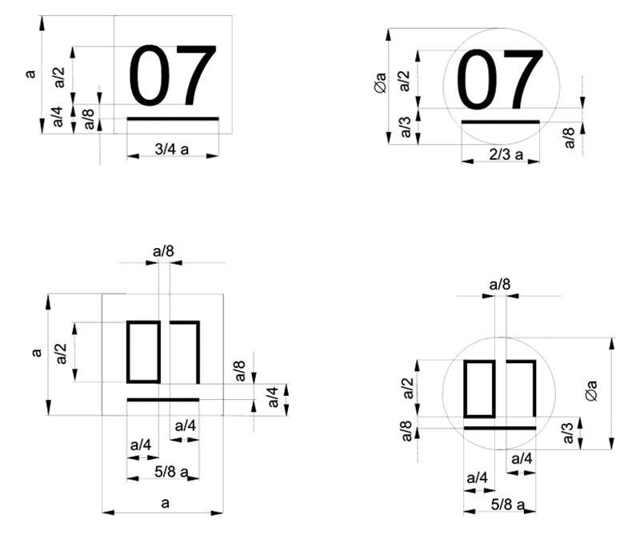

- „Obr. č. 4 Dvojčíslo roka, v ktorom bolo meradlo overené, dopĺňajúce overovaciu značku Slovenského metrologického ústavu alebo Slovenskej legálnej metrológie (razidlo).

- Obr. č. 5 Dvojčíslo roka, v ktorom bolo meradlo overené, dopĺňajúce overovaciu značku Slovenského metrologického ústavu alebo Slovenskej legálnej metrológie (plombovacie kliešte, vypaľovadlo, samolepka).

- Obr. č. 6 Dvojčíslo roka, v ktorom bolo meradlo overené, dopĺňajúce overovaciu značku autorizovanej osoby (razidlo).

- Obr. č. 7 Dvojčíslo roka, v ktorom bolo meradlo overené, dopĺňajúce overovaciu značku autorizovanej osoby (plombovacie kliešte, vypaľovadlo, samolepka).“.

- 21. V prílohe č. 3 sa za obrázok č. 7 vkladajú nové obrázky č. 7a a 7b:

- 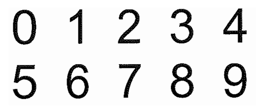

- „Obr. č. 7a Vyhotovenie číslic k obr. č. 4 a 5 (písmo: Arial, rez písma: normálne).

- 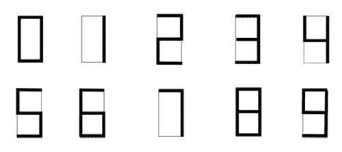

- Obr. č. 7b Vyhotovenie číslic k obr. č. 6 a 7.“.

- 22. V prílohe č. 3 nadpis k obrázkom č. 8 až 11 znie:

- „Príklady overovacích značiek – samolepiek doplnených dátumom overenia“.

- 23. V prílohe č. 3 sa obrázky č. 10 a 11 nahrádzajú novými obrázkami č. 10 a 11:

- 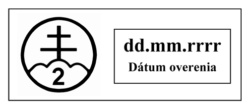

- „Obr. č. 10

- 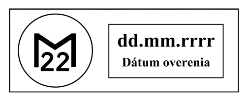

- Obr. č. 11“.

- 24. V prílohe č. 3 obrázku č. 12 sa text „A, S, FI“ nahrádza nákresmi:

- 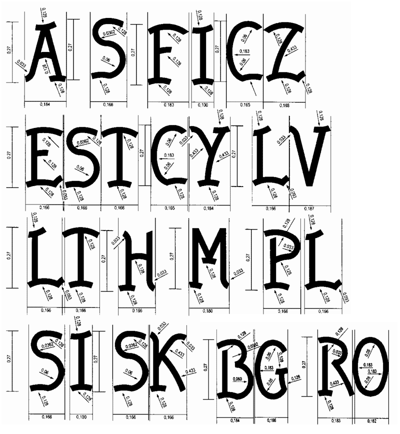

- 25. V prílohe č. 8 prvej časti bod 1 znie:

- „1.

- Táto príloha sa vzťahuje na merače pretečeného množstva studenej vody, ktoré sa používajú na meranie pretečeného množstva úžitkovej vody (ďalej len „merače“) ako určené meradlá podľa § 8 zákona. Nevzťahuje sa na vodomery na studenú vodu uvádzané na trh podľa osobitného predpisu.1) Vzťahuje sa aj na overovanie meračov pretečeného množstva studenej vody uvádzaných na trh podľa § 20 ods. 1 osobitného predpisu.1) Na účely tejto prílohy sa pod výrazom studená voda rozumie voda, ktorej teplota je v rozsahu od 0 oC do 30 oC.“.

- 26. V prílohe č. 8 poznámka pod čiarou k odkazu 1 znie:

- „1)

- Nariadenie vlády Slovenskej republiky č. 294/2005 Z. z. o meradlách.“.

- 27. V prílohe č. 8 prvej časti v bode 5 sa slová „požiadaviek platných v Slovenskej republike“ nahrádzajú slovami „požiadaviek uvedených v tretej časti“.

- 28. V prílohe č. 8 prvej časti sa bod 8 dopĺňa vetou: „Následné overenie a prvotné overenie po oprave meračov uvedených na trh podľa požiadaviek uvedených v druhej časti sa môže vykonať podľa požiadaviek uvedených v tretej časti.“.

- 29. V prílohe č. 8 tretej časti oddiele I v bode 3.1 sa vypúšťa prvá veta.

- 30. V prílohe č. 8 tretej časti oddiele II v bode 6.1 sa vypúšťa prvá veta.

- 31. V prílohe č. 8 tretej časti oddiele III v bode 6.1 sa vypúšťa prvá veta.

- 32. V prílohe č. 8 tretej časti oddiele IV v bode 6.1 sa vypúšťa prvá veta.

- 33. V prílohe č. 9 prvej časti v bode 5 sa slová „požiadaviek platných v Slovenskej republike“ nahrádzajú slovami „požiadaviek uvedených v tretej časti“.

- 34. V prílohe č. 9 prvej časti sa bod 8 dopĺňa vetou: „Následné overenie a prvotné overenie po oprave meračov uvedených na trh podľa požiadaviek uvedených v druhej časti sa môže vykonať podľa požiadaviek uvedených v tretej časti.“.

- 35. V prílohe č. 9 tretej časti oddiele I v bode 3.1 sa vypúšťa prvá veta.

- 36. V prílohe č. 9 tretej časti oddiele II v bode 6.1 sa vypúšťa prvá veta.

- 37. V prílohe č. 9 tretej časti oddiele III v bode 6.1 sa vypúšťa prvá veta.

- 38. V prílohe č. 13 druhej časti oddiele I časti B v bode 6.1 prvá veta znie: „Chyby sa vzťahujú na meranie vzduchom s referenčnou hustotou 1,2 kg m-3.“.

- 39. V prílohe č. 13 tretej časti oddiele I v bode 3.2.2 sa vzorec „ki = C1/Ci“ nahrádza vzorcom „ki = C1/Ci“.

- 40. V prílohe č. 24 druhej časti bod 11 znie:

- „11.

- Osobitné náležitosti

- Meradlá v prevádzke sa pri overení zabezpečujú úradnou uzáverou správcu dane.“.

- 41. V prílohe č. 25 druhej časti v bode 3.1 posledná veta znie: „Pri analyzátoroch dychu pracujúcich na elektrochemickom princípe a analyzátoroch dychu uvedených na trh do 31. 12. 2000 je merací rozsah najmenej do 1,40 mg/l.“.

- 42. V prílohe č. 25 druhej časti v bode 3.2 druhá veta znie: „Pri metrologickej kontrole alebo pri manuálnej kalibrácii rozlišuje meradlo hodnotu 0,001 mg/l, pri analyzátoroch dychu pracujúcich na elektrochemickom princípe a analyzátoroch dychu uvedených na trh do 31. 12. 2000 hodnotu 0,01 mg/l.“.

- 43. V prílohe č. 31 druhej časti bod 1.3.2 znie:

- „1.3.2

- Priestorový uhol vyžarovania laserového zväzku je rozbiehavosť vyžarovaného svetelného lúča lasera – vrcholový uhol svetelného kužeľa meraný v horizontálnej aj vo vertikálnej rovine.“.

- 44. V prílohe č. 31 druhej časti bod 2.4 znie:

- „2.4

- Ak sa súčasne s meraním vyhotovuje aj záznam situácie vo forme fotografického obrázka, videozáznamu a podobne, potom sa zabezpečuje správne nastavenie optickej osi záznamu a osi vyžarovacej charakteristiky antény alebo osi vyžarovaného svetelného lúča lasera. Postup nastavenia sa opisuje v technickej dokumentácii rýchlomera.“.

- 45. V prílohe č. 31 druhej časti bod 3.4.1 znie:

- „3.4.1

- Priestorový uhol vyžarovania laserového zväzku je uvedený v technickej dokumentácii výrobcu a nesmie byť väčší ako 5 mrad meraný ako rovinný uhol pre horizontálnu a vertikálnu rovinu na úrovni 50 % poklesu vyžarovaného výkonu.“.

- 46. V prílohe č. 31 druhej časti bod 4.2.1.1 znie:

- „4.2.1.1

- Mikrovlnný elektronický čítač merajúci v rozsahu vstupných frekvencií vysielača cestného radarového rýchlomera (pásmo 34 GHz) s kombinovanou štandardnou neistotou merania frekvencie menšou ako 2 x 10-5.“.

- 47. V prílohe č. 31 druhej časti bod 4.2.1.5 znie:

- „4.2.1.5

- Etalónové zariadenie na meranie rýchlosti motorového vozidla v teréne s meracím rozsahom rýchlostí od 20 km .h-1 do 130 km .h-1 s kombinovanou štandardnou neistotou merania rýchlosti menšou ako 0,5 km . h-1 do rozsahu merania rýchlosti 100 km .h-1 a s kombinovanou štandardnou neistotou merania rýchlosti 0,5 % z hodnoty meranej rýchlosti pre rozsah rýchlosti nad 100 km .h-1.“.

- 48. V prílohe č. 31 druhej časti v bode 4.2.2.4 druhá veta znie: „Zariadenie umožňuje meranie rýchlosti motorového vozidla v teréne od 20 km .h-1 do 130 km .h-1 s kombinovanou štandardnou neistotou merania rýchlosti menšou ako 0,5 km .h-1 do rýchlosti 100 km .h-1a s kombinovanou štandardnou neistotou merania rýchlosti 0,5 % z hodnoty meranej rýchlosti pre rýchlosti nad 100 km .h-1.“.

- 49. V prílohe č. 31 druhej časti sa za bod 4.2.2.4 vkladá nový bod 4.2.2.5, ktorý znie:

- „4.2.2.5

- Etalónové zariadenie na simulovanie rýchlosti vozidla – simulátor rýchlosti v rozsahoch frekvencie impulzov a oneskorenia impulzov zodpovedajúcich meraciemu rozsahu rýchlomera s kombinovanou štandardnou neistotou simulovania rýchlosti nepresahujúcou 0,5 km .h-1 pri simulácii rýchlostí do 100 km .h-1 a 0,5 % z hodnoty rýchlosti pre rýchlosti nad 100 km .h-1.“.

- Doterajší bod 4.2.2.5 sa označuje ako bod 4.2.2.6.

- 50. V prílohe č. 31 druhej časti sa za bod 4.3.4.4 vkladá nový bod 4.3.4.5, ktorý znie:

- „4.3.4.5

- Skúška správnosti rýchlomera simuláciou rýchlosti v laboratóriu

- Skúškou správnosti rýchlomera simulátorom rýchlosti sa zisťuje chyba rýchlomera v laboratóriu. Rýchlomer a simulátor rýchlosti sa inštalujú podľa predpisu výrobcu. Skúška sa vykoná najmenej pri troch hodnotách rýchlosti v rozsahu do 130 km .h-1v smere prichádzajúceho vozidla a pri troch hodnotách rýchlosti v rozsahu do 130 km .h-1 v smere odchádzajúceho vozidla a vypočíta sa kombinovaná štandardná neistota merania rýchlosti.“.

- Doterajší bod 4.3.4.5 sa označuje ako bod 4.3.4.6.

- 51. V prílohe č. 31 druhej časti bod 4.4.3 znie:

- „4.4.3

- Pri prvotnom overení cestných laserových rýchlomerov sa kontroluje zhoda predloženého rýchlomera so schváleným typom a vykonajú sa skúšky podľa bodov 4.3.1, 4.3.4.3 a skúška podľa bodov 4.3.4.4 alebo 4.3.4.5. Ak sa vykonáva skúška podľa bodu 4.3.4.5, musí sa vykonať aj skúška podľa bodu 4.3.4.4 aspoň pri jednej hodnote rýchlosti prichádzajúceho skúšobného vozidla a pri jednej hodnote rýchlosti odchádzajúceho skúšobného vozidla. Pri následnom overení cestných laserových rýchlomerov sa kontroluje zhoda predloženého rýchlomera so schváleným typom a vykonajú sa skúšky podľa bodov 4.3.1, 4.3.4.3 a 4.3.4.5.“.

- 52. V prílohe č. 31 druhej časti bod 4.5.2 znie:

- „4.5.2.

- Pri cestných laserových rýchlomeroch sa hodnoty rýchlosti namerané skúšaným rýchlomerom porovnajú s hodnotami rýchlosti skúšobného vozidla vypočítanými zo vzdialenosti kontrolných bodov na skúšobnej dráhe a príslušných časových intervalov prechodu vozidla týmito bodmi alebo s hodnotami indikovanými simulátorom rýchlosti.“.

- 53. V prílohe č. 41 sa body 4 až 7 nahrádzajú bodmi 4 až 9, ktoré znejú:

- „4.

- Meradlá dozimetrických veličín uvedené v bode 1 písm. a) a e) podliehajú pred uvedením na trh alebo do používania posúdeniu zhody podľa osobitného predpisu.1)

- 5.

- Meradlá dozimetrických veličín, okrem meradiel uvedených v bode 1 písm. a) a e), podliehajú pred uvedením na trh schváleniu typu a prvotnému overeniu.

- 6.

- Meradlá dozimetrických veličín schváleného typu výrobca alebo dovozca označí značkou schváleného typu.

- 7.

- Na meradlá dozimetrických veličín, ktoré pri overení vyhovejú ustanoveným požiadavkám, sa vystaví doklad o overení alebo sa označia overovacou značkou.

- 8.

- Meradlá dozimetrických veličín podliehajú počas ich používania ako určené meradlá následnému overeniu.

- 9.

- Metódy technických skúšok pri schvaľovaní typu a metódy skúšania pri overení sú uvedené v technických normách.“.

- 54. V prílohe č. 42 prvá časť vrátane nadpisu znie:

- „Prvá časť

- Vymedzenie meradiel a spôsob ich metrologickej kontroly

- 1.

- Táto príloha sa vzťahuje na meradlá akustického tlaku:

- a)

- zvukomer a integrujúci zvukomer,1)

- b)

- zvukomer,2)

- c)

- pásmový filter,

- d)

- osobný zvukový expozimeter

- ako určené meradlá podľa § 8 zákona.

- 2.

- Zvukomer a integrujúci zvukomer sú elektronické meracie prístroje určené na meranie zvuku.

- 3.

- Pásmový filter je prístroj schopný zabezpečiť spektrálnu informáciu pre široký rozsah zvukových signálov, napríklad časovo premenných, prerušovaných a ustálených, širokopásmových a s diskrétnou frekvenciou, s dlhým a krátkym časom trvania. Pásmový filter je samostatné meradlo alebo je modulovo zabudovaný do zvukomera a integrujúceho zvukomera.

- 4.

- Osobný zvukový expozimeter je prenosný elektronický merací prístroj určený na meranie zvukovej expozície.

- 5.

- Meradlo akustického tlaku pred uvedením na trh podlieha schváleniu typu a prvotnému overeniu. Metódy technických skúšok pri schvaľovaní typu a metódy skúšania pri overovaní sú uvedené v druhej časti.

- 6.

- Meradlo akustického tlaku schváleného typu výrobca alebo dovozca označí značkou schváleného typu.

- 7.

- Meradlo akustického tlaku, ktoré pri overení vyhovie ustanoveným požiadavkám, sa označí overovacou značkou.

- 8.

- Meradlo akustického tlaku počas jeho používania ako určeného meradla podlieha následnému overeniu.

- 9.

- Typy meradiel uvedených v bode 1 písm. a) nemožno schvaľovať odo dňa nadobudnutia účinnosti tejto vyhlášky.

- 10.

- Meradlá uvedené v bode 1 písm. a) sa následne overujú podľa predpisu platného v čase uvedenia na trh.“.

- Poznámky pod čiarou k odkazu 1 a 2 znejú:

- „1)

- IEC 60651 alebo EN 60651 a IEC 60804 alebo EN 60804.

- 2)

- IEC 61672-2 alebo EN 61672-2.“.

- 55. V prílohe č. 42 druhej časti sa oddiel I nahrádza oddielmi I A a I B, ktoré vrátane nadpisov znejú:

- „ODDIEL I A

- ZVUKOMERY A INTEGRUJÚCE ZVUKOMERY

- 1.

- Termíny a definície

- 1.1

- Zvukomer je merací prístroj, ktorým môžu byť merané hladiny akustického tlaku za presne definovaných podmienok tak, že výsledky získané používateľom prístroja sú vždy reprodukovateľné vnútri určených tolerancií.

- 1.2

- Integrujúci zvukomer je zvukomer, ktorý má ďalšie prídavné zariadenie umožňujúce merať ekvivalentnú hladinu akustického tlaku alebo v niektorých prípadoch aj hladinu zvukovej expozície. Integrujúci zvukomer sa tiež nazýva integrujúco-priemerujúci zvukomer.

- 1.3

- Akustický tlak je premenlivý tlak superponovaný na statický tlak prítomnosťou zvuku; vyjadruje sa v pascaloch (Pa).

- 1.4

- Vážená hladina akustického tlaku vyjadrená v decibeloch (dB) je dvadsaťnásobok dekadického logaritmu pomeru frekvenčne váženého akustického tlaku k referenčnému akustickému tlaku. Referenčný akustický tlak je 20 µPa (20 µN/m2). Hladina akustického tlaku sa musí udávať s vyznačeným frekvenčným a časovým vážením.

- 1.5

- Ekvivalentná hladina akustického tlaku A; priemerná hladina akustického tlaku A vyjadrená v decibeloch (dB) je desaťnásobok dekadického logaritmu pomeru v čase priemerovaného kvadrátu akustického tlaku frekvenčne váženého funkciou A počas doby priemerovania T ku kvadrátu štandardného referenčného akustického tlaku.

- 1.6

- Zvuková expozícia je časový integrál kvadrátu okamžitej hodnoty akustického tlaku A za stanovený čas, napríklad pracovný deň.

- 1.7

- Rozsah linearity je rozdiel medzi hornou a dolnou hladinou zodpovedajúci efektívnej hodnote pre spojité sínusové signály pripojené na vstup zvukomera, vnútri ktorého sú splnené požiadavky na linearitu.

- 1.8

- Referenčný smer je smer dopadu zvuku stanovený výrobcom na určenie akustickej citlivosti a frekvenčnej charakteristiky.

- 1.9

- Referenčná frekvencia je frekvencia stanovená výrobcom v rozsahu 200 Hz až 1 kHz na určovanie absolútnej akustickej citlivosti.

- 1.10

- Referenčná hladina akustického tlaku je hladina akustického tlaku stanovená výrobcom na určenie absolútnej akustickej citlivosti.

- 1.11

- Referenčný rozsah zvukomera je merací rozsah stanovený výrobcom na kalibračné účely. Tento rozsah musí obsahovať referenčnú hladinu akustického tlaku.

- 2.

- Technické požiadavky a metrologické požiadavky

- 2.1

- Konštrukcia prístroja

- Zvukomer je kombinácia mikrofónu, zosilňovača s požadovanými váženými filtrami a zariadením usmerňovač – indikátor s požadovanými časovými váženými charakteristikami.

- Zvukomer musí mať jednu alebo viac frekvenčných vážených charakteristík označených A, B, C. Voliteľné frekvenčné vážené charakteristiky, ktoré môžu byť zabudované, sú:

- a)

- charakteristika označená Lin, ktorej frekvenčná charakteristika je konštantná v závislosti od frekvencie,

- b)

- charakteristika označená D je vážený filter na meranie leteckého hluku.

- Zvukomer musí mať jednu alebo viac časových vážených charakteristík označených S, F, I. Časová charakteristika Peak môže byť takisto zabudovaná do zvukomera. Zvukomer s časovými váženými charakteristikami I alebo Peak musí mať takisto aspoň jednu charakteristiku F alebo S. Zvukomer a integrujúci zvukomer musia mať indikátor prebudenia.

- Integrujúci zvukomer navyše obsahuje integrátor, t. j. zariadenie priemerujúce v čase.

- Zvukomer a integrujúci zvukomer môže mať ďalšie prídavné zriadenia, ako sú indikátor so širokým rozsahom, číslicový zobrazovač, záznamový zobrazovač alebo automatický prepínač meracích rozsahov. Ďalšie prídavné zariadenia, ako sú predlžovací nadstavec, korektor pre náhodný dopad a podobne, sa považujú za súčasti zvukomera a integrujúceho zvukomera.

- Keďže je dôležitá len celková činnosť skutočného prístroja, nie je potrebná oddeliteľnosť jeho jednotlivých funkčných prvkov.

- Výrobca zabezpečí prostriedky na nahradenie elektrického vstupného signálu v mieste mikrofónu na účely vykonania skúšok úplného prístroja bez mikrofónu.

- Výrobca môže vybaviť prístroj na vykonanie elektrických skúšok prístupným vstupným skúšobným bodom alebo odporučiť a zabezpečiť ekvivalent mikrofónu alebo ekvivalentný vstupný adaptér, ktorý môže byť elektrický alebo neelektrický. K dispozícii môže byť voliteľný prístupný výstupný skúšobný bod.

- 2.2

- Meracie jednotky

- Meracou jednotkou na vyjadrovanie akustického tlaku v sústave meracích jednotiek SI je pascal (Pa). Na vyjadrovanie zvuku v akustike sa používa logaritmická stupnica a s ňou súvisiace hladinové vyjadrenie s jednotkami decibel (dB). Decibel nie je absolútna, ale relatívna jednotka vzťahujúca sa na dohodnutú referenčnú hodnotu 20 µPa. Hodnote 20 µPa zodpovedá hodnota 0 dB.

- 2.3

- Merací rozsah

- Rozsah linearity a impulzný dynamický rozsah stanovuje výrobca prístroja a musí spĺňať požiadavky uvedené v príslušných slovenských technických normách.

- Rozsah analógového alebo číslicového indikátora musí byť najmenej 15 dB. Ak je zabudovaný analógový indikátor, jeho stupnica musí byť graduovaná v dielikoch najviac 1 dB v rozsahu najmenej 15 dB. Dĺžka dielika zodpovedajúceho hodnote 1 dB musí byť najmenej 1 mm.

- Ak je zabudovaný číslicový indikátor alebo iný indikátor s nespojitým zobrazovaním, musí zvukomer obsahovať režim, v ktorom je najvyššia úroveň hladiny zvuku v meracom intervale zachovaná na zobrazovači. Priemerujúci režim musí indikovať hladinu zodpovedajúcu efektívnej hodnote.

- 2.4

- Trieda presnosti a najväčšie dovolené chyby

- Zvukomery a integrujúce zvukomery sa zaraďujú do štyroch tried presnosti, ktoré sa označujú ako trieda presnosti 0, 1, 2 a 3. Najväčšie dovolené chyby sa zväčšujú s rastúcim číslom triedy presnosti.

- Zvukomer a integrujúci zvukomer triedy presnosti 0 je určený ako etalón. Trieda presnosti 1 je určená na presné laboratórne meranie a prevádzkové meranie v miestach, kde akustické prostredie môže byť určené alebo ovládané. Presnosť meraní s takýmto prístrojom nebude vo všeobecnosti zabezpečená za bežných podmienok. Zvukomer a integrujúci zvukomer triedy presnosti 2 sú vhodné na použitie na bežné prevádzkové merania. Trieda presnosti 3 je určená na informatívne merania. Predmetom tejto prílohy sú iba zvukomery a integrujúce zvukomery triedy presnosti 0, 1 a 2.

- Zvukomer a integrujúci zvukomer určené na prevádzkové merania musia vyhovovať prísnym technickým parametrom prostredia. Ďalšie zvukomery a integrujúce zvukomery sa používajú iba v laboratóriách, kde je prostredie ovládané, a nie je opodstatnené vyžadovať, aby prístroje vyhovovali technickým požiadavkám ako prístroje určené na prevádzkové merania.

- Chyba údaja zvukomera a integrujúceho zvukomera pri referenčných podmienkach nesmie prekročiť najväčšiu dovolenú chybu ± 0,4 dB, ± 0,7 dB a ± 1,0 dB pre prístroje triedy presnosti 0, 1 a 2 po uplynutí doby zahriatia prístrojov určenej výrobcom.

- Najväčšie dovolené chyby zvukomerov a integrujúcich zvukomerov v stanovenom rozsahu podmienok prostredia sú uvedené v príslušných slovenských technických normách.

- 2.5

- Vlastnosti meraného média

- Zvukomer a integrujúci zvukomer sú určené na meranie zvuku vyvolaného ustálenými, prerušovanými, premennými, nepravidelnými alebo impulznými signálmi. Zvukomer a integrujúci zvukomer spolu s pásmovými filtrami sú schopné zabezpečiť spektrálnu informáciu pre široký okruh signálov, napríklad časovo premenných, prerušovaných a ustálených, širokopásmových a s diskrétnou frekvenciou, s dlhým a krátkym časom trvania.

- 2.6

- Referenčné podmienky

- Referenčné podmienky okolitého prostredia (ďalej len „referenčné podmienky“) sú:

- a)

- atmosférický tlak 101,3 kPa,

- b)

- teplota vzduchu 20 oC,

- c)

- relatívna vlhkosť vzduchu 65 %

- a neprítomnosť významných interferencií spôsobených okolitými zvukmi, prúdením vzduchu cez mikrofón, vibráciami, magnetickými poľami, elektromagnetickými poľami alebo elektrostatickými poľami.

- 2.7

- Špecifikácia pracovných podmienok

- 2.7.1

- Atmosférický tlak

- Pri kolísaní statického tlaku v rozsahu ± 10 % sa citlivosť celého prístroja nesmie zmeniť o viac ako ± 0,3 dB pre prístroje triedy presnosti 0 a 1 a o viac ako ± 0,5 dB pre prístroje triedy presnosti 2 v prípade, že sa skúšajú na frekvenciách medzi 200 Hz až 1 000 Hz.

- 2.7.2

- Teplota okolia

- Výrobca stanoví teplotný rozsah, v ktorom kalibrácia celého prístroja vrátane mikrofónu nie je ovplyvnená viac ako 0,5 dB pre prístroje triedy presnosti 0, 1 a 2 vzhľadom na údaj pri 20 oC. Ak zmena pri kalibrácii prístroja určeného na prevádzkové meranie presahuje ± 0,5 dB v teplotnom rozsahu –10 oC až + 50 oC, výrobca poskytne údaj o korekcii. Skúška sa musí vykonať na frekvenciách medzi 200 Hz až 1 000 Hz.

- 2.7.3

- Relatívna vlhkosť vzduchu

- Výrobca stanoví rozsah relatívnej vlhkosti vzduchu, pri ktorom môže prístroj pracovať vrátane mikrofónu. Pri prístrojoch určených na prevádzkové meranie sa údaj nesmie meniť viac ako ± 0,5 dB pre prístroje triedy presnosti 0, 1 a 2 vzhľadom na údaj pri 65 %, keď sa relatívna vlhkosť mení z 30 % na 90 %. Skúška sa musí vykonať pri teplote 40 oC na frekvenciách medzi 200 Hz až 1 000 Hz.

- 2.7.4

- Magnetické a elektrostatické polia

- Vplyv magnetických a elektrostatických polí sa musí znížiť na najnižšiu úroveň. Zvukomer a integrujúci zvukomer s pripevneným mikrofónom sa musia skúšať v magnetickom poli s intenzitou 80A/m pri 50 Hz alebo 60 Hz. Prístroje musia byť orientované v smere najväčšieho údaja indikátora zvukomera a vplyv polí musí byť určený pre všetky dostupné vážené charakteristiky. Pre meracie prístroje, ktoré používajú predlžovací kábel medzi mikrofónom a indikačnou jednotkou, sa musia skúšky vykonať aj na mikrofóne. Skúšobnú frekvenciu určí výrobca.

- 2.7.5

- Mechanické vibrácie

- Vplyv mechanických vibrácií na činnosť zvukomera a integrujúceho zvukomera sa musí obmedziť na najnižšiu úroveň. Účinok vibrácií s frekvenciou medzi 20 Hz až 1 000 Hz uvedie výrobca. V prípade, že sa neuvažuje, že mikrofón bude pri bežnom používaní pripojený k predlžovaciemu káblu, sa táto informácia musí vzťahovať na celý prístroj. V ďalších prípadoch sa táto informácia uvedie najmenej pre mikrofón. Prístroj sa musí podrobiť skúške sínusovými vibráciami so zrýchlením 1 m/s2. Na zabezpečenie, aby žiadny zvuk vyvolaný vibráciami neovplyvnil výsledok skúšky, musí sa použiť referenčný zvukomer, ktorý nie je vystavený vibráciám. Údaje oboch zvukomerov, skúšobného a referenčného, sa musia zaznamenať. Skúška sa musí vykonať pre zabudovanú frekvenčnú váženú charakteristiku s najširším frekvenčným pásmom. Skúšaný zvukomer sa musí upevniť v mieste, ktoré je určené na pripevnenie statívu, ak je k dispozícii, a vibrácie musia byť vyvolané v smere osi upevnenia. Ak sú možné dve metódy upevnenia, skúška sa musí vykonať pre obidve metódy upevnenia. Ak miesto upevnenia k statívu nie je zabudované, výrobca určí metódu upevnenia zvukomera pri skúške. V tomto prípade a v prípade nastaviteľného upevnenia zvukomera musia byť vibrácie vyvolané v smere kolmom na rovinu membrány mikrofónu.

- 2.7.6

- Kontrola napájacieho zdroja

- Ak je zvukomer, resp. integrujúci zvukomer napájaný z batérií, výrobca zabezpečí vhodný prostriedok na kontrolu napájacieho zdroja tak, aby v súlade s technickými požiadavkami na prístroj bolo dodržané predpísané napätie napájacieho zdroja.

- 2.8

- Nápisy a značky

- 2.8.1

- Nápisy

- Zvukomer spĺňajúci všetky požiadavky technickej normy1) musí byť označený uvedením tejto normy a označením trieda presnosti 0, trieda presnosti 1 alebo trieda presnosti 2 podľa tejto normy.

- Integrujúci zvukomer spĺňajúci všetky požiadavky technickej normy2) musí byť označený uvedením týchto noriem, označením trieda presnosti 0, trieda presnosti 1 alebo trieda presnosti 2 podľa týchto noriem a rokom výroby.

- Ak zvukomer a integrujúci zvukomer sú určené iba na laboratórne meranie, označujú sa prídavným písmenom „L“, napríklad trieda presnosti 2 L. Ak zvukomer a integrujúci zvukomer sú kalibrované pre difúzne zvukové pole, označujú sa prídavným písmenom „R“.

- Zvukomery a integrujúce zvukomery musia mať vyznačené

- a)

- meno výrobcu alebo obchodnú značku,

- b)

- typové označenie,

- c)

- výrobné číslo.

- 2.8.2

- Značky

- Značka schváleného typu a overovacia značka musia byť na zvukomere a integrujúcom zvukomere umiestnené na viditeľnom mieste a musia byť čitateľné a neodstrániteľné.

- 2.9

- Návod na používanie

- Každý zvukomer a integrujúci zvukomer sa musí dodávať s návodom na používanie v slovenskom jazyku, ktorý musí obsahovať informácie uvedené v príslušných slovenských technických normách.

- 2.10

- Ochrana proti neoprávneným zásahom

- Zvukomer a integrujúci zvukomer výrobca vhodne zabezpečí proti neoprávneným zásahom.

- Overovacie značky musia byť umiestnené na zvukomere a integrujúcom zvukomere tak, aby neoprávnený zásah do kalibračných prvkov bol evidentný.

- 3.

- Metódy skúšania pri overovaní zvukomerov a integrujúcich zvukomerov

- 3.1

- Zvukomery

- Pri prvotnom a následnom overení zvukomera sa vykonajú tieto úkony:

- a)

- Skúšky akustických vlastností, ktorých predmetom je

- 1.

- indikácia pri referenčných podmienkach,

- 2.

- relatívna frekvenčná charakteristika pre voľné pole v referenčnom smere pre vybraté frekvencie,

- 3.

- relatívna frekvenčná charakteristika pre voľné pole s príslušenstvom v prípade, ak príslušenstvo tvorí časť konfigurácie a predkladá sa na overenie pre vybraté frekvencie,

- 4.

- frekvencia, hladina a skreslenie akustického kalibrátora, ak je kalibrátor zabudovaný ako integrálna časť zvukomera.

- b)

- Skúšky elektrických vlastností, ktorých predmetom je

- 1.

- RMS usmerňovač pri vybratých crest faktoroch,

- 2.

- časové váženie pri vybratých hladinách signálu,

- 3.

- prepínač meracích rozsahov,

- 4.

- indikátor,

- 5.

- indikácia prebudenia, ak je zabudovaný indikátor.

- c)

- Kontrola náležitostí prístroja, ktorej predmetom sú

- nápisy a značky.

- 3.2

- Integrujúce zvukomery

- Pri prvotnom a následnom overení integrujúceho zvukomera sa vykonajú tieto úkony:

- a)

- Skúšky akustických vlastností, ktorých predmetom je

- 1.

- indikácia pri referenčných podmienkach,

- 2.

- frekvenčná charakteristika pre vybraté frekvencie,

- 3.

- frekvenčná charakteristika s príslušenstvom, ak obsahuje príslušenstvo, pre vybraté frekvencie,

- 4.

- frekvencia, hladina, skreslenie akustického kalibrátora, ak je obsiahnutý ako integrálna časť zvukomera.

- b)

- Skúšky elektrických vlastností, ktorých predmetom je

- 1.

- RMS usmerňovač pri vybratých crest faktoroch,

- 2.

- časové váženie pri vybratých hladinách signálu,

- 3.

- presnosť prepínača meracích rozsahov,

- 4.

- indikátor pre linearitu,

- 5.

- frekvenčné váženie, elektrický vstup.

- c)

- Skúšky elektrických vlastností špeciálne pre integrujúce zvukomery, ktorých predmetom je

- 1.

- indikácia prebudenia pre vybraté frekvencie,

- 2.

- časové priemerovanie,

- 3.

- priemerná AI vážená hladina akustického tlaku, ak je zabudovaná.

- d)

- Kontrola náležitostí prístroja, ktorej predmetom sú

- nápisy a značky.

- 3.3

- Postup pri prvotnom a následnom overení ustanovuje príslušná slovenská technická norma.

- ODDIEL I B

- ZVUKOMERY

- 1.

- Termíny a definície

- 1.1

- Referenčný akustický tlak je konvenčne zvolená referenčná hodnota rovnajúca sa 20 µPa pre zvuk šírený vzduchom.

- 1.2

- Hladina akustického tlaku je dvadsaťnásobok dekadického logaritmu pomeru efektívnej hodnoty daného akustického tlaku k referenčnému akustickému tlaku.

- 1.3

- Frekvenčné váženie; frekvenčná váhová charakteristika je pre zvukomer rozdiel medzi hladinou signálu indikovanou zobrazovacím zariadením a zodpovedajúcou hladinou ustáleného sínusového vstupného signálu s konštantnou amplitúdou špecifikovaný v tejto prílohe ako funkcia frekvencie.

- 1.4

- Časové váženie; časová váhová charakteristika je exponenciálna funkcia času so stanovenou časovou konštantou, ktorou sa váži kvadrát okamžitého akustického tlaku.

- 1.5

- Časovo vážená hladina akustického tlaku je dvadsaťnásobok dekadického logaritmu pomeru danej efektívnej hodnoty akustického tlaku k referenčnému akustickému tlaku, pričom efektívna hodnota akustického tlaku sa získa využitím štandardného frekvenčného váženia a štandardného časového váženia.

- 1.6

- Maximálna časovo vážená hladina akustického tlaku je najvyššia časovo vážená hladina akustického tlaku počas stanoveného časového intervalu.

- 1.7

- Vrcholový akustický tlak je najvyššia okamžitá absolútna hodnota akustického tlaku počas stanoveného časového intervalu.

- 1.8

- Hladina vrcholového akustického tlaku je dvadsaťnásobok dekadického logaritmu pomeru vrcholového akustického tlaku k referenčnému akustickému tlaku, pričom vrcholový akustický tlak sa získa štandardným frekvenčným vážením.

- 1.9

- Časovo priemerovaná hladina akustického tlaku, ekvivalentná hladina akustického tlaku je dvadsaťnásobok dekadického logaritmu pomeru efektívnej hodnoty akustického tlaku počas stanoveného časového intervalu k referenčnému akustickému tlaku, pričom akustický tlak sa získa štandardným frekvenčným vážením.

- 1.10

- Zvuková expozícia je časový integrál kvadrátu akustického tlaku za stanovený časový interval alebo udalosť.

- 1.11

- Hladina zvukovej expozície je desaťnásobok dekadického logaritmu pomeru zvukovej expozície k referenčnej zvukovej expozícii; referenčná zvuková expozícia je daná súčinom kvadrátu akustického tlaku a referenčného časového intervalu 1 s.

- 1.12

- Referenčný bod mikrofónu je bod špecifikovaný na mikrofóne alebo v jeho blízkosti určený na opis polohy mikrofónu.

- 1.13

- Referenčný smer je smer k referenčnému bodu mikrofónu špecifikovaný na účely určenia akustickej ozvy, smerovej charakteristiky a frekvenčného váženia zvukomera.

- 1.14

- Uhol dopadu zvuku je uhol medzi referenčným smerom a priamkou prechádzajúcou akustickým stredom zdroja zvuku a referenčným bodom mikrofónu.

- 1.15

- Merací rozsah je rozsah menovitých hladín akustického tlaku meraných v príslušnom nastavení prepínačov na zvukomere.

- 1.16

- Referenčná hladina akustického tlaku je hladina akustického tlaku špecifikovaná na skúšanie elektroakustických vlastností zvukomera.

- 1.17

- Referenčný merací rozsah je merací rozsah špecifikovaný na skúšanie elektroakustických vlastností zvukomera, ktorý obsahuje referenčnú hladinu akustického tlaku.

- 1.18

- Kontrolná kalibračná frekvencia je menovitá frekvencia v rozsahu od 160 Hz do 1 250 Hz akustického tlaku sínusového priebehu vytváraná akustickým kalibrátorom, ktorý sa používa na kontrolu a nastavenie zvukomera.

- 1.19

- Chyba linearity amplitúdovej charakteristiky je indikovaná hladina signálu mínus predpokladaná hladina signálu na stanovenej frekvencii.

- 1.20

- Rozsah linearity je rozsah hladín akustického tlaku na ľubovoľnom rozsahu hladín a na stanovenej frekvencii, v ktorom sú chyby linearity amplitúdovej charakteristiky v toleranciách špecifikovaných v tejto prílohe.

- 1.21

- Dynamický rozsah je rozsah hladín A akustického tlaku v ozve na sínusové signály od najnižších hladín akustického tlaku na najcitlivejšom rozsahu do najvyšších hladín akustického tlaku na najmenej citlivom rozsahu, ktoré možno merať bez indikácie prebudenia alebo indikácie nízkej hladiny signálu a ktoré sú v toleranciách špecifikovaných v tejto prílohe na chybu linearity amplitúdovej charakteristiky.

- 1.22

- Tónový impulz je jeden alebo viacej úplných cyklov sínusového signálu, ktoré sa začínajú a končia v bode prechodu nulou.

- 1.23

- Ozva na tónový impulz je najvyššia časovo vážená hladina akustického tlaku, ekvivalentná alebo časovo priemerovaná hladina akustického tlaku alebo hladina zvukovej expozície nameraná v ozve na sínusový elektrický tónový impulz mínus zodpovedajúca hladina akustického tlaku ustáleného sínusového vstupného signálu, z ktorého bol odvodený tónový impulz.

- 1.24

- Referenčná orientácia je orientácia zvukomera pri skúškach na preukázanie zhody so špecifikáciami uvedenými v tejto prílohe pre emisie vysokofrekvenčných polí a na citlivosť na vysokofrekvenčné polia.

- 2.

- Technické požiadavky a metrologické požiadavky

- 2.1

- Konštrukcia prístrojov

- Príslušné slovenské technické normy uvádzajú elektroakustické prevádzkové požiadavky na tri druhy prístrojov na meranie zvuku:

- a)

- konvenčný alebo klasický zvukomer, ktorý meria exponenciálne časovo vážené hladiny akustického tlaku,

- b)

- integrujúco-priemerujúci zvukomer, ktorý meria časovo priemerované alebo ekvivalentné hladiny akustického tlaku,

- c)

- integrujúci zvukomer, ktorý meria hladiny zvukovej expozície.

- Jednotlivý prístroj môže zaisťovať jedno z týchto meraní alebo všetky tri druhy merania. Prídavne sa uvádzajú prevádzkové požiadavky na meranie maximálnych časovo vážených hladín akustického tlaku a hladín C vrcholového akustického tlaku. Všetky zvukomery špecifikované v tejto prílohe musia byť vybavené frekvenčnou funkciou A.

- Zvukomer vyhovujúci požiadavkám, ktoré sú uvedené v príslušných slovenských technických normách, má stanovenú frekvenčnú charakteristiku zvuku dopadajúceho na mikrofón v jednom hlavnom smere vo voľnom zvukovom poli alebo v náhodných smeroch.

- Zvukomer môže byť samostatný ručný prístroj s pripojeným mikrofónom a vstavaným zobrazovacím zariadením. Zvukomer sa môže skladať z oddelených súčastí umiestnených v jednej alebo vo viacerých jednotkách a môže byť schopný zobrazovať rozmanité hladiny akustického signálu. Zvukomer môže obsahovať rozsiahle spracovanie analógového alebo digitálneho signálu, a to samostatne alebo v kombinácii s viacerými analógovými alebo digitálnymi výstupmi. Súčasťou zvukomera môžu byť viacúčelové počítače, zapisovače, tlačiarne a ďalšie zariadenia, ktoré tvoria nevyhnutnú súčasť úplného prístroja.

- Zvukomer môže byť navrhnutý na použitie za prítomnosti obsluhy alebo na automatické a trvalé meranie hladín akustického tlaku bez prítomnosti obsluhy. Technické požiadavky uvedené v tejto prílohe na ozvu na zvukové vlny platia pre zvukové pole bez prítomnosti obsluhy.

- Prevádzkové požiadavky, ktoré sú uvedené v príslušných slovenských technických normách, platia za referenčných podmienok prostredia.

- V návode na používanie sa uvedie konfigurácia úplného zvukomera a jeho bežný prevádzkový režim. Vo vhodnom prípade konfigurácia zvukomera zahŕňa kryt proti vetru a ďalšie zariadenia, ktoré sa inštalujú okolo mikrofónu ako nedeliteľnej časti pri bežnom prevádzkovom režime.

- Nedeliteľnou súčasťou zvukomera môže byť programové vybavenie počítača. V návode na používanie sa uvedie jednoznačná identifikácia takého programového vybavenia.

- Konvenčný alebo klasický zvukomer musí umožňovať najmenej indikovanie hladiny A akustického tlaku s časovou charakteristikou F. Integrujúco-priemerujúci zvukomer musí najmenej poskytovať prostriedky na indikovanie ekvivalentnej hladiny A akustického tlaku. Integrujúci zvukomer musí najmenej poskytovať prostriedky na indikovanie hladiny A zvukovej expozície. Zvukomery môžu obsahovať akýkoľvek alebo všetky vzory konštrukcie, na ktoré sú v príslušných slovenských technických normách uvedené prevádzkové požiadavky. Zvukomer musí vyhovovať príslušným prevádzkovým požiadavkám na tie vzory konštrukcie, podľa ktorých bol zhotovený.

- Zvukomer musí mať frekvenčnú váhovú charakteristiku A. Zvukomer predložený na technickú skúšku na účely schválenia typu vyhovujúci toleranciám triedy 1 musí mať frekvenčnú charakteristiku C. Zvukomer, ktorý meria neustálené zvuky vrcholovej hladiny C akustického tlaku, predložený na technickú skúšku na účely schválenia typu, musí merať aj ustálené zvuky hladiny C akustického tlaku. Frekvenčná charakteristika ZERO alebo tiež nulová, resp. lineárna váhová charakteristika je voliteľná. V návode na používanie sa opíšu všetky dostupné frekvenčné váhové charakteristiky.

- Referenčná hladina akustického tlaku, referenčný merací rozsah a referenčná orientácia sa stanovia v návode na používanie. V návode na používanie sa stanoví referenčný smer každého typu mikrofónu určeného na používanie so zvukomerom; stanoví sa aj poloha referenčného bodu mikrofónu. Uprednostňuje sa referenčná hladina akustického tlaku 94 dB. Alternatívne sa môže špecifikovať referenčná hladina akustického tlaku 74 dB, 84 dB, 104 dB alebo 124 dB. Hladina akustického tlaku 94 dB zodpovedá presne efektívnej hodnote akustického tlaku 1 Pa.

- Ak je zvukomer schopný merať maximálnu časovo váženú hladinu akustického tlaku a hladinu C vrcholového akustického tlaku, musí byť pri meraní týchto veličín dostupná funkcia “hold„. V návode na používanie sa opíše činnosť zariadenia s funkciou „hold“ a prostriedok na vynulovanie displeja, ktorý je pri tejto funkcii blokovaný.

- Určenie zhody s viacerými požiadavkami, ktoré sú uvedené v príslušných slovenských technických normách, vyžaduje použitie elektrických signálov. Elektrické signály musia byť ekvivalentné signálom z mikrofónu. Každý príslušný typ mikrofónu má v návode na používanie stanovenú menovitú impedanciu a platné tolerancie elektrických vlastností zariadenia alebo prostriedkov, ktorými možno priviesť signály na elektrický vstup zvukomera. Elektrické vlastnosti zahŕňajú odporovú a reaktačnú zložku elektrickej impedancie na výstupe zariadenia. Menovitá hodnota impedancie sa špecifikuje pre frekvenciu 1 kHz.

- Prevádzkové požiadavky, ktoré sú uvedené v slovenských technických normách, platia podľa príslušnosti pre akékoľvek časové alebo frekvenčné váženie pracujúce paralelne a pre každý nezávislý kanál vo viackanálovom zvukomere. V návode na používanie sa opíšu vlastnosti a funkcie každého nezávislého kanála. Viackanálový zvukomer môže mať dva alebo viac mikrofónových vstupov.

- 2.2

- Meracie jednotky

- Meracou jednotkou na vyjadrovanie akustického tlaku v sústave meracích jednotiek SI je pascal (Pa). Na vyjadrovanie zvuku v akustike sa používa logaritmická stupnica a s ňou súvisiace hladinové vyjadrenie s jednotkami decibel (dB). Decibel nie je absolútna, ale relatívna jednotka vzťahujúcu sa na dohodnutú referenčnú hodnotu 20 µPa. Hodnote 20 µPa zodpovedá hodnota 0 dB.

- 2.3

- Merací rozsah

- Pri použití vhodného prepínača meracieho rozsahu zvukomer môže mať viac ako jeden merací rozsah. Meracie rozsahy sa v návode na používanie opíšu pomocou menovitej hladiny A akustického tlaku na frekvencii 1 kHz. V návode na používanie sa opíše funkcia prepínačov meracieho rozsahu a uvedú sa odporúčania na voľbu optimálneho meracieho rozsahu na zobrazenie výsledkov merania hladiny akustického tlaku alebo hladiny zvukovej expozície.

- Na referenčnom meracom rozsahu musí byť na frekvencii 1 kHz rozpätie rozsahu linearity najmenej 60 dB. Pri zvukomere, ktorý meria časovo vážené hladiny akustického tlaku, sa rozsahy linearity na frekvencii 1 kHz musia na susedných meracích rozsahoch prekrývať aspoň o 30 dB. Pri zvukomere, ktorý meria ekvivalentné hladiny akustického tlaku alebo hladiny zvukovej expozície, musí byť prekrytie aspoň 40 dB.

- Ďalšie požiadavky na merací rozsah zvukomerov sú uvedené v príslušných slovenských technických normách.

- 2.4

- Trieda presnosti a najväčšie dovolené chyby

- V tejto prílohe sa špecifikujú dve prevádzkové kategórie, trieda 1 a trieda 2. Technické požiadavky na zvukomery triedy 1 a triedy 2 majú všeobecne rovnaké menovité charakteristiky a líšia sa hlavne v toleranciách a rozsahu prevádzkových teplôt. Tolerancie technických požiadaviek na triedu 2 sú širšie alebo zhodné s toleranciami technických požiadaviek na triedu 1.

- Zvukomer, ktorý je v návode na používanie stanovený ako zvukomer triedy 1 alebo triedy 2, musí vyhovovať všetkým záväzným požiadavkám na triedu 1, respektíve na triedu 2, ktoré sú uvedené v technickej norme. Zvukomer triedy 2 môže mať niektoré vlastnosti zvukomera triedy 1; ak však niektorá z vlastností vyhovuje len požiadavkám na triedu 2, je prístroj zvukomer triedy 2. Zvukomer môže byť špecifikovaný v jednej konfigurácii ako prístroj triedy 1 a v inej konfigurácii ako prístroj triedy 2, napríklad s rozdielnym mikrofónom alebo predzosilňovačom.

- V návode na používanie sa stanovia typy mikrofónov, s ktorými úplný zvukomer vyhovuje požiadavkám na činnosť v triede 1 alebo v triede 2 pre zvukové vlny dopadajúce na mikrofón v referenčnom smere vo voľnom poli alebo v náhodnom smere, alebo ak je to vhodné, oboma spôsobmi. V návode na používanie sa opíšu vhodné postupy na používanie zvukomera.

- Najväčšie dovolené chyby zvukomerov uvedené v príslušných slovenských technických normách v stanovenom rozsahu podmienok prostredia obsahujú čiastkové príspevky neistôt konštrukcie a výroby a najväčších rozšírených neistôt merania pri skúškach na preukázanie zhody s technickými požiadavkami. V niektorých prípadoch sú najväčšie dovolené chyby, ktoré sú uvedené v slovenských technických normách, širšie ako najväčšie dovolené chyby zodpovedajúcich charakteristík uvedené v pôvodných technických normách,3) ktoré nezahŕňali príspevky neistoty merania.

- 2.5

- Vlastnosti meraného média

- Zvukomery špecifikované v tejto prílohe sú všeobecne určené na meranie zvukov v rozsahu počutia človeka.

- Na meranie počuteľného zvuku za prítomnosti ultrazvuku možno použiť frekvenčnú funkciu AU špecifikovanú v technickej norme.4)

- 2.6

- Referenčné podmienky prostredia

- Referenčné podmienky prostredia na špecifikovanie prevádzkových vlastností zvukomera sú:

- a)

- teplota vzduchu 23 oC,

- b)

- statický tlak 101,325 kPa,

- c)

- relatívna vlhkosť vzduchu 50 %.

- 2.7

- Špecifikácia pracovných podmienok

- 2.7.1

- Všeobecne

- Zvukomer musí vyhovovať všetkým technickým požiadavkám, ktoré sú uvedené v príslušných slovenských technických normách a ktoré sa vzťahujú na zamýšľané použitie zvukomera. Ak je to vhodné, skôr ako zvukový signál začne pôsobiť na mikrofón, mal by sa prípadne odstrániť kryt proti vetru.

- Každá technická požiadavka na vplyv prevádzkového prostredia platí pre zvukomer, ktorý je zapnutý a nastavený na typický spôsob merania. V návode na používanie sa stanoví typický časový interval, ktorý je potrebný na stabilizáciu zvukomera po zmene podmienok prostredia.

- Technické požiadavky na vplyv kolísania statického tlaku, teploty vzduchu a relatívnej vlhkosti platia pre hladiny akustického tlaku indikované v ozve na použitie akustického kalibrátora, ktorý pracuje na frekvencii v rozsahu od 125 Hz do 1 250 Hz. Musí byť známy vplyv kolísania statického tlaku, teploty vzduchu a relatívnej vlhkosti na hladinu akustického tlaku vytváranú akustickým kalibrátorom.

- Podľa týchto technických požiadaviek sa nesmú zvukomery skúšať pri kombináciách teploty vzduchu a relatívnej vlhkosti vzduchu, ktorých výsledkom je rosný bod, za teploty vyššej ako +39 oC a nižšej ako –15 oC.

- 2.7.2

- Statický tlak

- V rozsahu statického tlaku od 85 kPa do 108 kPa odchýlka zobrazenej hladiny akustického tlaku od hladiny akustického tlaku zobrazenej pri referenčnom statickom tlaku zväčšená o rozšírenú neistotu merania nesmie prekročiť ± 0,7 dB pri zvukomeroch triedy 1 a ± 1,0 dB pri zvukomeroch triedy 2.

- V rozsahu statického tlaku od 65 kPa do menej ako 85 kPa odchýlka zobrazenej hladiny akustického tlaku od hladiny akustického tlaku zobrazenej pri referenčnom statickom tlaku zväčšená o rozšírenú neistotu merania nesmie prekročiť ± 1,2 dB pri zvukomeroch triedy 1 a ± 1,9 dB pri zvukomeroch triedy 2.

- 2.7.3

- Teplota vzduchu

- Vplyv kolísania teploty vzduchu na meranú hladinu signálu je špecifikovaný v rozsahu teplôt od –10 oC do +50 oC pri zvukomeroch triedy 1 a teplôt od 0 oC do +40 oC pri zvukomeroch triedy 2. Rozsahy teplôt platia pre kompletný zvukomer.

- Pre súčasti zvukomera, ako napríklad počítač, označené v návode na používanie za súčasti určené na prevádzku v priestoroch s riadenými podmienkami prostredia, napríklad vnútorné prostredie, sa môže rozsah teplôt obmedziť na +5 oC až +35 oC. Obmedzený rozsah teploty neplatí pre mikrofón.

- Odchýlka hladiny akustického tlaku zobrazenej pri akejkoľvek teplote od hladiny akustického tlaku zobrazenej pri referenčnej teplote vzduchu zväčšená o rozšírenú neistotu merania nesmie prekročiť ± 0,8 dB pri zvukomeroch triedy 1 a ± 1,3 dB pri zvukomeroch triedy 2. Táto technická požiadavka platí v príslušných rozsahoch teploty vzduchu, ktoré sú uvedené v príslušných slovenských technických normách.

- Chyba linearity amplitúdovej charakteristiky na frekvencii 1 kHz v stanovenom rozsahu linearity na referenčnom meracom rozsahu musí zostať v toleranciách, ktoré sú uvedené v príslušných slovenských technických normách. Táto špecifikácia linearity amplitúdovej charakteristiky platí v rozsahoch teploty vzduchu uvedených v predchádzajúcich bodoch a pre relatívnu vlhkosť, ktorá je v rozsahu 20 % vzhľadom na referenčnú vlhkosť vzduchu.

- 2.7.4

- Vlhkosť vzduchu

- Odchýlka hladiny akustického tlaku zobrazená pri akejkoľvek relatívnej vlhkosti od hladiny akustického tlaku zobrazenej pri referenčnej relatívnej vlhkosti zväčšená o rozšírenú neistotu merania nesmie prekročiť ± 0,8 dB pri zvukomeroch triedy 1 a ± 1,3 dB pri zvukomeroch triedy 2. Táto technická požiadavka platí v rozsahu relatívnej vlhkosti od 25 % do 90 % pri akejkoľvek teplote vzduchu v príslušných rozsahoch uvedených v predchádzajúcich bodoch.

- 2.7.5

- Elektrostatický výboj

- Zvukomer alebo viackanálové zvukomerné zariadenie musí pracovať podľa svojho určenia po expozícii kontaktnému výboju elektrostatického napätia až do ± 4 kV a vzduchovému výboju elektrostatického napätia až do ± 8 kV. Polarita elektrostatického napätia sa vzťahuje na uzemnenie. Metódy aplikácie elektrostatických výbojov sú uvedené v technickej norme.5)

- Expozícia elektrostatickým výbojom nesmie spôsobiť žiadne trvalé zhoršenie činnosti alebo stratu funkcie zvukomera. Ak je to stanovené v návode na používanie, môže byť činnosť alebo funkcia zvukomera dočasne v dôsledku elektrostatických výbojov zhoršená alebo stratená. Špecifikované zhoršenie činnosti alebo strata funkcie nesmie zahŕňať žiadnu zmenu prevádzkového stavu, zmenu konfigurácie alebo zničenie či stratu uložených údajov.

- 2.7.6

- Magnetické polia spôsobené striedavým prúdom sieťovej frekvencie a vysokofrekvenčné polia

- Expozícia špecifikovanému magnetickému poľu sieťovej frekvencie a vysokofrekvenčnému poľu nesmie spôsobiť žiadnu zmenu prevádzkového stavu, zmenu konfigurácie alebo poškodenie údajov, či stratu uložených údajov. Táto požiadavka platí pre celý zvukomer alebo príslušné súčasti, alebo pre viackanálový zvukomerný systém a pre akýkoľvek prevádzkový režim, ktorý je v súlade s bežnou prevádzkou. V návode na používanie sa stanovia prevádzkové režimy zvukomera a akýchkoľvek pripojených zariadení, ktoré majú najvyššiu citlivosť alebo najmenšiu odolnosť na magnetické pole sieťovej frekvencie a vysokofrekvenčné pole.

- Špecifikácia na expozíciu na frekvenciách elektrickej siete platí pre orientáciu zvukomera, ktorá je stanovená v návode na používanie tak, že má najvyššiu citlivosť alebo najmenšiu odolnosť na magnetické polia sieťovej frekvencie.

- Bez pôsobenia magnetického poľa alebo vysokofrekvenčného poľa sa zdroj zvuku nastaví tak, aby zvukomer indikoval hladinu A akustického tlaku s časovou konštantou F alebo ekvivalentnú hladinu A akustického tlaku 74 dB ± 1 dB. Ak má zvukomer viac ako jeden merací rozsah, musí sa hladina akustického tlaku zobraziť na meracom rozsahu, ktorého dolná medzná hodnota je najbližšie, ale nie je vyššia ako 70 dB.

- Odchýlka zobrazenej hladiny akustického tlaku od hladiny akustického tlaku zobrazenej, keď nepôsobí magnetické pole sieťovej frekvencie alebo vysokofrekvenčné pole, zväčšená o rozšírenú neistotu merania nesmie prekročiť ± 1,3 dB pri zvukomeroch triedy 1 a ± 2,3 dB pri zvukomeroch triedy 2.

- V návode na používanie sa môže stanoviť, že zvukomer vyhovuje technickým požiadavkám, ktoré sú uvedené v príslušných slovenských technických normách na expozíciu vysokofrekvenčným poliam pri hladine akustického tlaku nižšej ako 74 dB. V tom prípade zvukomer musí vyhovovať príslušným dovoleným odchýlkam uvedeným v predchádzajúcich bodoch pre hladiny akustického tlaku nižšie ako 74 dB smerom nadol k stanovenej nižšej hladine. Táto požiadavka platí na všetkých meracích rozsahoch pre všetky technické požiadavky týkajúce sa skupiny zvukomerov. Nižšia hladina stanovená v návode na používanie s rozlíšením 1 dB platí pre všetky prevádzkové režimy zvukomera.

- 2.7.7

- Používanie pomocných zariadení

- Výrobca zvukomera môže poskytnúť voliteľný mikrofónový nadstavec alebo kábel na inštaláciu medzi mikrofónom a mikrofónovým predzosilňovačom alebo medzi mikrofónovým predzosilňovačom a ďalšími súčasťami zvukomera. Ak je také zariadenie alebo kábel k dispozícii, uvedú sa v návode na používanie podrobnosti o akýchkoľvek korekciách výsledkov meraní vykonaných týmto spôsobom.

- V návode na používanie sa uvedie stredný účinok voliteľného príslušenstva dodávaného výrobcom zvukomera. Údaje platia pre všetky dôležité charakteristiky zvukomera, ktoré sú ovplyvnené inštaláciou príslušenstva. Voliteľné príslušenstvá zahŕňajú kryty proti vetru a zariadenia na ochranu pred dažďom, ktoré sa inštalujú na mikrofón. Za podmienok bezvetria sa poskytnú údaje pre typický účinok akéhokoľvek odporúčaného krytu proti vetru na citlivosť mikrofónu, smerovú charakteristiku a frekvenčné váženie.

- V návode na používanie sa stanoví, či po inštalácii voliteľného príslušenstva zvukomer vyhovuje technickým požiadavkám, ktoré sú uvedené v príslušných slovenských technických normách na rovnakú triedu. Ak po inštalácii voliteľného príslušenstva zvukomer nevyhovuje technickým požiadavkám na pôvodnú prevádzkovú triedu, v návode na používanie sa stanoví, či zvukomer vyhovuje technickým požiadavkám na inú triedu alebo už nevyhovuje požiadavkám na triedu 1 alebo na triedu 2.

- Ak sú na spektrálnu analýzu signálu akustického tlaku k dispozícii interné alebo externé pásmové filtre, v návode na používanie sa stanoví, akým spôsobom sa má zvukomer použiť na meranie filtrovaných hladín akustického tlaku.

- V návode na používanie sa uvedú podrobnosti na pripojenie pomocných zariadení dodávaných výrobcom zvukomera a prípadné účinky takých zariadení na vlastnosti zvukomera.

- 2.7.8

- Napájanie

- Zvukomer musí mať k dispozícii indikáciu, ktorá potvrdzuje, že napájací zdroj postačuje na prevádzku zvukomera podľa špecifikácií, ktoré sú uvedené v príslušných slovenských technických normách.

- V návode na používane sa stanoví najnižšie a najvyššie napätie napájacieho zdroja, pri ktorých zvukomer vyhovuje špecifikáciám tejto prílohy. Ak sa pri aplikácii akustického kalibrátora na mikrofón zníži napájacie napätie z najvyššej na najnižšiu hodnotu, zmena zobrazenej hladiny akustického tlaku zväčšená o rozšírenú neistotu merania nesmie prekročiť ± 0,3 dB pri zvukomeroch triedy 1 a ± 0,4 dB pri zvukomeroch triedy 2.

- Ak sa na napájanie zvukomera používajú vnútorné batérie, stanovia sa prijateľné typy batérií v návode na používanie a prednostne na prístroji. V návode na používanie sa stanoví aj trvalý čas prevádzky za referenčných podmienok prostredia, ktorý možno očakávať pri špecifikovanom bežnom prevádzkovom režime po inštalovaní úplne nabitých batérií.

- Pri zvukomeroch napájaných z batérií, ktoré sú skonštruované tak, že umožňujú indikovanie hladín akustického tlaku v lehote, ktorá prekračuje menovitú životnosť batérií, v návode na používanie sa opíše odporúčaný prostriedok na prevádzku zvukomera z externého napájacieho zdroja.

- Pri zvukomeroch určených na použitie pri napájaní z verejnej elektrickej striedavej siete sa v návode na používanie stanoví menovité napätie a frekvencia napájania a príslušné dovolené odchýlky.

- 2.8

- Nápisy a značky

- 2.8.1

- Označovanie

- Zvukomer, ktorý vyhovuje všetkým príslušným technickým požiadavkám, ktoré sú uvedené v technickej norme,6) sa označí tak, aby udával referenčné číslo a rok vydania tejto normy. Označenie musí uvádzať meno alebo značku dodávateľa zodpovedného za technické špecifikácie, ktoré sa týkajú úplného zvukomera. V súlade s technickými požiadavkami tejto normy musí označenie obsahovať označenie typu, výrobného čísla a prevádzkovej triedy úplného zvukomera.

- Ak sa zvukomer skladá z niekoľkých samostatných jednotiek, v prípade, že je to realizovateľné, musí byť každá základná jednotka alebo súčasť označená predchádzajúcim spôsobom.

- Tie súčasti zvukomera, ktoré sú dostupné používateľovi a ktoré môžu ovplyvniť elektroakustické vlastnosti, sa musia chrániť pomocou vhodných plomb alebo značiek výrobcu.

- 2.8.2

- Značky

- Značka schváleného typu a overovacia značka musia byť na zvukomeroch umiestnené na viditeľnom mieste a musia byť čitateľné a neodstrániteľné.

- 2.9

- Návod na používanie

- Každý zvukomer alebo ekvivalentný prístroj, ktorý vyhovuje technickým požiadavkám, ktoré sú uvedené v príslušných slovenských technických normách, sa dodáva spoločne s návodom na používanie.

- Návod na používanie obsahuje všetky informácie, ktoré sú uvedené v príslušných slovenských technických normách.

- Ak sa zvukomer skladá z niekoľkých samostatných súčastí, návod na používanie je k dispozícii na príslušnú kombináciu, ktorá tvorí úplný zvukomer. Návod na používanie opisuje všetky nevyhnutné súčasti a ich vzájomné ovplyvňovanie.

- Návod na používanie je dostupný v slovenskom jazyku v tlačenej podobe v jednej časti alebo vo viacerých častiach.

- 2.10

- Ochrana proti neoprávneným zásahom

- Zvukomer výrobca vhodne zabezpečí proti neoprávneným zásahom. Overovacie značky musia byť umiestnené na zvukomere tak, aby neoprávnený zásah do kalibračných prvkov bol evidentný.

- 3.

- Metrologická kontrola zvukomerov

- 3.1

- Metódy technických skúšok pri schvaľovaní typu

- 3.1.1

- Skúšky vplyvu prostredia, elektrostatických výbojov a vysokofrekvenčných polí

- 1.

- všeobecne,

- 2.

- rozšírené neistoty merania za podmienok skúšok vplyvu prostredia,

- 3.

- vplyv statického tlaku,

- 4.

- dovolené odchýlky na teplotu vzduchu, relatívnu vlhkosť a statický tlak,

- 5.

- požiadavky na aklimatizáciu pri skúškach vplyvu teploty vzduchu a relatívnej vlhkosti,

- 6.

- skrátená kombinovaná skúška vplyvu teploty vzduchu a relatívnej vlhkosti,

- 7.

- vplyv teploty vzduchu,

- 8.

- vplyv relatívnej vlhkosti,

- 9.

- vplyv elektrostatických výbojov,

- 10.

- vplyv magnetického poľa spôsobeného striedavým prúdom sieťovej frekvencie a vysokofrekvenčných polí.

- 3.1.2

- Rádiové rušenie a rušenie verejnej elektrickej siete

- 3.1.3

- Elektroakustické prevádzkové skúšky

- 1.

- všeobecne,

- 2.

- indikácia na kalibračnej kontrolnej frekvencii,

- 3.

- smerová charakteristika,

- 4.

- skúšky frekvenčných vážení akustickými signálmi,

- 5.

- skúšky frekvenčných vážení elektrickými signálmi,

- 6.

- kombinovaný účinok odrazov, ohybu a korekcií na menovitú frekvenčnú charakteristiku mikrofónu a vplyv krytu proti vetru,

- 7.

- korekcie na získanie hladín akustického tlaku vo voľnom poli,

- 8.

- linearita amplitúdovej charakteristiky,

- 9.

- indikácia nízkej hladiny signálu,

- 10.

- vlastný generovaný šum,

- 11.

- časové konštanty poklesu pre časové charakteristiky F, S, I,

- 12.

- ozva na tónový impulz pre zvukomery, ktoré merajú časovo váženú hladinu akustického tlaku,

- 13.

- ozva na tónový impulz pre zvukomery, ktoré merajú hladinu zvukovej expozície alebo ekvivalentnú hladinu akustického tlaku,

- 14.

- ozva na postupnosti opakovaných tónových impulzov pre zvukomery, ktoré merajú ekvivalentnú hladinu akustického tlaku,

- 15.

- indikácia prebudenia,

- 16.

- hladina C vrcholového akustického tlaku,

- 17.

- vynulovanie,

- 18.

- elektrický výstup,

- 19.

- časovacie zariadenia,

- 20.

- presluch vo viackanálových zvukomerných systémoch,

- 21.

- napájací zdroj.

- 3.1.4

- Postup technických skúšok pri schvaľovaní typu ustanovuje príslušná slovenská technická norma.

- 3.2

- Metódy skúšania pri overovaní

- 3.2.1

- Elektroakustické prevádzkové skúšky

- 1.

- všeobecné požiadavky,

- 2.

- indikácia na kalibračnej kontrolnej frekvencii,

- 3.

- vlastný generovaný šum,

- 3.1

- nainštalovaný mikrofón,

- 3.2

- mikrofón nahradený elektrickým vstupným zariadením,

- 4.

- skúšky frekvenčných vážení akustickými signálmi,

- 5.

- skúšky frekvenčných vážení elektrickými signálmi,

- 6.

- frekvenčné a časové váženie na 1 kHz,

- 7.

- amplitúdová linearita na referenčnom rozsahu,

- 8.

- amplitúdová linearita vrátane prepínača rozsahov,

- 9.

- ozva na tónové impulzy,

- 10.

- hladina C vrcholového akustického tlaku,

- 11.

- indikácia prebudenia,

- 12.

- časová charakteristika I.

- 3.2.2

- Postup pri prvotnom a následnom overení ustanovuje príslušná slovenská technická norma.“.

- Poznámky pod čiarou k odkazom 1 až 6 znejú:

- „1)

- IEC 60651 alebo EN 60651.

- 2)

- IEC 60651 alebo EN 60651 a IEC 60804 alebo EN 60804.

- 3)

- IEC 60651 alebo EN 60651 a IEC 60804 alebo EN 60804.

- 4)

- IEC 61012 alebo EN 61012.

- 5)

- IEC 61000-4-2 alebo EN 61000-4-2.

- 6)

- IEC 61672-1 alebo EN 61672-1.“.

- 56. V prílohe č. 43 sa body 4 až 7 nahrádzajú bodmi 4 až 9, ktoré znejú:

- „4.

- Meradlá aktivity rádionuklidov uvedené v bode 1 písm. b) a c) podliehajú pred uvedením na trh alebo do používania posúdeniu zhody podľa osobitného predpisu.2)

- 5.

- Meradlá aktivity rádionuklidov okrem meradiel uvedených v bode 1 písm. b) a c) podliehajú pred uvedením na trh schváleniu typu a prvotnému overeniu okrem meradiel uvedených v bode 1 písm. d) a f) a gamaspektrometrických prístrojov a zostáv podľa písmena e), ktoré nepodliehajú schváleniu typu, ale podliehajú prvotnému overeniu.

- 6.

- Meradlá aktivity rádionuklidov schváleného typu výrobca alebo dovozca označí značkou schváleného typu alebo k sprievodnej dokumentácii priloží kópiu rozhodnutia o schválení typu.

- 7.

- Na meradlá aktivity rádionuklidov, ktoré pri overení vyhovejú ustanoveným požiadavkám, sa vystaví doklad o overení. Tieto meradlá môžu byť označené overovacou značkou.

- 8.

- Meradlá aktivity rádionuklidov podliehajú počas ich používania ako určené meradlá následnému overeniu.

- 9.

- Metódy technických skúšok pri schvaľovaní typu a metódy skúšania pri overení sú uvedené v technických normách.“.

- 57. V prílohe č. 43 poznámka pod čiarou k odkazu 2 znie:

- „2)

- Zákon č. 264/1999 Z. z. o technických požiadavkách na výrobky a o posudzovaní zhody a o zmene a doplnení niektorých zákonov v znení neskorších predpisov.“.

- 58. Príloha č. 56 vrátane nadpisu znie:

- „Príloha č. 56 k vyhláške č. 210/2000 Z. z.

- SKÚŠOBNÉ SITÁ

- Prvá časť

- Všeobecné ustanovenia, vymedzenie meradiel a spôsob ich metrologickej kontroly

- 1.

- Táto príloha sa vzťahuje na skúšobné sitá (ďalej len „sito“), ktoré sa používajú ako určené meradlá podľa § 8 zákona.

- 2.

- Podľa druhu použitého materiálu a tvaru otvoru sa sitá delia na sitá z

- a)

- kovovej tkaniny,

- b)

- dierovaného plechu,

- c)

- elektroformovanej fólie.

- 3.

- Sitá pred uvedením na trh podliehajú prvotnému overeniu. Metódy skúšania pri prvotnom overení sú uvedené v druhej časti.

- 4.

- Sitá počas ich používania ako určené meradlá podliehajú následnému overeniu. Postup pri následnom overení je zhodný s postupom pri prvotnom overení.

- 5.

- Sitá, ktoré pri overení vyhovejú ustanoveným požiadavkám, sa označia overovacou značkou a vydá sa doklad o overení.

- Druhá časť

- Technické požiadavky, metrologické požiadavky a metódy skúšania pri overení sít

- 1.

- Termíny a definície

- 1.1

- Sito je meradlo na zisťovanie podielu častíc preosievaného materiálu, ktorých veľkosť je menšia ako menovitá veľkosť otvoru triediacej priehradky.

- 1.2

- Rám sita je uzavretý profil kruhového alebo štvorcového tvaru, v ktorom je pevne uchytená triediaca priehradka.

- 1.3

- Triediaca priehradka je kovová tkanina, dierovaný plech alebo elektroformovaná fólia s otvormi.

- 1.4

- Skúšobný materiál je kalibrovaná zmes sklených guliek so známou distribúciou veľkosti guliek v zmesi.

- 1.5

- Rozstup otvorov sít z dierovaného plechu alebo elektroformovanej fólie je vzdialenosť stredov susedných kruhových alebo štvorcových otvorov.

- 1.6

- + X je prípustná odchýlka veľkosti jednotlivých otvorov sita z kovovej tkaniny.

- 1.7

- ± X je prípustná odchýlka veľkosti jednotlivých otvorov sita z dierovaného plechu.

- 1.8

- ± Y je prípustná odchýlka priemernej veľkosti otvorov sita z kovovej tkaniny.

- 1.9

- σ0 je maximálna smerodajná odchýlka otvorov sita z kovovej tkaniny.

- 1.10

- Menovitá veľkosť otvoru w je základná metrologická charakteristika sita z hľadiska jeho používania.

- 2.

- Technické požiadavky a metrologické požiadavky

- 2.1

- Technické požiadavky a metrologické požiadavky na sitá z kovovej tkaniny

- 2.1.1

- Menovitá veľkosť otvorov od 1 mm vrátane do 125 mm sa vyjadruje v milimetroch (mm), menovitá veľkosť do 1 mm sa vyjadruje v mikrometroch (µm).

- 2.1.2

- Prípustné odchýlky veľkosti otvorov + X, ± Y a maximálna smerodajná odchýlka σ0 sú uvedené v tabuľkách č. 1 a 2 v stĺpcoch 4, 5 a 6. Prípustné odchýlky veľkosti otvorov platia pre veľkosť otvorov nameraných na osiach otvorov osobitne v smere osnovy a osobitne v smere útku.

- 2.1.3

- Hranice dovoleného rozpätia voľby priemeru drôtu kovovej tkaniny triediacej priehradky dmax a dmin sú uvedené v tabuľkách č. 1 a 2 v stĺpcoch 8 a 9. Odporúčané hodnoty priemeru drôtu dnom sú uvedené v tabuľkách č. 1 a 2 v stĺpci 7.

- 2.1.4

- Priemer drôtov sita musí byť približne rovnaký v smere osnovy aj v smere útku.

- 2.1.5

- Ďalšie technické požiadavky na sitá z kovovej tkaniny sú uvedené v príslušnej slovenskej technickej norme.

- Tabuľka č. 1: Prípustné odchýlky veľkosti otvorov a priemery drôtu

- Rozmery v milimetroch

- Menovité veľkosti otvorov, ω | | | Prípustné odchýlky veľkosti otvorov | | | Menovité priemery drôtu, d | |

- základné veľkosti | doplnkové veľkosti | | pre veľkosť jednotlivého otvoru | pre priemernú veľkosť otvoru | najväčšia smerodajná odchýlka | odporúčané veľkosti | hranice dovoleného rozpätia voľby |

- R 20/3 | R 20 | R 40/3 | + X | ± Y | σ0 | dnom | dmax | dmin

- 1 | 2 | 3 | 4 | 5 | 6 | 7 | 8 | 9

- 125 | 125 | 125 | 4,51 | 3,66 | - | 8 | 9,2 | 6,8

- | 112 | | 4,15 | 3,29 | - | 8 | 9,2 | 6,8

- | | 106 | 3,99 | 3,12 | - | 6,3 | 7,2 | 5,4

- | 100 | | 3,82 | 2,94 | - | 6,3 | 7,2 | 5,4

- 90 | 90 | 90 | 3,53 | 2,66 | - | 6,3 | 7,2 | 5,4

- | 80 | | 3,24 | 2,37 | - | 6,3 | 7,2 | 5,4

- | | 75 | 3,09 | 2,22 | - | 6,3 | 7,2 | 5,4

- | 71 | | 2,97 | 2,1 | - | 5,6 | 6,4 | 4,8

- 63 | 63 | 63 | 2,71 | 1,87 | - | 5,6 | 6,4 | 4,8

- | 56 | | 2,49 | 1,67 | - | 5 | 5,8 | 4,3

- | | 53 | 2,39 | 1,58 | - | 5 | 5,8 | 4,3

- | 50 | | 2,29 | 1,49 | - | 5 | 5,8 | 4,3

- 45 | 45 | 45 | 2,12 | 1,35 | 1,000 | 4,5 | 5,2 | 3,8

- | 40 | | 1,94 | 1,2 | 1,000 | 4,5 | 5,2 | 3,8

- | | 37,5 | 1,85 | 1,13 | 1,000 | 4,5 | 5,2 | 3,8

- | 35,5 | | 1,78 | 1,07 | 1,000 | 4 | 4,6 | 3,4

- 31,5 | 31,5 | 31,5 | 1,63 | 0,95 | 1,000 | 4 | 4,6 | 3,4

- | 28 | | 1,5 | 0,85 | 1,000 | 3,55 | 4,1 | 3

- | | 26,5 | 1,44 | 0,8 | 1,000 | 3,55 | 4,1 | 3

- | 25 | | 1,38 | 0,76 | 1,000 | 3,55 | 4,1 | 3

- 22,4 | 22,4 | 22,4 | 1,27 | 0,68 | 0,920 | 3,55 | 4,1 | 3

- | 20 | | 1,17 | 0,61 | 0,780 | 3,15 | 3,6 | 2,7

- | | 19 | 1,13 | 0,58 | 0,729 | 3,15 | 3,6 | 2,7

- | 18 | | 1,08 | 0,55 | 0,690 | 3,15 | 3,6 | 2,7

- 16 | 16 | 16 | 0,99 | 0,49 | 0,610 | 3,15 | 3,6 | 2,7

- | 14 | | 0,9 | 0,43 | 0,530 | 2,8 | 3,2 | 2,4

- | | 13,2 | 0,86 | 0,41 | 0,506 | 2,8 | 3,2 | 2,4

- | 12,5 | | 0,83 | 0,39 | 0,480 | 2,5 | 2,9 | 2,1

- 11,2 | 11,2 | 11,2 | 0,77 | 0,35 | 0,430 | 2,5 | 2,9 | 2,1

- | 10 | | 0,71 | 0,31 | 0,385 | 2,5 | 2,9 | 2,1

- | | 9,5 | 0,68 | 0,3 | 0,372 | 2,24 | 2,6 | 1,9

- | 9 | | 0,65 | 0,28 | 0,350 | 2,24 | 2,6 | 1,9

- 8 | 8 | 8 | 0,6 | 0,25 | 0,315 | 2 | 2,3 | 1,7

- | 7,1 | | 0,55 | 0,22 | 0,280 | 1,8 | 2,1 | 1,5

- | | 6,7 | 0,53 | 0,21 | 0,269 | 1,8 | 2,1 | 1,5

- | 6,3 | | 0,51 | 0,2 | 0,255 | 1,8 | 2,1 | 1,5

- 5,6 | 5,6 | 5,6 | 0,47 | 0,18 | 0,235 | 1,6 | 1,9 | 1,3

- | 5 | | 0,43 | 0,16 | 0,210 | 1,6 | 1,9 | 1,3

- | | 4,75 | 0,41 | 0,15 | 0,199 | 1,6 | 1,9 | 1,3

- | 4,5 | | 0,4 | 0,14 | 0,190 | 1,4 | 1,7 | 1,2

- 4 | 4 | 4 | 0,37 | 0,13 | 0,175 | 1,4 | 1,7 | 1,2

- | 3,55 | | 0,34 | 0,11 | 0,155 | 1,25 | 1,5 | 1,06

- | | 3,35 | 0,32 | 0,11 | 0,151 | 1,25 | 1,5 | 1,06

- | 3,15 | | 0,31 | 0,1 | 0,145 | 1,25 | 1,5 | 1,06

- 2,8 | 2,8 | 2,8 | 0,29 | 0,09 | 0,130 | 1,12 | 1,3 | 0,95

- | 2,5 | | 0,26 | 0,08 | 0,117 | 1 | 1,15 | 0,85

- | | 2,36 | 0,25 | 0,08 | 0,114 | 1 | 1,15 | 0,85

- | 2,24 | | 0,24 | 0,07 | 0,110 | 0,9 | 1,04 | 0,77

- 2 | 2 | 2 | 0,23 | 0,07 | 0,105 | 0,9 | 1,04 | 0,77

- | 1,8 | | 0,21 | 0,06 | 0,092 | 0,8 | 0,92 | 0,68

- | | 1,7 | 0,2 | 0,06 | 0,087 | 0,8 | 0,92 | 0,68

- | 1,6 | | 0,19 | 0,05 | 0,082 | 0,8 | 0,92 | 0,68

- 1,4 | 1,4 | 1,4 | 0,18 | 0,05 | 0,076 | 0,71 | 0,82 | 0,6

- | 1,25 | | 0,16 | 0,04 | 0,069 | 0,63 | 0,72 | 0,54

- | | 1,18 | 0,16 | 0,04 | 0,067 | 0,63 | 0,72 | 0,54

- | 1,12 | | 0,15 | 0,04 | 0,064 | 0,56 | 0,64 | 0,48

- 1 | 1 | 1 | 0,14 | 0,03 | 0,059 | 0,56 | 0,64 | 0,48

- Poznámka: Všetky veľkosti otvorov platia pre plátnovú väzbu.

- Tabuľka č. 2: Prípustné odchýlky veľkosti otvorov a priemery drôtu

- Rozmery v mikrometroch

- Menovité veľkosti otvorov, ω | | | Prípustné odchýlky veľkosti otvorov | | | Menovité priemery drôtu, d | |

- základné veľkosti | doplnkové veľkosti | | pre veľkosť jednotlivého otvoru | pre priemernú veľkosť otvoru | najväčšia smerodajná odchýlka | odporúčané veľkosti | hranice dovoleného rozpätia voľby |

- R 20/3 | R 20 | R 40/3 | + X | ± Y | σ0 | dnom | dmax | dmin

- 1 | 2 | 3 | 4 | 5 | 6 | 7 | 8 | 9

- | 900 | | 131 | 31 | 54,2 | 500 | 580 | 430

- | | 850 | 127 | 29 | 52,2 | 500 | 580 | 430

- | 800 | | 122 | 28 | 50,2 | 450 | 520 | 380

- 710 | 710 | 710 | 112 | 25 | 45,8 | 450 | 520 | 380

- | 630 | | 104 | 22 | 42 | 400 | 460 | 340

- | | 600 | 101 | 21 | 40,5 | 400 | 460 | 340

- | 560 | | 96 | 20 | 38,7 | 355 | 410 | 300

- 500 | 500 | 500 | 89 | 18 | 35,9 | 315 | 360 | 270

- | 450 | | 84 | 16 | 33,2 | 280 | 320 | 240

- | | 425 | 81 | 16 | 32,2 | 280 | 320 | 240

- | 400 | | 78 | 15 | 30,9 | 250 | 290 | 210

- 355 | 355 | 355 | 72 | 13 | 28,2 | 224 | 260 | 190

- | 315 | | 67 | 12 | 26,1 | 200 | 230 | 170

- | | 300 | 65 | 12 | 25,4 | 200 | 230 | 170

- | 280 | | 62 | 11 | 24,2 | 180 | 210 | 150

- 250 | 250 | 250 | 58 | 9,9 | 22,4 | 160 | 190 | 130

- | 224 | | 54 | 9 | 20,8 | 160 | 190 | 130

- | | 212 | 52 | 8,7 | 20 | 140 | 170 | 120

- | 200 | | 50 | 8,3 | 19,4 | 140 | 170 | 120

- 180 | 180 | 180 | 47 | 7,6 | 18 | 125 | 150 | 106

- | 160 | | 44 | 6,9 | 16,8 | 112 | 130 | 95

- | | 150 | 43 | 6,6 | 16,3 | 100 | 115 | 85

- | 140 | | 41 | 6,3 | 15,6 | 100 | 115 | 85

- 125 | 125 | 125 | 38 | 5,8 | 14,4 | 90 | 104 | 77

- | 112 | | 36 | 5,4 | 13,6 | 80 | 92 | 68

- | | 106 | 35 | 5,2 | 13,2 | 71 | 82 | 60

- | 100 | | 34 | 5 | 12,8 | 71 | 82 | 60

- 90 | 90 | 90 | 32 | 4,6 | 12 | 63 | 72 | 54

- | 80 | | 30 | 4,3 | 11,3 | 56 | 64 | 48

- | | 75 | 29 | 4,1 | 10,9 | 50 | 58 | 43

- | 71 | | 28 | 4 | 10,5 | 50 | 58 | 43

- 63 | 63 | 63 | 26 | 3,7 | 9,9 | 45 | 52 | 38

- | 56 | | 25 | 3,5 | 9,3 | 40 | 46 | 34

- | | 53 | 24 | 3,4 | 9 | 36 | 41 | 31

- | 50 | | 23 | 3,3 | 8,7 | 36 | 41 | 31

- 45 | 45 | 45 | 22 | 3,1 | 8,3 | 32 | 37 | 27

- | 40 | | 21 | 3 | 7,9 | 32 | 37 | 27

- | | 38 | 20 | 2,9 | 7,7 | 30 | 35 | 24

- RIO | 36 | | 20 | 2,8 | 7,5 | 30 | 35 | 24

- 32 | | | 19 | 2,7 | 6,8 | 28 | 33 | 23

- 25 | | | 16 | 2,5 | 6,1 | 25 | 29 | 21

- 20 | | | 14 | 2,3 | 5,7 | 20 | 23 | 17

- Poznámka: Všetky veľkosti otvorov platia pre plátnovú väzbu. Veľkosti otvorov 45 µm a menšie platia aj pre keprovú

- väzbu.

- 2.2

- Technické požiadavky a metrologické požiadavky na sitá z dierovaného plechu

- 2.2.1

- Sitá z dierovaného plechu sa podľa tvaru a veľkosti otvorov delia takto:

- a)

- sitá s kruhovými otvormi, veľkosti otvorov od 1 mm do 125 mm,

- b)

- sitá so štvorcovými otvormi, veľkosti otvorov od 4 mm do 125 mm.

- 2.2.2

- Prípustné odchýlky veľkosti jednotlivých otvorov ± X sú uvedené v tabuľke č. 3 v stĺpci 4. Platia pre šírku strednej časti štvorcových otvorov a pre priemery kruhových otvorov.

- 2.2.3

- Hranice dovoleného rozpätia voľby rozstupu otvorov pmax a pmin sú uvedené v tabuľke č. 3 v stĺpcoch 6 a 7. Odporúčané veľkosti rozstupu otvorov pnom sú uvedené v tabuľke č. 3 v stĺpci 5.

- Tabuľka č. 3: Prípustné odchýlky veľkosti jednotlivých otvorov a rozstupy otvorov

- Rozmery v milimetroch

- Menovité veľkosti otvorov, ω | | | Prípustné odchýlky veľkosti jednotlivých otvorov | Rozstup otvorov p | |

- základné veľkosti | doplnkové veľkosti | | | odporúčané veľkosti | hranice dovoleného rozpätia voľby |

- R 20/3 | R 20 | R 40/3 | ± X | pnom | pmax | pmin

- 1 | 2 | 3 | 4 | 5 | 6 | 7

- 125 | 125 | 125 | 1 | 160 | 184 | 143

- | 112 | | 0,95 | 140 | 161 | 126

- | | 106 | 0,9 | 132 | 152 | 119

- | 100 | | 0,85 | 125 | 144 | 113

- 90 | 90 | 90 | 0,8 | 112 | 129 | 101

- | 80 | | 0,7 | 100 | 115 | 90

- | | 75 | 0,7 | 95 | 109 | 85

- | 71 | | 0,65 | 90 | 103 | 81

- 63 | 63 | 63 | 0,6 | 80 | 92 | 72

- | 56 | | 0,55 | 71 | 82 | 63,5

- | | 53 | 0,55 | 67 | 77 | 60

- | 50 | | 0,55 | 63 | 72,5 | 56,5

- 45 | 45 | 45 | 0,5 | 56 | 64,5 | 50,5

- | 40 | | 0,45 | 50 | 57,5 | 45

- | | 37,5 | 0,45 | 47,5 | 54,6 | 42,5

- | 35,5 | | 0,4 | 45 | 51,7 | 40,5

- 31,5 | 31,5 | 31,5 | 0,4 | 40 | 46 | 36

- | 28 | | 0,35 | 35,5 | 40,8 | 31,8

- | | 26,5 | 0,35 | 33,5 | 38,5 | 30

- | 25 | | 0,35 | 31,5 | 36 | 28,5

- 22,4 | 22,4 | 22,4 | 0,3 | 28 | 32,2 | 25,5

- | 20 | | 0,3 | 25 | 29 | 22,5

- | | 19 | 0,29 | 23,6 | 27,1 | 21,3

- | 18 | | 0,28 | 22,4 | 25,8 | 20,2

- 16 | 16 | 16 | 0,27 | 20 | 23 | 18

- | 14 | | 0,26 | 18 | 20,7 | 16

- | | 13,2 | 0,25 | 17 | 19,5 | 15,1

- | 12,5 | | 0,24 | 16 | 18,4 | 14,3

- 11,2 | 11,2 | 11,2 | 0,23 | 14 | 16,1 | 12,6

- | 10 | | 0,21 | 12,6 | 14,5 | 11,3

- | | 9,5 | 0,21 | 12,1 | 13,8 | 10,2

- | 9 | | 0,2 | 11,6 | 13,3 | 9,8

- 8 | 8 | 8 | 0,19 | 10,4 | 12 | 9,2

- | 7,1 | | 0,18 | 9,4 | 10,8 | 8

- | | 6,7 | 0,17 | 8,9 | 10,2 | 7,5

- | 6,3 | | 0,17 | 8,5 | 9,8 | 7,2

- 1 | 2 | 3 | 4 | 5 | 6 | 7

- 5,6 | 5,6 | 5,6 | 0,15 | 7,7 | 8,9 | 6,6

- | 5 | | 0,14 | 6,9 | 7,9 | 5,9

- | | 4,75 | 0,14 | 6,6 | 7,6 | 5,6

- | 4,5 | | 0,14 | 6,3 | 7,2 | 5,3

- 4 | 4 | 4 | 0,13 | 5,8 | 6,7 | 4,9

- | 3,55 | | 0,12 | 5,2 | 6 | 4,4

- | | 3,35 | 0,11 | 5 | 5,7 | 4,2

- | 3,15 | | 0,11 | 4,7 | 5,3 | 3,9

- 2,8 | 2,8 | 2,8 | 0,11 | 4,35 | 5 | 3,6

- | 2,5 | | 0,11 | 3,9 | 4,5 | 3,3

- | | 2,36 | 0,11 | 3,75 | 4,3 | 3,2

- | 2,24 | | 0,1 | 3,6 | 4,1 | 3,1

- 2 | 2 | 2 | 0,09 | 3,3 | 3,8 | 2,8

- | 1,8 | | 0.08 | 3,1 | 3,6 | 2,7

- | | 1,7 | 0,08 | 3 | 3,4 | 2,5

- | 1,6 | | 0,08 | 2,75 | 3,2 | 2,3

- 1,4 | 1,4 | 1,4 | 0,08 | 2,6 | 3 | 2,2

- | 1,25 | | 0,08 | 2,45 | 2,9 | 2,1

- | | 1,18 | 0,07 | 2,4 | 2,7 | 2

- | 1,12 | | 0,07 | 2,22 | 2,5 | 1,8

- 1 | 1 | 1 | 0,07 | 2 | 2,3 | 1,7

- Poznámka: Dolná medza menovitej veľkosti štvorcových otvorov je 4 mm.

- 2.2.4

- Hranice dovoleného rozpätia voľby menovitej hrúbky plechu sú uvedené v tabuľke č. 4 v stĺpcoch 3 a 4. Odporúčaná hrúbka plechu je uvedená v tabuľke č. 4 v stĺpci 2.

- Tabuľka č. 4: Hrúbka plechu

- Rozmery v milimetroch

- Menovitá veľkosť otvorov ω | Hrúbka plechu | |

- | Odporúčaná hrúbka | Hranice dovoleného rozpätia voľby |

- | | najväčšia | najmenšia

- 1 | 2 | 3 | 4

- 125 až 50 | 3 | 3,5 | 2

- 45 až 16 | 2 | 2,5 | 1,5

- 14 až 8 | 1,5 | 2 | 1

- 7,1 až 1,7 | 1 | 1,5 | 0,8

- 1,6 až 1,0 | 0,6 | 1 | 0,5

- 2.2.5

- Ďalšie technické požiadavky na sitá z dierovaného plechu sú uvedené v príslušnej slovenskej technickej norme.

- 2.3

- Technické požiadavky a metrologické požiadavky na sitá z elektroformovanej fólie

- 2.3.1

- Sito z elektroformovanej fólie má kruhové alebo štvorcové otvory s veľkosťou od 5 mikrometrov do 500 mikrometrov.

- 2.3.2

- Usporiadanie otvorov je takéto:

- a)

- stredy kruhových otvorov ležia na vrcholoch rovnostranných trojuholníkov,

- b)

- stredy štvorcových otvorov ležia na priamkach a súčasne na vrcholoch štvorcov.

- 2.3.3

- Prípustná odchýlka priemernej veľkosti otvorov je ± 2 µm. Prípustné odchýlky platia pre šírku stredného prierezu štvorcových otvorov a pre priemery kruhových otvorov určených na osievanej strane.

- 2.3.4

- Hranice dovoleného rozpätia voľby rozstupu otvorov pmax a pmin sú uvedené v tabuľke č. 5 v stĺpcoch 5 a 6. Odporúčané veľkosti rozstupu pnom sú uvedené v tabuľke č. 5 v stĺpci 4.

- 2.3.5

- Odporúčané hrúbky fólie sú uvedené v tabuľke č. 5 v stĺpci 7 a platia pre elektroformovanú fóliu s kruhovými aj štvorcovými otvormi. Ak má fólia výstuž, meria sa hrúbka fólie bez výstuže.

- 2.3.6

- Ďalšie technické požiadavky na sitá z elektroformovanej fólie sú uvedené v príslušnej slovenskej technickej norme.

- Tabuľka č. 5: Rozstupy otvorov a hrúbka elektroformovanej fólie

- Rozmery v mikrometroch

- Menovité veľkosti otvorov ω | | | Rozstup otvorov p | | | odporúčaná hrúbka fólie

- základné veľkosti | doplnkové veľkosti | | odporúčané veľkosti | hranice dovoleného rozpätia voľby | |

- R 20/3 | R 20 | R 40/3 | pnom | pmax | pmin | e

- 1 | 2 | 3 | 4 | 5 | 6 | 7

- 500 | 500 | 500 | 620 | 710 | 530 | 50

- | 450 | | 560 | 645 | 475 |

- | | 425 | 530 | 610 | 450 | 45

- | 400 | | 490 | 555 | 425 |

- 355 | 355 | 355 | 450 | 510 | 380 |

- | 315 | | 395 | 480 | 335 |

- | 300 | 380 | 440 | 320 | |

- | 280 | | 355 | 420 | 300 | 30

- 250 | 250 | 250 | 320 | 385 | 270 |

- | 224 | | 275 | 340 | 250 |

- | | 212 | 270 | 320 | 240 |

- | 200 | | 260 | 305 | 225 | 25

- 180 | 180 | 180 | 240 | 270 | 200 |

- | 160 | | 210 | 255 | 180 |

- | | 150 | 200 | 230 | 170 | 20 až 25

- | 140 | | 190 | 230 | 160 |

- 125 | 125 | 125 | 170 | 205 | 140 |

- | 112 | | 155 | 205 | 135 |

- | | 106 | 150 | 205 | 130 |

- | 100 | | 140 | 170 | 120 | 15 až 25

- 90 | 90 | 90 | 130 | 170 | 110 |

- | 80 | | 115 | 170 | 100 |

- | | 75 | 110 | 140 | 95 |

- | 71 | | 105 | 140 | 90 |

- 63 | 63 | 63 | 95 | 140 | 90 |

- | 56 | | 90 | 140 | 75 | 12 az 25

- | | 53 | 85 | 100 | 70 |

- | 50 | | 80 | 100 | 70 |

- 45 | 45 | 45 | 75 | 100 | 65 |

- | 40 | | 70 | 90 | 60 |

- | | 38 | 65 | 85 | 55 | 12 až 25

- | 36 | | 65 | 85 | 55 |

- R10 | | | | | |

- 1 | 2 | 3 | 4 | 5 | 6 | 7

- 32 | | | 60 | 85 | 50 |

- 25 | | | 50 | 65 | 45 |

- 16 | | | 45 | 65 | 40 | 10 až 25

- 10 | | | 40 | 65 | 35 |

- | | | 30 | 50 | 25 |

- 5 | | | 25 | 40 | 20 | 8 až 25

- 3.

- Nápisy a značky

- 3.1

- Na ráme sita sú uvedené tieto údaje:

- a)

- meno výrobcu alebo dovozcu sita,

- b)

- menovitá veľkosť otvorov,

- c)

- odkaz na technickú normu, podľa ktorej je sito vyrobené,

- d)

- výrobné alebo identifikačné číslo.

- 3.2

- Ďalej môžu byť na site uvedené tieto doplňujúce údaje:

- a)

- materiál triediacej priehradky,

- b)

- materiál rámu sita,

- c)

- pri sitách z dierovaného plechu a elektroformovanej fólie tvar otvorov – kruhový alebo štvorcový,

- d)

- pri sitách z elektroformovanej fólie slovo „elektroformované“.

- 3.3

- Nápisy a značky sa umiestňujú tak, aby boli zreteľne viditeľné, ľahko čitateľné a neodstrániteľné.

- 4.

- Metódy skúšania pri prvotnom overení a následnom overení

- 4.1

- Metódy skúšania pri prvotnom overení a následnom overení sít z kovovej tkaniny

- 4.1.1

- Skúšky pri prvotnom overení a následnom overení pozostávajú z

- a)

- prehliadky rámu sita,

- b)

- prehliadky stavu kovovej tkaniny,

- c)

- kontroly nadmerne veľkých otvorov z hľadiska prípustnej odchýlky +X,

- d)

- určenia priemernej veľkosti otvorov a priemeru drôtu.

- 4.1.2

- Prehliadkou rámu sita sa vylúčia z ďalšieho skúšania tie sitá, ktoré majú rám skorodovaný, odretý, zdeformovaný alebo inak poškodený. Sitá sa majú dať na seba ľahko nasadzovať.

- 4.1.3

- Pri prehliadke stavu kovovej tkaniny sita sa tkanina prezrie proti rovnomerne osvetlenému pozadiu. Sitá nesmú mať zrejmé odchýlky v pravidelnosti otvorov, napríklad poškodenie vo väzbe tkaniny, záhyby, vrásky, miestne nepravidelnosti v tkanine, ktoré sa javia ako deformácie otvorov.

- 4.1.4

- Pri prehliadke stavu kovovej tkaniny podľa bodu 4.1.3 sa vyznačia otvory, ktorých veľkosť sa od priemernej hodnoty výrazne odlišuje; odchýlku veľkosti o 10 % možno rozpoznať voľným okom. Vyznačené otvory sa zmerajú a ich veľkosti sa posúdia z hľadiska prípustnej odchýlky +X. Zistená odchýlka veľkosti ktoréhokoľvek otvoru nesmie presiahnuť prípustnú odchýlku +X.

- 4.1.5

- Ak sito vyhovie skúškam podľa bodov 4.1.2, 4.1.3 a 4.1.4, vykonajú sa merania veľkosti otvorov na výpočet priemernej veľkosti otvoru a priemeru drôtu.

- 4.1.6

- Merania na výpočet priemernej veľkosti otvoru sa vykonajú priamou metódou alebo metódou preosievania skúšobného materiálu.

- 4.1.7

- Najmenší počet meraných otvorov v obidvoch smeroch pre sito s priemerom rámu 200 mm je uvedený v tabuľke č. 6. Pre sitá s priemerom rámu iným ako 200 mm sa počty meraných otvorov upravia proporcionálne vzhľadom na plochu triediacej priehradky. Ak v kovovej tkanine v jednom alebo v oboch smeroch nie je dostatočný počet otvorov predpísaných na skúšku, skontrolujú sa všetky otvory sita.

- Tabuľka č. 6: Najmenší počet meraných otvorov v obidvoch smeroch pre sito s priemerom rámu 200 mm a koeficient K na výpočet smerodajnej odchýlky

- Menovitá veľkosť otvorov, ω | Počet meraných otvorov | Koeficient K

- Rozmery v milimetroch | |

- 125 až 25 | všetky v oboch smeroch, najviac 25 pre sitá s priemerom väčším ako 200 mm | –

- 22,4 až 4 | 2 × 15 | 1,66

- 3,55 až 2,24 | 2 × 20 | 1,60

- 2 až 1,6 | 2 × 25 | 1,55

- 1,4 až 1 | 2 × 40 | 1,48

- Rozmery v mikrometroch | |

- 900 až 800 | 2 × 40 | 1,48

- 710 až 560 | 2 × 50 | 1,45

- 500 až 400 | 2 × 60 | 1,43

- 355 až 200 | 2 × 80 | 1,40

- 180 až 90 | 2 × 100 | 1,38

- 80 až 45 | 2 × 100 | 1,38

- 40 až 20 | 2 × 100 | 1,38

- 4.1.8

- Priemer drôtu kovovej tkaniny sa určí priamou metódou.

- 4.1.9

- Meranie priemeru drôtu sa vykoná najmenej na 10 drôtoch v každom smere.

- 4.1.10

- Na meranie veľkosti otvorov a priemeru drôtu priamou metódou sa použije meradlo, ktoré má presnosť odčítania hodnôt aspoň 1 µm alebo 1/4 prípustnej odchýlky pre priemernú veľkosť otvoru Y; použije sa väčšia z hodnôt.

- 4.1.11

- Pri určovaní priemernej veľkosti otvorov metódou preosievania sa použije skúšobný materiál so známou distribúciou jednotlivých frakcií v zmesi. Vzťah medzi priemernou veľkosťou otvoru triediacej priehradky sita a hmotnostným podielom prepadu skúšobného materiálu je uvedený v kalibračnom certifikáte skúšobného materiálu vrátane neistoty. Zložka neistoty od použitého skúšobného materiálu musí byť menšia ako 1 µm alebo 1/4 z prípustnej odchýlky pre priemernú veľkosť otvoru Y; použije sa väčšia z hodnôt.

- 4.1.12

- Metóda určenia priemernej veľkosti otvoru preosievaním je založená na meraní hmotnostného podielu prepadu skúšobného materiálu mp:

- 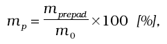

- kde: m0 je celková hmotnosť skúšobnej vzorky skúšobného materiálu použitej pri skúške,

- mprepad je hmotnosť skúšobnej vzorky skúšobného materiálu, ktorá prepadla triediacou

- priehradkou pri skúške preosievaním.

- Hmotnosti m0 a mprepad sa určia vážením s neistotou 0,01 g alebo 1 % z m0; použije sa menšia z hodnôt.

- Priemerná veľkosť otvoru sa ω určí podľa vzťahu pre príslušnú vzorku skúšobného materiálu, ktorý je uvedený v kalibračnom certifikáte.

- 4.1.13

- Na určenie priemernej veľkosti otvoru preosievaním je možné použiť ručné preosievanie, preosievanie na mechanickom vibračnom zariadení alebo preosievanie s použitím vákua.

- 4.1.14

- Priemerná veľkosť otvoru triediacej priehradky ω, určená buď priamou metódou, alebo preosievaním, vyhovuje požiadavkám podľa tabuliek č. 1 a 2, ak je splnená podmienka:

- 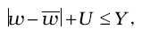

- kde: U je rozšírená neistota merania priemernej veľkosti otvoru ω pre koeficient rozšírenia k = 2,

- Y je prípustná odchýlka pre priemernú veľkosť otvoru podľa tabuliek č. 1 a 2.

- 4.1.15

- Ak sa na meranie veľkosti otvorov použije priama metóda a boli premerané všetky otvory v počte N, z nameraných hodnôt pre obidva smery merania sa vypočíta smerodajná odchýlka:

- 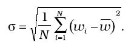

- 4.1.16

- Ak sa na meranie veľkosti otvorov použije priama metóda a bolo premeraných n otvorov podľa tabuľky č. 6, z nameraných hodnôt pre obidva smery merania sa vypočíta smerodajná odchýlka:

- 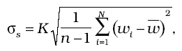

- kde K je koeficient podľa tabuľky č. 6.

- 4.1.17

- Vypočítané hodnoty σ, resp. σs musia byť menšie ako maximálna smerodajná odchýlka σ0uvedená v tabuľkách č. 1 a 2 v stĺpci 6. Ak sa použije metóda preosievania skúšobného materiálu, σ a σssa nevyhodnocujú.

- 4.1.18

- Namerané hodnoty priemeru drôtu tkaniny triediacej priehradky musia byť v hraniciach dovoleného rozpätia otvorov dmax a dmin, uvedených v tabuľkách č. 1 a 2 v stĺpcoch 8 a 9.

- 4.1.19

- Sito, ktoré pri overení vyhovie ustanoveným požiadavkám, sa označí overovacou značkou a vydá sa doklad o overení.

- 4.2

- Metódy skúšania pri prvotnom overení a následnom overení sít z dierovaného plechu

- 4.2.1

- Skúšky pri prvotnom overení a následnom overení pozostávajú z

- a)

- prehliadky rámu sita,

- b)

- prehliadky stavu triediacej priehradky sita,

- c)

- určenia veľkosti jednotlivých otvorov,

- d)

- určenia rozstupu otvorov.

- 4.2.2

- Pri prehliadke rámu sita sa vylúčia z ďalšieho skúšania tie sitá, ktoré majú rám skorodovaný, odretý, zdeformovaný alebo inak poškodený. Sitá sa majú dať na seba ľahko nasadzovať.

- 4.2.3

- Pri prehliadke stavu triediacej priehradky sita sa dierovaný plech sita prezrie proti rovnomerne osvetlenému pozadiu. Triediaca priehradka sita nesmie mať zrejmé odchýlky v pravidelnosti otvorov alebo iné poškodenia.

- 4.2.4

- Ak sito vyhovie skúškam podľa bodov 4.2.2 a 4.2.3, vykonajú sa merania na určenie veľkosti otvorov triediacej priehradky a rozstupov otvorov. Merania sa vykonajú priamou metódou.

- 4.2.5

- Na meranie veľkosti otvorov a ich rozstupu sa použije meradlo, ktoré má presnosť odčítania hodnôt aspoň 0,02 mm alebo 1/4 hodnoty prípustnej odchýlky pre jednotlivý otvor podľa tabuľky č. 3 stĺpca 4; použije sa väčšia z hodnôt.

- 4.2.6

- Pri určení veľkosti otvorov a rozstupov sa meria veľkosť otvorov a rozstupy vo vybraných miestach plechu v dvoch pruhoch rôznych smerov. Počet meraných otvorov je uvedený v tabuľke č. 7. Pre sitá s priemerom rámu iným ako 200 mm sa počty meraných otvorov upravia proporcionálne vzhľadom na plochu triediacej priehradky. Ak v plechu v jednom alebo v oboch smeroch nie je dostatočný počet otvorov predpísaných na skúšku, skontrolujú sa všetky otvory sita.

- Tabuľka č. 7: Najmenší počet meraných otvorov v obidvoch smeroch pre sito s priemerom rámu 200 mm

- Menovité veľkosti otvorov, ω | Počet meraných otvorov

- Rozmery v milimetroch |

- 125 až 25 | všetky v oboch smeroch, najviac 25 pre sitá s priemerom väčším ako 200 mm

- 22,4 až 4 | 2 × 15

- 3,55 až 2,24 | 2 × 20

- 2 až 1,6 | 2 × 25

- 1,4 až 1 | 2 × 40

- 4.2.7

- Namerané veľkosti jednotlivých otvorov sa posúdia podľa požiadavky na prípustnú odchýlku jednotlivého otvoru uvedenú v tabuľke č. 3 v stĺpci 4.

- 4.2.8

- Namerané hodnoty rozstupov otvorov musia byť v hraniciach dovoleného rozpätia voľby pmax a pmin uvedených v tabuľke č. 3 v stĺpcoch 6 a 7.

- 4.2.9

- Sito, ktoré pri overení vyhovie ustanoveným požiadavkám, sa označí overovacou značkou a vydá sa doklad o overení.

- 4.3

- Metódy skúšania pri prvotnom overení a následnom overení sít z elektroformovanej fólie so štvorcovými alebo kruhovými otvormi

- 4.3.1

- Skúšky pri prvotnom overení a následnom overení pozostávajú z

- a)

- prehliadky rámu sita,

- b)

- prehliadky stavu fólie sita,

- c)

- určenia priemernej veľkosti otvorov,

- d)

- určenia rozstupu otvorov.

- 4.3.2

- Pri prehliadke rámu sita sa vylúčia z ďalšieho skúšania tie sitá, ktoré majú rám skorodovaný, odretý, zdeformovaný alebo inak poškodený. Sitá sa majú dať na seba ľahko nasadzovať.

- 4.3.3

- Pri prehliadke stavu fólie sita sa elektroformovaná fólia prezrie proti rovnomerne osvetlenému pozadiu a súčasne sa sitom otáča okolo osi rovnobežnej s radom otvorov. Ak sa zistia nerovnomernosti otvorov už voľným okom, sito nevyhovuje. Elektroformovaná fólia v site nesmie mať žiadne nepravidelnosti, poškodenie ani zvlnenie.

- 4.3.4

- Ak sito vyhovie skúškam podľa bodov 4.3.2 a 4.3.3, vykonajú sa merania na určenie veľkosti otvorov triediacej priehradky a rozstupov otvorov.

- 4.3.5

- Merania na výpočet priemernej veľkosti otvoru sa vykonajú priamou metódou alebo metódou preosievania skúšobného materiálu. Rozstupy otvorov sa merajú priamou metódou.

- 4.3.6

- Na meranie veľkosti otvorov a ich rozstupu priamou metódou sa použije vhodné zariadenie s presnosťou odčítania hodnôt ± 0,5 µm a menej.

- 4.3.7

- Pri určovaní priemernej veľkosti otvorov metódou preosievania sa použije skúšobný materiál so známou distribúciou jednotlivých frakcií v zmesi. Kalibračný vzťah medzi strednou hodnotou veľkosti otvoru triediacej priehradky sita a hmotnostným podielom prepadu skúšobného materiálu musí byť zdokumentovaný v kalibračnom certifikáte skúšobného materiálu vrátane neistoty. Zložka neistoty od použitého skúšobného materiálu musí byť menšia ako 0,2 µm.

- 4.3.8

- Pri určení veľkosti otvorov priamou metódou sa otvory zmerajú v deviatich určených poliach. V každom poli sa meria najmenej 5 otvorov.

- 4.3.9

- Pri určení veľkosti otvorov metódou preosievania skúšobného materiálu sa postupuje podľa bodov 4.1.11 až 4.1.13 a 4.1.17.

- 4.3.10

- Zistená priemerná veľkosť otvorov určená priamou metódou sa porovná s prípustnou odchýlkou priemernej veľkosti otvorov uvedenou v bode 2.3.3.

- 4.3.11

- Posúdenie priemernej veľkosti otvorov triediacej priehradky metódou preosievania sa vykoná vyhodnotením podmienky:

- 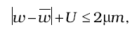

- kde: U je rozšírená neistota určenia priemernej veľkosti otvoru pre ω koeficient rozšírenia k = 2.

- 4.3.12

- Namerané hodnoty rozstupov otvorov musia byť v hraniciach dovoleného rozpätia voľby pmax a pmin uvedených v tabuľke č. 5 v stĺpcoch 5 a 6.

- 4.3.13

- Sito, ktoré pri overení vyhovie ustanoveným požiadavkám, sa označí overovacou značkou a vydá sa doklad o overení.“.

- 59. V prílohe č. 59 druhej časti sa vypúšťa bod 2.7. Doterajší bod 2.8 sa označuje ako bod 2.7.

- 60. V prílohe č. 59 druhej časti bod 5.11 znie:

- „5.11

- Relatívna chyba spätného chodu sa skúša najmenej pri troch hodnotách, a to približne v 20 %, 60 % a 100 % meracieho rozsahu.“.

- 61. V prílohe č. 59 druhej časti bod 5.14 znie:

- „5.14

- Relatívne rozpätie chyby sa skúša najmenej pri troch hodnotách, a to približne v 20 %, 60 % a 100 % meracieho rozsahu.“.

- 62. V prílohe č. 59 druhej časti sa za bod 5.15 dopĺňa nový bod 5.16, ktorý znie:

- „5.16

- Pri schválení typu meradla sa určia hodnoty meracieho rozsahu, v ktorých sa momentové kľúče skúšajú pri prvotnom a následnom overení.“.

- 63. V prílohe č. 59 druhej časti bod 6.5 znie:

- „6.5

- Rozšírená neistota merania pri prvotnom a následnom overení je menšia alebo sa rovná 1/2 najväčšej dovolenej chyby δM meradla.“.

- 64. V prílohe č. 59 druhej časti bod 6.8 znie:

- „6.8

- Momentové kľúče sa skúšajú v hodnotách meracieho rozsahu určených pri schválení typu meradla.“.

- 65. V prílohe č. 59 druhej časti bod 6.15 znie:

- „6.15

- Ďalšie podrobnosti postupu pri prvotnom a následnom overení ustanovuje príslušná slovenská technická norma.“.

- 66. Za prílohu č. 71 sa pripájajú prílohy č. 72 a 73, ktoré vrátane nadpisov znejú:

- „Príloha č. 72 k vyhláške č. 210/2000 Z. z.

- MERACIE ZOSTAVY NA LIEH

- Prvá časť

- Všeobecné ustanovenia, vymedzenie meradiel a spôsob ich metrologickej kontroly

- 1.

- Táto príloha sa vzťahuje na meracie zostavy na lieh určené na kontinuálne a dynamické meranie pretečeného množstva liehu vyjadreného v litroch 100 % alkoholu na základe údajov vlastného prietokového meradla merajúceho objem alebo hmotnosť (ďalej len „meracia zostava“).

- 2.

- Na účely tejto prílohy sa rozlišujú tieto oblasti použitia meracej zostavy:

- a)

- meracia zostava na etanol,

- b)

- meracia zostava na zmes etanolu a vody.

- 3.

- Meracia zostava pred uvedením na trh podlieha:

- a)

- posúdeniu zhody podľa osobitného predpisu1) alebo

- b)

- prvotnému overeniu, ak ide o meraciu zostavu, ktorej komponenty majú platné schválenie typu podľa predpisov2) platných pred nadobudnutím účinnosti osobitného predpisu.1)

- Meracia zostava pred uvedením do prevádzky podlieha zabezpečeniu úradnými uzáverami správcu dane.

- 4.

- Meracia zostava počas jej používania ako určeného meradla podlieha následnému overeniu. Metódy skúšania pri následnom overovaní a pri prvotnom overovaní po oprave sú uvedené v druhej časti.

- 5.

- Meracia zostava podľa bodu 3 písm. a) podlieha po oprave prvotnému overeniu, len ak nedôjde k naplneniu ustanovenia podľa osobitného predpisu.3)

- 6.

- Meracia zostava, ktorá pri overení vyhovie ustanoveným požiadavkám, sa označí overovacou značkou a vydá sa doklad o overení.

- Druhá časť

- Technické požiadavky, metrologické požiadavky a metódy skúšania pri overovaní meracích zostáv na lieh

- 1.

- Všeobecné požiadavky na meraciu zostavu

- 1.1

- Meracia zostava obsahuje všetky potrebné meracie zariadenia, ako je prietokové meradlo, vibračný hustomer, prepočítavač množstva kvapalín, ktoré umožňujú určenie množstva liehu vyjadreného v litroch 100 % alkoholu.

- 1.2

- Meracia zostava podľa prvej časti bodu 3 písm. a)

- Meracia zostava musí spĺňať požiadavky prílohy č. 1 osobitného predpisu1) a prílohy MI-005 osobitného predpisu.1)

- 1.3

- Meracia zostava podľa prvej časti bodu 3 písm. b)

- Meracia zostava na lieh pozostáva z objemového prietokového meradla na kvapaliny okrem vody zodpovedajúceho podmienkam prílohy č. 10 alebo z hmotnostného prietokomera na kvapaliny zodpovedajúceho podmienkam prílohy č. 65, ku ktorému je pripojený vibračný hustomer na kvapaliny zodpovedajúci podmienkam prílohy č. 71 a prepočítavač množstva kvapalín zodpovedajúci podmienkam prílohy č. 69, ak nie sú súčasťou vlastného hmotnostného prietokomeru.

- 1.4

- Prídavným zariadením meracej zostavy je:

- a)

- regulátor prietoku alebo vyrovnávacia jednotka liehu do meracej zostavy s vymedzením hraníc prietoku na účely hlásenia poruchy,

- b)

- teplotný poistný ventil, ktorý automaticky odstaví meraciu zostavu v prípade prekročenia maximálnej teploty liehu po 10 sekundách.

- 1.5

- Meracia zostava je vybavená záložným zdrojom napájania.

- 1.6

- K meracej zostave je pripojené etalónové gravimetrické zariadenie s nádržou s objemom zabezpečujúcim hodnotu rozšírenej neistoty merania nie väčšiu ako 0,05 %, pričom objem nádrže nie je menší ako 1000 dm3. Toto zariadenie slúži na účely overovania meracej zostavy a pre potreby správcu dane.

- 2.

- Triedy presnosti a najväčšie dovolené chyby

- 2.1

- Meracia zostava podľa prvej časti bodu 3 písm. a)

- Meracia zostava musí spĺňať požiadavku na triedu presnosti 0,3 s najväčšou dovolenou chybou ± 0,3 %.

- 2.2

- Meracia zostava podľa prvej časti bodu 3 písm. b)

- Meracia zostava musí spĺňať požiadavku na triedu presnosti 0,3 s najväčšou dovolenou chybou ± 0,3 %.

- Jednotlivé komponenty meracej zostavy musia spĺňať požiadavky:

- a)

- objemové prietokové meradlo podľa prílohy č. 10 – trieda presnosti 0,3,

- b)

- hmotnostný prietokomer na kvapaliny podľa prílohy č. 65 – trieda presnosti 0,2,

- c)

- vibračný hustomer na kvapaliny podľa prílohy č. 71 – trieda presnosti 0,1,

- d)

- prepočítavač množstva kvapalín podľa prílohy č. 69 – trieda presnosti 0,1.

- 3.

- Metódy skúšania pri overení

- 3.1

- Meracia zostava podľa prvej časti bodu 3 písm. a)

- Meracia zostava sa následne overuje a prvotne overuje po vykonanej oprave podľa harmonizovaných slovenských technických noriem alebo normatívnych dokumentov.

- 3.2

- Meracia zostava podľa prvej časti bodu 3 písm. b)

- Meracia zostava sa počas platnosti schválenia typu komponentov meracej zostavy overuje podľa predpisov platných ku dňu schválenia typu.

- Meracia zostava, ktorej platnosť rozhodnutia o schválení typu komponentov uplynula, musí pri následnom overení splniť požiadavku najväčšej dovolenej chyby podľa harmonizovaných slovenských technických noriem alebo normatívnych dokumentov.4)

- 4.

- Zabezpečenie proti neoprávnenému zásahu

- Meracia zostava je zabezpečená proti neoprávnenému zásahu overovacími značkami5) alebo zabezpečovacími značkami6),7) tak, ako bolo určené pri jej uvedení na trh, a úradnými uzáverami správcu dane tak, ako bolo určené pri jej uvedení do prevádzky.

- 5.

- Osobitné náležitosti

- Meracia zostava v prevádzke sa pri overení zabezpečuje úradnými uzáverami správcu dane.“.

  - Poznámky pod čiarou k odkazom 1 až 5 znejú:

  - „1)

  - Nariadenie vlády Slovenskej republiky č. 294/2005 Z. z. o meradlách.

  - 2)

  - Napríklad zákon č. 142/2000 Z. z. o metrológii a o zmene a doplnení niektorých zákonov v znení zákona č. 431/2004 Z. z.

  - 3)

  - § 9 ods. 4 zákona č. 264/1999 Z. z. o technických požiadavkách na výrobky a o posudzovaní zhody a o zmene a doplnení niektorých zákonov v znení neskorších predpisov.

  - 4)

  - § 11 ods. 8 zákona č. 142/2000 Z. z. v znení zákona č. 431/2004 Z. z.

  - 5)

  - § 2 písm. k) zákona č. 142/ 2000 Z. z.

  - 6)

  - § 2 písm. l) zákona č. 142/2000 Z. z.

  - 7)

  - Bod 8 prílohy č. 1 k nariadeniu vlády Slovenskej republiky č. 294/2005 Z. z.“.

  - „Príloha č. 73 k vyhláške č. 210/2000 Z. z.

  - PLYNOVÉ CHROMATOGRAFY NA STANOVENIE ENERGETICKEJ HODNOTY ZEMNÉHO PLYNU

    - Prvá časť Vymedzenie meradiel a spôsob ich metrologickej kontroly

      - 1. Táto príloha sa vzťahuje na procesné plynové chromatografy a laboratórne plynové chromatografy, ktoré sa používajú na meranie chemického zloženia zemného plynu, stanovenie jeho energetickej hodnoty a relatívnej hustoty (ďalej len „plynový chromatograf“). Energetické hodnoty slúžia na výpočet množstva energie obsiahnutej v zemnom plyne.

      - 2. Plynový chromatograf pred uvedením na trh podlieha schváleniu typu a prvotnému overeniu. Metódy technických skúšok pri schvaľovaní typu a metódy skúšania pri overení sú uvedené v druhej časti.

      - 3. Plynový chromatograf schváleného typu výrobca alebo dovozca označí značkou schváleného typu.

      - 4. Plynový chromatograf, ktorý pri overení vyhovie ustanoveným požiadavkám, sa označí overovacou značkou a vydá sa doklad o overení.

      - 5. Plynový chromatograf počas jeho používania ako určeného meradla podlieha následnému overeniu.

    - Druhá časť Technické požiadavky, metrologické požiadavky, metódy technických skúšok pri schvaľovaní typu a metódy skúšania pri overení plynových chromatografov

      - 1. Termíny a definície

      - 1.1 Plynový chromatograf je meradlo určené na stanovenie energetickej hodnoty, t. j. spaľovacieho tepla a výhrevnosti zemného plynu na základe výsledkov analýzy chemického zloženia. Energetická hodnota a ďalšie veličiny sa vypočítajú programom zohľadňujúcim požiadavky príslušnej slovenskej technickej normy.1)

      - 1.2 Procesný plynový chromatograf je plynový chromatograf, ktorý, na rozdiel od laboratórneho plynového chromatografu, je napojený priamo na plynárenskú sieť zemného plynu.

      - 1.3 Spaľovacie teplo je množstvo tepla, ktoré sa uvoľní úplným spálením stanoveného množstva plynu vo vzduchu tak, že tlak p1,pri ktorom daná reakcia prebieha, zostane konštantný a teplota všetkých produktov spaľovania sa vráti na východiskovú teplotu t1 zhodnú s teplotou reagujúcich zložiek, pričom všetky produkty spaľovania sú v plynnom stave s výnimkou vody vytvorenej spálením, ktorá pri teplote t1 skondenzovala do kvapalného stavu.

      - 1.4 Výhrevnosť je množstvo tepla, ktoré sa uvoľní úplným spálením stanoveného množstva plynu vo vzduchu tak, že tlak p1,pri ktorom daná reakcia prebieha, zostane konštantný a teplota všetkých produktov spaľovania sa vráti na východiskovú teplotu t1 zhodnú s teplotou reagujúcich zložiek, pričom všetky produkty spaľovania sú v plynnom stave.

      - 1.5 Mólový zlomok je podiel počtu mólov zložky k počtu mólov plynnej zmesi.

      - 1.6 Objemový zlomok je podiel objemu zložky k objemu zmesi za daných podmienok, t. j. tlaku a teploty.

      - 1.7 Hmotnostný zlomok je podiel hmotnosti zložky k hmotnosti plynnej zmesi.

      - 1.8 Hustota je pomer hmotnosti vzorky plynu k jej objemu za definovaných podmienok.

      - 1.9 Relatívna hustota je hustota plynu delená hustotou suchého vzduchu štandardného zloženia1) za rovnakých stanovených podmienok tlaku a teploty.

      - 1.10 Kalibračný plyn je zmes plynov definovaného zloženia, zabezpečujúceho metrologickú nadväznosť jednotlivých zložiek, používaná pri periodických kalibráciách meradla a pri metrologických skúškach.

      - 1.11 Interný kalibračný plyn je kalibračný plyn, ktorý je súčasťou meradla a slúži na jeho periodickú kalibráciu.

      - 1.12 Externý kalibračný plyn je kalibračný plyn, ktorý netvorí súčasť meradla a používa sa na metrologickú kontrolu meradla.

      - 1.13 Kompresibilitný faktor je pomer skutočného objemu určitej hmotnosti plynu za stanovených podmienok tlaku a teploty a objemu plynu vypočítaného zo stavovej rovnice pre ideálny plyn.

      - 2. Metrologické požiadavky

      - 2.1 Referenčné podmienky: tlak 101,325 kPa, teplota spaľovania 25 oC, teplota merania objemu 15 oC.

      - 2.2 Pracovné podmienky: teplota –18 oC až 55 oC.

      - 2.3 Meracie rozsahy

      - Meracie rozsahy a meracie jednotky stanovovaných veličín na plynovom chromatografe sú tieto:

        - a) mólové zlomky jednotlivých zložiek zemného plynu vyjadrené v %,

        - b) spaľovacie teplo: (25 až 50) MJ . m-3, resp. (7 až 14) kWh .m-3,

        - c) relatívna hustota: 0,555 až 0,700.

      - Merateľné rozsahy mólových zlomkov zložiek sú uvedené v tabuľke č. 1:

      - Tabuľka č. 1

      - Zložka | Merateľné rozsahy %

      - dusík | 0 až 15

      - metán | 75 až 100

      - oxid uhličitý | 0 až 10

      - etán | 0 až 10

      - propán | 0 až 3

      - izobután | 0 až 1

      - n-bután | 0 až 1

      - neopentán | 0,0 až 0,5

      - izopentán | 0,0 až 0,5

      - n-pentán | 0,0 až 0,5

      - C6+ (n-hexán) | 0,0 až 0,2

      - 2.4 Kalibrácia interným kalibračným plynom sa musí v prípade procesného plynového chromatografu vykonávať pravidelne, optimálne raz denne, najmenej však raz za 168 hodín. Na kalibráciu musí byť na chromatografe vyčlenený samostatný vstup, ktorý musí byť zabezpečený proti neoprávnenému zásahu značkou používateľa, napríklad plombou.

      - V prípade laboratórneho plynového chromatografu sa kalibrácia vykonáva bezprostredne pred analýzou odobratej vzorky.

      - 2.5 Interný kalibračný plyn musí byť zabezpečený tak, aby sa zabránilo neoprávnenej manipulácii s ním. Jeho vlastnosti sú uvedené v certifikáte. Rozšírené relatívne neistoty jeho jednotlivých hodnôt vlastností – spaľovacieho tepla, relatívnej hustoty a mólového zlomku metánu nesmú byť väčšie ako 0,25 %. Technické požiadavky na kalibračné plyny na analýzu zemného plynu sú uvedené v bode 3.6.

      - 2.6 Externé kalibračné plyny používané pri metrologickej kontrole sú certifikované referenčné materiály s rôznymi hodnotami spaľovacieho tepla, ktoré musia obsahovať najmenej 11 zložiek. Na overenie sa použijú 2 plyny, pričom hodnoty ich rozšírených relatívnych neistôt nesmú byť väčšie ako 0,2 % príslušnej hodnoty spaľovacieho tepla, relatívnej hustoty a mólového zlomku metánu.

      - 2.7 Opakovateľnosť merania vyjadrená v percentách ako relatívna smerodajná odchýlka z určitého počtu meraní musí byť menšia ako hodnoty uvedené pre jednotlivé veličiny v tabuľke č. 2.

      - Tabuľka č. 2

      - 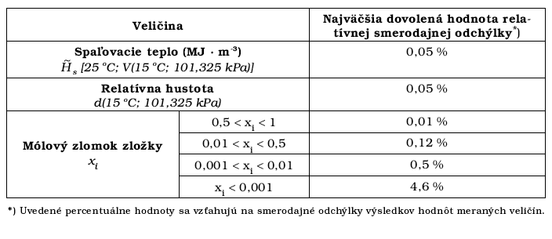

      - Kontrola sa vykonáva pri technických skúškach na účely schvaľovania typu meradla a pri prvotnom overení.

      - 2.8 Hodnoty najväčších dovolených chýb pri technických skúškach na účely schvaľovania typu, pri prvotnom a následnom overení pre jednotlivé veličiny sú uvedené v tabuľke č. 3.

      - Tabuľka č. 3

      - 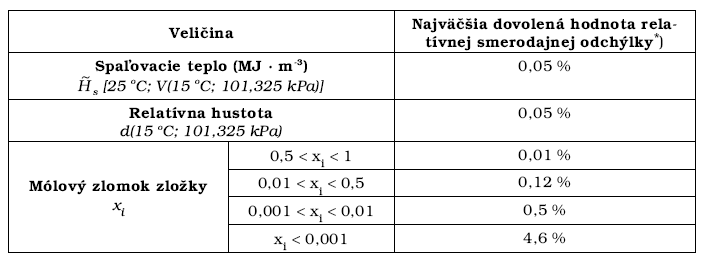

      - 3. Technické požiadavky

      - 3.1 Plynový chromatograf je spravidla tvorený:

        - a) analytickou časťou – dávkovací systém, teplotne stabilizované chromatografické kolóny, detektor,

        - b) pneumatickou časťou zabezpečujúcou prívod plynov vrátane regulácie vstupných tlakov,

        - c) elektronickou riadiacou a ovládacou jednotkou vrátane integračnej jednotky.

      - 3.1.1 Príslušenstvo:

        - a) sonda na odber vzorky zemného plynu alebo vzorkovnica zemného plynu,

        - b) výstupné potrubie pre plyny vchádzajúce do prístroja,

        - c) tlaková nádoba s nosným plynom,

        - d) tlaková nádoba s interným kalibračným plynom.

      - 3.2 Konštrukcia vlastného prístroja musí zabezpečiť merací systém proti neprípustnej manipulácii.

      - 3.3 Analytická časť musí umožňovať stanovenie všetkých zložiek v jednej analýze. Jednotlivé zložky musia byť separované s výnimkou uhľovodíkov s počtom uhlíkov v reťazci vyšším ako šesť.

      - 3.4 Elektronická riadiaca jednotka môže byť zabudovaná do analytickej časti alebo môže byť umiestnená oddelene ako samostatná časť. Táto jednotka vykonáva integráciu signálu, uchováva kalibračné údaje, vykonáva vyhodnotenie a výpočet spaľovacieho tepla a relatívnej hustoty. Vypočítané údaje sa uchovávajú v elektronickej podobe alebo sa prenášajú do záznamového zariadenia.

      - 3.5 Pneumatická časť zabezpečuje stabilizáciu a reguláciu tlaku nosného plynu, najčastejšie hélia, a pracovných plynov, napr. vodík, vzduch alebo dusík, ktoré sú potrebné na činnosť použitých detektorov alebo na ovládanie pneumatických ventilov analytickej a vzorkovacej časti.

      - 3.6 Interný kalibračný plyn tvorí súčasť meradla a slúži na jeho pravidelnú kalibráciu. Musí obsahovať všetkých 11 zložiek zemného plynu v rozsahoch podľa tabuľky č. 1. V prípade procesného plynového chromatografu sa nesmie kalibračný plyn odpojovať od prístroja. Kalibračný certifikát interného kalibračného plynu musí byť k dispozícii.

      - 3.7 Časť na prepínanie vstupov vzoriek a interného kalibračného plynu pri procesnom plynovom chromatografe býva ovládaná elektronickou jednotkou a musí umožňovať napojenie vzoriek a kalibračného plynu. V prípade použitia viacerých vstupov vzoriek musí byť dĺžka analýzy a početnosť dávkovania nastavená tak, aby bolo možné vykonať aspoň 24 analýz z každého vstupu za 24 hodín. V prípade, že sa odber vzoriek vykonáva mimo budovy, musí byť odberová kapilára temperovaná tak, aby teplota plynu neklesla pod teplotu rosného bodu jednotlivých zložiek zmesi. Prietok vzoriek musí byť nastavený tak, aby časové oneskorenie vzorky plynu bolo kratšie, ako je cyklus dávkovania.

      - 3.8 Tlaková nádoba s kalibračným plynom musí byť vybavená temperovacím zariadením, aby v prípade nižších teplôt prostredia nedochádzalo ku kondenzácii jeho zložiek a aby sa zabezpečila homogenita obsahu tlakovej nádoby.

      - 4. Nápisy a značky

      - 4.1 Štítok

      - Prístroj musí mať trvalý a ľahko čitateľný štítok, ktorý obsahuje tieto údaje:

        - a) ochrannú značku alebo obchodné meno výrobcu,

        - b) rok výroby,

        - c) výrobné číslo,

        - d) typové označenie alebo číslo modelu,

        - e) merací rozsah spaľovacieho tepla pri referenčných podmienkach.

      - 4.2 Umiestnenie overovacej značky

      - Prístroj, ktorý pri overení vyhovie ustanoveným požiadavkám, sa označí overovacou značkou a vydá sa doklad o overení. Umiestnenie overovacej značky sa uvádza v rozhodnutí o schválení typu a v doklade o overení.

      - 5. Metódy technických skúšok

      - 5.1 Prístroj predložený na skúšku na účely schvaľovania typu musí byť kompletný s príslušenstvom a dokumentáciou. Skúšky sa vykonávajú na mieste jeho používania podľa pracovného postupu schváleného Slovenským metrologickým ústavom.

      - Pred technickými skúškami na účely schvaľovania typu sa najskôr vykoná jeho nastavenie interným kalibračným plynom podľa pracovných inštrukcií výrobcu. Nastavenie aj následné skúšky sa vykonávajú v referenčných podmienkach uvedených v bode 2.1 pomocou externých kalibračných plynov, ktorými sú certifikované referenčné materiály s certifikovaným obsahom všetkých požadovaných 11 zložiek zemného plynu.

      - 5.2 Ak sa prístroj používa v prevádzkových podmienkach stanovených výrobcom, potom údaje prístroja pri hodnotení jeho stability za relatívne stabilných podmienok okolia a po kalibrácii interným kalibračným plynom zostávajú pri skúške typu počas 8 hodín v rámci driftu, ktorého priemerná hodnota je menšia alebo nanajvýš sa rovná polovičnej hodnote najväčšej dovolenej chyby.

      - 5.3 Vypočítajú sa relatívne odchýlky v percentách, ktoré sa porovnajú s najväčšou dovolenou chybou pre danú veličinu. Relatívne odchýlky musia byť menšie ako najväčšie dovolené chyby uvedené v tabuľke č. 3.

      - 5.4 Opakovateľnosť merania sa vyhodnotí zo smerodajnej odchýlky 20 nameraných hodnôt. Musí byť menšia ako najväčšie dovolené hodnoty uvedené v tabuľke č. 2.

      - 6. Metódy skúšania pri overení

      - 6.1 Overenie plynového chromatografu sa vykonáva na mieste jeho používania použitím predpísaných metód a certifikovaných referenčných materiálov zmesí plynov – externé kalibračné plyny, ktoré sú nadviazané na národný etalón zloženia vybraných zmesí plynov.

      - 6.2 Prvotné overenie

      - Prvotné overenie prístroja sa vykonáva po schválení jeho typu, a to použitím potrebných pomôcok a externých kalibračných plynov. Pozostáva z týchto krokov:

        - a) vonkajšej obhliadky – kontroly certifikátu interného kalibračného plynu, ktorý musí spĺňať požiadavky metrologickej nadväznosti, úrovne štandardných neistôt a platnosti; kontroly stavu štítkov a plombovania,

        - b) kontroly stavu kalibrácie plynového chromatografu, t.j. kalibračnej tabuľky v overovanom prístroji a jej porovnania s kalibračným certifikátom,

        - c) skúšky správnosti merania hodnôt mólových zlomkov, spaľovacích tepiel a relatívnych hustôt porovnaním s hodnotami uvedenými v certifikáte externého kalibračného plynu,

        - d) skúšky opakovateľnosti merania.

      - Opakovateľnosť merania sa vyhodnotí zo smerodajnej odchýlky 10 nameraných hodnôt. Musí byť menšia ako najväčšie dovolené hodnoty uvedené v tabuľke č. 2.

      - 6.3 Následné overenie

      - Následné overenie pozostáva z rovnakých skúšok ako prvotné overenie s výnimkou skúšky opakovateľnosti merania.

      - 6.4 Na meranie sa použijú certifikované referenčné materiály zmesí plynov, ktoré sú nadviazané na národný etalón mólového zlomku vybraných zmesí plynov.

      - 6.5 Vyhodnotenie nameraných výsledkov a spracovanie výsledkov skúšok

      - Pre každé meranie sa stanoví hodnota rozšírenej neistoty výsledku merania. Pre meradlo, ktoré vyhovie príslušným požiadavkám, sa vystaví doklad o overení a meradlo sa označí overovacou značkou.“.

- Poznámka pod čiarou k odkazu 1 znie:

- „1)

- STN EN ISO 6976 Zemný plyn. Výpočet výhrevnosti, hustoty, relatívnej hustoty a Wobbeho indexu zo zloženia.“.

- 67. Za prílohu č. 73 sa pripája príloha č. 74, ktorá vrátane nadpisu znie:

- „Príloha č. 74 k vyhláške č. 210/2000 Z. z.

- Zoznam preberaných právnych aktov Európskych spoločenstiev a Európskej únie

- 1.

- „Smernica Rady 71/316/EHS o zbližovaní právnych predpisov členských štátov, ktoré sa týkajú tak meradiel, ako aj metód metrologickej kontroly (Mimoriadne vydanie Ú. v. EÚ, kap.13/zv. 1) v znení smernice Rady 72/427/EHS (Mimoriadne vydanie Ú. v. EÚ, kap.13/zv. 1), v znení smernice Rady 83/575/EHS (Mimoriadne vydanie Ú. v. EÚ, kap.13/zv. 7), v znení smernice Rady 87/354/EHS (Mimoriadne vydanie Ú. v. EÚ, kap.13./zv. 8), v znení smernice Rady 87/355/EHS (Mimoriadne vydanie Ú. v. EÚ, kap.13/zv. 8) a v znení smernice Rady 88/665/EHS (Mimoriadne vydanie Ú. v. EÚ, kap.13/zv. 9) a v znení nariadenia Rady ES č. 807/2003 zo dňa 14. 04. 2003 (Mimoriadne vydanie Ú. v. EÚ, kap.1/zv. 4).

- 2.

- Smernica Rady 71/317/EHS o zbližovaní právnych predpisov členských štátov, ktoré sa týkajú rovnobežnostenných závaží strednej triedy presnosti od 5 kg do 50 kg a valcových závaží strednej triedy presnosti od 1 g do 10 kg (Mimoriadne vydanie Ú. v. EÚ, kap.13/zv. 1).

- 3.

- Smernica Rady 71/318/EHS o zbližovaní právnych predpisov členských štátov, ktoré sa týkajú plynomerov (Mimoriadne vydanie Ú. v. EÚ, kap.13/zv. 1) v znení smernice Rady 74/331/EHS (Mimoriadne vydanie Ú. v. EÚ, kap.13/zv. 2), v znení smernice Rady 78/365/EHS (Mimoriadne vydanie Ú. v. EÚ, kap.13/zv. 5) a v znení smernice Rady 82/623/EHS (Mimoriadne vydanie Ú. v. EÚ, kap.13/zv. 6).

- 4.

- Smernica Rady 71/319/EHS o zbližovaní právnych predpisov členských štátov, ktoré sa týkajú meradiel na kvapaliny iné ako voda (Mimoriadne vydanie Ú. v. EÚ, kap.13/zv. 1).

- 5.

- Smernica Rady 71/348/EHS o zbližovaní právnych predpisov členských štátov, ktoré sa týkajú prídavných zariadení k meradlám na kvapaliny iné ako voda (Mimoriadne vydanie Ú. v. EÚ, kap.13/zv. 1).

- 6.

- Smernica Rady 73/362/EHS o zbližovaní právnych predpisov členských štátov, ktoré sa týkajú dĺžkových mier (Mimoriadne vydanie Ú. v. EÚ, kap.13/zv. 2) v znení smernice Rady 78/629/EHS (Mimoriadne vydanie Ú. v. EÚ, kap.13/zv. 5) a v znení smernice Komisie 85/146/EHS (Mimoriadne vydanie Ú. v. EÚ, kap.13/zv. 8).

- 7.

- Smernica Rady 74/148/EHS o zbližovaní právnych predpisov členských štátov, ktoré sa týkajú závaží vyššej triedy presnosti od 1 mg do 50 kg (Mimoriadne vydanie Ú. v. EÚ, kap.13/zv. 2).

- 8.

- Smernica Rady 75/33/EHS o zbližovaní právnych predpisov členských štátov, ktoré sa týkajú vodomerov na studenú vodu (Mimoriadne vydanie Ú. v. EÚ, kap.13/zv. 3).

- 9.

- Smernica Rady 75/410/EHS o zbližovaní právnych predpisov členských štátov, ktoré sa týkajú kontinuálnych sčítavacích váh s automatickou činnosťou (Mimoriadne vydanie Ú. v. EÚ, kap.13/zv. 3).

- 10.

- Smernica Rady 76/765/EHS o zbližovaní právnych predpisov členských štátov, ktoré sa týkajú liehomerov a liehových hustomerov (Mimoriadne vydanie Ú. v. EÚ, kap.13/zv. 3) v znení smernice Rady 82/624/EHS (Mimoriadne vydanie Ú. v. EÚ, kap.13/zv. 6).

- 11.

- Smernica Rady 76/766/EHS o zbližovaní právnych predpisov členských štátov, ktoré sa týkajú liehových tabuliek (Mimoriadne vydanie Ú. v. EÚ, kap.13/zv. 3).

- 12.

- Smernica Rady 76/891/EHS o zbližovaní právnych predpisov členských štátov, ktoré sa týkajú elektromerov (Mimoriadne vydanie Ú. v. EÚ, kap.13/zv. 3) v znení smernice Rady 82/621/EHS (Mimoriadne vydanie Ú. v. EÚ, kap.13/zv. 6).

- 13.

- Smernica Rady 77/95/EHS o zbližovaní právnych predpisov členských štátov, ktoré sa týkajú taxametrov (Mimoriadne vydanie Ú. v. EÚ, kap.13 /zv. 4).

- 14.

- Smernica Rady 77/313/EHS o zbližovaní právnych predpisov členských štátov, ktoré sa týkajú meracích systémov na kvapaliny iné ako voda (Mimoriadne vydanie Ú. v. EÚ, kap.13/zv. 4) v znení smernice Komisie 82/625/EHS (Mimoriadne vydanie Ú. v. EÚ, kap.13/zv. 6).

- 15.

- Smernica Rady 78/1031/EHS o zbližovaní právnych predpisov členských štátov, ktoré sa týkajú vytrieďovacích kontrolných váh a triediacich váh s automatickou činnosťou (Mimoriadne vydanie Ú. v. EÚ, kap.13/zv. 5).

- 16.

- Smernica Rady 79/830/EHS o zbližovaní právnych predpisov členských štátov, ktoré sa týkajú vodomerov na teplú vodu (Mimoriadne vydanie Ú. v. EÚ, kap.13/zv. 5).

- 17.

- Smernica Rady 2006/96/ES z 20. novembra 2006, ktorou sa z dôvodu pristúpenia Bulharska a Rumunska upravujú určité smernice v oblasti voľného pohybu tovaru (Ú. v. EÚ L 363, 20. 12. 2006).

- 18.

- Smernica Komisie 2007/13/ES zo 7. marca 2007, ktorou sa mení a dopĺňa príloha II k smernici Rady 71/316/EHS o aproximácii právnych predpisov členských štátov o spoločných ustanoveniach pre meradlá a metódy metrologickej kontroly (Ú. v. EÚ L 73, 13. 3. 2007).“.
