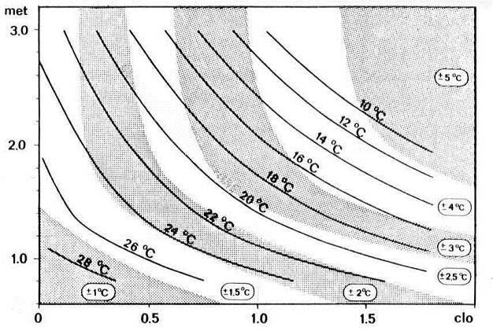
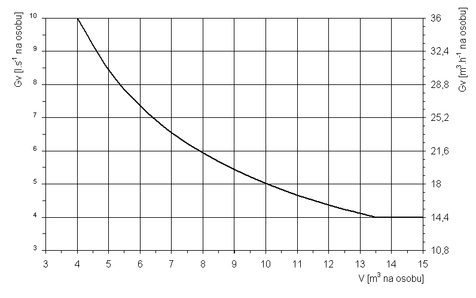

Príloha č. 2 k vyhláške č. 259/2008 Z. z.

- POŽIADAVKY NA TEPELNO-VLHKOSTNÚ MIKROKLÍMU A VETRANIE

  - Tabuľka č. 1 Triedy činnosti

  - Trieda činnosti | Celkový energetický výdaj | | Príklady činnosti *)

  - | qM [W.m-2] | qM [met] |

  - 0 | ≤ 65 | ≤ 1,12 | Pokojné ležanie, uvoľnené sedenie (odpočinok, sledovanie programu).

  - 1a | 66 až 80 | 1,13 až 1,38 | Činnosť posediačky s minimálnou pohybovou aktivitou (administratívne práce, činnosť v učebniach); činnosť posediačky spojená s ľahkou manuálnou prácou rúk a ramien (písanie na stroji, práca s PC, jednoduché šitie, laboratórne práce, zostavovanie alebo triedenie drobných ľahkých predmetov).

  - 1b | 81 až 105 | 1,39 až 1,81 | Činnosť posediačky s občasnou manuálnou prácou rúk, ramien a nôh; činnosť postojačky občas spojená s pomalou chôdzou po rovnej podlahe s prenášaním ľahkých bremien alebo prekonávaním malého odporu (varenie, strojné opracovanie a montáž malých ľahkých dielcov, nakupovanie).

  - 1c | 106 až 130 | 1,82 až 2,23 | Činnosť posediačky so stálym zapojením oboch rúk, ramien a nôh; činnosť postojačky s trvalým zapojením oboch rúk, ramien a nôh spojená s prenášaním bremien do 10 kg (činnosť v sklade alebo v kuchyni, upratovanie, lakovanie, ťahanie alebo tlačenie ľahkých vozíkov). Pomalá chôdza po rovine.

    - Poznámka:

    - *) Uvedené príklady činnosti slúžia len na orientáciu. Na spoľahlivé zatriedenie činnosti sa vykonáva objektívne meranie energetického výdaja alebo podrobná analýza vykonávanej činnosti.

    - Triedy činnosti sú odvodené od klasifikácie uvedenej v technickej norme STN EN 27243 Horúce prostredie. Stanovenie tepelnej záťaže pracovníka podľa ukazovateľa WBGT (teploty mokrého guľového teplomeru).

  - Tabuľka č. 2a Optimálne a prípustné podmienky tepelno-vlhkostnej mikroklímy pre teplé obdobie roka

  - Trieda činnosti | Operatívna teplota to [oC] | | Prípustná rýchlosť prúdenia vzduchu Va [m.s-1] | Prípustná relatívna vlhkosť vzduchu φ [%]

  - | optimálna | prípustná | |

  - 0 | 25 – 28 | 20 – 29 | ≤ 0,2 | 30 až 70

  - 1a | 23 – 27 | 20 – 28 | ≤ 0,25 |

  - 1b | 22 – 25 | 19 – 27 | ≤ 0,3 |

  - 1c | 20 – 24 | 17 – 26 | ≤ 0,3 |

    - Poznámka:

    - Hodnoty to, φ, Va sú určené pre štandardné oblečenie Rcl = 0,3 až 0,5 clo.

  - Tabuľka č. 2b Optimálne a prípustné podmienky tepelno-vlhkostnej mikroklímy pre chladné obdobie roka

  - Trieda činnosti | Operatívna teplota to [oC] | | Prípustná rýchlosť prúdenia vzduchu Va [m.s-1] | Prípustná relatívna vlhkosť vzduchu φ [%]

  - | optimálna | prípustná | |

  - 0 | 22 – 26 | 20 – 27 | ≤ 0,2 | 30 až 70

  - 1a | 20 – 24 | 18 – 26 | ≤ 0,2 |

  - 1b | 18 – 21 | 15 – 24 | ≤ 0,25 |

  - 1c | 15 – 20 | 12 – 22 | ≤ 0,3 |

    - Poznámka:

    - Hodnoty to, φ, Va sú určené pre štandardné oblečenie Rcl = 0,7 až 1,0 clo.

  - Tabuľka č. 3 Vertikálny rozdiel operatívnej teploty medzi úrovňou hlavy a členkov

  - Obdobie roka | Rcl [clo] | Δto,max = to,hlava – to,členky [K] |

  - chladné | 1,0 | -8,0 | +3,0

  - teplé | 0,5 | -4,0 | +2,0

    - Poznámka:

    - Hodnoty ∆to, max sú určené v závislosti od Rcl, preto v prípade rozdielneho celkového tepelného odporu možno ∆to, max určiť lineárnou interpoláciou bez ohľadu na obdobie roka.

- 

  - Obr. 1 Oblasti optimálnej a prípustnej operatívnej teploty v závislosti od odevu a činnosti

  - Poznámka:

  - Prípustné hodnoty operatívnej teploty podľa § 2 ods. 6 sa určia pripočítaním tolerancií k optimálnym hodnotám. Hodnoty sa zaokrúhľujú po 0,5 oC.

  - Príklad:

  - Pre optimálnu teplotu 22 °C, odev 0,9 clo a činnosť 1,2 met (65 W.m-2) budú prípustné hodnoty to v rozsahu 20,0 °C až 24,0 °C.

- 

  - Obr. 2 Požiadavky na množstvo vymieňaného vzduchu na 1 osobu

  - Príklad: Ak z objemu miestnosti pripadá na 1 osobu 10 m3 vzduchu (V), požaduje sa výmena 18 m3.h-1, resp. 5 l.s-1 čerstvého vzduchu na každú prítomnú osobu (GV).

  - Tabuľka č. 4 Parametre tepelno-vlhkostnej mikroklímy vo vybraných priestoroch s krátkodobým pobytom osôb

  - Priestor | to [oC] | n [h-1]

  - chodby a schodiská | 15 – 18 | 2 – 3

  - vstupné haly | 18 – 20 | –

  - WC | 15 – 20 | 5 – 10

  - kúpeľne, umyvárne | 22 – 24 | 10

  - čakárne | 18 – 20 | 3

  - miestnosti pre upratovačky | 18 – 20 | 10

  - sklady | 10 – 17 | 10

  - sklady liekov | 15 – 20 | 2 – 10

  - šatne | 20 – 22 | 10

  - denné miestnosti | 20 – 22 | 5

  - Tabuľka č. 5 Parametre tepelno-vlhkostnej mikroklímy pre priestory s osobitnými požiadavkami

  - Priestor | to [oC] | φ [%] | n [h-1]

  - Sauny, soláriá, kryté umelé kúpaliská | | |

  - sprcháreň/bazén sauny | 22 – 24 | ≤ 85 | 8

  - potiareň | 80 a 100a) | – | 5

  - odpočiváreň | 24 – 26 | 30 – 70 | 3

  - miestnosť s opaľovacími zariadeniami | 22 – 24 | 30 – 70 | 3

  - šatňa | 22 – 24 | 30 – 70 | 3

  - bazénová hala krytého umelého kúpaliskab) | 26 – 32 | ≤ 70 | 6 – 7

  - Zariadenia pre deti a mládež | | |

  - herne a spálne pre deti do 6 rokov veku | najmenej 22 | 30 – 70 | 5

  - umyvárne a WC pre deti do 6 rokov veku | najmenej 24 | 30 – 70 | 8

  - učebne, herne, denné miestnosti | 20 – 24 | 30 – 70 | 3 – 8

  - telocvične, cvičebne | 15 | 30 – 70 | 5

  - šatne pri telocvičniach, cvičebniach | najmenej 20 | 30 – 70 | 5

  - umyvárne a WC pri telocvičniach, cvičebniach | najmenej 24 | 30 – 70 | 8

  - iné šatne, chodby, záchody | najmenej 15 | 30 – 70 | 5

  - Hotely, hromadné ubytovne | | |

  - študovne, spoločenské miestnosti | 22 – 24 | 30 – 70 | 3 – 6

  - jedálne | 20 – 22 | 30 – 70 | 5 –10

  - Kúpeľné a liečebné budovy | | |

  - priestory určené na obnaženie pacientov | 24 – 25 | 30 – 70 | 5

  - osušovne | 25 – 30 | 30 – 60 | 2 – 4

  - sprchy | 24 – 27 | ≤ 85 | 8

  - bazénové halyb) | 24 – 30 | ≤ 65 | 6 – 7

  - vodoliečebné sály | 24 – 26 | ≤ 80 | 8 – 10

  - sály pre liečebný telocvik | 18 – 20 | 30 – 70 | 5

  - Školy, predškolské zariadenia | | |

  - telocvične | 15 – 17 | 30 – 70 | 5

  - spálne DJ, MŠ | 18 – 20c) | 30 – 70 | 5

  - učebne, herne, denné miestnosti | 20 – 24c) | 30 – 70 | 3 – 8

  - izolačná miestnosť | 22 – 24 | 30 – 70 | 5

  - Divadlá, kiná, koncertné sály a iné kultúrne zariadenia | | |

  - hľadisko, sály, priľahlé priestory | 20 – 22 | 30 – 70 | 5 – 8

  - šatne pre účinkujúcich | 22 – 24 | 30 – 70 | 2

  - výstavné sály, múzeá | 17 – 20 | 30 – 70 | 3 – 8

  - Zdravotnícke zariadenia, zariadenia sociálnych služieb | | |

  - vyšetrovne, terapeutické miestnosti | 22 – 24 | 30 – 70 | 5

  - izby pacientov | 20 – 24 | 30 – 70 | 5

  - lôžková časť OAIM (ARO), JIS | 22 – 24 | 30 – 70 | 8 – 10

  - operačné sály | min. 25d) | 30 – 70 | min. 15

  - centrálna sterilizácia | 20 – 22 | 50 – 65 | 10 – 12

  - sanitárna miestnosť | 18 – 20 | 30 – 70 | 10

  - Poznámky:

    - a) Maximálna teplota 100 oC pre dospelých, 80 oC pre deti predškolského veku; meria sa vo výške 1,5 m nad podlahou, najmenej 1,0 m od vykurovacieho telesa a najmenej 0,2 m od stien.

    - b) Pri teplote vody v bazéne t ≤ 30°C má byť teplota vzduchu (t0) v bazénovej hale vyššia aspoň o 1 °C ako teplota vody v bazéne; pri vyššej teplote vody v bazéne má byť teplota vzduchu najviac 32 °C.

    - c) V miestnostiach predškolských zariadení sa hodnoty to určujú 0,5 m nad podlahou.

    - d) Vyššia teplota podľa určenia lekárom.
