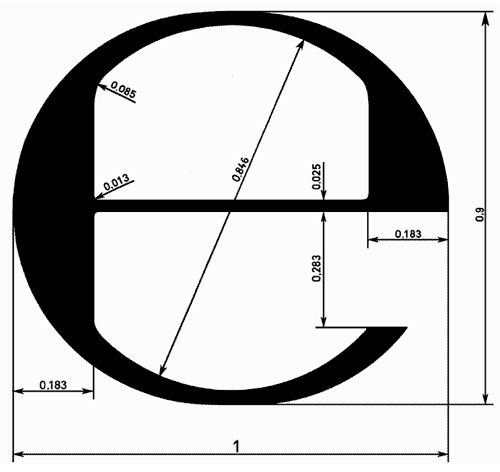

# Čl. I

Vyhláška Úradu pre normalizáciu, metrológiu a skúšobníctvo Slovenskej republiky č. 207/2000 Z. z. o označenom spotrebiteľskom balení v znení vyhlášky č. 420/2001 Z. z. a vyhlášky č. 355/2004 Z. z. sa mení a dopĺňa takto:

- 1. V § 1 sa vypúšťajú slová „ktorých druhy sú uvedené v § 4 a“ a slovo „výrobku“.

- 2. § 4 vrátane nadpisu znie:

- 㤠4

- Výrobky v označených spotrebiteľských baleniach

- (1)

- Výrobky uvedené v prílohe č. 3 bode 2, ktoré sú balené v označenom spotrebiteľskom balení v intervaloch uvedených v prílohe č. 3 bode 1, sa môžu uvádzať na trh len s menovitými množstvami uvedenými v prílohe č. 3 bode 1.

- (2)

- Na výrobky, ktoré sa predávajú v bezcolných predajniach na účely spotreby mimo Európskej únie, sa odsek 1 nevzťahuje.

- (3)

- Ak je v spotrebiteľskom balení viac jednotlivých označených spotrebiteľských balení, potom hodnoty uvedené v prílohe č. 3 bode 1 sa vzťahujú na každé jednotlivé označené spotrebiteľské balenie.

- (4)

- Ak sú v označenom spotrebiteľskom balení dve jednotlivé spotrebiteľské balenia alebo viac jednotlivých spotrebiteľských balení, ktoré nie sú určené na predaj jednotlivo, hodnoty uvedené v prílohe č. 3 bode 1 sa vzťahujú na označené spotrebiteľské balenie ako celok.

- (5)

- Na aerosólových rozprašovačoch1) sa uvádza celkový menovitý objem nádoby, a to tak, aby nedošlo k jeho zámene s menovitým objemom výrobku.

- (6)

- Výrobky, ktoré sa predávajú v aerosólových rozprašovačoch, sa nemusia označovať menovitou hmotnosťou výrobku.“.

- Poznámka pod čiarou k odkazu 1 znie:

- „1)

- Zákon č. 163/2001 Z. z. o chemických látkach a chemických prípravkoch v znení neskorších predpisov.“.

- 3. V § 5 ods. 2 sa slová „v prílohe č. 6“ nahrádzajú slovami „v prílohe č. 4“.

- 4. V § 5 ods. 4 sa slová „v prílohe č. 7“ nahrádzajú slovami „v prílohe č. 5“.

- 5. Za § 5 sa vkladá § 5a, ktorý znie:

- 㤠5a

- Touto vyhláškou sa preberajú právne akty Európskych spoločenstiev a Európskej únie uvedené v prílohe č. 7.“.

- 6. V prílohe č. 1 bod 1.3 znie:

- „1.3 Záporná chyba obsahu označeného spotrebiteľského balenia (ďalej len „záporná chyba“) je množstvo, o ktoré je skutočný obsah označeného spotrebiteľského balenia menší ako menovité množstvo.“.

- 7. V prílohe č. 1 sa bod 3.3 dopĺňa vetou, ktorá znie:

- „Grafické znázornenie značky „e“ je v prílohe č. 6.“.

- 8. V prílohe č. 2 bode 1 sa slová „chyba merania“ nahrádzajú slovami „rozšírená kombinovaná štandardná neistota merania (k = 2)“.

- 9. Príloha č. 3 vrátane nadpisu znie:

- „Príloha č. 3

- k vyhláške č. 207/2000 Z. z.

- RAD MENOVITÝCH MNOŽSTIEV OBSAHU SPOTREBITEĽSKÝCH BALENÍ

- 1. Výrobky predávané podľa objemu (množstvo v ml)

- Tiché víno | V intervale od 100 ml do 1 500 ml len týchto 8 menovitých množstiev: (100; 187; 250; 375; 500; 750; 1 000; 1 500) ml.

- Žlté víno | V intervale od 100 ml do 1 500 ml len toto 1 menovité množstvo: 620 ml.

- Šumivé víno | V intervale od 125 ml do 1 500 ml len týchto 5 menovitých množstiev: (125; 200; 375; 750; 1 500) ml.

- Likérové víno | V intervale od 100 ml do 1 500 ml len týchto 7 menovitých množstiev: (100; 200; 375; 500; 750; 1 000; 1 500) ml.

- Aromatizované víno | V intervale od 100 ml do 1 500 ml len týchto 7 menovitých množstiev: (100; 200; 375; 500; 750; 1 000; 1 500) ml.

- Liehoviny | V intervale od 100 ml do 2 000 ml len týchto 9 menovitých množstiev: (100; 200; 350; 500; 700; 1 000; 1 500; 1 750; 2 000) ml.

- 2. Vymedzenia výrobkov

- Tiché víno.2)

- Žlté víno, víno s určením pôvodu: „Côtes du Jura“, „Arbois“, „ľEtoile“ a „Château-Chalon“ vo fľašiach, podľa osobitného predpisu.3)

- Šumivé víno.4)

- Likérové víno.5)

- Aromatizované víno.6)

- Liehoviny.7)

- 10. Prílohy č. 4 až 5a sa vypúšťajú.

- Doterajšie prílohy č. 6 a 7 sa označujú ako prílohy č. 4 a 5.

- 11. V prílohe č. 4 bode 1.2 sa vypúšťajú odkaz 1 a poznámka pod čiarou k odkazu 1 a súčasne sa na konci pripája táto veta:

- „Rozdiel medzi celkovým objemom nádoby a menovitým objemom nádoby sa nazýva expanzný objem.“.

- 12. V prílohe č. 4 bod 2 znie:

- „2.

- Odmerné nádoby sa plnia na

- a)

- konštantnú hĺbku hladiny alebo

- b)

- konštantný expanzný priestor.

- Všetky nádoby rovnakého typu, t. j. všetky nádoby vyrobené podľa toho istého návrhu, musia mať hĺbku hladiny, ako aj veľkosť expanzného objemu dostatočne konštantnú.“.

- 13. V prílohe č. 4 bode 3 sa slová „s dostatočnou presnosťou a najmä s presnosťou“ nahrádzajú slovami „s dostatočne malou neistotou a najmä s neistotou“.

- 14. V prílohe č. 4 bode 3 sa slová „za podmienok kontroly ustanovených v prílohe č. 7“ nahrádzajú slovami „za podmienok kontroly ustanovených v prílohe č. 5“.

- 15. V prílohe č. 4 bode 6 sa slová „v prílohe č. 7“ nahrádzajú slovami „v prílohe č. 5“.

- 16. V prílohe č. 4 bode 8.2.2 sa vypúšťa veta „Na nádobe môžu byť vyznačené aj iné údaje za predpokladu, že nespôsobia zámenu s povinnými údajmi.“.

- 17. V prílohe č. 4 sa dopĺňa bod 8.3, ktorý znie:

- „8.3 Na nádobe môžu byť vyznačené aj iné údaje za predpokladu, že nespôsobia zámenu s povinnými údajmi.“.

- 18. V prílohe č. 5 bode 2 sa slová „Chyba merania“ nahrádzajú slovami „Rozšírená kombinovaná štandardná neistota merania (k = 2)“.

- 19. V prílohe č. 5 bode 3.1.2.1 sa slová „pozri prílohu č. 6, bod 8“ nahrádzajú slovami „pozri prílohu č. 4 bod 8“.

- 20. V prílohe č. 5 bode 3.1.2.2 sa slová „pozri prílohu č. 6, bod 8“ nahrádzajú slovami „pozri prílohu č. 4 bod 8“.

- 21. V prílohe č. 5 bode 3.2.2.1 sa slová „pozri prílohu č. 6, bod 8“ nahrádzajú slovami „pozri prílohu č. 4 bod 8“.

- 22. V prílohe č. 5 bode 3.2.2.2 sa slová „pozri prílohu č. 6, bod 8“ nahrádzajú slovami „pozri prílohu č. 4 bod 8“.

- 23. Za prílohu č. 5 sa vkladá príloha č. 6, ktorá vrátane nadpisu znie:

- „Príloha č. 6

- k vyhláške č. 207/2000 Z. z.

- TVAR ZNAČKY „e“.

  - “.

- 24. Za prílohu č. 6 sa vkladá príloha č. 7, ktorá vrátane nadpisu znie:

- „Príloha č. 7

- k vyhláške č. 207/2000 Z. z.

- ZOZNAM PREBERANÝCH PRÁVNYCH AKTOV EURÓPSKYCH SPOLOČENSTIEV A EURÓPSKEJ ÚNIE

- Smernica Európskeho parlamentu a Rady 2007/45/ES zo dňa 5. septembra 2007, ktorou sa stanovujú pravidlá pre menovité množstvá spotrebiteľsky balených výrobkov, zrušujú sa smernice Rady 75/106/EHS a 80/232/EHS a ktorou sa mení a dopĺňa smernica Rady 76/211/EHS (Ú. v. EÚ L 247, 21. 9. 2007).“.
