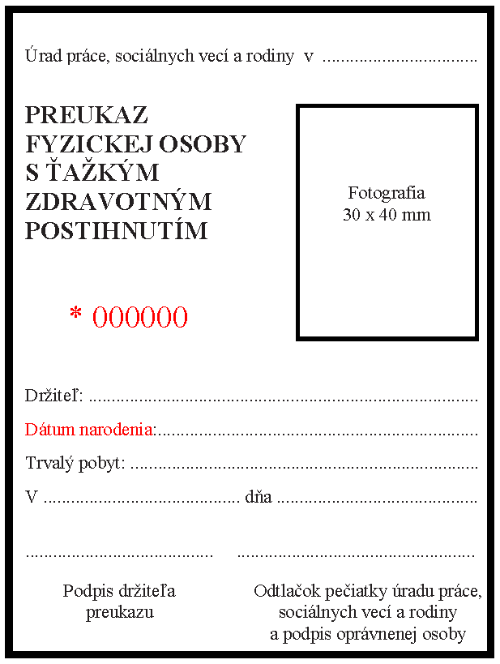
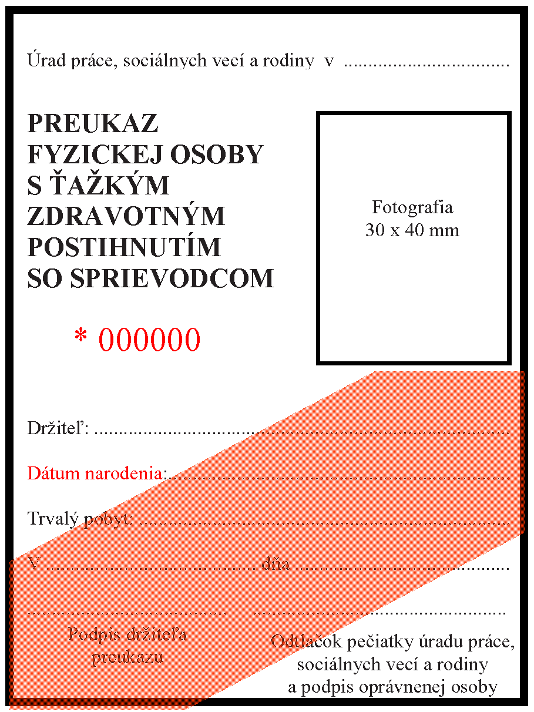
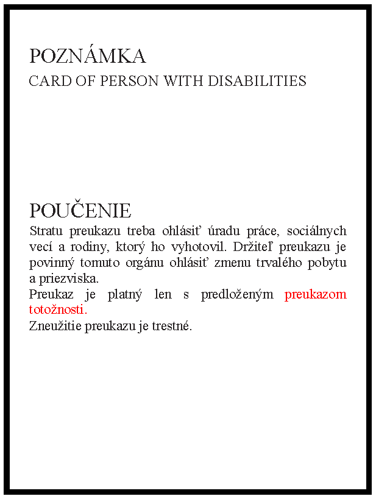

Príloha č. 8 k zákonu č. 447/2008 Z. z.

- Vzor preukazu fyzickej osoby s ťažkým zdravotným postihnutím

  - Predná strana preukazu fyzickej osoby s ťažkým zdravotným postihnutím:

- 

  - Predná strana preukazu fyzickej osoby s ťažkým zdravotným postihnutím so sprievodcom:

- 

  - Zadná strana preukazu fyzickej osoby s ťažkým zdravotným postihnutím a preukazu fyzickej osoby s ťažkým zdravotným postihnutím so sprievodcom:

- 

  - Charakteristika preukazu fyzickej osoby s ťažkým zdravotným postihnutím a preukazu fyzickej osoby s ťažkým zdravotným postihnutím so sprievodcom:

  - Preukaz je 75 mm široký a 100 mm vysoký. Preukaz je vytlačený na tvrdom bielom papieri.

  - Na prednej strane preukazu je v ľavom hornom rohu uvedený drobným typom písma text „Úrad práce, sociálnych vecí a rodiny v .......................“.

  - Pod týmto textom sú zvýrazneným veľkým typom písma na ľavej strane preukazu fyzickej osoby s ťažkým zdravotným postihnutím slová „PREUKAZ FYZICKEJ OSOBY S AŽKÝM ZDRAVOTNÝM POSTIHNUTÍM“ vysoké 3 mm a preukazu fyzickej osoby s ťažkým zdravotným postihnutím so sprievodcom slová „PREUKAZ FYZICKEJ OSOBY S AŽKÝM ZDRAVOTNÝM POSTIHNUTÍM SO SPRIEVODCOM“ vysoké 3 mm. Pod týmto textom je uvedená hviezdička a päťmiestne evidenčné číslo preukazu napísané výrazným typom písma vysokým 5 mm. Každý preukaz má svoje neopakovateľné číslo.

  - Vpravo od textu „PREUKAZ FYZICKEJ OSOBY S AŽ KÝM ZDRAVOTNÝM POSTIHNUTÍM“ a od textu „PREUKAZ FYZICKEJ OSOBY S AŽ KÝM ZDRAVOTNÝM POSTIHNUTÍM SO SPRIEVODCOM“ je obdĺžnik 30 mm široký a 40 mm vysoký. V obdĺžniku je text „Fotografia 30 x 40 mm“.

  - V druhej polovici prednej strany preukazu je na ľavej strane uvedený text 2 mm vysoký na troch riadkoch. V prvom riadku „Držiteľ:“, v druhom riadku „Dátum narodenia:“, v treťom riadku „Trvalý pobyt:“. Ostávajúca časť textu je vybodkovaná do konca pravej strany. V štvrtom riadku je text 2 mm vysoký „V................. dňa ..............“.

  - V poslednom riadku prednej strany preukazu je uvedený text „..............Podpis držiteľa preukazu“ a „....................Odtlačok pečiatky úradu práce, sociálnych vecí a rodiny a podpis oprávnenej osoby“.

  - Na prednej strane preukazu fyzickej osoby s ťažkým zdravotným postihnutím so sprievodcom je z dolného ľavého rohu preukazu do pravej časti po spodok obdĺžnika pre fotografiu červená čiara široká 30 mm.

  - Na zadnej strane preukazu je v hornej časti uvedený text „POZNÁMKA“ veľkým typom písma 3 mm vysokým. Pod textom „POZNÁMKA“ je uvedený text „CARD OF PERSON WITH DISABILITIES“ veľkým typom písma 2 mm vysokým.

  - V dolnej časti zadnej strany preukazu je uvedené zvýrazneným veľkým typom písma 3 mm vysokým slovo „POUČENIE“ a pod ním 1 mm vysoký text poučenia „Stratu preukazu treba ohlásiť úradu práce, sociálnych vecí a rodiny, ktorý ho vyhotovil. Držiteľ preukazu je povinný tomuto orgánu ohlásiť zmenu trvalého pobytu a priezviska. Preukaz je platný len s predloženým preukazom totožnosti. Zneužitie preukazu je trestné.“.
