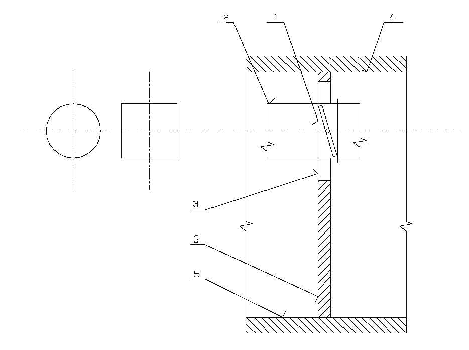
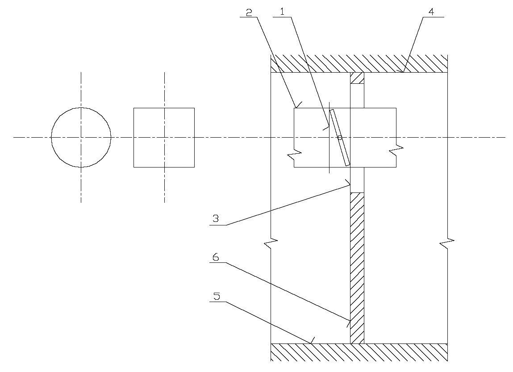
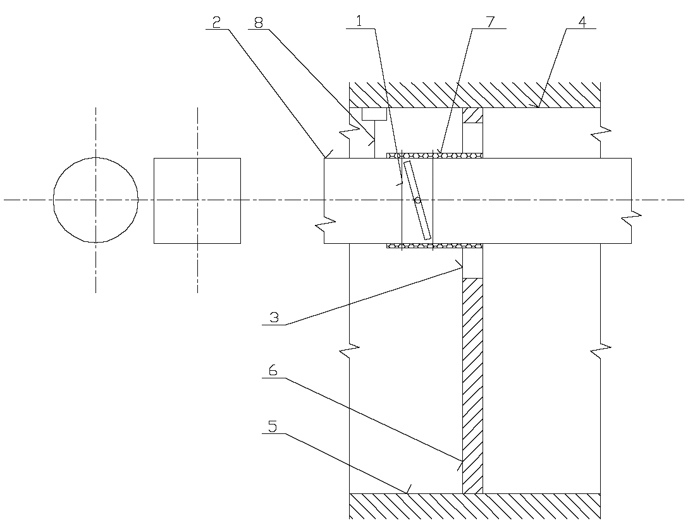

Príloha č. 1

k vyhláške č. 478/2008 Z. z.

Príklady inštalácie klapky požiarne odolnej, klapky dymotesnej a klapky kombinovanej do trvalého otvoru v požiarne deliacej konštrukcii, na požiarne deliacu konštrukciu alebo do potrubia s požiarnou odolnosťou vetracieho systému zaisťujúceho dodávku alebo výmenu vzduchu

Nákres č. 1. Príklad inštalácie klapky požiarne odolnej, klapky dymotesnej a klapky kombinovanej do trvalého otvoru v požiarne deliacej konštrukcii

1 klapka požiarne odolná, klapka dymotesná alebo klapka kombinovaná

2. vzduchotechnické potrubie

3. izolácia prestupu klapky vyznačenej v pozícii 1 zvislou požiarne deliacou konštrukciou

4. požiarne deliaca konštrukcia – strop

5. požiarne deliaca konštrukcia – podlaha

6. požiarne deliaca konštrukcia – stena

Nákres č. 2. Príklad inštalácie klapky požiarne odolnej, klapky dymotesnej a klapky kombinovanej na požiarne deliacu konštrukciu – stenu

1. klapka požiarne odolná, klapka dymotesná alebo klapka kombinovaná

2. vzduchotechnické potrubie

3. izolácia prestupu klapky vyznačenej v pozícii 1 zvislou požiarne deliacou konštrukciou

4. požiarne deliaca konštrukcia – strop

5. požiarne deliaca konštrukcia – podlaha

6. požiarne deliaca konštrukcia – stena

Nákres č. 3. Príklad inštalácie klapky požiarne odolnej, klapky dymotesnej a klapky kombinovanej do vzduchotechnického potrubia s požiarnou odolnosťou vetracieho systému zaisťujúceho dodávku alebo výmenu vzduchu

1. klapka požiarne odolná, klapka dymotesná alebo klapka kombinovaná

2. vzduchotechnické potrubie

3. izolácia prestupu klapky vyznačenej v pozícii 1 zvislou požiarne deliacou konštrukciou

4. požiarne deliaca konštrukcia – strop

5. požiarne deliaca konštrukcia – podlaha

6. požiarne deliaca konštrukcia – stena

7. obklad vzduchotechnického potrubia

8. záves vzduchotechnického potrubia
