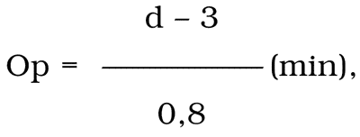

Príloha č. 6

k vyhláške č. 478/2008 Z. z.

Vzťah pre výpočet požiarnej odolnosti drevených dverí s plným krídlom alebo s viacerými plnými krídlami a s polodrážkou

kde – Op je požiarna odolnosť posudzovaných drevených dverí,

– d je hrúbka plného dreva v milimetroch meraná v mieste najväčšieho oslabenia krídla posudzovaných dverí.
