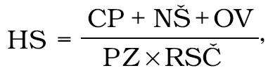

Príloha k nariadeniu vlády č. 493/2008 Z. z.

Výpočet výšky výdavkov

1. Vzorec na výpočet výšky výdavkov:

VV = HS x PH + CN,

kde

VV je výška výdavkov spojená s kontrolami,

HS je hodinová sadzba,

PH je počet hodín výkonu kontroly; hodinou výkonu kontroly je každá aj začatá hodina práce

inšpektora pri kontrole,

CN sú skutočné cestovné náklady všetkých inšpektorov zúčastnených na kontrole.

2. Vzorec na výpočet hodinovej sadzby:

kde

HS je hodinová sadzba,

CP je cena práce všetkých inšpektorov podieľajúcich sa na kontrolách,

NŠ sú náklady na školenia všetkých inšpektorov podieľajúcich sa na kontrolách,

OV sú náklady na odber vzorky,

PZ je počet všetkých inšpektorov podieľajúcich sa na kontrolách,

RSČ je ročný služobný čas.
