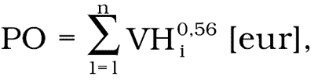

# Čl. I

Vyhláška Ministerstva spravodlivosti Slovenskej republiky č. 491/2004 Z. z. o odmenách, náhradách výdavkov a náhradách za stratu času pre znalcov, tlmočníkov a prekladateľov v znení vyhlášky č. 400/2006 Z. z. sa mení takto:

- 1. V § 3 ods. 1 sa suma „400 Sk“ nahrádza sumou „13,28 eura“.

- 2. V § 4 odsek 2 znie:

- „(2)

- Podielová odmena sa určuje podľa stanovenej výšky východiskovej hodnoty predmetu znaleckého úkonu podľa vzťahu

- 

- kde:

- PO – výška podielovej odmeny,

- VH – východisková hodnota predmetu úkonu zaokrúhlená na celé eurá nahor; za predmet úkonu sa považujú jednotlivo hlavné stavebné objekty, spoločne príslušenstvo (napríklad ploty, studne, inžinierske siete, spevnené plochy a pod.) a spoločne pozemky; východisková hodnota pozemkov je 16,60 eura/m2,

- n – počet predmetov ohodnotenia.“.

- 3. V § 4 ods. 3 sa slová „na celé stokoruny“ nahrádzajú slovami „na celé eurá“.

- 4. V § 4 ods. 4 sa suma „800 Sk“ nahrádza sumou „26,56 eura“.

- 5. § 5 vrátane nadpisu znie:

- 㤠5

- Paušálna odmena

- Znalcovi patrí paušálna odmena za

- a)

- podanie vyžiadaného písomného stanoviska o stave rozpracovania znaleckého úkonu 6,64 eura,

- b)

- prevzatie a prvotné oboznámenie so spisom 19,92 eura,

- c)

- prešetrovanie pri vykonaní znaleckého úkonu 6,64 eura; prešetrovaním sa rozumie najmä nahliadnutie do registrov alebo archívov s prihliadnutím na § 16 ods. 2 písm. c) zákona.“.

- 6. V § 6 ods. 1 sa suma „600 Sk“ nahrádza sumou „19,92 eura“.

- 7. V § 7 odsek 1 znie:

- „(1)

- Znalcovi v odvetví súdne lekárstvo patrí paušálna odmena za každý z týchto čiastkových úkonov:

- a)

- prevzatie a prvotné oboznámenie sa so spisom 19,92 eura,

- b)

- účasť znalca pri obhliadke mŕtvoly na mieste nálezu za každú začatú jednu hodinu 19,92 eura,

- c)

- výkon pitvy vrátane histologického mikroskopického vyšetrenia

- 1.

- do 10 preparátov 298,75 eura,

- 2.

- za vyšetrenie každého ďalšieho preparátu 5,31 eura,

- d)

- sérohematologické vyšetrenie a vyhodnotenie podskupín (krvná skupina v systéme A, B, 0, Rh faktor, podskupiny MNs, spermie) 82,98 eura,

- e)

- vyhodnotenie a interpretácia toxikologických analýz 33,19 eura,

- f)

- vyšetrenie rozsievok 99,58 eura,

- g)

- súdnolekárske znalecké vyšetrenie poškodeného – živej osoby 66,39 eura.“.

- 8. V § 8 odsek 1 znie:

- „(1)

- Tarifná odmena za tlmočenie je za každú aj začatú hodinu pri tlmočení jedným smerom alebo oboma smermi medzi

- a)

- slovenským jazykom a českým jazykom 13,28 eura,

- b)

- slovenským jazykom a inými európskymi jazykmi 19,92 eura,

- c)

- slovenským jazykom a neeurópskymi jazykmi 23,24 eura,

- d)

- dvoma jazykmi, z ktorých ani jeden nie je slovenský jazyk, 26,56 eura.“.

- 9. V § 8 ods. 2 sa suma „400 Sk“ nahrádza sumou „13,28 eura“.

- 10. V § 9 ods. 1 sa suma „800 Sk“ nahrádza sumou „26,56 eura“.

- 11. V § 9 ods. 2 sa suma „1 000 Sk“ nahrádza sumou „33,19 eura“.

- 12. V § 9 ods. 3 sa suma „400 Sk“ nahrádza sumou „13,28 eura“.

- 13. V § 10 odsek 1 znie:

- „(1)

- Tarifná odmena za preklad je za každú aj začatú stranu prekladu medzi

- a)

- slovenským jazykom a českým jazykom 13,28 eura,

- b)

- slovenským jazykom a inými európskymi jazykmi 19,92 eura,

- c)

- slovenským jazykom a neeurópskymi jazykmi 23,24 eura,

- d)

- dvoma jazykmi, z ktorých ani jeden nie je slovenský jazyk, 26,56 eura.“.

- 14. V § 10 ods. 2 sa suma „50 Sk“ nahrádza sumou „1,66 eura“.

- 15. V § 10 ods. 3 sa suma „400 Sk“ nahrádza sumou „13,28 eura“.

- 16. V § 10 ods. 4 sa suma „600 Sk“ nahrádza sumou „19,92 eura“.

- 17. V § 14 odsek 3 znie:

- „(3)

- Znalec a prekladateľ môže od zadávateľa požadovať paušálnu náhradu za

- a)

- každé písomné vyhotovenie znaleckého úkonu alebo prekladateľského úkonu vo výške 2,66 eura; rovnaká náhrada sa vzťahuje aj na každé vyhotovenie v elektronickej forme,

- b)

- vyhotovenie jedného čiernobieleho listu písomne podaného znaleckého úkonu alebo prekladateľského úkonu vo výške 0,10 eura za formát A4 a 0,20 eura za formát A3,

- c)

- vyhotovenie farebného listu s grafickým obsahom písomne podaného znaleckého úkonu alebo prekladateľského úkonu vo výške 0,83 eura za formát A4 a 1,66 eura za formát A3,

- d)

- vyhotovenie jednej fotografie vo výške 0,66 eura,

- e)

- vyhotovenie zvukového záznamu vo výške 0,07 eura za každú jednu sekundu zvukového záznamu,

- f)

- vyhotovenie obrazového záznamu vo výške 0,13 eura za každú jednu sekundu obrazového záznamu.“.

- 18. V § 14 odsek 5 znie:

- „(5)

- V odvetví súdne lekárstvo je výška paušálnych výdavkov za

- a)

- odborné pomocné práce (sérológia)

- 1.

- vyšetrenie krvných skupín (A, B, 0, Rh faktor, MNs, spermie) 8,30 eura,

- 2.

- za každý ďalší systém 3,32 eura,

- 3.

- suché a hnilobne zmenené vzorky 19,92 eura,

- b)

- odborné pomocné práce histológia

- 1.

- do desať preparátov 19,92 eura,

- 2.

- za každý ďalší preparát 1,66 eura,

- c)

- jednu fotografickú snímku 1,66 eura,

- d)

- jednu rtg. snímku 4,98 eura,

- e)

- maceráciu a preparáciu orgánov (lebky, kostí, príprava preparátov) 33,19 eura,

- f)

- pitevného sanitára 33,19 eura,

- g)

- činnosť zapisovateľa 13,28 eura.“.

- 19. V § 17 ods. 1 sa suma „100 Sk“ nahrádza sumou „3,32 eura“.

- 20. V § 17 ods. 2 sa suma „100 Sk“ nahrádza sumou „3,32 eura“.
