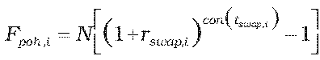
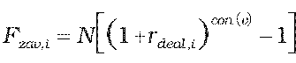
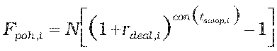
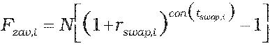
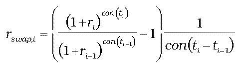

Príloha č. 10 k vyhláške č. 246/2009 Z. z.

- Určenie teoretickej ceny IRS swapu

  - (1) Teoretická cena IRS swapu so splatnosťou kratšou ako jeden rok vrátane sa vypočíta postupom uvedeným v prílohe č. 9, pričom:

    - Fpoh,i = N.rswap,i . con(tswap,i) a Fzav,i = N.rdeal,i . con(tswap,i), ak ide o nákup dohodnutej úrokovej sadzby a predaj swapovej úrokovej sadzby,

    - Fpoh,i = N.rdeal,i . con(tswap,i) a Fzav,i = N.rswap,i . con(tswap,i), ak ide o predaj dohodnutej úrokovej sadzby a nákup swapovej úrokovej sadzby,

    - kde

    - N – dohodnutá istina (nocionálna hodnota),

    - rswap,i – swapová úroková miera i-tej platby swapu v deň, ku ktorému sa IRS swap oceňuje,

    - rdeal,i – dohodnutá swapová úroková miera i-tej platby swapu,

    - tswap,i – dĺžka i-tého úrokového obdobia v dňoch,

    - con() – dĺžka obdobia vypočítaná podľa konvencie v podmienkach príslušného derivátu.

  - (2) Teoretická cena IRS swapu so splatnosťou dlhšou ako jeden rok sa vypočíta postupom uvedeným v prílohe č. 9, pričom:

  -  a , ak ide o nákup dohodnutej úrokovej sadzby a predaj swapovej úrokovej sadzby,

  -  a , ak ide o predaj dohodnutej úrokovej sadzby a nákup swapovej úrokovej sadzby,

    - kde

    - N – dohodnutá istina (nocionálna hodnota),

    - rswap,i – swapová úroková miera i-tej platby swapu v deň, ku ktorému sa IRS swap oceňuje,

    - rdeal,i – dohodnutá swapová úroková miera i-tej platby swapu,

    - tswap,i – dĺžka i-tého úrokového obdobia v dňoch,

    - con() – dĺžka obdobia vypočítaná podľa konvencie v podmienkach príslušného derivátu.

  - (3) Ak swapová úroková miera i-tej platby swapu v deň, ku ktorému sa IRS swap oceňuje, nie je dostupná, vypočíta sa podľa vzorca:

  - ,

    - kde

    - ti – dĺžka obdobia do i-tej platby swapu v dňoch,

    - ti-1 – dĺžka obdobia do i – 1-ej platby swapu v dňoch,

    - con() – dĺžka obdobia vypočítaná podľa konvencie v podmienkach príslušného derivátu,

    - ri – požadovaný úrokový výnos vypočítaný podľa prílohy č. 15 na obdobie ti,

    - ri-1 – požadovaný úrokový výnos vypočítaný podľa prílohy č. 15 na obdobie ti-1.
