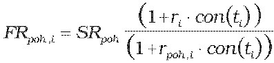
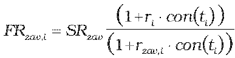
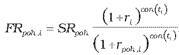
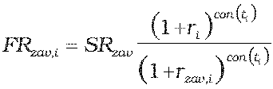

Príloha č. 11 k vyhláške č. 246/2009 Z. z.

- Určenie teoretickej ceny FX swapu

  - (1) Teoretická cena FX swapu sa vypočíta postupom uvedeným v prílohe č. 9, pričom:

    - Fpoh = Npoh . FRpoh,

    - Fzav = Nzav . FRzav,

    - kde

    - Npoh – dohodnutý objem nakúpenej meny,

    - Nzav – dohodnutý objem predanej meny,

    - FRpoh,i – forwardový kurz i-tej zámeny referenčnej meny k nakúpenej mene v deň, ku ktorému sa swap oceňuje,

    - FRzav,i – forwardový kurz i-tej zámeny referenčnej meny k predanej mene v deň, ku ktorému sa swap oceňuje.

  - (2) Ak forwardový kurz i-tej zámeny referenčnej meny k nakúpenej alebo predanej mene v deň, ku ktorému sa swap oceňuje, nie je dostupný, určí sa postupom, ak ide o

    - a) FX swap so splatnosťou kratšou ako jeden rok vrátane,

    - , ,

    - b) FX swap so splatnosťou dlhšou ako jeden rok,

    - , ,

      - kde

      - SRpoh – spotový kurz nakúpenej meny k referenčnej mene ku dňu, ku ktorému sa swap oceňuje,

      - SRzav – spotový kurz predanej meny k referenčnej mene ku dňu, ku ktorému sa swap oceňuje,

      - ri – požadovaný úrokový výnos pre referenčnú menu určený podľa prílohy č. 15 na obdobie ti,

      - rpoh,i – požadovaný úrokový výnos pre nakúpenú menu vypočítaný podľa prílohy č. 15 na obdobie ti,

      - rzav,i – požadovaný úrokový výnos pre predanú menu vypočítaný podľa prílohy č. 15 na obdobie ti,

      - con() – dĺžka obdobia vypočítaná podľa konvencie v podmienkach príslušného derivátu.
