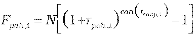
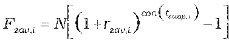

Príloha č. 12 k vyhláške č. 246/2009 Z. z.

- Určenie teoretickej ceny bázického swapu

  - (1) Na výpočet teoretickej ceny bázického swapu so splatnosťou kratšou ako jeden rok vrátane sa použije postup uvedený v prílohe č. 9, pričom:

    - Fpoh,i = N.rpoh,i . con(tswap,i) a Fzav,i = N.rzav,i . con(tswap,i),

    - kde

    - N – dohodnutá istina (nocionálna hodnota),

    - rpoh,i – swapová úroková miera pohľadávky i-tej platby swapu v deň, ku ktorému sa swap oceňuje,

    - rzav,i – swapová úroková miera záväzku i-tej platby swapu v deň, ku ktorému sa swap oceňuje,

    - rswap.i – dĺžka i-tého úrokového obdobia v dňoch,

    - con() – dĺžka obdobia vypočítaná podľa konvencie v podmienkach príslušného derivátu.

  - (2) Na výpočet teoretickej ceny bázického swapu so splatnosťou dlhšou ako jeden rok sa použije postup uvedený v prílohe č. 9, pričom:

  -  a ,

    - kde

    - N – dohodnutá istina (nocionálna hodnota),

    - rpoh,i – swapová úroková miera pohľadávky i-tej platby swapu v deň, ku ktorému sa swap oceňuje,

    - rzav,i – swapová úroková miera záväzku i-tej platby swapu v deň, ku ktorému sa swap oceňuje,

    - rswap.i – dĺžka i-tého úrokového obdobia v dňoch,

    - con() – dĺžka obdobia vypočítaná podľa konvencie v podmienkach príslušného derivátu.
