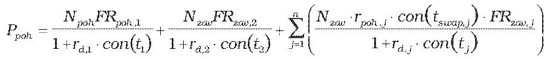
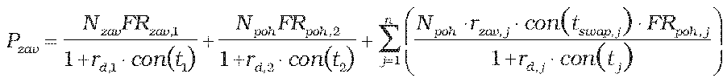
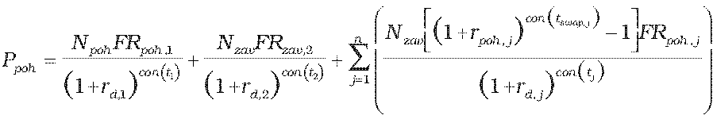
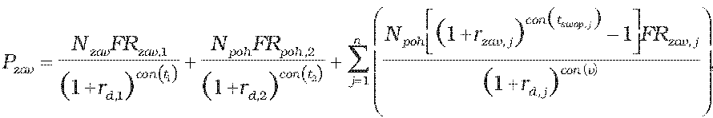

Príloha č. 13 k vyhláške č. 246/2009 Z. z.

- Určenie teoretickej ceny krížového menovo-úrokového swapu

  - (1) Teoretická cena krížového menovo-úrokového swapu so splatnosťou kratšou ako jeden rok vrátane sa vypočíta postupom:

  - ,

  - .

  - (2) Teoretická cena krížového menovo-úrokového swapu so splatnosťou dlhšou ako jeden rok sa vypočíta postupom:

  - ,

  - ,

    - kde

    - Ppoh – hodnota diskontovaných pohľadávok zo swapu,

    - Pzav – hodnota diskontovaných záväzkov zo swapu,

    - t1 – začiatok krížového menovo-úrokového swapu,

    - t2 – koniec krížového menovo-úrokového swapu,

    - tj – zostatková splatnosť j-tej úrokovej platby swapu,

    - con() – dĺžka obdobia vypočítaná podľa konvencie v podmienkach príslušného derivátu,

    - rd,1 – požadovaný úrokový výnos pre referenčnú menu vypočítaný podľa prílohy č. 15 na obdobie t1,

    - rd,2 – požadovaný úrokový výnos pre referenčnú menu vypočítaný podľa prílohy č. 15 na obdobie t2,

    - rd,j – požadovaný úrokový výnos pre referenčnú menu vypočítaný podľa prílohy č. 15 na obdobie tj,

    - Npoh – objem nakúpenej meny, ktorý sa nakúpi v čase t1 a spätne sa predá v čase t2,

    - Nzav – objem predanej meny, ktorý sa predá v čase t1 a spätne sa odkúpi v čase t2,

    - FRpoh.i – forwardový kurz referenčnej meny k nakúpenej mene k i-tej zámene objemu cudzej meny ku dňu, ku ktorému sa swap oceňuje,

    - FRzav,i – forwardový kurz referenčnej meny k predanej mene k i-tej zámene objemu cudzej meny ku dňu, ku ktorému sa swap oceňuje,

    - rpoh,j – swapová úroková miera pohľadávky j-tej platby swapu ku dňu, ku ktorému sa swap oceňuje,

    - rzav,j – swapová úroková miera záväzku j-tej platby swapu ku dňu, ku ktorému sa swap oceňuje.
