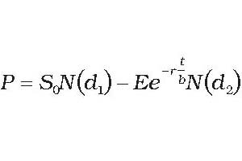
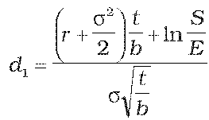
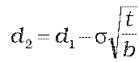
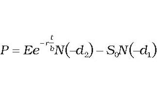
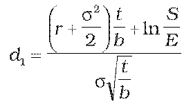
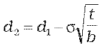
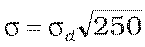
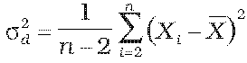
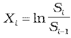
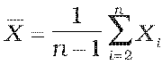

Príloha č. 14 k vyhláške č. 246/2009 Z. z.

- Určenie teoretickej ceny európskej opcie

  - (1) Teoretická cena európskej call opcie na kapitálový cenný papier, z ktorého sa nevypláca dividenda, sa vypočíta postupom:

  - , pričom

  - ,

  - ,

    - kde

    - P – teoretická cena európskej call opcie,

    - S0 – cena kapitálového cenného papiera v deň, ku ktorému sa opcia oceňuje,

    - E – expiračná cena kapitálového cenného papiera,

    - t – zostatková doba splatnosti opcie do expirácie v dňoch,

    - b – báza počtu dní v roku,

    - σ – historická volatilita kapitálového cenného papiera vyjadrená v rokoch,

    - r – požadovaný spojitý úrokový výnos na obdobie t,

    - N() – kumulatívna distribučná funkcia normálneho rozdelenia so strednou hodnotou 0 a varianciou 1.

  - (2) Teoretická cena európskej put opcie na kapitálový cenný papier, z ktorého sa nevypláca dividenda, sa vypočíta postupom:

  - , pričom

  - ,

  - ,

    - kde

    - P – teoretická cena európskej call opcie,

    - S0 – cena kapitálového cenného papiera v deň, ku ktorému sa opcia oceňuje,

    - E – expiračná cena kapitálového cenného papiera,

    - t – zostatková doba splatnosti opcie do expirácie v dňoch,

    - b – báza počtu dní v roku,

    - σ – historická volatilita kapitálového cenného papiera vyjadrená v rokoch,

    - r – požadovaný spojitý úrokový výnos na obdobie t,

    - N() – kumulatívna distribučná funkcia normálneho rozdelenia so strednou hodnotou 0 a varianciou 1.

  - (3) Ak spojitý úrokový výnos nie je dostupný, vypočíta sa postupom:

    - r = ln(1 + rd),

    - kde

    - rd – požadovaný úrokový výnos vypočítaný podľa prílohy č. 15 na obdobie t.

  - (4) Ak historická volatilita príslušného kapitálového cenného papiera nie je dostupná, vypočíta sa postupom:

  - ,

    - pričom

  - ,

  - ,

  - ,

    - kde

    - σ – historická volatilita kapitálového cenného papiera vyjadrená v rokoch,

    - σd – historická volatilita kapitálového cenného papiera vyjadrená v dňoch,

    - Si – cena príslušného kapitálového cenného papiera v deň i,

    - n – počet obchodných dní od začiatku kótovania ceny kapitálového cenného papiera; počet dní, za ktoré je počítaná historická volatilita kapitálového cenného papiera,

    - i=1, 2, 3... – index obchodných dní od začiatku kótovania ceny kapitálového cenného papiera.
