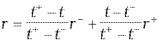

Príloha č. 15 k vyhláške č. 246/2009 Z. z.

- Určenie požadovaného úrokového výnosu peňažných tokov plynúcich z finančného nástroja

  - (1) Požadovaný úrokový výnos peňažných tokov plynúcich z finančného nástroja (ďalej len „požadovaný úrokový výnos“) sa určuje metódou lineárnej interpolácie z výnosovej krivky dlhopisu s nulovým kupónom, a to podľa vzorca:

  - ,

    - kde

    - r – požadovaný úrokový výnos,

    - t – doba splatnosti peňažného toku z finančného nástroja,

    - t+ – najbližšia dlhšia doba splatnosti dostupná na výnosovej krivke dlhopisu s nulovým kupónom,

    - t– – najbližšia kratšia doba splatnosti dostupná na výnosovej krivke dlhopisu s nulovým kupónom,

    - r+ – hodnota úrokovej sadzby na výnosovej krivke dlhopisu s nulovým kupónom prináležiaca k najbližšej dlhšej dobe splatnosti dostupnej na výnosovej krivke dlhopisu s nulovým kupónom,

    - r– – hodnota úrokovej sadzby na výnosovej krivke dlhopisu s nulovým kupónom prináležiaca k najbližšej kratšej dobe splatnosti dostupnej na výnosovej krivke dlhopisu s nulovým kupónom.

  - (2) Ak nie je uvedené inak, všetky úrokové sadzby sú v percentuálnom vyjadrení v ročnej miere.

  - (3) Výnosová krivka dlhopisu s nulovým kupónom sa zostaví bootstrappingom, ak ide o finančné nástroje so splatnosťou

    - a) kratšou ako jeden rok vrátane, z úrokových sadzieb medzibankového trhu, a to pre menu, v ktorej je príslušný finančný nástroj denominovaný,

    - b) dlhšou ako jeden rok, zo swapových úrokových sadzieb medzibankového trhu v mene, v ktorej je príslušný finančný nástroj denominovaný.
