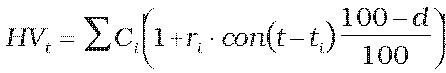

Príloha č. 2 k vyhláške č. 246/2009 Z. z.

- Určenie hodnoty peňažných prostriedkov na bežnom účte a na vkladovom účte

  - Hodnota peňažných prostriedkov na bežnom účte a na vkladovom účte sa vypočíta podľa vzorca:

- ,

  - kde

  - Ci – peňažný tok v čase ti,

  - ri – úroková sadzba, ktorou sa príslušný peňažný tok úročí,

  - con() – dĺžka obdobia vypočítaná podľa konvencie dohodnutej v podmienkach vkladu,

  - d – daň z príjmov vyberaná zrážkou podľa § 43 zákona č. 595/2003 Z. z. o dani z príjmov v znení neskorších predpisov v percentuálnom vyjadrení.
