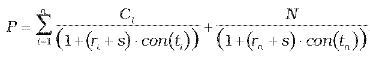
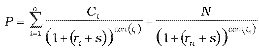

Príloha č. 3 k vyhláške č. 246/2009 Z. z.

- Určenie teoretickej ceny dlhového cenného papiera

  - (1) Teoretická cena dlhového cenného papiera so splatnosťou kratšou ako jeden rok vrátane sa vypočíta postupom:

  - ,

    - kde

    - P – teoretická cena dlhového cenného papiera vrátane alikvotného úrokového výnosu,

    - ri – požadovaný úrokový výnos určený podľa prílohy č. 15,

    - s – prémia za riziko určená podľa prílohy č. 16,

    - N – menovitá hodnota dlhového cenného papiera,

    - Ci – hodnota i-tého kupónu z dlhového cenného papiera; ak kupónová sadzba je odvodená zo sadzby medzibankového trhu, budúce kupónové sadzby sa určia zo vzorca uvedeného v prílohe č. 6 ods. 3 použitím forwardovej sadzby medzibankového trhu odvodenej z výnosovej krivky medzibankového trhu; ak nie je možné použiť výnosovú krivku medzibankového trhu, na odvodenie budúcich kupónových sadzieb sa použije swapová úroková krivka,

    - ti – počet dní do splatnosti i-tého kupónu z dlhového cenného papiera v dňoch,

    - i – index budúceho kupónu z dlhového cenného papiera,

    - n – počet budúcich kupónov z dlhového cenného papiera,

    - tn – počet dní do splatnosti dlhového cenného papiera v dňoch,

    - con() – dĺžka obdobia vypočítaná podľa konvencie v emisných podmienkach príslušného dlhového cenného papiera.

  - (2) Teoretická cena dlhového cenného papiera so splatnosťou dlhšou ako jeden rok sa vypočíta postupom:

  - ,

    - kde

    - P – teoretická cena dlhového cenného papiera vrátane alikvotného úrokového výnosu,

    - ri – požadovaný úrokový výnos určený podľa prílohy č. 15,

    - s – prémia za riziko určená podľa prílohy č. 16,

    - N – menovitá hodnota dlhového cenného papiera,

    - Ci – hodnota i-tého kupónu z dlhového cenného papiera; ak kupónová sadzba je odvodená zo sadzby medzibankového trhu, budúce kupónové sadzby sa určia zo vzorca uvedeného v prílohe č. 6 ods. 3 použitím forwardovej sadzby medzibankového trhu odvodenej z výnosovej krivky medzibankového trhu; ak nie je možné použiť výnosovú krivku medzibankového trhu, na odvodenie budúcich kupónových sadzieb sa použije swapová úroková krivka,

    - ti – počet dní do splatnosti i-tého kupónu z dlhového cenného papiera v dňoch,

    - i – index budúceho kupónu z dlhového cenného papiera,

    - n – počet budúcich kupónov z dlhového cenného papiera,

    - tn – počet dní do splatnosti dlhového cenného papiera v dňoch,

    - con() – dĺžka obdobia vypočítaná podľa konvencie v emisných podmienkach príslušného dlhového cenného papiera.
