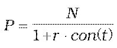
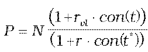
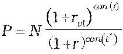

Príloha č. 4 k vyhláške č. 246/2009 Z. z.

- Určenie teoretickej ceny nástroja peňažného trhu

  - (1) Teoretická cena pokladničnej poukážky sa vypočíta postupom:

  - ,

    - kde

    - P – teoretická cena pokladničnej poukážky,

    - N – menovitá hodnota pokladničnej poukážky,

    - r – požadovaný úrokový výnos určený podľa prílohy č. 15,

    - t – počet dní do splatnosti pokladničnej poukážky,

    - con() – dĺžka obdobia vypočítaná podľa konvencie v emisných podmienkach.

  - (2) Teoretická cena vkladového listu sa vypočíta postupom:

    - a) teoretická cena vkladového listu so splatnosťou kratšou ako jeden rok vrátane:

    - ,

    - b) teoretická cena vkladového listu so splatnosťou dlhšou ako jeden rok:

    - ,

      - kde

      - N – nominálna hodnota vkladového listu,

      - rvl – ročná úroková sadzba vkladového listu platná pre aktuálne obdobie v percentuálnom vyjadrení,

      - r – požadovaný úrokový výnos určený podľa prílohy č. 15,

      - t – celková doba splatnosti vkladového listu v dňoch,

      - t* – doba do splatnosti vkladového listu v dňoch ku dňu ocenenia,

      - con() – dĺžka obdobia vypočítaná podľa konvencie v emisných podmienkach.
