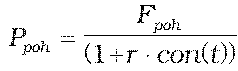
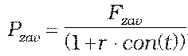
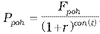
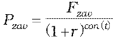

Príloha č. 5 k vyhláške č. 246/2009 Z. z.

- Určenie teoretickej ceny forwardu

  - (1) Teoretická cena forwardu so splatnosťou kratšou ako jeden rok vrátane sa vypočíta postupom:

    - P = Ppoh – Pzav,

  - ,

  - ,

    - kde

    - P – teoretická cena forwardu,

    - Ppoh – hodnota diskontovaných pohľadávok z forwardu,

    - Pzav – hodnota diskontovaných záväzkov z forwardu,

    - Fpoh – forwardová hodnota pohľadávok z forwardu,

    - Fzav – forwardová hodnota záväzkov z forwardu,

    - t – zostatková doba splatnosti forwardu v dňoch,

    - r – požadovaný úrokový výnos určený podľa prílohy č. 15,

    - con() – dĺžka obdobia vypočítaná podľa konvencie v podmienkach príslušného derivátu.

  - (2) Teoretická cena forwardu so splatnosťou dlhšou ako jeden rok sa vypočíta postupom:

    - P = Ppoh – Pzav,

    - kde

  - ,

  - ,

    - kde

    - P – teoretická cena forwardu,

    - Ppoh – hodnota diskontovaných pohľadávok z forwardu,

    - Pzav – hodnota diskontovaných záväzkov z forwardu,

    - Fpoh – forwardová hodnota pohľadávok z forwardu,

    - Fzav – forwardová hodnota záväzkov z forwardu,

    - t – zostatková doba splatnosti forwardu v dňoch,

    - r – požadovaný úrokový výnos určený podľa prílohy č. 15,

    - con() – dĺžka obdobia vypočítaná podľa konvencie v podmienkach príslušného derivátu.
