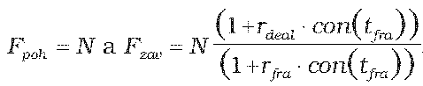
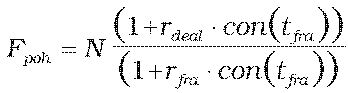
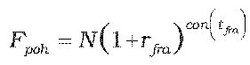
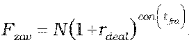
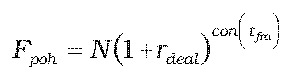
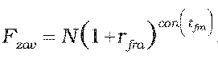
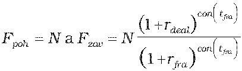
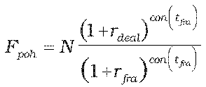
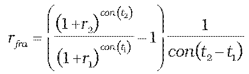

Príloha č. 6 k vyhláške č. 246/2009 Z. z.

- Určenie teoretickej ceny FRA obchodu

  - (1) Teoretická cena FRA obchodu so splatnosťou do jedného roka vrátane sa vypočíta postupom uvedeným v prílohe č. 5, pričom ak k finančnému vysporiadaniu dôjde v

    - a) deň t2,

      - Ppoh = N(1+rfra.con(tfra)) a Fzav = N(1+rdeal.con(tfra)), ak sa platí dohodnutá forwardová úroková miera a prijíma sa forwardová úroková miera príslušného dňa, alebo

      - Fpoh = N(1+rdeal.con(tfra)) a Fzav = N(1+rfra.con(tfra)), ak sa platí forwardová úroková miera príslušného dňa a prijíma sa dohodnutá forwardová úroková miera,

    - b) deň t1,

    - , ak sa platí dohodnutá forwardová úroková miera a prijíma sa forwardová úroková miera príslušného dňa, alebo

    -  a Fzav = N, ak sa platí forwardová úroková miera príslušného dňa a prijíma sa dohodnutá forwardová úroková miera,

      - kde

      - N – dohodnutá istina,

      - rdeal – dohodnutá forwardová úroková miera na obdobie od t1 do t2,

      - rfra – forwardová úroková miera príslušného dňa na obdobie od t1 do t2,

      - tfra = t2 – t1 = – perióda FRA obchodu v dňoch,

      - con() – dĺžka obdobia vypočítaná podľa konvencie v podmienkach príslušného derivátu.

  - (2) Teoretická cena FRA obchodu so splatnosťou dlhšou ako jeden rok sa vypočíta postupom uvedeným v prílohe č. 5, pričom ak k finančnému vysporiadaniu dôjde v

    - a) deň t2,

    -  a , ak sa platí dohodnutá forwardová úroková miera a prijíma sa forwardová úroková miera príslušného dňa,

    -  a , ak sa platí forwardová úroková miera príslušného dňa a prijíma sa dohodnutá forwardová úroková miera,

    - b) deň t1,

    - , ak sa platí dohodnutá forwardová úroková miera a prijíma sa forwardová úroková miera príslušného dňa,

    -  a Fzav = N, ak sa platí forwardová úroková miera príslušného dňa a prijíma sa dohodnutá forwardová úroková miera,

      - kde

      - N – dohodnutá istina,

      - rdeal – dohodnutá forwardová úroková miera na obdobie od t1 do t2,

      - rfra – forwardová úroková miera príslušného dňa na obdobie od t1 do t2,

      - tfra = t2 – t1 – perióda FRA obchodu v dňoch,

      - con() – dĺžka obdobia vypočítaná podľa konvencie v podmienkach príslušného derivátu.

  - (3) Ak forwardová úroková miera príslušného dňa na obdobie od t1 do t2 nie je dostupná, určí sa podľa vzorca:

  - ,

    - kde

    - rfra – forwardová úroková miera na obdobie (t2– t1) platná od t1,

    - r1 – požadovaný úrokový výnos vypočítaný podľa prílohy č. 15 na obdobie t1,

    - r2 – požadovaný úrokový výnos vypočítaný podľa prílohy č. 15 na obdobie t2,

    - con() – dĺžka obdobia vypočítaná podľa konvencie v podmienkach príslušného derivátu.
