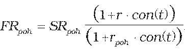
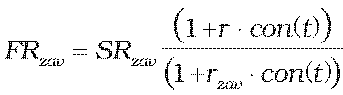
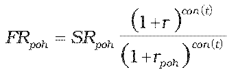
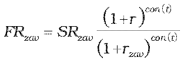

Príloha č. 7 k vyhláške č. 246/2009 Z. z.

- Určenie teoretickej ceny FX forwardu

  - (1) Teoretická cena FX forwardu sa vypočíta postupom uvedeným v prílohe č. 5, pričom:

    - Fpoh = Npoh . FRpoh a

    - Fzav = Nzav . FRzav ,

    - kde

    - Npoh – dohodnutý objem nakúpenej meny,

    - Nzav – dohodnutý objem predanej meny,

    - FRpoh – forwardový kurz referenčnej meny k nakúpenej mene ku dňu realizácie obchodu,

    - FRzav – forwardový kurz referenčnej meny k predanej mene ku dňu realizácie obchodu.

  - (2) Ak forwardový kurz cudzej meny k domácej mene alebo inej určenej mene ku dňu, ku ktorému sa FX forward oceňuje, nie je dostupný, vypočíta sa postupom:

    - a) pre FX forwardy so splatnosťou kratšou ako jeden rok vrátane:

    - , ,

    - b) pre FX forwardy so splatnosťou dlhšou ako jeden rok:

    - , ,

      - kde

      - FRpoh – forwardový kurz referenčnej meny k nakúpenej mene ku dňu, ku ktorému sa FX forward oceňuje,

      - FRzav – forwardový kurz referenčnej meny k predanej mene ku dňu, ku ktorému sa FX forward oceňuje,

      - SRpoh – spotový kurz referenčnej meny k nakúpenej mene ku dňu ocenenia,

      - SRzav – spotový kurz referenčnej meny k predanej mene ku dňu ocenenia,

      - r – požadovaný úrokový výnos pre referenčnú menu určený podľa prílohy č. 15 na obdobie t,

      - rpoh – požadovaný úrokový výnos pre nakúpenú menu určený podľa prílohy č. 15 na obdobie t,

      - rzav – požadovaný úrokový výnos pre predanú menu určený podľa prílohy č. 15 na obdobie t,

      - con() – dĺžka obdobia vypočítaná podľa konvencie v podmienkach príslušného derivátu.
