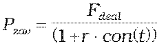
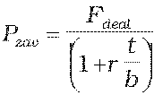
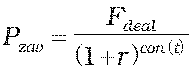
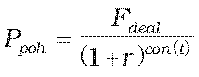

Príloha č. 8 k vyhláške č. 246/2009 Z. z.

- Určenie teoretickej ceny forwardu na dlhový cenný papier a forwardu na kapitálový cenný papier

  - (1) Teoretická cena forwardu na dlhový cenný papier a na kapitálový cenný papier sa vypočíta spôsobom:

    - P = Ppoh – Pzav,

    - kde

    - Ppoh – súčasná hodnota pohľadávok z forwardu,

    - Pzav – súčasná hodnota záväzkov z forwardu.

  - (2) Súčasná hodnota pohľadávok a záväzkov z forwardu na dlhový cenný papier a forwardu na kapitálový cenný papier so splatnosťou kratšou ako jeden rok vrátane sa vypočíta postupom, ak ide o

    - a) nákup predmetu forwardu, Ppoh = So a ,

    - b) predaj predmetu forwardu, , Pzav = So ,

      - kde

      - P – teoretická cena forwardu,

      - S0 – hodnota dlhového cenného papiera alebo kapitálového cenného papiera ku dňu ocenenia podľa § 4,

      - Fdeal – dohodnutá cena dlhového cenného papiera alebo kapitálového cenného papiera,

      - t – zostatková doba splatnosti forwardu v dňoch,

      - r – požadovaný úrokový výnos určený podľa prílohy č. 15,

      - con() – dĺžka obdobia vypočítaná podľa konvencie v podmienkach príslušného derivátu.

  - (3) Súčasná hodnota pohľadávky a záväzku z forwardu na dlhový cenný papier a forwardu na kapitálový cenný papier so splatnosťou dlhšou ako jeden rok sa vypočíta postupom, ak ide o

    - a) nákup predmetu forwardu, Ppoh = So a ,

    - b) predaj predmetu forwardu,  a Pzav = So,

      - kde

      - P – teoretická cena forwardu,

      - S0 – hodnota dlhového cenného papiera alebo kapitálového cenného papiera ku dňu ocenenia podľa § 4,

      - Fdeal – dohodnutá cena dlhového cenného papiera alebo kapitálového cenného papiera,

      - t – zostatková doba splatnosti forwardu v dňoch,

      - r – požadovaný úrokový výnos určený podľa prílohy č. 15,

      - con() – dĺžka obdobia vypočítaná podľa konvencie v podmienkach príslušného derivátu.
