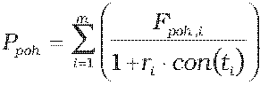
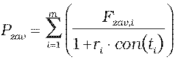
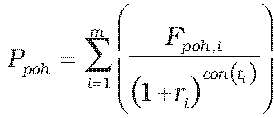
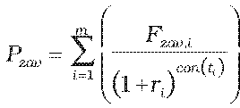

Príloha č. 9 k vyhláške č. 246/2009 Z. z.

- Určenie teoretickej ceny swapu

  - (1) Teoretická cena swapu so splatnosťou kratšou ako jeden rok vrátane sa vypočíta spôsobom:

    - P = Ppoh – Pzav,

    - kde

  - ,

  - .

  - (2) Teoretická cena swapu so splatnosťou dlhšou ako jeden rok sa vypočíta spôsobom:

    - P = Ppoh – Pzav,

    - kde

  - ,

  - ,

    - kde

    - P – teoretická cena swapu,

    - Ppoh – hodnota oddiskontovaných pohľadávok zo swapu,

    - Pzav – hodnota oddiskontovaných záväzkov zo swapu,

    - Ppoh,i – forwardová cena pohľadávky zo swapu pre i-tú platbu v deň, ku ktorému sa swap oceňuje,

    - Pzav,i – forwardová cena záväzku zo swapu pre i-tú platbu v deň, ku ktorému sa swap oceňuje,

    - ti – zostatková doba splatnosti i-tej platby swapu v dňoch,

    - ri – požadovaný úrokový výnos vypočítaný podľa prílohy č. 15 na obdobie ti,

    - i – index budúcej platby swapu,

    - m – počet budúcich platieb swapu,

    - con() – dĺžka obdobia vypočítaná podľa konvencie v podmienkach príslušného derivátu.
