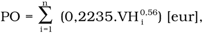

# Čl. I

Vyhláška Ministerstva spravodlivosti Slovenskej republiky č. 491/2004 Z. z. o odmenách, náhradách výdavkov a náhradách za stratu času pre znalcov, tlmočníkov a prekladateľov v znení vyhlášky č. 400/2006 Z. z. a vyhlášky č. 565/2008 Z. z. sa mení takto:

V § 4 odsek 2 znie:

„(2)

Podielová odmena sa určuje podľa stanovenej výšky východiskovej hodnoty predmetu znaleckého úkonu podľa vzťahu

kde:

PO – výška podielovej odmeny,

VH – východisková hodnota predmetu úkonu zaokrúhlená na celé eurá nahor; za predmet úkonu sa považujú jednotlivo hlavné stavebné objekty, spoločne príslušenstvo (napríklad ploty, studne, inžinierske siete, spevnené plochy a pod.) a spoločne pozemky; východisková hodnota pozemkov je 16,60 eura/m2,

n – počet predmetov ohodnotenia.“.
