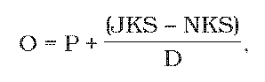
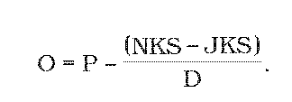

# § 25 Jelenia zver

(1) Plánovaný pomer pohlavia jelenej zveri je 1:1, najviac 1:1,2 v prospech jeleníc.

(2) Plánovaná veková a pohlavná štruktúra populácie je 40 % jeleňov, 40 % jeleníc a 20 % jelenčiat.

(3) Plánovaná veková štruktúra jeleňov je takáto:

- a) I. veková trieda – ročné a dvojročné jelene 23 %,

- b) II. veková trieda – trojročné až šesťročné jelene 32 %,

- c) III. veková trieda – sedemročné až desaťročné jelene 25 %,

- d) IV. veková trieda – jedenásťročné a staršie jelene 20 %.

(4) Ak sú dosiahnuté chovateľské ciele podľa § 24, plán odstrelu jelenej zveri predstavuje 30 % z normovaného kmeňového stavu, štruktúra plánu lovu je 34 % jeleňov, 36 % jeleníc a 30 % jelenčiat. Z plánu odstrelu jeleňov treba v I. vekovej triede uloviť 30 %, II. vekovej triede 30 %, III. vekovej triede 15 % a vo IV. vekovej triede 25 % pri zachovaní kritérií selektívneho odstrelu; úhyn zveri sa započíta do plnenia plánu lovu.

(5) Prevod prírastku jelenej zveri z predchádzajúceho roku sa v pláne chovu a lovu vykonáva takto:

- a) z počtu jelenčiat zistených k 31. marcu sa presunie 50 % do I. vekovej triedy jeleňov a 50 % do kategórie jeleníc; pri nepárnom počte jelenčiat sa 50-percentný podiel zaokrúhlený na celé kusy nahor presunie do kategórie jeleníc a zvyšok do I. vekovej triedy jeleňov,

- b) 50 % jeleňov I. vekovej triedy bez presunutého počtu jelenčiat sa presunie do II. vekovej triedy, z II. vekovej triedy sa presunie 25 % do III. vekovej triedy a z III. vekovej triedy sa presunie 25 % do IV. vekovej triedy; pri nepárnych počtoch sa presúva príslušný percentuálny podiel zaokrúhlený na celé kusy nahor,

- c) do triedy jelenčiat sa pripočíta očakávaný prírastok.

(6) Ak je v kmeňovom stave prevaha jeleníc a mladej zveri, treba úmerne zvýšiť ich odstrel a obmedziť lov jeleňov II. a III. vekovej triedy. Ak sú kmeňové stavy jelenej zveri v revíri vyššie ako normované, treba loviť viac zveri, ako je ročný prírastok, pričom treba loviť intenzívnejšie jelenice a jelenčatá. Ročný plán odstrelu sa v takomto prípade vypočíta podľa vzorca

kde

O – ročný odstrel v kusoch,

P – očakávaný ročný prírastok v kusoch,

JKS – skutočný jarný kmeňový stav v kusoch,

NKS – normovaný kmeňový stav v kusoch,

D – počet rokov, za ktoré sa má dosiahnuť normovaný

stav.

(7) Údaje do vzorca treba každoročne aktualizovať a údaj D sa každý rok počas redukcie znižuje o jeden rok.

(8) Ak je skutočný stav zveri v revíri nižší ako normovaný, loví sa menej zveri, ako je prírastok, a na prechodný čas treba znížiť intenzitu lovu samičej zveri. Plán odstrelu sa v takomto prípade vypočíta podľa vzorca

