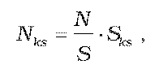
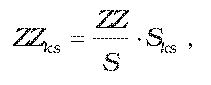
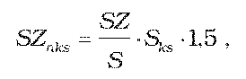
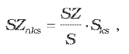
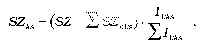
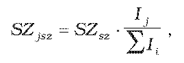
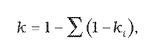

# Čl. I

Vyhláška Úradu pre reguláciu sieťových odvetví č. 630/2005 Z. z., ktorou sa ustanovuje teplota teplej úžitkovej vody na odbernom mieste, pravidlá rozpočítavania množstva tepla dodaného na prípravu teplej úžitkovej vody a rozpočítavania množstva dodaného tepla sa mení a dopĺňa takto:

- 1. V § 4 ods. 3 písmeno c) znie:

- „c)

- regulačného príkonu na vykurovanie na odbernom mieste a regulačného príkonu na teplo v teplej úžitkovej vode na odbernom mieste,“.

- 2. § 4 sa dopĺňa novým odsekom 5, ktorý znie:

- „(5)

- Ak si koneční spotrebitelia v objekte rozpočítavania pripravujú teplú úžitkovú vodu z tepla meraného určeným meradlom1) na vstupe do bytu alebo nebytového priestoru a nemajú uzatvorenú zmluvu o dodávke a odbere tepla,5) celkové náklady za namerané teplo na prípravu teplej úžitkovej vody v miestach prípravy teplej úžitkovej vody u konečných spotrebiteľov sa rozpočítavajú konečným spotrebiteľom podľa § 9. Ak nie sú v miestach prípravy teplej úžitkovej vody nainštalované určené meradlá1) množstva tepla na prípravu teplej úžitkovej vody, množstvo tepla na prípravu teplej úžitkovej vody sa vypočíta z nameranej spotreby teplej úžitkovej vody a mernej spotreby na jej výrobu, ktorá je určená hodnotou 75 kWh/m3. Náklady na vykurovanie, ktoré sa vypočítajú ako rozdiel množstva tepla na odbernom mieste odberateľa tepla a súčtu množstva tepla použitého na prípravu teplej úžitkovej vody nameranej v miestach prípravy teplej úžitkovej vody a ceny tepla, sa rozpočítavajú konečným spotrebiteľom podľa § 7.“.

- Poznámka pod čiarou k odkazu 5 znie:

- „5)

- § 19 zákona č. 657/2004 Z. z.“.

- 3. § 5 vrátane nadpisu znie:

- 㤠5

- Rozpočítavanie množstva dodaného tepla za dodávku tepla na vykurovanie podľa podlahovej plochy bytu a nebytového priestoru

- (1)

- Ak v objekte rozpočítavania nie sú zapojené pomerové rozdeľovače tepla ani určené meradlá1) tepla u konečných spotrebiteľov podľa osobitného predpisu,6) náklady na dodané teplo na vykurovanie sa rozpočítavajú konečným spotrebiteľom v pomere podlahovej plochy bytu, nebytových priestorov a spoluvlastníckeho podielu na spoločných priestoroch konečného spotrebiteľa k celkovej podlahovej ploche všetkých bytov, nebytových priestorov a spoločných priestorov v objekte rozpočítavania podľa vzorca

- 

- kde predstavuje

- Nks – náklady pre konečného spotrebiteľa [euro],

- N – náklady na dodané teplo na vykurovanie za objekt rozpočítavania [euro],

- S – celkovú podlahovú plochu bytov, vykurovaných nebytových priestorov a spoločných priestorov [m2],

- Sks – podlahovú plochu bytu, vykurovaného nebytového priestoru a spoluvlastníckeho podielu na spoločných priestoroch konečného spotrebiteľa [m2].

- (2)

- Ak sú v objekte rozpočítavania aj byty alebo nebytové priestory s individuálnym vykurovaním, náklady za dodané teplo na vykurovanie sa rozdelia na základnú zložku a spotrebnú zložku, pričom základná zložka tvorí 10 % a spotrebná zložka 90 % z celkových nákladov. Obidve zložky sa rozpočítavajú konečným spotrebiteľom v pomere podlahovej plochy bytu, nebytových priestorov a spoluvlastníckeho podielu na spoločných priestoroch konečného spotrebiteľa k celkovej podlahovej ploche všetkých bytov, nebytových priestorov a spoločných priestorov v objekte rozpočítavania, pričom základná zložka nákladov sa rozpočítava aj medzi užívateľov bytov a nebytových priestorov s individuálnym vykurovaním okrem prípadov, keď byt alebo nebytový priestor s individuálnym vykurovaním má polohu podľa § 7 ods. 3 písm. a).

- (3)

- Náklady na dodané teplo do spoločných priestorov sa rozpočítavajú konečným spotrebiteľom podľa spoluvlastníckeho podielu na spoločných priestoroch podľa odseku 1.

- (4)

- Ustanovenie odseku 3 sa neuplatňuje, ak sa spoločné priestory využívajú inak ako na účel, na ktorý sa zriadili, a nevyužívajú sa v prospech všetkých konečných spotrebiteľov. V takom prípade sa náklady na dodané teplo do spoločných priestorov rozpočítavajú podľa podlahovej plochy bytu a nebytových priestorov tým konečným spotrebiteľom, ktorí spoločné priestory využívajú len na osobnú potrebu na základe dohody s vlastníkmi bytov a nebytových priestorov.

- (5)

- Ak počas zúčtovacieho obdobia došlo k zmene konečného spotrebiteľa, náklady na dodané teplo na vykurovanie a na prípravu teplej úžitkovej vody podľa § 4 ods. 3 sa konečnému spotrebiteľovi rozpočítavajú v pomere nákladov na dodané teplo podľa jednotlivých mesiacov k celkovým nákladom na dodané teplo za zúčtovacie obdobie podľa prílohy č. 1 alebo v pomere počtu dennostupňov v jednotlivých mesiacoch k celkovému počtu dennostupňov za zúčtovacie obdobie, ak sa koneční spotrebitelia nedohodnú inak.

- (6)

- Ak sa vlastníci bytov a nebytových priestorov dohodnú podľa osobitného predpisu7) inak, rozpočítavanie množstva dodaného tepla na vykurovanie podľa odsekov 1 až 5 sa neuplatňuje.“.

- Poznámky pod čiarou k odkazom 6 a 7 znejú:

- „6)

- § 18 ods. 4 písm. a) zákona č. 657/2004 Z. z.

- 7)

- § 14 zákona Národnej rady Slovenskej republiky č. 182/1993 Z. z. o vlastníctve bytov a nebytových priestorov v znení neskorších predpisov.“.

- 4. V § 6 sa slovo „zákona5)“ nahrádza slovom „predpisu6)“.

- 5. § 7 vrátane nadpisu znie:

- 㤠7

- Rozpočítavanie množstva dodaného tepla na vykurovanie podľa pomerových rozdeľovačov tepla alebo určených meradiel tepla

- (1)

- Ak sú v objekte rozpočítavania zapojené pomerové rozdeľovače tepla rovnakého typu alebo určené meradlá1) tepla rovnakej triedy presnosti na meranie množstva tepla u konečných spotrebiteľov, náklady na množstvo dodaného tepla na vykurovanie sa rozdelia na základnú zložku a spotrebnú zložku. Základná zložka tvorí 60 % a spotrebná zložka 40 % z celkových nákladov na dodané teplo na vykurovanie.

- (2)

- Základná zložka sa rozpočítava konečným spotrebiteľom podľa podlahovej plochy bytu, nebytových priestorov a spoluvlastníckeho podielu na spoločných priestoroch konečného spotrebiteľa a priemeru základnej zložky na meter štvorcový vypočítaného z podlahovej plochy všetkých bytov, nebytových priestorov a spoločných priestorov v objekte rozpočítavania podľa vzorca

- 

- kde predstavuje

- ZZks – základnú zložku pre konečného spotrebiteľa [euro],

- ZZ – základnú zložku [euro],

- S – celkovú upravenú podlahovú plochu bytov, nebytových priestorov a spoločných priestorov [m2],

- Sks – upravenú podlahovú plochu bytu, nebytového priestoru a spoluvlastníckeho podielu na spoločných priestoroch konečného spotrebiteľa [m2].

- (3)

- Základná zložka na dodané teplo podľa odseku 2 sa rozpočítava aj medzi užívateľov bytov a nebytových priestorov, ktorí majú individuálne vykurovanie, pričom podlahová plocha bytu alebo nebytového priestoru s individuálnym vykurovaním sa vynásobí koeficientom

- a)

- 0,0 pri bytoch a nebytových priestoroch v nadstavbách a vstavbách do podkrovia, pri bytoch a nebytových priestoroch alebo ich častiach, ktoré sa nachádzajú na najvyššom podlaží alebo nad priestormi, ktoré nie sú vykurované, alebo v tých bytoch a nebytových priestoroch s individuálnym vykurovaním, cez ktoré neprechádzajú rozvody vykurovacej sústavy centrálneho zásobovania teplom,

- b)

- 0,25 pri ostatných bytoch a nebytových priestoroch s individuálnym vykurovaním.

- (4)

- Konečnému spotrebiteľovi, ktorý nemá zapojené pomerové rozdeľovače tepla alebo určené meradlo1) tepla, alebo odmietol umožniť vykonať ich odčítanie, alebo neoprávnene do nich zasahoval, čím spôsobil ich nesprávnu funkciu, alebo ich poškodil, sa určí spotrebná zložka ako súčin 1,5 násobku priemeru spotrebnej zložky na meter štvorcový vypočítaný z podlahovej plochy všetkých vykurovaných bytov, nebytových priestorov a spoločných priestorov a podlahovej plochy vykurovaného bytu, nebytového priestoru a spoluvlastníckeho podielu na spoločných priestoroch konečného spotrebiteľa podľa vzorca

- 

- kde predstavuje

- SZnks – spotrebnú zložku pre konečného spotrebiteľa určenú náhradným výpočtom [euro],

- SZ – spotrebnú zložku [euro],

- S – celkovú podlahovú plochu vykurovaných bytov, nebytových priestorov a spoločných priestorov [m2],

- Sks – podlahovú plochu vykurovaného bytu, nebytového priestoru a spoluvlastníckeho podielu na spoločných priestoroch konečného spotrebiteľa [m2].

- (5)

- V prípade poruchy pomerových rozdeľovačov tepla alebo určeného meradla1) tepla, alebo ak konečný spotrebiteľ neúmyselne neumožnil ich odčítanie, spotrebná zložka sa konečnému spotrebiteľovi určí ako súčin priemeru spotrebnej zložky na meter štvorcový a podlahovej plochy vykurovaného bytu, nebytového priestoru a spoluvlastníckeho podielu na spoločných priestoroch konečného spotrebiteľa podľa vzorca

- 

- kde predstavuje

- SZnks – spotrebnú zložku pre konečného spotrebiteľa určenú náhradným výpočtom [euro],

- SZ – spotrebnú zložku [euro],

- S – celkovú podlahovú plochu vykurovaných bytov, nebytových a spoločných priestorov [m2],

- Sks – podlahovú plochu vykurovaného bytu, nebytového priestoru a spoluvlastníckeho podielu na spoločných priestoroch konečného spotrebiteľa [m2].

- (6)

- Rozdiel nákladov spotrebnej zložky a nákladov určených náhradným spôsobom podľa odsekov 4 a 5 sa rozpočítava medzi konečných spotrebiteľov podľa indikovaných údajov pomerových rozdeľovačov tepla alebo určených meradiel tepla s použitím korekcií, ktoré zohľadňujú nepriaznivú polohu miestnosti bytu alebo nebytového priestoru konečného spotrebiteľa podľa prílohy č. 2, ak sa koneční spotrebitelia nedohodnú podľa osobitného predpisu7) inak, alebo metódou, ktorá priamo zohľadňuje nepriaznivú polohu miestnosti. Spotrebná zložka pre jedného konečného spotrebiteľa sa určí v pomere súčtu korigovaných indikovaných údajov pomerových rozdeľovačov tepla alebo určených meradiel tepla konečného spotrebiteľa k celkovému súčtu korigovaných indikovaných údajov v objekte rozpočítavania podľa vzorca

- 

- kde predstavuje

- SZks – spotrebnú zložku pre konečného spotrebiteľa [euro],

- SZ – spotrebnú zložku [euro],

- ∑SZnks – súčet nákladov na spotrebnú zložku určených náhradným spôsobom [euro],

- Ikks – korigované indikované údaje pomerových rozdeľovačov tepla alebo určených meradiel tepla konečného spotrebiteľa [–, kWh ],

- ∑Ikks – súčet všetkých korigovaných indikovaných údajov pomerových rozdeľovačov tepla alebo určených meradiel tepla v objekte rozpočítavania [–, kWh].

- (7)

- Náklady na dodané teplo do spoločných priestorov určené podľa odsekov 2 až 6 sa rozpočítavajú medzi všetkých konečných spotrebiteľov podľa spoluvlastníckeho podielu na spoločných priestoroch.

- (8)

- Ak sa spoločné priestory využívajú inak ako na účel, na ktorý sa zriadili, a nevyužívajú sa v prospech všetkých konečných spotrebiteľov, ustanovenie odseku 7 sa neuplatňuje. V takom prípade sa náklady na dodané teplo do spoločných priestorov rozpočítavajú podľa podlahovej plochy bytu a nebytových priestorov tým konečným spotrebiteľom, ktorí spoločné priestory využívajú len na osobnú potrebu na základe dohody s ostatnými vlastníkmi.

- (9)

- Ak sa v priebehu kalendárneho roka zmení cena tepla, na rozpočítavanie spotrebnej zložky ku dňu účinnosti novej ceny tepla sa použijú pomerné množstvá z celoročných indikovaných údajov pomerových rozdeľovačov tepla alebo určených meradiel tepla podľa prílohy č. 1 alebo sa zabezpečí archivácia údajov alebo odčítanie pomerových rozdeľovačov tepla alebo určených meradiel tepla.

- (10)

- Ak sa vlastníci bytov a nebytových priestorov dohodnú podľa osobitného predpisu7) inak, rozpočítavanie množstva dodaného tepla na vykurovanie podľa odsekov 1 až 9 sa neuplatňuje.“.

- 6. V § 8 ods. 2 vo vysvetlivke Qi sa slovo „[GJ]“ nahrádza slovom „[kWh]“ a vo vysvetlivke Q sa slovo „[GJ]“ nahrádza slovom „[kWh]“.

- 7. V § 9 odseky 1 až 3 znejú:

- „(1)

- Náklady na prípravu teplej úžitkovej vody na objekt rozpočítavania určené podľa § 4 ods. 3 a § 8 sa rozdelia na základnú zložku a spotrebnú zložku. Základná zložka tvorí 10 % a spotrebná zložka 90 % nákladov na prípravu teplej úžitkovej vody v objekte rozpočítavania.

- (2)

- Základná zložka sa rozpočítava medzi konečných spotrebiteľov rovnakým dielom na každý byt a nebytový priestor v objekte rozpočítavania, ak sú zabezpečené technické podmienky na odber teplej úžitkovej vody z centrálneho rozvodu u konečného spotrebiteľa.

- (3)

- Spotrebná zložka sa rozpočítava medzi konečných spotrebiteľov v pomere indikovaného údaja určeného meradla1) na meranie množstva teplej úžitkovej vody inštalovaného u konečného spotrebiteľa k súčtu indikovaných údajov určených meradiel na meranie množstva teplej úžitkovej vody u konečných spotrebiteľov v objekte rozpočítavania podľa vzorca

- 

- kde predstavuje

- SZjsz – spotrebnú zložku tepla v teplej úžitkovej vode pre j-teho konečného spotrebiteľa [euro],

- SZsz – spotrebnú zložku tepla v teplej úžitkovej vode podľa odseku 1 [euro],

- Ij – indikovaný údaj určeného meradla1) teplej úžitkovej vody u j-teho konečného spotrebiteľa (spotreba za zúčtovacie obdobie) [m3],

- ∑Ii – súčet všetkých indikovaných údajov určených meradiel teplej úžitkovej vody v objekte rozpočítavania (spotreba za zúčtovacie obdobie) vrátane určených náhradných indikovaných údajov [m3].“.

- 8. § 9 sa dopĺňa novým odsekom 8, ktorý znie:

- „(8)

- Ak sa vlastníci bytov a nebytových priestorov dohodnú podľa osobitného predpisu7) inak, rozpočítavanie množstva dodaného tepla v teplej úžitkovej vode podľa odsekov 2 až 7 sa neuplatňuje.“.

- 9. § 10 vrátane nadpisu znie:

- 㤠10

- Údaje uvedené v rozpočítavaní množstva dodaného tepla v teplej úžitkovej vode a množstva dodaného tepla na vykurovanie

- (1)

- Pri rozpočítavaní množstva dodaného tepla na prípravu teplej úžitkovej vody a množstva dodaného tepla sa uvedú údaje podľa odsekov 2 až 6.

- (2)

- Údaje o objekte rozpočítavania sú:

- a)

- objekt zúčtovania,

- b)

- identifikácia zdroja tepla,

- c)

- podlahová plocha v metroch štvorcových alebo obostavaný objem v metroch kubických bytov, nebytových priestorov a spoločných priestorov v objekte rozpočítavania,

- d)

- skutočná merná spotreba objektu na celkovú podlahovú plochu v kilowatthodinách na meter štvorcový alebo obostavaný objem v kilowatthodinách na meter kubický bytov, nebytových priestorov a spoločných priestorov,

- e)

- variabilná zložka maximálnej ceny tepla pre domácnosti v eurách na kilowatthodinu,

- f)

- variabilná zložka maximálnej ceny tepla pre odberateľov a konečných spotrebiteľov okrem domácností v eurách na kilowatthodinu,

- g)

- fixná zložka maximálnej ceny tepla v eurách na kilowatt.

- (3)

- Údaje o nákladoch na dodávku tepla na vykurovanie za objekt rozpočítavania sú:

- a)

- regulačný príkon na vykurovanie na odbernom mieste v kilowattoch,

- b)

- namerané množstvo tepla na vykurovanie v kilowatthodinách,

- c)

- fixné náklady po ich prerozdelení podľa skutočnej spotreby v eurách,

- d)

- celkové náklady na dodané teplo na vykurovanie v eurách,

- e)

- základná zložka celkových nákladov v eurách,

- f)

- spotrebná zložka celkových nákladov v eurách,

- g)

- súčet všetkých indikovaných alebo korigovaných indikovaných údajov pomerových rozdeľovačov tepla alebo určených meradiel tepla v objekte rozpočítavania.

- (4)

- Údaje o nákladoch na prípravu teplej úžitkovej vody za objekt rozpočítavania sú:

- a)

- regulačný príkon na teplo v teplej úžitkovej vode na odbernom mieste v kilowattoch,

- b)

- súčet indikovaných údajov (spotreba za zúčtovacie obdobie) na odberných miestach v okruhu zásobovania teplej úžitkovej vody v metroch kubických,

- c)

- indikovaný údaj (spotreba za zúčtovacie obdobie) pre objekt rozpočítavania na odbernom mieste v metroch kubických,

- d)

- vypočítané množstvo dodaného tepla na prípravu teplej úžitkovej vody podľa § 8 v kilowattoch,

- e)

- fixné náklady po ich prerozdelení podľa skutočnej spotreby v eurách,

- f)

- celkové náklady na teplo na prípravu teplej úžitkovej vody v eurách.

- (5)

- Údaje o rozpočítavaní množstva tepla na vykurovanie pre konečného spotrebiteľa sú:

- a)

- meno konečného spotrebiteľa,

- b)

- podlahová plocha (obostavaný objem) bytu, podlahová plocha (obostavaný objem) nebytového priestoru a spoluvlastnícky podiel na spoločných priestoroch (obostavaný objem) v metroch štvorcových (v metroch kubických),

- c)

- základná zložka nákladov na dodané teplo pre konečného spotrebiteľa v eurách,

- d)

- indikované údaje alebo korigované indikované údaje pomerového rozdeľovača tepla alebo určeného meradla1) tepla konečného spotrebiteľa,

- e)

- spotrebná zložka nákladov na dodané teplo pre konečného spotrebiteľa v eurách,

- f)

- celkové náklady množstva tepla na vykurovanie pre konečného spotrebiteľa v eurách.

- (6)

- Údaje o rozpočítavaní množstva tepla na prípravu teplej úžitkovej vody pre konečného spotrebiteľa sú:

- a)

- základná zložka nákladov na prípravu teplej úžitkovej vody vypočítaná na byt alebo nebytový priestor z celkových nákladov v eurách,

- b)

- indikovaný údaj (spotreba za zúčtovacie obdobie) určených meradiel na meranie množstva teplej úžitkovej vody konečného spotrebiteľa v metroch kubických,

- c)

- spotrebná zložka nákladov na prípravu teplej úžitkovej vody pre konečného spotrebiteľa v eurách,

- d)

- celkové náklady na prípravu teplej úžitkovej vody pre konečného spotrebiteľa v eurách.

- (7)

- Pri rozpočítavaní množstva dodaného tepla a množstva tepla na prípravu teplej úžitkovej vody za zúčtovacie obdobie sa uvedie aj výška zálohových platieb podľa určeného zálohového predpisu, celkové náklady na množstvo dodaného tepla na vykurovanie a množstvo tepla na prípravu teplej úžitkovej vody a výška nedoplatku alebo preplatku konečného spotrebiteľa.“.

- 10. Za § 10 sa vkladá § 10a, ktorý vrátane nadpisu znie:

- 㤠10a

- Prechodné ustanovenie účinné od 15. septembra 2009

- Podľa ustanovení účinných od 15. septembra 2009 sa prvýkrát postupuje pri rozpočítaní dodaného množstva tepla v teplej úžitkovej vode a množstva tepla na vykurovanie za rok 2010.“.

- 11. Príloha č. 2 znie:

- „Príloha č. 2 k vyhláške č. 630/2005 Z. z.

- Koeficienty zohľadňujúce nepriaznivú polohu miestnosti

- (1) Koeficienty ki zohľadňujúce nepriaznivú polohu miestnosti v objekte rozpočítavania:

- a) | miestnosť s dvomi vonkajšími stenami (rohová miestnosť) | 0,90,

- b) | miestnosť s dvomi vonkajšími stenami, z ktorých jedna smeruje na sever alebo východ | 0,82,

- c) | tretia stena susediaca s vonkajším prostredím | 0,93,

- d) | najvyššie podlažie – plochá strecha | 0,80,

- e) | najvyššie podlažie – pod nevykurovanou povalou | 0,85,

- f) | najnižšie podlažie – nad terénom alebo nevykurovanou pivnicou | 0,80.

- (2) Pri prípadnej kombinácii nepriaznivých polôh sa výsledný koeficient zohľadňujúci nepriaznivú polohu miestnosti vypočíta podľa vzorca

- 

- kde predstavuje

- k – výsledný koeficient zohľadňujúci nepriaznivú polohu miestnosti,

- ki – koeficient zohľadňujúci jednu nepriaznivú polohu miestnosti.“.
