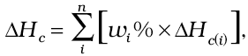
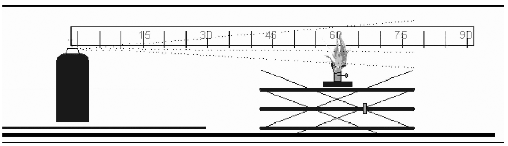
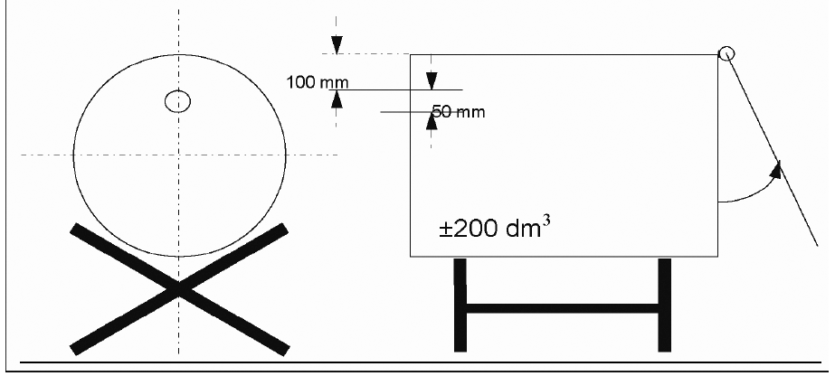
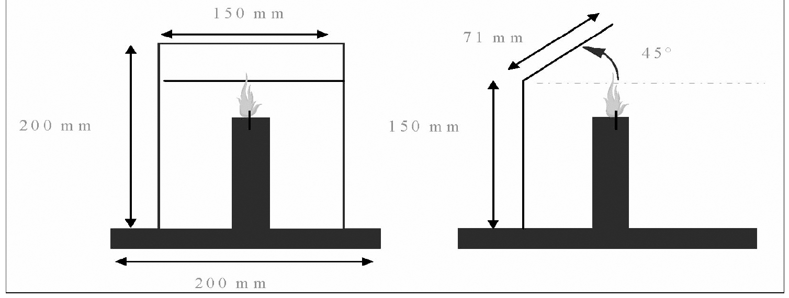
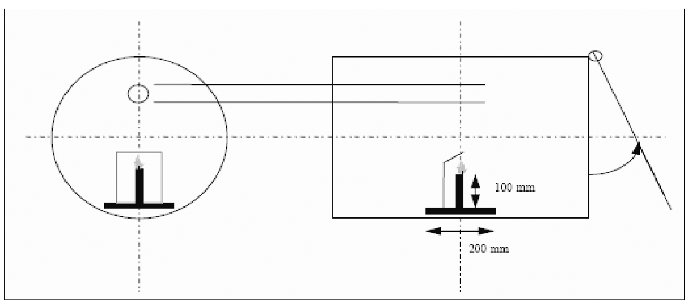
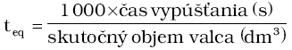
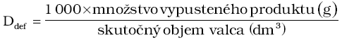

Príloha č. 1 k nariadeniu vlády č. 46/2009 Z. z.

- 1. Definície 1.1. až 1.7. sú obsiahnuté v § 3 ods. 2 tohto nariadenia.

- 1.8. Horľavý obsah

- Obsah aerosólových rozprašovačov (ďalej len „aerosól“) sa považuje za horľavý, ak obsahuje niektorú zo zložiek, ktorá je klasifikovaná ako horľavá:

  - a) horľavá kvapalina je kvapalina, ktorej teplota vzplanutia neprevyšuje 93 oC,

  - b) horľavá tuhá látka je tuhá látka alebo zmes, ktorá je ľahko zápalná alebo môže spôsobiť zapálenie alebo k nemu prispieť v dôsledku trenia. Ľahko zápalné tuhé látky sú práškové, zrnité alebo pastovité látky alebo zmesi, ktoré sú nebezpečné, ak sa môžu ľahko zapáliť už pri krátkom kontakte so zápalným zdrojom, ako napríklad horiaca zápalka, a plameň sa následne rýchlo šíri,

  - c) horľavý plyn je plyn alebo plynná zmes s rozsahom horľavosti na vzduchu pri teplote 20 oC a štandardnom tlaku 1,013 bar.

  - Táto definícia sa nevzťahuje na samozápalné, samovoľne sa zahrievajúce alebo s vodou reagujúce látky a zmesi, ktoré nikdy nesmú byť zložkami obsahu aerosólov.

- 1.9. Mimoriadne horľavé, horľavé a nehorľavé aerosóly

- Na účely tohto nariadenia sa aerosól považuje za mimoriadne horľavý, horľavý alebo nehorľavý podľa jeho chemického spalného tepla a hmotnostného obsahu horľavých zložiek takto:

  - a) aerosól sa klasifikuje ako mimoriadne horľavý, ak obsahuje 85 % alebo viac horľavých zložiek a chemické spalné teplo sa rovná alebo prevyšuje 30 kJ/g,

  - b) aerosól sa klasifikuje ako nehorľavý, ak obsahuje 1 % alebo menej horľavých zložiek a chemické spalné teplo je nižšie ako 20 kJ/g,

  - c) všetky ostatné aerosóly sa podrobia nasledujúcim postupom klasifikácie horľavosti alebo sa klasifikujú ako mimoriadne horľavé. Test zápalnej vzdialenosti, test zapálenia v uzavretom priestore a test horľavosti peny musia byť v súlade s bodom 6.3.

- 1.9.1. Horľavé aerosóly sú také aerosóly, ktoré sa uvoľňujú ako častice v kvapalnom alebo v pevnom stave alebo v prášku (ďalej len „sprejové aerosóly“).

- V prípade sprejových aerosólov sa klasifikácia vykoná s prihliadnutím na chemické spalné teplo a výsledky testu zápalnej vzdialenosti takto:

  - a) ak je chemické spalné teplo nižšie ako 20 kJ/g,

    - 1. aerosól sa klasifikuje ako horľavý, ak vzplanutie nastane vo vzdialenosti rovnajúcej sa alebo väčšej ako 15 cm, ale menšej ako 75 cm,

    - 2. aerosól sa klasifikuje ako mimoriadne horľavý, ak vzplanutie nastane vo vzdialenosti 75 cm alebo väčšej,

    - 3. ak vzplanutie pri teste zápalnej vzdialenosti nenastane, vykoná sa test zapálenia v uzavretom priestore a v tomto prípade sa aerosól klasifikuje ako horľavý, ak je časový ekvivalent nižší alebo sa rovná 300 s/m3alebo ak je zápalná hustota menšia alebo sa rovná 300 g/m3. V opačnom prípade sa aerosól klasifikuje ako nehorľavý,

  - b) ak sa chemické spalné teplo rovná alebo prevyšuje 20 kJ/g, aerosól sa klasifikuje ako mimoriadne horľavý, ak zapálenie nastane vo vzdialenosti 75 cm alebo väčšej. V opačnom prípade sa aerosól klasifikuje ako horľavý.

- 1.9.2. Horľavé aerosóly, ktoré sa uvoľňujú vo forme peny (ďalej len „penové aerosóly“).

- V prípade penových aerosólov sa klasifikácia vykoná na základe výsledkov testu horľavosti peny:

  - a) aerosólový produkt sa klasifikuje ako mimoriadne horľavý, ak

    - 1. výška plameňa je 20 cm alebo viac a plameň horí 2 s alebo dlhšie, alebo

    - 2. výška plameňa je 4 cm alebo viac a plameň horí 7 s alebo dlhšie,

  - b) aerosólový produkt, ktorý nespĺňa kritériá podľa písmena a), sa klasifikuje ako horľavý, ak výška plameňa je 4 cm alebo viac a plameň horí 2 s alebo dlhšie.

- 1.10. Chemické spalné teplo

- Chemické spalné teplo ΔHcsa stanoví

  - a) podľa uznávaných technologických pravidiel uvedených napríklad v normách, ako sú ASTM D 240, ISO 13943 86.1 až 86.3 a NFPA 30B, alebo v uznávanej vedeckej literatúre, alebo

  - b) využitím nasledujúcej metódy výpočtu:

    - Chemické spalné teplo (ΔHc) v kilojouloch na gram (kJ/g) možno vypočítať ako súčin teoretického spalného tepla (ΔHcomb) a účinnosti spaľovania, ktorá je zvyčajne menšia ako 1,0 (bežná účinnosť spaľovania je 0,95 alebo 95 %).

    - Pri zložených aerosólových zmesiach je chemické spalné teplo súčtom vážených hodnôt spalného tepla jednotlivých zložiek:

  - 

    - kde

    - ΔHc = chemické spalné teplo (kJ/g) produktu,

    - ωi% = hmotnostný podiel zložky i v produkte,

    - ΔHc(i) = špecifické spalné teplo (kJ/g) zložky i v produkte.

- 2. Všeobecné ustanovenia

- 2.1. Konštrukcia a príslušenstvo

- 2.1.1. Naplnený aerosólový rozprašovač musí byť vyrobený tak, aby za bežných podmienok použitia a skladovania vyhovoval ustanoveniam tejto prílohy.

- 2.1.2. Ventil musí umožňovať skutočne hermetické uzavretie za bežných prepravných a skladovacích podmienok a musí byť chránený proti neúmyselnému otvoreniu a akémukoľvek poškodeniu, napríklad ochranným uzáverom.

- 2.1.3. Nesmie existovať žiadna možnosť, že bude znížená mechanická odolnosť aerosólového rozprašovača pôsobením látok v ňom obsiahnutých, a to ani pri dlhodobom skladovaní.

- 2.2 Označovanie

  - Každý aerosólový rozprašovač musí byť bez toho, aby boli dotknuté požiadavky osobitného predpisu,3) viditeľne, zreteľne a nezmazateľne označený

  - a) výstražným slovom „Pozor“ a ostatnými prvkami označovania pre aerosóly kategórie 3 stanovenými v tabuľke 2.3.1 osobitného predpisu,5) ak je aerosól podľa kritérií bodu 1.9 klasifikovaný ako „nehorľavý“,

  - b) výstražným slovom „Pozor“ a ostatnými prvkami označovania pre aerosóly kategórie 2 stanovenými v tabuľke 2.3.1 osobitného predpisu,5) ak je aerosól podľa kritérií bodu 1.9 klasifikovaný ako „horľavý“,

  - c) výstražným slovom „Nebezpečenstvo“ a ostatnými prvkami označovania pre aerosóly kategórie 1 stanovenými v tabuľke 2.3.1 osobitného predpisu,5) ak je aerosól podľa kritérií bodu 1.9 klasifikovaný ako „mimoriadne horľavý“,

  - d) bezpečnostným upozornením P102 uvedeným v tabuľke 6.1 osobitného predpisu,4) ak je aerosólový rozprašovač spotrebným výrobkom,

  - e) ďalšími upozorneniami o zaobchádzaní, ktoré upozorňujú spotrebiteľov na osobitné nebezpečenstvá produktu; ak je k aerosólovému rozprašovaču priložený samostatný návod na použitie, ten musí obsahovať uvedené upozornenia.

- 2.3. Objem kvapalnej fázy

  - Objem kvapalnej fázy nesmie pri teplote 50 oC presiahnuť 90 % čistého objemu.

- 3. Okrem základných podmienok uvedených v prílohe č. 1 bodoch 1.8. až 2.4. pre aerosólové kovové rozprašovače platia aj osobitné podmienky upravené v bodoch 3.1. a 3.1.2.

- 3.1. Obsah

  - Celkový obsah nádob nesmie presahovať 1 000 ml.

- 3.1.1. Testovací tlak pre obaly plnené pri tlaku

  - a) nižšom ako 0,6 až 0,7 MPa a pri teplote 50 oC musí sa testovací tlak rovnať najmenej 1,0 MPa,

  - b) rovnajúcom sa alebo vyššom ako 0,6 až 0,7 MP a pri teplote 50 oC musí byť testovací tlak o 50 % vyšší ako vnútorný tlak pri teplote 50 oC.

- 3.1.2 Pri teplote 50 °C nesmie tlak v aerosólovom rozprašovači presiahnuť hodnoty uvedené v tejto tabuľke v závislosti od obsahu plynov v aerosólovom rozprašovači:

- Obsah plynov | Tlak pri teplote 50 °C

- Skvapalnený plyn alebo plynná zmes, ktorá má na vzduchu pri teplote 20 °C a štandardnom tlaku 0,1013 MPa hranicu horľavosti | 1,2 MPa

- Skvapalnený plyn alebo plynná zmes, ktorá nemá na vzduchu pri teplote 20 °C a štandardnom tlaku 0,1013 MPa hranicu horľavosti | 1,32 MPa

- Stlačené plyny alebo plyny rozpustené pod tlakom, ktoré nemajú na vzduchu pri teplote 20 °C a štandardnom tlaku 0,1013 MPa hranicu horľavosti | 1,5 MPa

- 4. Okrem základných podmienok uvedených v prílohe č. 1 bodoch 1.8. až 2.4. pre aerosólové sklenené rozprašovače platia aj osobitné podmienky upravené v bodoch 4.1. až 5.2.

- 4.1. Obaly s plastovým povlakom alebo trvalo chránené obaly

  - Obaly tohto typu možno používať na plnenie stlačeným, skvapalneným alebo rozpusteným plynom.

- 4.1.1. Obsah

  - Celkový obsah takých nádob nesmie byť väčší ako 220 ml.

- 4.1.2. Ochranný povlak

  - Ochranný povlak musí pozostávať z plastov alebo z iných vhodných látok a má vylúčiť nebezpečenstvo vymrštenia úlomkov skla pri neúmyselnom rozbití nádoby a musí byť vyhotovený tak, že nebudú vymrštené žiadne úlomky skla, ak na 20 oC zohriaty a naplnený aerosólový rozprašovač padne z výšky 1,8 m na betónovú podlahu.

- 4.1.3. Testovací tlak pre nádoby plnené

  - a) stlačeným alebo rozpusteným plynom musia odolať testovaciemu tlaku s veľkosťou minimálne 1,2 MPa,

  - b) skvapalneným plynom musia odolať testovaciemu tlaku minimálne 1,0 MPa.

- 4.1.4. Plnenie

- Aerosólové rozprašovače, ktoré sú plnené

  - a) stlačeným plynom, nesmú byť pri teplote 50 oC vystavené tlaku, ktorý je vyšší ako 0,9 MPa,

  - b) rozpusteným plynom, nesmú byť pri teplote 50 oC vystavené tlaku, ktorý je vyšší ako 0,8 MPa,

  - c) skvapalneným plynom alebo zmesami skvapalnených plynov, nesmú byť pri teplote 20 oC vystavené tlakom, ktoré sú vyššie ako tlaky uvedené v tabuľke:

  - Celková objemová kapacita | Podiel skvapalneného plynu k celkovej zmesi v hmotnostných percentách | |

  - | 20 % | 50 % | 80 %

  - 50 ml až 80 ml viac ako 80 ml až 160 ml viac ako 160 ml až 220 ml | 0,35 MPa 0,32 MPa 0,28 MPa | 0,28 MPa 0,25 MPa 0,21 MPa | 0,25 MPa 0,22 MPa 0,18 MPa

    - Tabuľka udáva prípustné hraničné hodnoty tlakov pri teplote 20 oC v závislosti od percentuálneho podielu plynu.

    - Pre percentuálne podiely plynu, ktoré nie sú uvedené v tabuľke, sa hraničné hodnoty tlaku vypočítajú extrapoláciou.

- 4.2. Nechránené sklenené nádoby

  - Aerosólové rozprašovače používajúce nechránené sklenené nádoby môžu byť plnené len skvapalneným alebo rozpusteným plynom.

- 4.2.1. Obsah

  - Celkový obsah nechránených sklenených nádob nesmie presahovať 150 ml.

- 4.2.2. Testovací tlak nádoby

  - Testovací tlak nádoby musí byť najmenej 1,2 MPa.

- 4.2.3. Plnenie

- Aerosólové rozprašovače, ktoré sú plnené

  - a) rozpusteným plynom, nesmú byť pri teplote 50 oC vystavené tlaku, ktorý je vyšší ako 0,8 MPa,

  - b) skvapalneným plynom, nesmú byť pri teplote 20 oC vystavené tlakom, ktoré sú väčšie ako tlaky uvedené v tabuľke:

  - Celková objemová kapacita | Podiel skvapalneného plynu k celkovej zmesi v hmotnostných percentách | |

  - | 20 % | 50 % | 80 %

  - 50 ml až 70 ml viac ako 70 ml až 150 ml | 0,15 MPa 0,15 MPa | 0,15 MPa 0,15 MPa | 0,125 MPa 0,1 MPa

    - Tabuľka udáva prípustné hraničné hodnoty tlakov pri teplote 20 oC v závislosti od percentuálneho podielu skvapalneného plynu.

    - Pre percentuálne podiely plynu, ktoré nie sú uvedené v tabuľke, sa hraničné hodnoty tlaku vypočítajú extrapoláciou.

- 5. Podmienky pre plastové aerosólové rozprašovače

- 5.1. Plastové aerosólové rozprašovače, pri ktorých rozbití môžu vzniknúť úlomky, sa považujú za aerosólové rozprašovače s obalmi z nechráneného skla.

- 5.2. Plastové aerosólové rozprašovače, pri ktorých rozbití nemôžu vzniknúť žiadne úlomky, sa považujú za aerosólové rozprašovače z chráneného skla.

- 6. Testy

- 6.1. Požiadavky na testy

- 6.1.1. Hydraulický test prázdnych nádob

- 6.1.1.1. Kovové, sklenené a plastové aerosólové rozprašovače majú byť schopné odolať testu na hydraulický tlak tak, ako je to stanovené v bodoch 3.1.1., 4.1.3. a 4.2.2.

- 6.1.1.2. Kovové nádoby, ktoré vykazujú asymetrické alebo značné deformácie alebo iné podobné nedostatky, treba vyradiť. Malá symetrická deformácia dna alebo deformácia profilu vrchného krytu je povolená za predpokladu, že nádoba vyhovie testu prasknutia.

- 6.1.2. Deštrukčný test prázdnych kovových nádob

  - Osoba zodpovedná za uvedenie kovového aerosólového rozprašovača na trh musí zabezpečiť, aby hodnota tlaku prasknutia nádob bola najmenej o 20 % vyššia ako stanovená hodnota testovacieho tlaku.

- 6.1.3. Test pádom nádob z chráneného skla

  - Nádoby majú spĺňať požiadavky testov ustanovené v bode 4.1.2.

- 6.1.4. Záverečná kontrola naplnených aerosólových rozprašovačov

- 6.1.4.1. Aerosólové rozprašovače sa podrobia jednej z nasledujúcich záverečných testovacích metód:

  - a) Test v horúcom vodnom kúpeli

  - Každý naplnený aerosólový rozprašovač sa ponorí do horúceho vodného kúpeľa:

    - 1. teplota vodného kúpeľa a trvanie testu by mali byť také, aby vnútorný tlak dosiahol hodnotu tlaku obsahu pri jednotnej teplote 50 oC,

    - 2. každý aerosólový rozprašovač, ktorý vykazuje viditeľnú trvalú deformáciu alebo netesnosť, sa musí vyradiť.

  - b) Záverečné testovacie metódy za tepla

    - Môžu sa použiť aj iné metódy zahriatia obsahu aerosólových rozprašovačov, ak tie zaručia, že tlak a teplota v každom naplnenom aerosólovom rozprašovači dosiahnu hodnoty požadované pri teste v horúcom vodnom kúpeli a deformácie a netesnosti sa odhalia s rovnakou presnosťou ako v prípade testu v horúcom vodnom kúpeli.

  - c) Záverečné testovacie metódy za studena

    - Môže sa použiť alternatívna záverečná testovacia metóda za studena, ak je v súlade s ustanoveniami o alternatívnych metódach k testu aerosólových rozprašovačov v horúcom vodnom kúpeli podľa osobitného predpisu.6)

- 6.1.4.2. Pri aerosólových rozprašovačoch, ktorých obsah prechádza fyzikálnou alebo chemickou premenou, ktorá mení ich vlastnosti tlaku po naplnení a pred prvým použitím, by sa mali použiť záverečné testovacie metódy za studena podľa bodu 6.1.4.1. písm. c).

- 6.1.4.3. V prípade testovacích metód podľa bodu 6.1.4.1. písm. b) a c):

  - a) testovacia metóda musí byť schválená akreditovanou osobou,5)

  - b) osoba zodpovedná za uvedenie aerosólových rozprašovačov na trh musí podať žiadosť o schválenie akreditovanej osobe; k žiadosti sa priloží technický opis danej metódy,

  - c) osoba zodpovedná za uvedenie aerosólových rozprašovačov na trh musí mať na účely dohľadu k dispozícii schválenie akreditovanou osobou, technický opis metódy a prípadne aj správy z kontroly bežne dostupné na adrese uvedenej na označení v súlade s § 4 ods. 1 písm. a) tohto nariadenia,

  - d) technický opis musí byť v štátnom jazyku alebo musí byť pripojený jeho úradný preklad v priloženom príbalovom letáku,

  - e) kontrolné testy aerosólových rozprašovačov vykonáva akreditovaná osoba.5)

- 6.2. Príklady kontrolných testov

- 6.2.1. Test prázdnych aerosólových nádob

  - Päť náhodne vybratých prázdnych aerosólových nádob z rovnorodej šarže 2 500 prázdnych nádob, ktoré sú vyrobené z toho istého materiálu z kontinuálneho výrobného procesu šarže alebo zo šarže zodpovedajúcej hodinovej produkcii, sa vystaví počas 25 sekúnd testovaciemu tlaku.

  - Ak ktorákoľvek z nádob nevyhovie testu, odoberie sa náhodne z tej istej šarže desať ďalších nádob a podrobia sa tomu istému testu; ak ktorákoľvek z týchto nádob nevyhovie testu, potom je celá šarža nevhodná na použitie.

- 6.2.2. Testy naplnených aerosólových rozprašovačov

  - Vykonajú sa kontrolné testy tesnosti na vzduch a vodu ponorením reprezentatívneho počtu naplnených aerosólových rozprašovačov do vodného kúpeľa. Teplota kúpeľa a doba ponorenia musia byť také, aby obsahu aerosólového rozprašovača umožnili dosiahnuť jednotnú teplotu 50 oC počas požadovanej doby, aby bolo zaručené, že nedošlo k roztrhnutiu alebo prasknutiu.

  - Každá šarža aerosólových rozprašovačov, ktorá nevyhovie testom, sa považuje za nevhodnú na použitie.

- 6.3. Testy horľavosti aerosólov

- 6.3.1. Test zápalnej vzdialenosti sprejových aerosólov

- 6.3.1.1. Úvod

- 6.3.1.1.1. Tento test opisuje metódu stanovenia zápalnej vzdialenosti aerosólového spreja s cieľom posúdiť súvisiace riziko horľavosti. Aerosól sa strieka v smere zápalného zdroja v intervaloch 15 cm a pozoruje sa, či nastane zapálenie a neprerušené horenie. Zapálenie a neprerušené horenie sa definujú ako stabilný plameň, ktorý trvá aspoň 5 s. Zápalným zdrojom je plynový horák s modrým nesvietivým plameňom vysokým 4 cm – 5 cm.

- 6.3.1.1.2. Tento test sa používa pri aerosólových produktoch s dostrekom 15 cm alebo viac. Aerosólové produkty s dostrekom kratším ako 15 cm, ako sú rozprašovače peny, gélov, pást alebo tie, ktoré sú vybavené dávkovačmi, sú z tohto testu vylúčené. Aerosólové produkty, ktoré rozprašujú penu, gély alebo pasty, sa testujú testom horľavosti aerosólovej peny.

- 6.3.1.2. Zariadenie a materiál

- 6.3.1.2.1. Vyžaduje sa toto zariadenie:

- Vodný kúpeľ udržiavaný na 20 oC | presnosť na ± 1 oC

- Kalibrovaná laboratórna váha | presnosť na ± 0,1 g

- Časomiera (stopky) | presnosť na ± 0,2 s

- Delená stupnica, podstavec a svorka | diely v cm

- Plynový horák, podstavec a svorka |

- Teplomer | presnosť na ± 1 oC

- Snímač vlhkosti | presnosť na ± 5 %

- Tlakomer | presnosť na ± 0,1 bar

- 6.3.1.3. Postup

- 6.3.1.3.1. Všeobecné požiadavky

- 6.3.1.3.1.1. Pred testovaním sa každý aerosólový rozprašovač kondiciuje a potom pripraví na test vypustením obsahu v trvaní približne 1 sekundy. Účelom tohto postupu je odstrániť nehomogénne látky z čerpacej trubičky.

- 6.3.1.3.1.2. Návod na použitie aerosólového rozprašovača sa prísne dodržiava vrátane pokynov, či sa rozprašovač má používať v stojatej alebo obrátenej polohe. Ak je potrebné potriasť, potraste bezprostredne pred testom.

- 6.3.1.3.1.3. Test sa vykonáva v prostredí bez prievanu s dostatočným vetraním pri teplote udržiavanej na 20 oC 5 oC a relatívnej vlhkosti v rozpätí 30 % – 80 %.

- 6.3.1.3.1.4. Každý aerosólový rozprašovač sa testuje:

  - a) keď je plný, uskutočnením celého postupu s plynovým horákom vo vzdialenosti

  - 15 cm až 90 cm od spúšťacieho mechanizmu aerosólovej nádoby,

  - b) keď zostáva 10 % až 12 % úrovne náplne (hmotnostné %), iba jeden test vo vzdialenosti 15 cm od spúšťacieho mechanizmu, ak sa sprej z plnej nádoby vôbec nezapálil, alebo vo vzdialenosti zapálenia spreja z plnej nádoby plus 15 cm.

- 6.3.1.3.1.5. Počas testu je nádoba v polohe podľa pokynov uvedených na označení. Zápalný zdroj sa umiestni podľa potreby.

- 6.3.1.3.1.6. Postup testu si vyžaduje testovanie spreja v intervaloch 15 cm medzi plameňom horáka a spúšťacím mechanizmom aerosólu, a to v rozpätí 15 cm až 90 cm. Je výhodné začať vo vzdialenosti 60 cm medzi plameňom horáka a spúšťacím mechanizmom aerosólu. Vzdialenosť medzi plameňom horáka a spúšťacím mechanizmom aerosólu sa zvýši o 15 cm v prípade zapálenia spreja vo vzdialenosti 60 cm. Vzdialenosť sa zníži o 15 cm v prípade, ak nenastane zapálenie vo vzdialenosti 60 cm medzi plameňom horáka a spúšťacím mechanizmom aerosólu. Cieľom je stanoviť maximálnu vzdialenosť medzi spúšťacím mechanizmom aerosólu a plameňom horáka, pri ktorej nastane trvalé horenie spreja, alebo potvrdiť, že zapálenie nenastane ani vo vzdialenosti 15 cm medzi plameňom horáka a spúšťacím mechanizmom aerosólu.

- 6.3.1.3.2. Testovací postup

  - a) Najmenej tri plné aerosólové rozprašovače sa kondiciujú na teplotu 20 oC 1 oC ponorením minimálne 95 % rozprašovača do vody na najmenej 30 minút pred začiatkom každého testu (ak je aerosól ponorený celý, 30 minútové kondiciovanie je postačujúce),

  - b) splňte všeobecné požiadavky: zaznamenajte teplotu a relatívnu vlhkosť prostredia,

  - c) odvážte aerosólový rozprašovač a zaznamenajte jeho hmotnosť,

  - d) stanovte vnútorný tlak a počiatočnú rýchlosť vypúšťania pri teplote 20 oC 1 oC (aby ste vylúčili chybné alebo len čiastočne naplnené aerosólové rozprašovače),

  - e) upevnite plynový horák na rovný horizontálny povrch alebo prichyťte horák svorkou k podstavcu,

  - f) zapáľte plynový horák; plameň má byť nesvietivý a vysoký približne 4 cm až 5 cm,

  - g) umiestnite dýzu spúšťacieho mechanizmu do požadovanej vzdialenosti od plameňa; aerosól sa testuje v polohe, v ktorej by sa mal používať, t. j. v stojatej alebo obrátenej polohe,

  - h) výškovo zarovnajte dýzu spúšťacieho mechanizmu a plameň horáka a uistite sa, že dýza smeruje presne na plameň (pozri obrázok 6.3.1.1.); sprej sa strieka cez hornú polovicu plameňa,

  - 

  - i) splňte všeobecné požiadavky týkajúce sa pretrepania obsahu rozprašovača,

  - j) aktivujte piest aerosólového rozprašovača a striekajte jeho obsah počas 5 s, pokiaľ nenastane zapálenie; ak nastane zapálenie, pokračujte v striekaní a udržujte plameň počas 5 s od zapálenia,

  - k) zaznamenajte výsledok zapálenia pre vzdialenosť medzi plynovým horákom a aerosólovým rozprašovačom do uvedenej tabuľky,

  - l) ak nenastane zapálenie počas činnosti uvedenej v písmene j), testujte aerosól v iných polohách, t. j. v obrátenej polohe pri produktoch, ktoré sa majú používať v stojatej polohe, a zistite, či nastane zapálenie,

  - m) opakujte činnosti uvedené v písmenách g) až l) ešte dvakrát (spolu trikrát) s rovnakou nádobou a v rovnakej vzdialenosti medzi plynovým horákom a spúšťacím mechanizmom aerosólu,

  - n) opakujte testovací postup s dvoma ďalšími aerosólovými nádobami rovnakého produktu v rovnakej vzdialenosti medzi plynovým horákom a spúšťacím mechanizmom aerosólu,

  - o) opakujte činnosti uvedené v písmenách g) až n) testovacieho postupu vo vzdialenostiach od 15 cm do 90 cm medzi spúšťacím mechanizmom aerosólovej nádoby a plameňom horáka v závislosti od výsledku každého testu (pozri takisto 6.3.1.3.1.4. a 6.3.1.3.1.5.),

  - p) ak nenastane zapálenie vo vzdialenosti 15 cm, postup pre pôvodne plné nádoby sa ukončí. Postup sa ukončí aj vtedy, ak zapálenie a neprerušené horenie nastane vo vzdialenosti 90 cm. Ak vo vzdialenosti 15 cm nenastane zapálenie, zaznamenajte, že zapálenie nenastalo. Maximálna vzdialenosť medzi plameňom horáka a spúšťacím mechanizmom aerosólu, pri ktorej nastalo zapálenie a neprerušené horenie, sa označuje ako „zápalná vzdialenosť“ pri všetkých ďalších okolnostiach,

  - q) jeden test sa vykoná s 3 nádobami približne naplnenými na úroveň 10 % až 12 % obsahu. Tieto nádoby sa testujú tak, aby vzdialenosť medzi spúšťacím mechanizmom aerosólu a plameňom horáka zodpovedala „vzdialenosti zapálenia pri plných nádobách + 15 cm“,

  - r) vyprázdnite aerosólovú nádobu na približne 10 % až 12 % (hmotnostných) úrovne náplne dávkami v trvaní najviac 30 s. Dodržte minimálnu prestávku 300 s medzi jednotlivými dávkami; počas tejto prestávky rozstrekovače umiestnite do vodného kúpeľa,

  - s) opakujte činnosti uvedené v písmenách g) až n) s aerosólovými nádobami naplnenými na približne 10 % až 12 %, pričom vynechajte činnosti uvedené v písmenách l) a m); tento test sa vykonáva s aerosólmi iba v jednej polohe, t. j. stojatej alebo obrátenej, ktorá zodpovedá polohe, pri ktorej nastalo prípadné zapálenie pri plných nádobách,

  - t) zaznamenajte všetky výsledky do uvedenej tabuľky 6.3.1.1.

- 6.3.1.3.2.1. Všetky pokusy sa vykonávajú pod digestorom v miestnosti, ktorú možno dobre vetrať. Vetranie digestora a miestnosti by malo trvať najmenej 3 minúty po každom teste. Prijmite všetky potrebné bezpečnostné opatrenia, aby ste predišli vdýchnutiu produktov horenia.

- 6.3.1.3.2.2. Nádoby s približnou úrovňou náplne 10 % až 12 % sa testujú iba raz. Tabuľka výsledkov musí obsahovať iba jeden výsledok pre každú nádobu.

- 6.3.1.3.2.3. Ak je výsledok testu negatívny v polohe, v ktorej by sa rozprašovač mal používať, test sa zopakuje v takej polohe rozprašovača, v ktorej sa najpravdepodobnejšie dosiahne pozitívny výsledok.

- 6.3.1.4. Metóda hodnotenia výsledkov

- 6.3.1.4.1. Všetky výsledky sa zaznamenajú. Nasledujúca tabuľka 6.3.1.1. predstavuje vzorovú „tabuľku výsledkov“, ktorá by sa mala používať na zaznamenávanie výsledkov.

  - Tabuľka 6.3.1.1.

- Dátum | | Teplota … oC Relatívna vlhkosť … % | |

- Názov produktu | | | |

- Čistý objem | | Nádoba 1 | Nádoba 2 | Nádoba 3

- Pôvodná úroveň náplne | | % | % | %

- Vzdialenosť rozprašovača | Test | 1 2 3 | 1 2 3 | 1 2 3

- 15 cm | Zapálenie? ÁNO alebo NIE | | |

- 30 cm | Zapálenie? ÁNO alebo NIE | | |

- 45 cm | Zapálenie? ÁNO alebo NIE | | |

- 60 cm | Zapálenie? ÁNO alebo NIE | | |

- 75 cm | Zapálenie? ÁNO alebo NIE | | |

- 90 cm | Zapálenie? ÁNO alebo NIE | | |

- Pozorovania vrátane polohy nádoby | | | |

- 6.3.2. Test zapálenia v uzavretom priestore

- 6.3.2.1. Úvod

  - Táto testovacia norma opisuje metódu posúdenia horľavosti produktov vypúšťaných aerosólovými rozprašovačmi vyplývajúcej z ich tendencie zapáliť sa v uzavretom alebo stiesnenom priestore. Obsah aerosólového rozprašovača sa strieka do valcovitej testovacej nádoby, v ktorej je umiestnená horiaca sviečka. Ak nastane pozorovateľné zapálenie, zaznamená sa uplynutý čas a vypustené množstvo.

- 6.3.2.2. Zariadenie a materiál

- 6.3.2.2.1. Vyžaduje sa toto zariadenie:

- Časomiera (stopky) | presnosť na ± 0,2 s

- Vodný kúpeľ udržiavaný na 20 oC | presnosť na ± 1 oC

- Kalibrovaná laboratórna váha | presnosť na ± 0,1 g

- Teplomer | presnosť na ± 1 oC

- Snímač vlhkosti | presnosť na ± 5 %

- Tlakomer | presnosť na ± 0,1 bar

- Valcovitá testovacia nádoba | podľa uvedených podrobností

- 6.3.2.2.2. Príprava testovacieho zariadenia

- 6.3.2.2.2.1. Valcovitá nádoba s objemom približne 200 dm3, priemerom približne 600 mm a dĺžkou približne 720 mm, ktorá je na jednom konci otvorená, sa upraví takto:

  - a) zatvárací systém tvorený sklápacím krytom sa upevní na otvorený koniec nádoby alebo

  - b) ako zatvárací systém môže slúžiť plastová fólia s hrúbkou 0,01 mm až 0,02 mm. Ak sa test vykonáva s plastovou fóliou, je potrebné postupovať takto: napnite fóliu na otvorený koniec valca a prichyťte ju elastickou páskou; pevnosť pásky má byť taká, že keď sa navlečie na valec položený na bočnej strane, roztiahne sa iba o 25 mm, ak k nej v najnižšom bode pripevníte závažie s hmotnosťou 0,45 kg. Vyrežte do fólie štrbinu s dĺžkou 25 mm začínajúcu sa 50 mm od okraja valca; fólia musí byť napnutá,

  - c) na opačnom konci valca vyvŕtajte otvor s priemerom 50 mm vzdialený 100 mm od okraja tak, aby bol umiestnený v hornej časti, keď je nádoba položená a pripravená na test (obrázok 6.3.2.1.),

  - 

  - d) na kovový podstavec s rozmermi 200 mm 200 mm umiestnite parafínovú voskovú sviečku s priemerom 20 mm až 40 mm a výškou 100 mm. Sviečka sa vymení, keď jej výška klesne pod 80 mm. Plameň sviečky sa chráni pred zásahom spreja krytom so šírkou 150 mm a s výškou 200 mm. Vo výške 150 mm od základne krytu je rovina naklonená v uhle 45 o (obrázok 6.3.2.2.),

  - 

  - e) sviečka na kovovom podstavci sa umiestni do stredu medzi dva konce valca (obrázok 6.3.2.3.),

  - 

  - f) valec sa položí na podlahu alebo podstavec na mieste, kde je teplota medzi 15 oC a 25 oC. Testovaný produkt sa strieka do vnútra valca s objemom približne 200 dm3, v ktorom je zdroj zapálenia.

- 6.3.2.2.2.2. Zvyčajne produkt opúšťa aerosólovú nádobu v uhle 90o k vertikálnej osi nádoby. Uvedené rozmiestnenie a postup sa vzťahujú na tento druh aerosólového produktu. V prípade aerosólov fungujúcich iným spôsobom (napríklad aerosólové rozprašovače s vertikálnym striekaním) bude potrebné zaznamenať zmeny v zariadení a postupoch v súlade so správnou laboratórnou praxou, napríklad podľa normy.7)

- 6.3.2.3. Postup

- 6.3.2.3.1. Všeobecné požiadavky

- 6.3.2.3.1.1. Pred testovaním sa každý aerosólový rozprašovač kondiciuje a potom pripraví na test vypustením obsahu v trvaní približne 1 s. Účelom tohto postupu je odstrániť nehomogénne látky z čerpacej trubičky.

- 6.3.2.3.1.2. Návod na použitie sa prísne dodržiava vrátane pokynov, či sa rozprašovač má používať v stojatej alebo obrátenej polohe. Ak je potrebné pretrepať, pretrepte bezprostredne pred testom.

- 6.3.2.3.1.3. Test sa vykonáva v prostredí bez prievanu s dostatočným vetraním pri teplote udržiavanej na 20 oC 5 oC a relatívnej vlhkosti v rozpätí 30 % – 80 %.

- 6.3.2.3.2. Testovací postup

  - a) Najmenej 3 plné aerosólové rozprašovače sa kondiciujú na teplotu 20 oC 1 oC ponorením minimálne 95 % rozprašovača do vody na najmenej 30 minút pred začiatkom každého testu (ak je aerosól ponorený celý, 30-minútové kondiciovanie je postačujúce),

  - b) odmerajte a vypočítajte skutočný objem valca v dm3,

  - c) splňte všeobecné požiadavky; zaznamenajte teplotu a relatívnu vlhkosť prostredia,

  - d) stanovte vnútorný tlak a počiatočnú rýchlosť vypúšťania pri teplote 20 oC 1 oC (aby ste vylúčili chybné alebo len čiastočne naplnené aerosólové rozprašovače),

  - e) odvážte jeden z aerosólových rozprašovačov a zaznamenajte jeho hmotnosť,

  - f) zapáľte sviečku a použite zatvárací systém (kryt alebo plastová fólia),

  - g) umiestnite dýzu spúšťacieho mechanizmu aerosólového rozprašovača do vzdialenosti 35 mm od stredu otvoru vo valci alebo ešte bližšie pri širokom rozprašovaní. Zapnite časomieru (stopky) a podľa návodu na použitie produktu nasmerujte sprej do stredu protiľahlého konca (kryt alebo plastová fólia). Aerosól sa testuje v polohe, v ktorej by sa mal používať, t. j. v stojatej alebo obrátenej polohe,

  - h) striekajte, až kým nenastane zapálenie. Zastavte stopky a zaznamenajte uplynutý čas. Opätovne odvážte aerosólový rozprašovač a zaznamenajte jeho hmotnosť,

  - i) vyvetrajte a vyčistite valec a pritom odstráňte všetky pozostatky, ktoré by mohli ovplyvniť nasledujúce testy. Podľa potreby nechajte valec vychladnúť,

  - j) opakujte testovací postup v činnostiach uvedených v písmenách d) až i) s dvoma ďalšími aerosólovými rozprašovačmi rovnakého produktu (spolu 3, upozornenie: každý rozprašovač sa testuje iba jedenkrát).

- 6.3.2.4. Metóda hodnotenia výsledkov

- 6.3.2.4.1. Vypracuje sa testovacia správa, ktorá obsahuje nasledujúce informácie:

  - a) testovaný produkt a jeho referencie,

  - b) vnútorný tlak a počiatočnú rýchlosť vypúšťania aerosólového rozprašovača,

  - c) teplotu a relatívnu vlhkosť vzduchu v miestnosti,

  - d) pri každom teste čas vypúšťania (s) potrebný na zapálenie (ak sa produkt nezapáli, uveďte túto skutočnosť),

  - e) hmotnosť produktu vystriekanú počas každého testu (g),

  - f) skutočný objem valca (dm3).

- 6.3.2.4.2. Časový ekvivalent (teq) potrebný na zapálenie v 1 m3 sa vypočíta takto:

- 

- 6.3.2.4.3. Zápalná hustota (Ddef) potrebná na zapálenie počas testu sa môže vypočítať aj takto:

- 

- 6.3.3. Test horľavosti aerosólovej peny

- 6.3.3.1. Úvod

- 6.3.3.1.1. Tento test opisuje metódu stanovenia zápalnej vzdialenosti aerosólového spreja s cieľom posúdiť súvisiace riziko horľavosti. Aerosól, ktorý vypúšťa penu, gél alebo pastu, sa nastrieka (približne 5 g) na hodinové sklíčko a zápalný zdroj (sviečka, voskový knôt, zápalka alebo zapaľovač) sa priloží ku dnu hodinového sklíčka, pričom sa pozoruje, či nastane zapálenie a neprerušené horenie peny, gélu alebo pasty. Zapálenie sa definuje ako stabilný plameň trvajúci najmenej 2 s s minimálnou výškou 4 cm.

- 6.3.3.2. Zariadenie a materiál

- 6.3.3.2.1. Vyžaduje sa nasledujúce zariadenie:

- Delená stupnica, podstavec a svorka | diely v cm

- Ohňovzdorné hodinové sklíčko s priemerom |

- približne 150 mm |

- Časomiera (stopky) | presnosť na ± 0,2 s

- Sviečka, voskový knôt, zápalka alebo zapaľovač |

- Kalibrovaná laboratórna váha | presnosť na ± 0,1 g

- Vodný kúpeľ udržiavaný na 20 oC | presnosť na ± 1 oC

- Teplomer | presnosť na ± 1 oC

- Snímač vlhkosti | presnosť na ± 5 %

- Tlakomer | presnosť na ± 0,1 bar

- 6.3.3.2.2. Hodinové sklíčko sa umiestni na ohňovzdorný povrch v priestore bez prievanu, ktorý sa môže po každom teste vetrať. Delená stupnica sa umiestni presne za hodinové sklíčko a upevní sa vertikálne pomocou podstavca a svorky.

- 6.3.3.2.3. Stupnica je v takej polohe, že jej začiatok je zarovnaný s dnom hodinového sklíčka v horizontálnej rovine.

- 6.3.3.3. Postup

- 6.3.3.3.1. Všeobecné požiadavky

- 6.3.3.3.1.1. Pred testom sa každý aerosólový rozprašovač kondiciuje a potom pripraví na test vypustením obsahu v trvaní približne 1 s. Účelom tohto postupu je odstrániť nehomogénne látky z čerpacej trubičky.

- 6.3.3.3.1.2. Návod na použitie sa prísne dodržiava vrátane pokynov, či sa rozprašovač má používať v stojatej alebo obrátenej polohe. Ak je potrebné pretrepať, pretrepte bezprostredne pred testom.

- 6.3.3.3.1.3. Test sa vykonáva v prostredí bez prievanu s dostatočným vetraním pri teplote udržiavanej na 20 oC 5 oC a relatívnej vlhkosti v rozpätí 30 % – 80 %.

- 6.3.3.3.2. Testovací postup

  - a) Najmenej štyri plné aerosólové rozprašovače z každého produktu sa kondiciujú na teplotu 20 oC 1 oC ponorením minimálne 95 % rozprašovača do vody na najmenej 30 minút pred začiatkom každého testu (ak je aerosól ponorený celý, 30-minútové kondiciovanie je postačujúce),

  - b) splňte všeobecné požiadavky; zaznamenajte teplotu a relatívnu vlhkosť prostredia,

  - c) stanovte vnútorný tlak pri teplote 20 oC 1 oC (aby ste vylúčili chybné alebo len čiastočne naplnené aerosólové rozprašovače),

  - d) odmerajte rýchlosť vypúšťania alebo prietoku testovaného aerosólového produktu, aby bolo možné presnejšie určiť použité množstvo testovaného produktu,

  - e) odvážte jeden z aerosólových rozprašovačov a zaznamenajte jeho hmotnosť,

  - f) na základe odmeranej rýchlosti vypúšťania alebo prietoku a podľa pokynov výrobcu vypustite približne 5 g produktu do stredu čistého hodinového sklíčka s cieľom vytvoriť kôpku nie vyššiu ako 25 mm,

  - g) do 5 s po dokončení vypúšťania priložte zdroj zapálenia k okraju vzorky a zároveň zapnite časomieru (stopky). Pokiaľ je to potrebné, odstráňte zdroj zapálenia od okraja vzorky po približne dvoch sekundách, aby ste zreteľne videli, či nastalo zapálenie; ak nepozorujete žiadne zapálenie vzorky, priložte zdroj zapálenia opäť k okraju vzorky,

  - h) ak nastane zapálenie, zaznamenajte nasledujúce údaje:

    - 1. maximálnu výšku plameňa v cm nad dnom hodinového sklíčka,

    - 2. trvanie plameňa v s,

    - 3. vysušte a opätovne odvážte aerosólový rozprašovač a vypočítajte hmotnosť vypusteného produktu,

  - i) vyvetrajte testovací priestor okamžite po každom teste,

  - j) ak nenastane zapálenie a vypustený produkt zostane vo forme peny alebo pasty počas doby použitia, zopakujte činnosti uvedené v písmenách e) až i). Produkt nechajte odstáť 30 sekúnd, 1 minútu, 2 minúty alebo 4 minúty pred priložením zdroja zapálenia,

  - k) opakujte testovací postup v činnostiach uvedených v písmenách e) až j) ešte dvakrát (spolu trikrát) s tou istou nádobou,

  - l) opakujte testovací postup v činnostiach uvedených v písmenách e) až k) s dvoma ďalšími aerosólovými rozprašovačmi rovnakého produktu (spolu 3 nádoby).

- 6.3.3.4. Metóda hodnotenia výsledkov

- 6.3.3.4.1. Vypracuje sa správa o teste, ktorá obsahuje tieto informácie:

  - a) či sa produkt zapálil,

  - b) maximálnu výšku plameňa v cm,

  - c) trvanie plameňa v s,

  - d) hmotnosť testovaného produktu.
