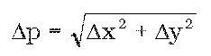

# § 56

(1) Identické body sú jednoznačne identifikovateľné podrobné body v teréne a zobrazené na katastrálnej mape, ktoré slúžia na zobrazenie a spojenie výsledku merania s obsahom mapy. Ako identické body možno použiť aj pevné body podrobného polohového bodového poľa.

(2) Overenie identických bodov v katastrálnom území, v ktorom je spravovaná nečíselná vektorová katastrálna mapa, sa vykoná určením ich vzájomnej polohy alebo odmeraním vzdialenosti identického bodu od najmenej dvoch ďalších bodov, ktoré možno považovať za identické a porovnaním výsledku so zodpovedajúcimi údajmi dokumentovanými v súbore geodetických informácií.

(3) Body podľa odseku 2 možno považovať za identické, ak sú splnené kritériá presnosti ustanovené v prílohe č. 13, v závislosti od pôvodu určenia posudzovaného bodu. Ak sa overením identity bodu zistí prekročenie kritérií presnosti, takýto bod sa považuje za neidentický a nesmie byť použitý.

(4) Na účely aktualizácie číselnej vektorovej katastrálnej mapy sa za identické body vyberú body, ktoré umožňujú určiť polohovú odchýlku Δp medzi polohou bodu určeného pri pôvodnom meraní obsahu mapy a polohou identického bodu určenou meraním pomocou aktívnych geodetických základov, s následným využitím Prevodnej interpolačnej tabuľky alebo základnej transformácie. Ako identické body sa prednostne použijú najmä pevné body podrobného polohového bodového poľa, ak z nich bol meraný pôvodný obsah mapy alebo podrobné body, ktoré od času pôvodného merania obsahu mapy nezmenili svoju polohu.

(5) Polohová odchýlka Δp sa vypočíta zo vzťahu

kde Δx = x1 – x2 a Δy = y1 – y2; kde x1, y1 sú súradnice bodu z pôvodného merania a x2, y2 sú súradnice identického bodu určeného v podmienkach globálnych navigačných satelitných systémov a transformované do S-JTSK prostredníctvom Prevodnej interpolačnej tabuľky.

(6) Kritérium na posudzovanie súradnicových rozdielov Δx a Δy je Δp; Δp = 0,24 m.
