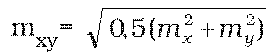
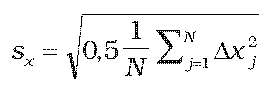
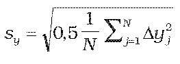
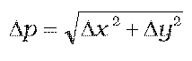
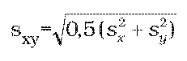

# § 59 Presnosť meračských a zobrazovacích prác

(1) Presnosť meračských prác a výsledných súradníc podrobných bodov je stanovená charakteristikami presnosti a kritériami presnosti.

(2) Charakteristikou presnosti určenia súradníc x, y podrobných bodov je základná stredná súradnicová chyba mxy, určená vzťahom , kde mx, my sú základné stredné chyby určenia súradníc x, y.

(3) Charakteristikou relatívnej presnosti určenia súradníc dvojice bodov je základná stredná chyba md dĺžky d priamej spojnice týchto bodov vypočítanej zo súradníc.

(4) Súradnice podrobných bodov sa určia tak, aby

- a) charakteristika mxy nepresiahla kritérium uxy = 0,08 m,

- b) charakteristika md nepresiahla kritérium ud vypočítané pre každú dĺžku d zo vzťahu ud = 0,12(d + 12)/(d + 20) v m.

(5) Dosiahnutie stanovenej presnosti sa overuje pomocou

- a) kontrolných omerných mier alebo kontrolným meraním dĺžok priamych spojníc bodov a ich porovnaním s dĺžkami vypočítanými zo súradníc,

- b) nezávislého kontrolného merania a výpočtu súradníc výberu bodov a ich porovnaním s prvotne určenými súradnicami, kontrolné meranie sa vykoná s rovnakou alebo vyššou presnosťou.

(6) Podrobné body sa na účel overenia presnosti vyberú tak, aby

- a) boli jednoznačne identifikovateľné,

- b) boli rozmiestnené rovnomerne po celom území,

- c) tvorili reprezentatívny výber podľa technickej normy.13)

(7) Rozsah reprezentatívneho výberu podľa odseku 6 písm. c) sa určí počtom najmenej 100 podrobných bodov alebo najmenej 100 dvojíc podrobných bodov.

(8) Pri overovaní podľa odseku 5 písm. a) sa vypočítajú rozdiely dĺžok Δd = dm– dk, kde dm je dĺžka vypočítaná zo súradníc a dk je dĺžka určená kontrolným meraním. Presnosť sa považuje za vyhovujúcu, ak platí, že |Δd|≤2ud a pritom pre 60 % posudzovaných odchýlok platí, že |Δd|≤ud.

(9) Pri overovaní podľa odseku 5 písm. b) sa pre výber bodov vypočítajú rozdiely súradníc Δx = xm – xk, Δy = ym – yk, kde xm, ym sú prvotne určené súradnice podrobného bodu a xk, yk sú súradnice podrobného bodu z kontrolného merania. Presnosť sa testuje pomocou výberovej strednej súradnicovej chyby sxy vypočítanej ako kvadratický priemer stredných chýb súradníc sxy, sxy, ktoré sa určia vo výbere v rozsahu N bodov zo vzťahov , . Presnosť určenia sa považuje za vyhovujúcu, ak

- a) polohová odchýlka p vypočítaná zo vzťahu  vyhovuje kritériu Δp < = 0,14 m a

- b) výberová stredná súradnicová chyba sxy vypočítaná zo vzťahu  vyhovuje kritériu sxy≤ 0,09 m pre výber v rozsahu od 100 do 300 bodov alebo sxy≤ 0,08 m pre výber väčší než 300 bodov.

(10) V katastrálnej mape spravovanej v papierovej podobe sa podrobné body zobrazujú tak, aby presnosť zobrazenia bodov charakterizovaná základnou strednou súradnicovou chybou zobrazenia bodu neprekročila hodnotu 0,16 mm na katastrálnej mape.

(11) Dosiahnutie presnosti zobrazenia bodov podľa odseku 10 sa overuje porovnaním dĺžok priamych spojníc dvojice podrobných bodov určených z priameho merania s dĺžkami určenými z mapy.

(12) Pri overovaní podľa odseku 11 sa vypočítajú rozdiely dĺžok „Δp Dd = dm – dk, kde dm je dĺžka určená z hodnôt odmeraných na mape a dk je dĺžka určená priamym meraním. Presnosť sa považuje za vyhovujúcu, ak platí

- a) pre mapy v mierkach 1 : 1000, 1 : 2000 a 1 : 5000, že |Δd| < = 2.ud·k a pritom pre 60 % posudzovaných odchýlok platí, že |Δd| < = ud·k, pričom kritérium ud sa vypočíta podľa odseku 4 písm. b) a koeficient k má hodnotu podľa prílohy č. 15 tabuľky č. 1,

- b) pre mapy v ostatných mierkach, že |Δd| < = 2.(0,00015.dk + 0,005 · √dk + 0,015) + k, koeficient k má hodnotu podľa prílohy č. 15 tabuľky č. 2.
